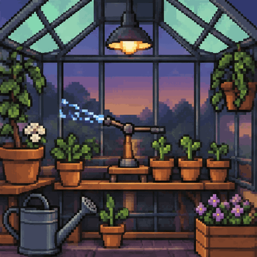

<!-- Generated by scripts/build_readme.py. Edit source data, locale catalogs and generator scripts. -->

<a id="top"></a>

[](https://raphael.app/?utm_source=github&utm_medium=repository&utm_campaign=gpt_image_2_6_launch&utm_content=hero&utm_term=es-ES)

# 🚀 Colección de prompts de GPT Image 2.6

[](https://github.com/sindresorhus/awesome)
[](https://github.com/RaphaelAI-OpenLab/awesome-gpt-image-2.6-prompts)
[](LICENSE)
[](https://github.com/RaphaelAI-OpenLab/awesome-gpt-image-2.6-prompts/actions/workflows/validate.yml)
[](CONTRIBUTING.md)

> 🎨 Colección seleccionada de prompts y ejemplos visuales para GPT Image 2.6 y ChatGPT Images 2.6: Flare y Sunburst, prompts de GIF nativo, prompts vectoriales SVG y edición guiada por marcas.

> ⚠️ **Aviso de derechos de autor**: Esta colección incluye prompts y ejemplos de fuentes públicas, así como imágenes generadas de forma independiente, exclusivamente con fines educativos. Si consideras que algún contenido infringe tus derechos, por favor, [abre una incidencia](https://github.com/RaphaelAI-OpenLab/awesome-gpt-image-2.6-prompts/issues/new?template=report-problem.yml), y lo retiraremos de inmediato.

---

<a href="README.md"></a> <a href="README.zh-CN.md"></a> <a href="README.zh-TW.md"></a> <a href="README.ja-JP.md"></a><br />
<a href="README.ko-KR.md"></a> <a href="README.th-TH.md"></a> <a href="README.vi-VN.md"></a> <a href="README.hi-IN.md"></a><br />
<a href="README.es-ES.md"></a> <a href="README.es-419.md"></a> <a href="README.de-DE.md"></a> <a href="README.fr-FR.md"></a><br />
<a href="README.it-IT.md"></a> <a href="README.pt-BR.md"></a> <a href="README.pt-PT.md"></a> <a href="README.tr-TR.md"></a>

---

Esta versión lingüística traduce la interfaz del repositorio. Los detalles completos de los casos están disponibles actualmente en inglés y chino simplificado.

Los títulos, las descripciones y las páginas de detalles de los casos se muestran en inglés cuando no hay traducción disponible. Los prompts originales y las citas de las fuentes no se traducen.

<a id="gallery"></a>

## 🌐 Ver en la galería web

**[👉 Explora la galería de prompts de GPT Image 2.6 en Raphael](https://raphael.app/gpt-image-2-6-prompts?utm_source=github&utm_medium=repository&utm_campaign=gpt_image_2_6_launch&utm_content=top_cta&utm_term=es-ES)**

**[📝 Prompts completos](README.md#collection)**

¿Por qué crear en la web?

| Función | GitHub README | Web de Raphael |
| --- | --- | --- |
| 🆓 Generación gratuita | Consultar ejemplos y prompts | Generación básica gratis, sin iniciar sesión ni tarjeta |
| ✍️ Uso de prompts | Copiar los prompts publicados | Pegar un prompt y generar una imagen |
| 🖼️ Edición con imágenes de referencia | Consultar las referencias y los requisitos de entrada | Subir referencias para orientar la generación y la edición |
| 🤖 Elección de modelo | Ver qué modelo se usó en cada ejemplo | Elegir entre GPT Image, Seedream, Nano Banana y otros |
| 🎨 Estilos y tamaños | Consultar los estilos y ajustes documentados por la fuente | Elegir estilo, relación de aspecto y formato de salida |
| 🔄 Variaciones | Comparar los ejemplos recopilados | Generar hasta 4 imágenes a la vez por prompt |
| 🛠️ Herramientas de imagen | Leer los procesos de edición | Quitar fondos, ampliar la resolución, extender y editar imágenes |
| 📱 Móvil | Leer ejemplos | Generar y editar imágenes desde el navegador del móvil |

La generación gratuita utiliza el modo básico. Los requisitos de créditos y planes de los demás modelos se muestran en la web.

[Ver todos los casos de este repositorio →](#all-cases)

<a id="categories"></a>

## 🏷️ Explorar por categoría

[Todos (158)](README.md#all-cases) · [GIF y animación (89)](README.md#category-gif-animation) · [Personajes y coherencia (26)](README.md#category-characters-consistency) · [Anotaciones y ediciones específicas (11)](README.md#category-markup-edits) · [Carteles y tipografía (9)](README.md#category-posters-typography) · [Imágenes de marca y producto (8)](README.md#category-brand-products) · [Infografías (8)](README.md#category-infographics) · [SVG y recursos de diseño (4)](README.md#category-svg-design-assets) · [Interiores y arquitectura (3)](README.md#category-interiors-architecture)

<a id="contents"></a>

## 📖 Índice

- [¿Qué es GPT Image 2.6 (ChatGPT Images 2.6)?](#about)
- [Inicio rápido de la API de OpenAI (Flare y Sunburst)](#api-quickstart)
- [Estadísticas](#statistics)
- [Casos destacados](#featured)
- [Todos los casos](#all-cases)
- [Prompts completos](README.md#collection)
- [Cómo usar](#using)
- [Colaborar](#contribute)
- [Licencia](#license)
- [Agradecimientos](#acknowledgements)
- [Historial de estrellas](#star-history)

<a id="about"></a>

## 🤔 ¿Qué es GPT Image 2.6 (ChatGPT Images 2.6)?

OpenAI presentó Images 2.6 (ChatGPT Images 2.6 / GPT Image 2.6) el 4 de noviembre de 2026 con dos variantes de API: `gpt-image-2.6-sunburst` y `gpt-image-2.6-flare`. Esta colección reúne prompts copiables y ejemplos visuales para generación de imágenes, edición guiada por marcas, prompts de GIF nativo y prompts vectoriales SVG. La variante se registra caso por caso sin suposiciones.

[Anuncio oficial](https://openai.com/index/introducing-images-2-6/) · [Documentación del modelo](https://developers.openai.com/api/docs/guides/image-generation)

### GPT-Image-2.6 Flare vs Sunburst y flujos clave

| Variante / Flujo | Ideal para | Ver ejemplos |
| --- | --- | --- |
| GPT-Image-2.6 Sunburst (`gpt-image-2.6-sunburst`) | Mayor detalle, composiciones complejas, tipografía exacta, consistencia de personajes en varios pasos, GIF y SVG nativos | [Casos destacados](#featured) |
| GPT-Image-2.6 Flare (`gpt-image-2.6-flare`) | Iteración rápida con baja latencia, borradores ágiles, generación a alto volumen, edición con marcas, GIF y SVG | [Todos los casos](README.md#all-cases) |
| Prompts de GIF nativo (Native GIF Prompts) | GIF animados en bucle continuo (`output_format: gif`, 2–16 fotogramas) para stickers, demos y storyboards | [GIF y animación](README.md#category-gif-animation) |
| Prompts vectoriales SVG (SVG Vector Prompts) | Logotipos vectoriales limpios y editables, iconos, conceptos de interfaz y recursos de diseño (`output_format: svg`) | [SVG y recursos de diseño](README.md#category-svg-design-assets) |
| Edición guiada por marcas (Markup-Guided Editing) | Rodea o anota una foto de referencia para cambiar colores, sustituir objetos o localizar diseños con precisión | [Anotaciones y ediciones específicas](README.md#category-markup-edits) |

<a id="api-quickstart"></a>

## ⚡ Inicio rápido de la API de OpenAI (Flare y Sunburst)

Copia cualquier prompt de esta colección y ejecútalo directamente con la API de imágenes de OpenAI (`gpt-image-2.6-flare` para velocidad o `gpt-image-2.6-sunburst` para mayor detalle).

```python
import base64
from openai import OpenAI

client = OpenAI()  # Reads OPENAI_API_KEY from environment

# 1) High-detail still image with GPT-Image-2.6 Sunburst (or "gpt-image-2.6-flare" for speed)
image = client.images.generate(
    model="gpt-image-2.6-sunburst",
    prompt="Editorial studio photo of a cobalt ceramic vase on warm oak, soft morning light",
    size="1024x1024",
    quality="high",
)

# 2) Native looping GIF prompt (output_format="gif", 2-16 frames)
gif = client.images.generate(
    model="gpt-image-2.6-flare",
    prompt="A tiny lantern-carrying monkey in a snowy pine forest at dusk, seamless loop animation",
    output_format="gif",
    frame_count=8,
    frame_duration_ms=150,
)
with open("loop.gif", "wb") as f:
    f.write(base64.b64decode(gif.data[0].b64_json))

# 3) Editable SVG vector prompt (output_format="svg")
svg = client.images.generate(
    model="gpt-image-2.6-sunburst",
    prompt="Minimalist bakery logo 'Field & Flour', clean vector silhouette, warm balanced negative space",
    output_format="svg",
)
with open("logo.svg", "wb") as f:
    f.write(base64.b64decode(svg.data[0].b64_json))
```

```bash
curl https://api.openai.com/v1/images/generations \
  -H "Content-Type: application/json" \
  -H "Authorization: Bearer $OPENAI_API_KEY" \
  -d '{
    "model": "gpt-image-2.6-flare",
    "prompt": "Minimalist geometric bakery logo on cream paper, clean vector aesthetic",
    "size": "1024x1024",
    "output_format": "svg"
  }'
```

<a id="statistics"></a>

## 📊 Estadísticas

| **Métrica** | **Cantidad** |
| --- | --- |
| 📝 Prompts totales | **156** |
| ⭐ Destacados | **12** |
| 🗂️ Recursos en el CMS | **10** |
| 🔄 Última actualización | **2026-11-25 UTC 16:02:01** |

<!-- cms-stats 10 2026-11-25T16:02:01Z -->

<a id="featured"></a>

## 🔥 Casos destacados

<a id="featured-case-launch-higgsfield"></a>

### 38. [Knight scene and clothing edit sequence](README.md#source-case-launch-higgsfield)

<div align="center">
<a href="assets/examples/launch-higgsfield/source-01.webp"></a><br /><sub>Source image 1</sub>
</div>

<div align="center">
<a href="assets/examples/launch-higgsfield/source-02.webp"></a><br /><sub>Source image 2</sub>
</div>

<div align="center">
<a href="assets/examples/launch-higgsfield/source-03.webp"></a><br /><sub>Source image 3</sub>
</div>

**Prompt original**

**Starting image · Character and scene**

```text
Epic high fantasy anime key visual, mature seinen style like a modern high-budget anime film. A young woman sorceress-knight in her twenties with long crimson hair and sharp golden eyes stands on the edge of a cliff in ornate silver and emerald armor with a flowing royal blue cape, a glowing runic sword planted in front of her, magic sparks around her hands. Behind her a vast fantasy kingdom: floating islands with waterfalls pouring into the clouds, a white castle with spires, a huge ancient dragon flying in the distance, giant blooming sakura and golden autumn forests in the valley below. Sunset sky with vivid orange, magenta, turquoise and violet clouds, god rays, glowing magic particles in the air. Extremely vibrant saturated colors, dramatic rim lighting, cel shading with detailed painted backgrounds, crisp clean line art, depth and atmosphere, dynamic low camera angle, wide cinematic composition. Adult, elegant, serious heroic mood, not childish, no chibi, no sci-fi, no neon, no text, no watermark.
```

**Edit 1 · Sunset valley**

```text
Replace the moonlit landscape with a golden sunset over a misty mountain valley, winding river, waterfalls and ancient ruins. Keep the background softly blurred and the knight, armor, sword, rock and composition unchanged.
```

**Edit 2 · Floating castle**

```text
Replace the background with a majestic floating castle, smaller floating islands, cascading waterfalls and a dragon flying overhead. Preserve the warm sunset, atmospheric haze and shallow depth of field. Keep the knight and foreground unchanged.
```

**Edit 3 · Recolor armor**

```text
Recolor the armor to ivory white with rich gold trim, replace emerald gemstones with rubies, and change green fabric panels to deep crimson. Preserve the armor design, blue cape, red hair, golden sword glow, pose and background.
```

Use the edits in order, passing the previous output into the next edit. The official page includes the starting-image prompt alongside Edit 1; the three archived images show the edited results.

[Prompt original en la fuente](https://openai.com/index/introducing-images-2-6/#more-ways-to-create-and-edit-in-the-api)

**Autor**: [Higgsfield](https://openai.com/index/introducing-images-2-6/#more-ways-to-create-and-edit-in-the-api)

**Fuente original**: [Demostración oficial de lanzamiento](https://openai.com/index/introducing-images-2-6/#more-ways-to-create-and-edit-in-the-api) · [Detalles de la fuente](cases/launch-higgsfield/README.md)

**[👉 Pruébalo ahora →](https://raphael.app/gpt-image-2-6-prompts?utm_source=github&utm_medium=repository&utm_campaign=gpt_image_2_6_launch&utm_content=case_gallery_launch-higgsfield&utm_term=es-ES)**

---

<a id="featured-case-raphael-observatory-weather-cycle"></a>

### 95. [Observatory through four skies](README.md#source-case-raphael-observatory-weather-cycle)

<div align="center">
<a href="assets/examples/raphael-observatory-weather-cycle/observatory-weather-cycle.gif"></a><br /><sub>Observatory through four skies</sub>
</div>

**Prompt original**

```text
A small red-domed observatory on a rocky bluff against a locked circular composition, illustrated as colored pencil over paper. Clouds give way to a shower, dawn rainbow, clear starry sky and then back to drifting clouds. Preserve the building and horizon in every frame. Soft weather transitions in a short square loop.
```

[Prompt original (.txt)](cases/raphael-observatory-weather-cycle/prompt.txt)


**Autor**: Raphael

[Detalles de la fuente](cases/raphael-observatory-weather-cycle/README.md)

**[👉 Pruébalo ahora →](https://raphael.app/gpt-image-2-6-prompts?utm_source=github&utm_medium=repository&utm_campaign=gpt_image_2_6_launch&utm_content=case_gallery_raphael-observatory-weather-cycle&utm_term=es-ES)**

---

<a id="featured-case-docs-bakery-svg"></a>

### 66. [Bakery SVG logo](README.md#source-case-docs-bakery-svg)

<div align="center">
<a href="assets/examples/docs-bakery-svg/field-and-flour-gpt-image-2-6-flare.svg"></a><br /><sub>Flare SVG logo</sub>
</div>

<div align="center">
<a href="assets/examples/docs-bakery-svg/field-and-flour-gpt-image-2-6-sunburst.svg"></a><br /><sub>Sunburst SVG logo</sub>
</div>

**Prompt original**

```text
Create an original, non-infringing logo for a company called Field & Flour, a local bakery.
The logo should feel warm, simple, and timeless. Use clean, vector-like shapes, a strong silhouette, and balanced negative space.
Favor simplicity over detail so it reads clearly at small and large sizes. Flat design, minimal strokes, no gradients unless essential.
Fully transparent background. Deliver a single centered logo with generous padding, clean alpha edges, and no solid backdrop, scenery, checkerboard, or watermark.
```

[Prompt original en la fuente](https://developers.openai.com/api/docs/guides/image-prompting#generate-svg-output)

**Autor**: [OpenAI](https://developers.openai.com/api/docs/guides/image-prompting#generate-svg-output)

**Fuente original**: [Documentación oficial](https://developers.openai.com/api/docs/guides/image-prompting#generate-svg-output) · [Detalles de la fuente](cases/docs-bakery-svg/README.md)

**[👉 Pruébalo ahora →](https://raphael.app/gpt-image-2-6-prompts?utm_source=github&utm_medium=repository&utm_campaign=gpt_image_2_6_launch&utm_content=case_gallery_docs-bakery-svg&utm_term=es-ES)**

---

<a id="featured-case-raphael-greenhouse-day-to-night"></a>

### 97. [Greenhouse from dawn through night](README.md#source-case-raphael-greenhouse-day-to-night)

<div align="center">
<a href="assets/examples/raphael-greenhouse-day-to-night/greenhouse-day-to-night.gif"></a><br /><sub>Greenhouse from dawn through night</sub>
</div>

**Prompt original**

```text
Seen from outside, a tiny steel-framed desert greenhouse holds several tall cacti. Pink dawn sweeps into turquoise afternoon glass, then deep violet night with a single interior grow lamp and back to dawn. Fixed wide composition and architecture, softly textured gouache, smooth light changes in a brief ambient loop, no text.
```

[Prompt original (.txt)](cases/raphael-greenhouse-day-to-night/prompt.txt)


**Autor**: Raphael

[Detalles de la fuente](cases/raphael-greenhouse-day-to-night/README.md)

**[👉 Pruébalo ahora →](https://raphael.app/gpt-image-2-6-prompts?utm_source=github&utm_medium=repository&utm_campaign=gpt_image_2_6_launch&utm_content=case_gallery_raphael-greenhouse-day-to-night&utm_term=es-ES)**

---

<a id="featured-case-social-cyan-poetry-wet-portrait"></a>

### 46. [Glowing cyan poetry and equations on wet skin](README.md#source-case-social-cyan-poetry-wet-portrait)

<div align="center">
<a href="assets/examples/social-cyan-poetry-wet-portrait/source-01.jpg"></a><br /><sub>Glowing cyan poetry and equations on wet skin</sub>
</div>

**Prompt original**

```text
A cinematic, ultra-realistic close-up portrait of a young woman with wet, tousled dark hair and luminous skin, staring directly into the camera with an intense, introspective expression. Glowing cyan handwritten text and symbols are projected across her face, neck, and shoulders, resembling poetic phrases, equations, and abstract handwriting. The light reflections shimmer on her damp skin, creating a futuristic, cyber-poetry aesthetic. Dark,moody background with soft shadows, shallow depth of field, sharp focus on the eyes, high contrast lighting, teal and blue color palette, hyper-detailed skin texture, photorealistic, dramatic atmosphere, cyberpunk meets fine-art portrait photography, 8K quality, cinematic lighting.
```

[Prompt original (.txt)](cases/social-cyan-poetry-wet-portrait/prompt.txt)

[Prompt original en la fuente](https://x.com/iamsofiaijaz/status/2118561558511132918)

**Autor**: [iamsofiaijaz](https://x.com/iamsofiaijaz)

**Fuente original**: [Modelo indicado por el creador](https://x.com/iamsofiaijaz/status/2118561513879507399) · [Detalles de la fuente](cases/social-cyan-poetry-wet-portrait/README.md)

**[👉 Pruébalo ahora →](https://raphael.app/gpt-image-2-6-prompts?utm_source=github&utm_medium=repository&utm_campaign=gpt_image_2_6_launch&utm_content=case_gallery_social-cyan-poetry-wet-portrait&utm_term=es-ES)**

---

<a id="featured-case-raphael-moon-jelly-aquarium"></a>

### 100. [Moon jelly aquarium](README.md#source-case-raphael-moon-jelly-aquarium)

<div align="center">
<a href="assets/examples/raphael-moon-jelly-aquarium/moon-jelly-aquarium.gif"></a><br /><sub>Moon jelly aquarium</sub>
</div>

**Prompt original**

```text
A pair of tiny moon jellies drift in a tall cylindrical aquarium, backlit in pale aqua and lavender against indigo. Their bells pulse in a gently offset rhythm and fine suspended specks drift upward as the two jellyfish return to their original arrangement. Macro photography look, camera locked, no type, ambient loop.
```

[Prompt original (.txt)](cases/raphael-moon-jelly-aquarium/prompt.txt)


**Autor**: Raphael

[Detalles de la fuente](cases/raphael-moon-jelly-aquarium/README.md)

**[👉 Pruébalo ahora →](https://raphael.app/gpt-image-2-6-prompts?utm_source=github&utm_medium=repository&utm_campaign=gpt_image_2_6_launch&utm_content=case_gallery_raphael-moon-jelly-aquarium&utm_term=es-ES)**

---

<a id="featured-case-docs-pixel-style"></a>

### 57. [Transfer a pixel-art style](README.md#source-case-docs-pixel-style)

<div align="center">
<a href="assets/examples/docs-pixel-style/motorcycle-gpt-image-2-6-flare.webp"></a><br /><sub>Pixel-art motorcycle rider using the reference style — GPT Image 2.6 Flare (official model output)</sub>
</div>

<div align="center">
<a href="assets/examples/docs-pixel-style/motorcycle-gpt-image-2-6-sunburst.webp"></a><br /><sub>Pixel-art motorcycle rider using the reference style — GPT Image 2.6 Sunburst (official model output)</sub>
</div>

**Imágenes de referencia**

Imagen de referencia o de entrada, no es un resultado generado.

<div align="center">
<a href="assets/references/docs-pixel-style/pixels.webp"></a><br /><sub>Reference input: Pixel-art game screen used as a style reference</sub>
</div>


**Prompt original**

```text
Use the same style from the input image and generate a man riding a motorcycle on a white background.
```

[Prompt original en la fuente](https://developers.openai.com/api/docs/guides/image-prompting#transfer-a-visual-style)

**Autor**: [OpenAI](https://developers.openai.com/api/docs/guides/image-prompting#transfer-a-visual-style)

**Fuente original**: [Documentación oficial](https://developers.openai.com/api/docs/guides/image-prompting#transfer-a-visual-style) · [Detalles de la fuente](cases/docs-pixel-style/README.md)

**[👉 Pruébalo ahora →](https://raphael.app/gpt-image-2-6-prompts?utm_source=github&utm_medium=repository&utm_campaign=gpt_image_2_6_launch&utm_content=case_gallery_docs-pixel-style&utm_term=es-ES)**

---

<a id="featured-case-raphael-sketchbook-bicycle"></a>

### 108. [Sketchbook bicycle comes alive](README.md#source-case-raphael-sketchbook-bicycle)

<div align="center">
<a href="assets/examples/raphael-sketchbook-bicycle/sketchbook-bicycle.gif"></a><br /><sub>Sketchbook bicycle comes alive</sub>
</div>

**Prompt original**

```text
A sketchbook close-up with a simple cobalt pen doodle of a tiny bicycle. The wheels start spinning and a pennant flutters, then the bicycle rides in one small circle on the page and returns to its original outline. Keep the paper and camera fixed, no hands or text, whimsical looping animation.
```

[Prompt original (.txt)](cases/raphael-sketchbook-bicycle/prompt.txt)


**Autor**: Raphael

[Detalles de la fuente](cases/raphael-sketchbook-bicycle/README.md)

**[👉 Pruébalo ahora →](https://raphael.app/gpt-image-2-6-prompts?utm_source=github&utm_medium=repository&utm_campaign=gpt_image_2_6_launch&utm_content=case_gallery_raphael-sketchbook-bicycle&utm_term=es-ES)**

---

<a id="featured-case-docs-market-ui"></a>

### 67. [Farmers market mobile interface](README.md#source-case-docs-market-ui)

<div align="center">
<a href="assets/examples/docs-market-ui/ui-farmers-market-gpt-image-2-6-flare.webp"></a><br /><sub>Farmers market mobile app mockup — GPT Image 2.6 Flare (official model output)</sub>
</div>

<div align="center">
<a href="assets/examples/docs-market-ui/ui-farmers-market-gpt-image-2-6-sunburst.webp"></a><br /><sub>Farmers market mobile app mockup — GPT Image 2.6 Sunburst (official model output)</sub>
</div>

**Prompt original**

```text
Create a realistic mobile app UI mockup for a local farmers market.
Show today’s market with a simple header, a short list of vendors with small photos and categories, a small “Today’s specials” section, and basic information for location and hours.
Design it to be practical, and easy to use. White background, subtle natural accent colors, clear typography, and minimal decoration.
It should look like a real, well-designed, beautiful app for a small local market.
Place the UI mockup in an iPhone frame.
```

[Prompt original en la fuente](https://developers.openai.com/api/docs/guides/image-prompting#create-an-interface-preview)

**Autor**: [OpenAI](https://developers.openai.com/api/docs/guides/image-prompting#create-an-interface-preview)

**Fuente original**: [Documentación oficial](https://developers.openai.com/api/docs/guides/image-prompting#create-an-interface-preview) · [Detalles de la fuente](cases/docs-market-ui/README.md)

**[👉 Pruébalo ahora →](https://raphael.app/gpt-image-2-6-prompts?utm_source=github&utm_medium=repository&utm_campaign=gpt_image_2_6_launch&utm_content=case_gallery_docs-market-ui&utm_term=es-ES)**

---

<a id="featured-case-raphael-pixel-greenhouse-sprinkler"></a>

### 109. [Pixel greenhouse sprinkler](README.md#source-case-raphael-pixel-greenhouse-sprinkler)

<div align="center">
<a href="assets/examples/raphael-pixel-greenhouse-sprinkler/pixel-greenhouse-sprinkler.gif"></a><br /><sub>Pixel greenhouse sprinkler</sub>
</div>

**Prompt original**

```text
A cozy pixel-art greenhouse at dusk: mint roof panes, terra-cotta pots and a tiny sprinkler rotating above a shelf of seedlings. The sprinkler sprays a few bright pixels in two directions and returns to its first angle. Stable scene, limited 16-bit palette, crisp square pixels, no text, seamless loop.
```

[Prompt original (.txt)](cases/raphael-pixel-greenhouse-sprinkler/prompt.txt)


**Autor**: Raphael

[Detalles de la fuente](cases/raphael-pixel-greenhouse-sprinkler/README.md)

**[👉 Pruébalo ahora →](https://raphael.app/gpt-image-2-6-prompts?utm_source=github&utm_medium=repository&utm_campaign=gpt_image_2_6_launch&utm_content=case_gallery_raphael-pixel-greenhouse-sprinkler&utm_term=es-ES)**

---

<a id="featured-case-docs-vase-markup"></a>

### 55. [Recolor a marked vase](README.md#source-case-docs-vase-markup)

<div align="center">
<a href="assets/examples/docs-vase-markup/markup-vase-gpt-image-2-6-flare.webp"></a><br /><sub>GPT Image 2.6 Flare output: Flare edit of the kitchen with a blue vase and dried stems on the table</sub>
</div>

<div align="center">
<a href="assets/examples/docs-vase-markup/markup-vase-gpt-image-2-6-sunburst.webp"></a><br /><sub>GPT Image 2.6 Sunburst output: Sunburst edit of the kitchen with the same vase in cobalt blue and the red circle removed</sub>
</div>

**Imágenes de referencia**

Imagen de referencia o de entrada, no es un resultado generado.

<div align="center">
<a href="assets/references/docs-vase-markup/markup-vase-input-gpt-image-2-6.webp"></a><br /><sub>Reference input: Kitchen photo with a red circle around the striped vase on the dining table</sub>
</div>


**Prompt original**

```text
Recolor the striped vase inside the red circle to solid cobalt blue ceramic. Keep its shape, the dried stems, and the rest of the kitchen unchanged. Remove the red circle from the finished photo.
```

[Prompt original en la fuente](https://developers.openai.com/api/docs/guides/image-prompting#guide-an-edit-with-markup)

**Autor**: [OpenAI](https://developers.openai.com/api/docs/guides/image-prompting#guide-an-edit-with-markup)

**Fuente original**: [Documentación oficial](https://developers.openai.com/api/docs/guides/image-prompting#guide-an-edit-with-markup) · [Detalles de la fuente](cases/docs-vase-markup/README.md)

**[👉 Pruébalo ahora →](https://raphael.app/gpt-image-2-6-prompts?utm_source=github&utm_medium=repository&utm_campaign=gpt_image_2_6_launch&utm_content=case_gallery_docs-vase-markup&utm_term=es-ES)**

---

<a id="featured-case-community-struggle-sailor-dance"></a>

### 121. [Moonlit magical-girl dance](README.md#source-case-community-struggle-sailor-dance)

<div align="center">
<a href="assets/examples/community-struggle-sailor-dance/9ff4f428146eff32d28f14d3db8d46d1.gif"></a><br /><sub>Magical girl dancing at night</sub>
</div>

**Prompt original**

```text
创建一个 GIF，内容是 一位美少女战士在跳舞
```

[Prompt original en la fuente](https://tianqi.csdn.net/6aebfbae40858c2d8818a1fd.html#devmenu4)

**Autor**: [STRUGGLE_xlf](https://tianqi.csdn.net/6aebfbae40858c2d8818a1fd.html#devmenu4)

**Fuente original**: [Modelo indicado por el creador](https://tianqi.csdn.net/6aebfbae40858c2d8818a1fd.html#devmenu4) · [Detalles de la fuente](cases/community-struggle-sailor-dance/README.md)

**[👉 Pruébalo ahora →](https://raphael.app/gpt-image-2-6-prompts?utm_source=github&utm_medium=repository&utm_campaign=gpt_image_2_6_launch&utm_content=case_gallery_community-struggle-sailor-dance&utm_term=es-ES)**

---

Las vistas previas de vídeo son el primer fotograma; abre el archivo enlazado para ver el movimiento. Las referencias y los carteles originales se identifican por separado.

<a id="all-cases"></a>

## 📋 Todos los casos

Esta edición localizada incluye la introducción traducida, el inicio rápido de la API, estadísticas en vivo y todos los casos destacados. Para evitar duplicar prompts en inglés sin traducir en 14 archivos, navega por el índice completo de 158 casos por categoría abajo o abre la galería web localizada.

| Categoría | Casos | Ver ejemplos |
| --- | ---: | --- |
| GIF y animación | **89** | [Leer en inglés](README.md#category-gif-animation) |
| Personajes y coherencia | **26** | [Leer en inglés](README.md#category-characters-consistency) |
| Anotaciones y ediciones específicas | **11** | [Leer en inglés](README.md#category-markup-edits) |
| Carteles y tipografía | **9** | [Leer en inglés](README.md#category-posters-typography) |
| Imágenes de marca y producto | **8** | [Leer en inglés](README.md#category-brand-products) |
| Infografías | **8** | [Leer en inglés](README.md#category-infographics) |
| SVG y recursos de diseño | **4** | [Leer en inglés](README.md#category-svg-design-assets) |
| Interiores y arquitectura | **3** | [Leer en inglés](README.md#category-interiors-architecture) |

**[👉 Ver la colección completa en inglés (los 158 casos) →](README.md#all-cases)**

[Abrir la galería web de Raphael en español ↗](https://raphael.app/es/gpt-image-2-6-prompts?utm_source=github&utm_medium=repository&utm_campaign=gpt_image_2_6_launch&utm_content=localized_all_cases&utm_term=es-ES)

<a id="using"></a>

## 📚 Cómo usar

1. Abre un caso desde una categoría o una tarjeta destacada.
2. Consulta la evidencia del modelo, las entradas necesarias, la fuente y los límites de reutilización.
3. Sigue el enlace al prompt original cuando esté disponible. Si falta un prompt, se deja como no disponible; no lo deduzcas de una imagen.

<a id="contribute"></a>

## 🤝 Cómo colaborar

Añade los casos con fuente a content/source-cases.json y los prompts completos a content/prompts.json. El generador crea el índice y páginas de detalles en inglés y chino.

[Guía de colaboración](CONTRIBUTING.md) · [Guía de casos de fuentes y material multimedia](docs/SOURCE_CASES.md) · [Guía de idiomas](docs/LANGUAGES.md)

<a id="license"></a>

## 📄 Licencia

El código, la documentación original y los marcadores SVG decorativos usan la licencia MIT. Los prompts y el material multimedia de terceros conservan sus propios términos, con la procedencia y el estado de reutilización registrados para cada elemento. El diseño adaptado del README se acredita por separado más abajo.

[Licencia del repositorio](LICENSE) · [Notas de atribución](docs/ATTRIBUTION.md)

<a id="acknowledgements"></a>

## 🙏 Agradecimientos

Estructura del README adaptada de awesome-nano-banana-pro-prompts de YouMind OpenLab bajo CC BY 4.0. Adaptada para GPT Image 2.6 con nuevos textos, datos, páginas de detalles locales y marcadores provisionales explícitos; no se han copiado ejemplos creativos ni material multimedia.

[YouMind README](https://github.com/YouMind-OpenLab/awesome-nano-banana-pro-prompts/blob/main/README_zh.md) · [CC BY 4.0](https://creativecommons.org/licenses/by/4.0/) · [Notas de atribución](docs/ATTRIBUTION.md)

Gracias a OpenAI y a los creadores originales acreditados en la página de cada caso.

<a id="star-history"></a>

## ⭐ Historial de estrellas

[Historial de estrellas](https://star-history.com/#RaphaelAI-OpenLab/awesome-gpt-image-2.6-prompts&Date) · [Ver quién ha dado una estrella](https://github.com/RaphaelAI-OpenLab/awesome-gpt-image-2.6-prompts/stargazers)

[Dar una estrella / seguir este repositorio](https://github.com/RaphaelAI-OpenLab/awesome-gpt-image-2.6-prompts)

[↑ Volver arriba](#top)

---

Selección de Raphael. [Página de inicio](https://raphael.app/?utm_source=github&utm_medium=repository&utm_campaign=gpt_image_2_6_launch&utm_content=footer&utm_term=es-ES)

Generado a partir de datos estructurados de las fuentes. Edita los conjuntos de datos y vuelve a generar el archivo; no lo edites directamente.
