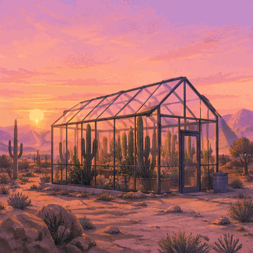

<!-- Generated by scripts/build_readme.py. Edit source data, locale catalogs and generator scripts. -->

<a id="top"></a>

[](https://raphael.app/?utm_source=github&utm_medium=repository&utm_campaign=gpt_image_2_6_launch&utm_content=hero&utm_term=ko-KR)

# 🚀 GPT Image 2.6 프롬프트 모음

[](https://github.com/sindresorhus/awesome)
[](https://github.com/RaphaelAI-OpenLab/awesome-gpt-image-2.6-prompts)
[](LICENSE)
[](https://github.com/RaphaelAI-OpenLab/awesome-gpt-image-2.6-prompts/actions/workflows/validate.yml)
[](CONTRIBUTING.md)

> 🎨 GPT Image 2.6(ChatGPT Images 2.6) 프롬프트 및 시각 사례 엄선 모음 — Flare & Sunburst, 네이티브 GIF 프롬프트, SVG 벡터 프롬프트, 마크업 기반 편집 포함.

> ⚠️ **저작권 안내**: 이 모음집은 공개 출처의 프롬프트와 사례, 독립적으로 생성한 이미지를 포함하며 교육 목적으로만 제공됩니다. 권리를 침해하는 콘텐츠가 있다고 생각하시면 [이슈를 등록해 주세요](https://github.com/RaphaelAI-OpenLab/awesome-gpt-image-2.6-prompts/issues/new?template=report-problem.yml). 즉시 삭제하겠습니다.

---

<a href="README.md"></a> <a href="README.zh-CN.md"></a> <a href="README.zh-TW.md"></a> <a href="README.ja-JP.md"></a><br />
<a href="README.ko-KR.md"></a> <a href="README.th-TH.md"></a> <a href="README.vi-VN.md"></a> <a href="README.hi-IN.md"></a><br />
<a href="README.es-ES.md"></a> <a href="README.es-419.md"></a> <a href="README.de-DE.md"></a> <a href="README.fr-FR.md"></a><br />
<a href="README.it-IT.md"></a> <a href="README.pt-BR.md"></a> <a href="README.pt-PT.md"></a> <a href="README.tr-TR.md"></a>

---

이 언어 버전은 저장소 인터페이스를 번역합니다. 전체 사례 상세 정보는 현재 영어와 중국어 간체로 제공됩니다.

사례 제목, 설명, 상세 페이지에 번역이 없으면 영어로 표시됩니다. 원문 프롬프트와 출처 인용문은 번역하지 않습니다.

<a id="gallery"></a>

## 🌐 웹 갤러리에서 보기

**[👉 Raphael의 GPT Image 2.6 프롬프트 갤러리 둘러보기](https://raphael.app/gpt-image-2-6-prompts?utm_source=github&utm_medium=repository&utm_campaign=gpt_image_2_6_launch&utm_content=top_cta&utm_term=ko-KR)**

**[📝 전체 프롬프트](README.md#collection)**

웹사이트에서 창작하는 이유는?

| 기능 | GitHub README | Raphael 웹사이트 |
| --- | --- | --- |
| 🆓 무료 이미지 생성 | 사례와 프롬프트 둘러보기 | 기본 이미지 생성은 무료, 로그인·카드 등록 불필요 |
| ✍️ 프롬프트 활용 | 공개된 프롬프트 복사 | 프롬프트를 붙여 넣고 바로 이미지 생성 |
| 🖼️ 참조 이미지 편집 | 참조 이미지와 입력 조건 확인 | 참조 이미지를 업로드해 생성과 편집에 활용 |
| 🤖 모델 선택 | 각 사례에 사용된 모델 확인 | GPT Image, Seedream, Nano Banana 등에서 선택 |
| 🎨 스타일과 크기 | 출처에 기록된 스타일과 설정 확인 | 스타일, 화면 비율, 출력 형식 선택 |
| 🔄 여러 결과 시도 | 수록된 사례의 결과 비교 | 프롬프트 하나로 한 번에 최대 4장 생성 |
| 🛠️ 이미지 도구 | 이미지 편집 작업 과정 읽기 | 배경 제거, 확대, 이미지 확장 및 부분 편집 |
| 📱 모바일 | 사례 읽기 | 모바일 브라우저에서 이미지 생성과 편집 |

무료 생성은 기본 모드를 사용합니다. 다른 모델에 필요한 크레딧과 요금제는 웹사이트에 표시됩니다.

[이 저장소의 모든 사례 보기 →](#all-cases)

<a id="categories"></a>

## 🏷️ 카테고리별 탐색

[전체 (158)](README.md#all-cases) · [GIF 및 애니메이션 (89)](README.md#category-gif-animation) · [캐릭터 및 일관성 (26)](README.md#category-characters-consistency) · [마크업 및 특정 영역 편집 (11)](README.md#category-markup-edits) · [포스터 및 타이포그래피 (9)](README.md#category-posters-typography) · [브랜드 및 제품 비주얼 (8)](README.md#category-brand-products) · [인포그래픽 (8)](README.md#category-infographics) · [SVG 및 디자인 에셋 (4)](README.md#category-svg-design-assets) · [인테리어 및 건축 (3)](README.md#category-interiors-architecture)

<a id="contents"></a>

## 📖 목차

- [GPT Image 2.6(ChatGPT Images 2.6)이란?](#about)
- [OpenAI API 빠른 시작 (Flare & Sunburst)](#api-quickstart)
- [통계](#statistics)
- [주요 사례](#featured)
- [모든 사례](#all-cases)
- [전체 프롬프트](README.md#collection)
- [사용 방법](#using)
- [기여하기](#contribute)
- [라이선스](#license)
- [감사의 말](#acknowledgements)
- [스타 기록](#star-history)

<a id="about"></a>

## 🤔 GPT Image 2.6(ChatGPT Images 2.6)이란?

OpenAI는 2026년 11월 4일 Images 2.6(ChatGPT Images 2.6 / GPT Image 2.6)을 출시하며 `gpt-image-2.6-sunburst`와 `gpt-image-2.6-flare` 두 가지 API 모델을 공개했습니다. 이 컬렉션은 이미지 생성, 마크업 기반 편집, 네이티브 GIF 프롬프트, SVG 벡터 프롬프트의 복사 가능한 예시를 정리합니다. 모델 변형 지원 여부는 추정하지 않고 사례별로 기록합니다.

[공식 발표](https://openai.com/index/introducing-images-2-6/) · [모델 문서](https://developers.openai.com/api/docs/guides/image-generation)

### GPT-Image-2.6 Flare vs Sunburst 및 핵심 워크플로

| 버전 / 워크플로 | 적합한 용도 | 사례 보기 |
| --- | --- | --- |
| GPT-Image-2.6 Sunburst (`gpt-image-2.6-sunburst`) | 높은 디테일, 복잡한 레이아웃, 정확한 타이포그래피, 다단계 캐릭터 일관성, 네이티브 GIF 및 SVG 출력 | [주요 사례](#featured) |
| GPT-Image-2.6 Flare (`gpt-image-2.6-flare`) | 저지연 빠른 반복, 신속한 시안 제작, 대량 생성, 마크업 편집, GIF 및 SVG 출력 | [모든 사례](README.md#all-cases) |
| 네이티브 GIF 프롬프트 (Native GIF Prompts) | 스티커, 데모, 스토리보드용 매끄러운 반복 애니메이션 GIF (`output_format: gif`, 2–16프레임) | [GIF 및 애니메이션](README.md#category-gif-animation) |
| SVG 벡터 프롬프트 (SVG Vector Prompts) | 편집 가능한 깔끔한 벡터 로고, 아이콘, UI 콘셉트 및 디자인 에셋 (`output_format: svg`) | [SVG 및 디자인 에셋](README.md#category-svg-design-assets) |
| 마크업 기반 편집 (Markup-Guided Editing) | 참조 사진에 동그라미나 주석을 표시해 색상 변경, 요소 교체, 레이아웃 현지화를 정밀하게 수행 | [마크업 및 특정 영역 편집](README.md#category-markup-edits) |

<a id="api-quickstart"></a>

## ⚡ OpenAI API 빠른 시작 (Flare & Sunburst)

이 컬렉션에서 프롬프트를 복사해 OpenAI Images API로 바로 실행할 수 있습니다(속도는 `gpt-image-2.6-flare`, 고품질 디테일은 `gpt-image-2.6-sunburst`).

```python
import base64
from openai import OpenAI

client = OpenAI()  # Reads OPENAI_API_KEY from environment

# 1) High-detail still image with GPT-Image-2.6 Sunburst (or "gpt-image-2.6-flare" for speed)
image = client.images.generate(
    model="gpt-image-2.6-sunburst",
    prompt="Editorial studio photo of a cobalt ceramic vase on warm oak, soft morning light",
    size="1024x1024",
    quality="high",
)

# 2) Native looping GIF prompt (output_format="gif", 2-16 frames)
gif = client.images.generate(
    model="gpt-image-2.6-flare",
    prompt="A tiny lantern-carrying monkey in a snowy pine forest at dusk, seamless loop animation",
    output_format="gif",
    frame_count=8,
    frame_duration_ms=150,
)
with open("loop.gif", "wb") as f:
    f.write(base64.b64decode(gif.data[0].b64_json))

# 3) Editable SVG vector prompt (output_format="svg")
svg = client.images.generate(
    model="gpt-image-2.6-sunburst",
    prompt="Minimalist bakery logo 'Field & Flour', clean vector silhouette, warm balanced negative space",
    output_format="svg",
)
with open("logo.svg", "wb") as f:
    f.write(base64.b64decode(svg.data[0].b64_json))
```

```bash
curl https://api.openai.com/v1/images/generations \
  -H "Content-Type: application/json" \
  -H "Authorization: Bearer $OPENAI_API_KEY" \
  -d '{
    "model": "gpt-image-2.6-flare",
    "prompt": "Minimalist geometric bakery logo on cream paper, clean vector aesthetic",
    "size": "1024x1024",
    "output_format": "svg"
  }'
```

<a id="statistics"></a>

## 📊 통계

| **지표** | **개수** |
| --- | --- |
| 📝 전체 프롬프트 | **156** |
| ⭐ 추천 | **12** |
| 🗂️ CMS 자료 수 | **9** |
| 🔄 마지막 업데이트 | **2026-11-25 UTC 14:22:41** |

<!-- cms-stats 9 2026-11-25T14:22:41Z -->

<a id="featured"></a>

## 🔥 주요 사례

<a id="featured-case-launch-higgsfield"></a>

### 38. [Knight scene and clothing edit sequence](README.md#source-case-launch-higgsfield)

<div align="center">
<a href="assets/examples/launch-higgsfield/source-01.webp"></a><br /><sub>Source image 1</sub>
</div>

<div align="center">
<a href="assets/examples/launch-higgsfield/source-02.webp"></a><br /><sub>Source image 2</sub>
</div>

<div align="center">
<a href="assets/examples/launch-higgsfield/source-03.webp"></a><br /><sub>Source image 3</sub>
</div>

**원문 프롬프트**

**Starting image · Character and scene**

```text
Epic high fantasy anime key visual, mature seinen style like a modern high-budget anime film. A young woman sorceress-knight in her twenties with long crimson hair and sharp golden eyes stands on the edge of a cliff in ornate silver and emerald armor with a flowing royal blue cape, a glowing runic sword planted in front of her, magic sparks around her hands. Behind her a vast fantasy kingdom: floating islands with waterfalls pouring into the clouds, a white castle with spires, a huge ancient dragon flying in the distance, giant blooming sakura and golden autumn forests in the valley below. Sunset sky with vivid orange, magenta, turquoise and violet clouds, god rays, glowing magic particles in the air. Extremely vibrant saturated colors, dramatic rim lighting, cel shading with detailed painted backgrounds, crisp clean line art, depth and atmosphere, dynamic low camera angle, wide cinematic composition. Adult, elegant, serious heroic mood, not childish, no chibi, no sci-fi, no neon, no text, no watermark.
```

**Edit 1 · Sunset valley**

```text
Replace the moonlit landscape with a golden sunset over a misty mountain valley, winding river, waterfalls and ancient ruins. Keep the background softly blurred and the knight, armor, sword, rock and composition unchanged.
```

**Edit 2 · Floating castle**

```text
Replace the background with a majestic floating castle, smaller floating islands, cascading waterfalls and a dragon flying overhead. Preserve the warm sunset, atmospheric haze and shallow depth of field. Keep the knight and foreground unchanged.
```

**Edit 3 · Recolor armor**

```text
Recolor the armor to ivory white with rich gold trim, replace emerald gemstones with rubies, and change green fabric panels to deep crimson. Preserve the armor design, blue cape, red hair, golden sword glow, pose and background.
```

Use the edits in order, passing the previous output into the next edit. The official page includes the starting-image prompt alongside Edit 1; the three archived images show the edited results.

[출처의 원문 프롬프트](https://openai.com/index/introducing-images-2-6/#more-ways-to-create-and-edit-in-the-api)

**작성자**: [Higgsfield](https://openai.com/index/introducing-images-2-6/#more-ways-to-create-and-edit-in-the-api)

**원본 출처**: [공식 출시 데모](https://openai.com/index/introducing-images-2-6/#more-ways-to-create-and-edit-in-the-api) · [출처 상세 정보](cases/launch-higgsfield/README.md)

**[👉 지금 사용해 보기 →](https://raphael.app/gpt-image-2-6-prompts?utm_source=github&utm_medium=repository&utm_campaign=gpt_image_2_6_launch&utm_content=case_gallery_launch-higgsfield&utm_term=ko-KR)**

---

<a id="featured-case-raphael-observatory-weather-cycle"></a>

### 95. [Observatory through four skies](README.md#source-case-raphael-observatory-weather-cycle)

<div align="center">
<a href="assets/examples/raphael-observatory-weather-cycle/observatory-weather-cycle.gif"></a><br /><sub>Observatory through four skies</sub>
</div>

**원문 프롬프트**

```text
A small red-domed observatory on a rocky bluff against a locked circular composition, illustrated as colored pencil over paper. Clouds give way to a shower, dawn rainbow, clear starry sky and then back to drifting clouds. Preserve the building and horizon in every frame. Soft weather transitions in a short square loop.
```

[원문 프롬프트 (.txt)](cases/raphael-observatory-weather-cycle/prompt.txt)


**작성자**: Raphael

[출처 상세 정보](cases/raphael-observatory-weather-cycle/README.md)

**[👉 지금 사용해 보기 →](https://raphael.app/gpt-image-2-6-prompts?utm_source=github&utm_medium=repository&utm_campaign=gpt_image_2_6_launch&utm_content=case_gallery_raphael-observatory-weather-cycle&utm_term=ko-KR)**

---

<a id="featured-case-docs-bakery-svg"></a>

### 66. [Bakery SVG logo](README.md#source-case-docs-bakery-svg)

<div align="center">
<a href="assets/examples/docs-bakery-svg/field-and-flour-gpt-image-2-6-flare.svg"></a><br /><sub>Flare SVG logo</sub>
</div>

<div align="center">
<a href="assets/examples/docs-bakery-svg/field-and-flour-gpt-image-2-6-sunburst.svg"></a><br /><sub>Sunburst SVG logo</sub>
</div>

**원문 프롬프트**

```text
Create an original, non-infringing logo for a company called Field & Flour, a local bakery.
The logo should feel warm, simple, and timeless. Use clean, vector-like shapes, a strong silhouette, and balanced negative space.
Favor simplicity over detail so it reads clearly at small and large sizes. Flat design, minimal strokes, no gradients unless essential.
Fully transparent background. Deliver a single centered logo with generous padding, clean alpha edges, and no solid backdrop, scenery, checkerboard, or watermark.
```

[출처의 원문 프롬프트](https://developers.openai.com/api/docs/guides/image-prompting#generate-svg-output)

**작성자**: [OpenAI](https://developers.openai.com/api/docs/guides/image-prompting#generate-svg-output)

**원본 출처**: [공식 문서](https://developers.openai.com/api/docs/guides/image-prompting#generate-svg-output) · [출처 상세 정보](cases/docs-bakery-svg/README.md)

**[👉 지금 사용해 보기 →](https://raphael.app/gpt-image-2-6-prompts?utm_source=github&utm_medium=repository&utm_campaign=gpt_image_2_6_launch&utm_content=case_gallery_docs-bakery-svg&utm_term=ko-KR)**

---

<a id="featured-case-raphael-greenhouse-day-to-night"></a>

### 97. [Greenhouse from dawn through night](README.md#source-case-raphael-greenhouse-day-to-night)

<div align="center">
<a href="assets/examples/raphael-greenhouse-day-to-night/greenhouse-day-to-night.gif"></a><br /><sub>Greenhouse from dawn through night</sub>
</div>

**원문 프롬프트**

```text
Seen from outside, a tiny steel-framed desert greenhouse holds several tall cacti. Pink dawn sweeps into turquoise afternoon glass, then deep violet night with a single interior grow lamp and back to dawn. Fixed wide composition and architecture, softly textured gouache, smooth light changes in a brief ambient loop, no text.
```

[원문 프롬프트 (.txt)](cases/raphael-greenhouse-day-to-night/prompt.txt)


**작성자**: Raphael

[출처 상세 정보](cases/raphael-greenhouse-day-to-night/README.md)

**[👉 지금 사용해 보기 →](https://raphael.app/gpt-image-2-6-prompts?utm_source=github&utm_medium=repository&utm_campaign=gpt_image_2_6_launch&utm_content=case_gallery_raphael-greenhouse-day-to-night&utm_term=ko-KR)**

---

<a id="featured-case-social-cyan-poetry-wet-portrait"></a>

### 46. [Glowing cyan poetry and equations on wet skin](README.md#source-case-social-cyan-poetry-wet-portrait)

<div align="center">
<a href="assets/examples/social-cyan-poetry-wet-portrait/source-01.jpg"></a><br /><sub>Glowing cyan poetry and equations on wet skin</sub>
</div>

**원문 프롬프트**

```text
A cinematic, ultra-realistic close-up portrait of a young woman with wet, tousled dark hair and luminous skin, staring directly into the camera with an intense, introspective expression. Glowing cyan handwritten text and symbols are projected across her face, neck, and shoulders, resembling poetic phrases, equations, and abstract handwriting. The light reflections shimmer on her damp skin, creating a futuristic, cyber-poetry aesthetic. Dark,moody background with soft shadows, shallow depth of field, sharp focus on the eyes, high contrast lighting, teal and blue color palette, hyper-detailed skin texture, photorealistic, dramatic atmosphere, cyberpunk meets fine-art portrait photography, 8K quality, cinematic lighting.
```

[원문 프롬프트 (.txt)](cases/social-cyan-poetry-wet-portrait/prompt.txt)

[출처의 원문 프롬프트](https://x.com/iamsofiaijaz/status/2118561558511132918)

**작성자**: [iamsofiaijaz](https://x.com/iamsofiaijaz)

**원본 출처**: [제작자가 밝힌 모델](https://x.com/iamsofiaijaz/status/2118561513879507399) · [출처 상세 정보](cases/social-cyan-poetry-wet-portrait/README.md)

**[👉 지금 사용해 보기 →](https://raphael.app/gpt-image-2-6-prompts?utm_source=github&utm_medium=repository&utm_campaign=gpt_image_2_6_launch&utm_content=case_gallery_social-cyan-poetry-wet-portrait&utm_term=ko-KR)**

---

<a id="featured-case-raphael-moon-jelly-aquarium"></a>

### 100. [Moon jelly aquarium](README.md#source-case-raphael-moon-jelly-aquarium)

<div align="center">
<a href="assets/examples/raphael-moon-jelly-aquarium/moon-jelly-aquarium.gif"></a><br /><sub>Moon jelly aquarium</sub>
</div>

**원문 프롬프트**

```text
A pair of tiny moon jellies drift in a tall cylindrical aquarium, backlit in pale aqua and lavender against indigo. Their bells pulse in a gently offset rhythm and fine suspended specks drift upward as the two jellyfish return to their original arrangement. Macro photography look, camera locked, no type, ambient loop.
```

[원문 프롬프트 (.txt)](cases/raphael-moon-jelly-aquarium/prompt.txt)


**작성자**: Raphael

[출처 상세 정보](cases/raphael-moon-jelly-aquarium/README.md)

**[👉 지금 사용해 보기 →](https://raphael.app/gpt-image-2-6-prompts?utm_source=github&utm_medium=repository&utm_campaign=gpt_image_2_6_launch&utm_content=case_gallery_raphael-moon-jelly-aquarium&utm_term=ko-KR)**

---

<a id="featured-case-docs-pixel-style"></a>

### 57. [Transfer a pixel-art style](README.md#source-case-docs-pixel-style)

<div align="center">
<a href="assets/examples/docs-pixel-style/motorcycle-gpt-image-2-6-flare.webp"></a><br /><sub>Pixel-art motorcycle rider using the reference style — GPT Image 2.6 Flare (official model output)</sub>
</div>

<div align="center">
<a href="assets/examples/docs-pixel-style/motorcycle-gpt-image-2-6-sunburst.webp"></a><br /><sub>Pixel-art motorcycle rider using the reference style — GPT Image 2.6 Sunburst (official model output)</sub>
</div>

**참조 이미지**

참조 / 입력 이미지이며 생성 결과물이 아닙니다.

<div align="center">
<a href="assets/references/docs-pixel-style/pixels.webp"></a><br /><sub>Reference input: Pixel-art game screen used as a style reference</sub>
</div>


**원문 프롬프트**

```text
Use the same style from the input image and generate a man riding a motorcycle on a white background.
```

[출처의 원문 프롬프트](https://developers.openai.com/api/docs/guides/image-prompting#transfer-a-visual-style)

**작성자**: [OpenAI](https://developers.openai.com/api/docs/guides/image-prompting#transfer-a-visual-style)

**원본 출처**: [공식 문서](https://developers.openai.com/api/docs/guides/image-prompting#transfer-a-visual-style) · [출처 상세 정보](cases/docs-pixel-style/README.md)

**[👉 지금 사용해 보기 →](https://raphael.app/gpt-image-2-6-prompts?utm_source=github&utm_medium=repository&utm_campaign=gpt_image_2_6_launch&utm_content=case_gallery_docs-pixel-style&utm_term=ko-KR)**

---

<a id="featured-case-raphael-sketchbook-bicycle"></a>

### 108. [Sketchbook bicycle comes alive](README.md#source-case-raphael-sketchbook-bicycle)

<div align="center">
<a href="assets/examples/raphael-sketchbook-bicycle/sketchbook-bicycle.gif"></a><br /><sub>Sketchbook bicycle comes alive</sub>
</div>

**원문 프롬프트**

```text
A sketchbook close-up with a simple cobalt pen doodle of a tiny bicycle. The wheels start spinning and a pennant flutters, then the bicycle rides in one small circle on the page and returns to its original outline. Keep the paper and camera fixed, no hands or text, whimsical looping animation.
```

[원문 프롬프트 (.txt)](cases/raphael-sketchbook-bicycle/prompt.txt)


**작성자**: Raphael

[출처 상세 정보](cases/raphael-sketchbook-bicycle/README.md)

**[👉 지금 사용해 보기 →](https://raphael.app/gpt-image-2-6-prompts?utm_source=github&utm_medium=repository&utm_campaign=gpt_image_2_6_launch&utm_content=case_gallery_raphael-sketchbook-bicycle&utm_term=ko-KR)**

---

<a id="featured-case-docs-market-ui"></a>

### 67. [Farmers market mobile interface](README.md#source-case-docs-market-ui)

<div align="center">
<a href="assets/examples/docs-market-ui/ui-farmers-market-gpt-image-2-6-flare.webp"></a><br /><sub>Farmers market mobile app mockup — GPT Image 2.6 Flare (official model output)</sub>
</div>

<div align="center">
<a href="assets/examples/docs-market-ui/ui-farmers-market-gpt-image-2-6-sunburst.webp"></a><br /><sub>Farmers market mobile app mockup — GPT Image 2.6 Sunburst (official model output)</sub>
</div>

**원문 프롬프트**

```text
Create a realistic mobile app UI mockup for a local farmers market.
Show today’s market with a simple header, a short list of vendors with small photos and categories, a small “Today’s specials” section, and basic information for location and hours.
Design it to be practical, and easy to use. White background, subtle natural accent colors, clear typography, and minimal decoration.
It should look like a real, well-designed, beautiful app for a small local market.
Place the UI mockup in an iPhone frame.
```

[출처의 원문 프롬프트](https://developers.openai.com/api/docs/guides/image-prompting#create-an-interface-preview)

**작성자**: [OpenAI](https://developers.openai.com/api/docs/guides/image-prompting#create-an-interface-preview)

**원본 출처**: [공식 문서](https://developers.openai.com/api/docs/guides/image-prompting#create-an-interface-preview) · [출처 상세 정보](cases/docs-market-ui/README.md)

**[👉 지금 사용해 보기 →](https://raphael.app/gpt-image-2-6-prompts?utm_source=github&utm_medium=repository&utm_campaign=gpt_image_2_6_launch&utm_content=case_gallery_docs-market-ui&utm_term=ko-KR)**

---

<a id="featured-case-raphael-pixel-greenhouse-sprinkler"></a>

### 109. [Pixel greenhouse sprinkler](README.md#source-case-raphael-pixel-greenhouse-sprinkler)

<div align="center">
<a href="assets/examples/raphael-pixel-greenhouse-sprinkler/pixel-greenhouse-sprinkler.gif"></a><br /><sub>Pixel greenhouse sprinkler</sub>
</div>

**원문 프롬프트**

```text
A cozy pixel-art greenhouse at dusk: mint roof panes, terra-cotta pots and a tiny sprinkler rotating above a shelf of seedlings. The sprinkler sprays a few bright pixels in two directions and returns to its first angle. Stable scene, limited 16-bit palette, crisp square pixels, no text, seamless loop.
```

[원문 프롬프트 (.txt)](cases/raphael-pixel-greenhouse-sprinkler/prompt.txt)


**작성자**: Raphael

[출처 상세 정보](cases/raphael-pixel-greenhouse-sprinkler/README.md)

**[👉 지금 사용해 보기 →](https://raphael.app/gpt-image-2-6-prompts?utm_source=github&utm_medium=repository&utm_campaign=gpt_image_2_6_launch&utm_content=case_gallery_raphael-pixel-greenhouse-sprinkler&utm_term=ko-KR)**

---

<a id="featured-case-docs-vase-markup"></a>

### 55. [Recolor a marked vase](README.md#source-case-docs-vase-markup)

<div align="center">
<a href="assets/examples/docs-vase-markup/markup-vase-gpt-image-2-6-flare.webp"></a><br /><sub>GPT Image 2.6 Flare output: Flare edit of the kitchen with a blue vase and dried stems on the table</sub>
</div>

<div align="center">
<a href="assets/examples/docs-vase-markup/markup-vase-gpt-image-2-6-sunburst.webp"></a><br /><sub>GPT Image 2.6 Sunburst output: Sunburst edit of the kitchen with the same vase in cobalt blue and the red circle removed</sub>
</div>

**참조 이미지**

참조 / 입력 이미지이며 생성 결과물이 아닙니다.

<div align="center">
<a href="assets/references/docs-vase-markup/markup-vase-input-gpt-image-2-6.webp"></a><br /><sub>Reference input: Kitchen photo with a red circle around the striped vase on the dining table</sub>
</div>


**원문 프롬프트**

```text
Recolor the striped vase inside the red circle to solid cobalt blue ceramic. Keep its shape, the dried stems, and the rest of the kitchen unchanged. Remove the red circle from the finished photo.
```

[출처의 원문 프롬프트](https://developers.openai.com/api/docs/guides/image-prompting#guide-an-edit-with-markup)

**작성자**: [OpenAI](https://developers.openai.com/api/docs/guides/image-prompting#guide-an-edit-with-markup)

**원본 출처**: [공식 문서](https://developers.openai.com/api/docs/guides/image-prompting#guide-an-edit-with-markup) · [출처 상세 정보](cases/docs-vase-markup/README.md)

**[👉 지금 사용해 보기 →](https://raphael.app/gpt-image-2-6-prompts?utm_source=github&utm_medium=repository&utm_campaign=gpt_image_2_6_launch&utm_content=case_gallery_docs-vase-markup&utm_term=ko-KR)**

---

<a id="featured-case-community-struggle-sailor-dance"></a>

### 121. [Moonlit magical-girl dance](README.md#source-case-community-struggle-sailor-dance)

<div align="center">
<a href="assets/examples/community-struggle-sailor-dance/9ff4f428146eff32d28f14d3db8d46d1.gif"></a><br /><sub>Magical girl dancing at night</sub>
</div>

**원문 프롬프트**

```text
创建一个 GIF，内容是 一位美少女战士在跳舞
```

[출처의 원문 프롬프트](https://tianqi.csdn.net/6aebfbae40858c2d8818a1fd.html#devmenu4)

**작성자**: [STRUGGLE_xlf](https://tianqi.csdn.net/6aebfbae40858c2d8818a1fd.html#devmenu4)

**원본 출처**: [제작자가 밝힌 모델](https://tianqi.csdn.net/6aebfbae40858c2d8818a1fd.html#devmenu4) · [출처 상세 정보](cases/community-struggle-sailor-dance/README.md)

**[👉 지금 사용해 보기 →](https://raphael.app/gpt-image-2-6-prompts?utm_source=github&utm_medium=repository&utm_campaign=gpt_image_2_6_launch&utm_content=case_gallery_community-struggle-sailor-dance&utm_term=ko-KR)**

---

동영상 미리보기는 첫 프레임입니다. 움직임은 연결된 파일에서 확인하세요. 참조 이미지와 원본 포스터는 별도로 표시합니다.

<a id="all-cases"></a>

## 📋 모든 사례

이 언어 버전에는 번역된 개요, API 빠른 시작, 실시간 통계 및 모든 엄선 사례가 포함되어 있습니다. 번역되지 않은 영어 프롬프트 중복을 줄이기 위해 전체 158개 사례는 아래 카테고리 링크 또는 한국어 웹 갤러리에서 확인하세요.

| 카테고리 | 사례 수 | 사례 보기 |
| --- | ---: | --- |
| GIF 및 애니메이션 | **89** | [영어로 읽기](README.md#category-gif-animation) |
| 캐릭터 및 일관성 | **26** | [영어로 읽기](README.md#category-characters-consistency) |
| 마크업 및 특정 영역 편집 | **11** | [영어로 읽기](README.md#category-markup-edits) |
| 포스터 및 타이포그래피 | **9** | [영어로 읽기](README.md#category-posters-typography) |
| 브랜드 및 제품 비주얼 | **8** | [영어로 읽기](README.md#category-brand-products) |
| 인포그래픽 | **8** | [영어로 읽기](README.md#category-infographics) |
| SVG 및 디자인 에셋 | **4** | [영어로 읽기](README.md#category-svg-design-assets) |
| 인테리어 및 건축 | **3** | [영어로 읽기](README.md#category-interiors-architecture) |

**[👉 영어 메인 페이지에서 전체 158개 사례 보기 →](README.md#all-cases)**

[Raphael 한국어 웹 갤러리 열기 ↗](https://raphael.app/ko/gpt-image-2-6-prompts?utm_source=github&utm_medium=repository&utm_campaign=gpt_image_2_6_launch&utm_content=localized_all_cases&utm_term=ko-KR)

<a id="using"></a>

## 📚 사용 방법

1. 카테고리 또는 주요 사례 카드에서 사례를 여세요.
2. 모델 관련 근거, 필요한 입력, 출처, 재사용 제한을 확인하세요.
3. 원문 프롬프트 링크가 있으면 해당 링크를 확인하세요. 제공되지 않은 프롬프트는 그대로 누락된 상태로 두고, 이미지로 추정하지 마세요.

<a id="contribute"></a>

## 🤝 기여 방법

출처가 있는 사례는 content/source-cases.json에, 전체 프롬프트는 content/prompts.json에 추가하세요. 생성기는 색인과 영어·중국어 상세 페이지를 만듭니다.

[기여 가이드](CONTRIBUTING.md) · [출처 사례 및 미디어 가이드](docs/SOURCE_CASES.md) · [다국어 안내](docs/LANGUAGES.md)

<a id="license"></a>

## 📄 라이선스

코드, 자체 작성 문서, 장식용 SVG 자리표시자에는 MIT 라이선스를 적용합니다. 제3자의 프롬프트와 미디어에는 각각의 이용 약관이 적용되며, 항목별로 출처와 재사용 상태를 기록합니다. 수정해 사용한 README 레이아웃의 출처는 아래에 별도로 표시합니다.

[저장소 라이선스](LICENSE) · [출처 표시 안내](docs/ATTRIBUTION.md)

<a id="acknowledgements"></a>

## 🙏 감사의 말

README 구조는 CC BY 4.0에 따라 YouMind OpenLab의 awesome-nano-banana-pro-prompts를 수정해 사용했습니다. GPT Image 2.6에 맞춰 새로운 문구, 데이터, 로컬 상세 페이지를 작성하고 자리표시자를 명확히 표시했습니다. 창작 예시나 미디어는 복사하지 않았습니다.

[YouMind README](https://github.com/YouMind-OpenLab/awesome-nano-banana-pro-prompts/blob/main/README_zh.md) · [CC BY 4.0](https://creativecommons.org/licenses/by/4.0/) · [출처 표시 안내](docs/ATTRIBUTION.md)

OpenAI와 각 사례 페이지에 표시된 원작자들께 감사드립니다.

<a id="star-history"></a>

## ⭐ 스타 기록

[스타 기록](https://star-history.com/#RaphaelAI-OpenLab/awesome-gpt-image-2.6-prompts&Date) · [스타를 누른 사용자 보기](https://github.com/RaphaelAI-OpenLab/awesome-gpt-image-2.6-prompts/stargazers)

[이 저장소에 스타 누르기 / 팔로우하기](https://github.com/RaphaelAI-OpenLab/awesome-gpt-image-2.6-prompts)

[↑ 맨 위로](#top)

---

Raphael이 수집하고 정리합니다. [홈페이지](https://raphael.app/?utm_source=github&utm_medium=repository&utm_campaign=gpt_image_2_6_launch&utm_content=footer&utm_term=ko-KR)

구조화된 출처 데이터로 생성되었습니다. 데이터셋을 수정한 후 다시 생성하세요. 이 파일을 직접 수정하지 마세요.
