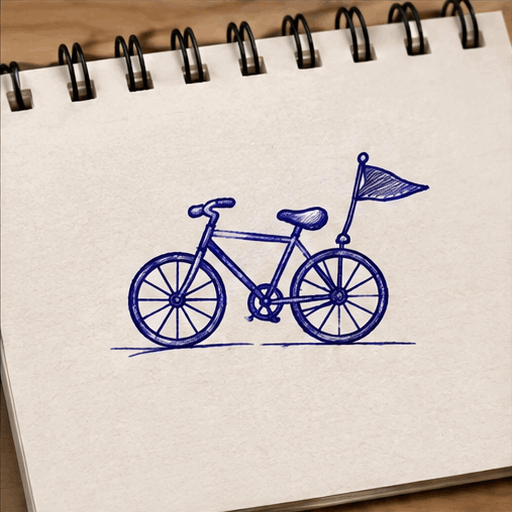

<!-- Generated by scripts/build_readme.py. Edit source data, locale catalogs and generator scripts. -->

<a id="top"></a>

[](https://raphael.app/?utm_source=github&utm_medium=repository&utm_campaign=gpt_image_2_6_launch&utm_content=hero&utm_term=pt-BR)

# 🚀 Coleção de prompts para GPT Image 2.6

[](https://github.com/sindresorhus/awesome)
[](https://github.com/RaphaelAI-OpenLab/awesome-gpt-image-2.6-prompts)
[](LICENSE)
[](https://github.com/RaphaelAI-OpenLab/awesome-gpt-image-2.6-prompts/actions/workflows/validate.yml)
[](CONTRIBUTING.md)

> 🎨 Coleção selecionada de prompts e exemplos visuais para GPT Image 2.6 e ChatGPT Images 2.6 — cobrindo Flare e Sunburst, prompts de GIF nativo, prompts vetoriais SVG e edição guiada por marcações.

> ⚠️ **Aviso de direitos autorais**: Esta coleção inclui prompts e exemplos de fontes públicas, além de imagens geradas de forma independente, apenas para fins educacionais. Se você acredita que algum conteúdo infringe seus direitos, por favor, [abra uma issue](https://github.com/RaphaelAI-OpenLab/awesome-gpt-image-2.6-prompts/issues/new?template=report-problem.yml), e o removeremos imediatamente.

---

<a href="README.md"></a> <a href="README.zh-CN.md"></a> <a href="README.zh-TW.md"></a> <a href="README.ja-JP.md"></a><br />
<a href="README.ko-KR.md"></a> <a href="README.th-TH.md"></a> <a href="README.vi-VN.md"></a> <a href="README.hi-IN.md"></a><br />
<a href="README.es-ES.md"></a> <a href="README.es-419.md"></a> <a href="README.de-DE.md"></a> <a href="README.fr-FR.md"></a><br />
<a href="README.it-IT.md"></a> <a href="README.pt-BR.md"></a> <a href="README.pt-PT.md"></a> <a href="README.tr-TR.md"></a>

---

Esta versão de idioma traduz a interface do repositório. Os detalhes completos dos casos estão disponíveis atualmente em inglês e chinês simplificado.

Os títulos, as descrições e as páginas de detalhes dos casos são exibidos em inglês quando não há tradução disponível. Os prompts originais e as citações das fontes não são traduzidos.

<a id="gallery"></a>

## 🌐 Ver na galeria web

**[👉 Explore a galeria de prompts GPT Image 2.6 no Raphael](https://raphael.app/gpt-image-2-6-prompts?utm_source=github&utm_medium=repository&utm_campaign=gpt_image_2_6_launch&utm_content=top_cta&utm_term=pt-BR)**

**[📝 Prompts completos](README.md#collection)**

Por que criar no site?

| Recurso | GitHub README | Site do Raphael |
| --- | --- | --- |
| 🆓 Geração gratuita | Consultar exemplos e prompts | Geração básica grátis, sem login nem cartão de crédito |
| ✍️ Uso de prompts | Copiar os prompts publicados | Colar um prompt e gerar uma imagem |
| 🖼️ Edição com imagens de referência | Consultar as referências e os requisitos de entrada | Enviar referências para orientar a geração e a edição |
| 🤖 Escolha do modelo | Ver qual modelo foi usado em cada exemplo | Escolher entre GPT Image, Seedream, Nano Banana e outros |
| 🎨 Estilos e tamanhos | Consultar estilos e configurações registrados pela fonte | Escolher estilo, proporção e formato de saída |
| 🔄 Variações | Comparar os exemplos coletados | Gerar até 4 imagens de uma vez por prompt |
| 🛠️ Ferramentas de imagem | Ler os fluxos de edição | Remover fundos, aumentar a resolução, expandir e editar imagens |
| 📱 Dispositivos móveis | Ler exemplos | Gerar e editar imagens no navegador do celular |

A geração gratuita usa o modo básico. Os créditos e planos exigidos pelos demais modelos são informados no site.

[Ver todos os casos deste repositório →](#all-cases)

<a id="categories"></a>

## 🏷️ Explorar por categoria

[Todos (158)](README.md#all-cases) · [GIF e animação (89)](README.md#category-gif-animation) · [Personagens e consistência (26)](README.md#category-characters-consistency) · [Anotações e edições pontuais (11)](README.md#category-markup-edits) · [Pôsteres e tipografia (9)](README.md#category-posters-typography) · [Imagens de marcas e produtos (8)](README.md#category-brand-products) · [Infográficos (8)](README.md#category-infographics) · [SVG e recursos de design (4)](README.md#category-svg-design-assets) · [Interiores e arquitetura (3)](README.md#category-interiors-architecture)

<a id="contents"></a>

## 📖 Sumário

- [O que é GPT Image 2.6 (ChatGPT Images 2.6)?](#about)
- [Início rápido da API OpenAI (Flare e Sunburst)](#api-quickstart)
- [Estatísticas](#statistics)
- [Casos em destaque](#featured)
- [Todos os casos](#all-cases)
- [Prompts completos](README.md#collection)
- [Como usar](#using)
- [Contribuir](#contribute)
- [Licença](#license)
- [Agradecimentos](#acknowledgements)
- [Histórico de estrelas](#star-history)

<a id="about"></a>

## 🤔 O que é GPT Image 2.6 (ChatGPT Images 2.6)?

A OpenAI lançou o Images 2.6 (ChatGPT Images 2.6 / GPT Image 2.6) em 4 de novembro de 2026 com duas variantes de API: `gpt-image-2.6-sunburst` e `gpt-image-2.6-flare`. Esta coleção organiza prompts copiáveis e exemplos visuais para geração de imagens, edição guiada por marcações, prompts de GIF nativo e prompts vetoriais SVG. O suporte de variante é registrado caso a caso.

[Anúncio oficial](https://openai.com/index/introducing-images-2-6/) · [Documentação do modelo](https://developers.openai.com/api/docs/guides/image-generation)

### GPT-Image-2.6 Flare vs Sunburst e fluxos principais

| Variante / Fluxo | Ideal para | Explorar exemplos |
| --- | --- | --- |
| GPT-Image-2.6 Sunburst (`gpt-image-2.6-sunburst`) | Mais detalhes, layouts complexos, tipografia precisa, consistência de personagens em múltiplas etapas, saídas GIF e SVG nativas | [Casos em destaque](#featured) |
| GPT-Image-2.6 Flare (`gpt-image-2.6-flare`) | Iteração rápida com baixa latência, rascunhos ágeis, geração em alta escala, edições com marcações, GIF e SVG | [Todos os casos](README.md#all-cases) |
| Prompts de GIF nativo (Native GIF Prompts) | GIFs animados em loop contínuo (`output_format: gif`, 2–16 quadros) para figurinhas, demos e storyboards | [GIF e animação](README.md#category-gif-animation) |
| Prompts vetoriais SVG (SVG Vector Prompts) | Logotipos vetoriais limpos e editáveis, ícones, conceitos de UI e ativos de design (`output_format: svg`) | [SVG e recursos de design](README.md#category-svg-design-assets) |
| Edição guiada por marcações (Markup-Guided Editing) | Circule ou anote uma foto de referência para recolorir objetos, trocar itens ou localizar layouts com precisão | [Anotações e edições pontuais](README.md#category-markup-edits) |

<a id="api-quickstart"></a>

## ⚡ Início rápido da API OpenAI (Flare e Sunburst)

Copie um prompt desta coleção e execute diretamente na API de Imagens da OpenAI (`gpt-image-2.6-flare` para velocidade ou `gpt-image-2.6-sunburst` para mais detalhes).

```python
import base64
from openai import OpenAI

client = OpenAI()  # Reads OPENAI_API_KEY from environment

# 1) High-detail still image with GPT-Image-2.6 Sunburst (or "gpt-image-2.6-flare" for speed)
image = client.images.generate(
    model="gpt-image-2.6-sunburst",
    prompt="Editorial studio photo of a cobalt ceramic vase on warm oak, soft morning light",
    size="1024x1024",
    quality="high",
)

# 2) Native looping GIF prompt (output_format="gif", 2-16 frames)
gif = client.images.generate(
    model="gpt-image-2.6-flare",
    prompt="A tiny lantern-carrying monkey in a snowy pine forest at dusk, seamless loop animation",
    output_format="gif",
    frame_count=8,
    frame_duration_ms=150,
)
with open("loop.gif", "wb") as f:
    f.write(base64.b64decode(gif.data[0].b64_json))

# 3) Editable SVG vector prompt (output_format="svg")
svg = client.images.generate(
    model="gpt-image-2.6-sunburst",
    prompt="Minimalist bakery logo 'Field & Flour', clean vector silhouette, warm balanced negative space",
    output_format="svg",
)
with open("logo.svg", "wb") as f:
    f.write(base64.b64decode(svg.data[0].b64_json))
```

```bash
curl https://api.openai.com/v1/images/generations \
  -H "Content-Type: application/json" \
  -H "Authorization: Bearer $OPENAI_API_KEY" \
  -d '{
    "model": "gpt-image-2.6-flare",
    "prompt": "Minimalist geometric bakery logo on cream paper, clean vector aesthetic",
    "size": "1024x1024",
    "output_format": "svg"
  }'
```

<a id="statistics"></a>

## 📊 Estatísticas

| **Métrica** | **Quantidade** |
| --- | --- |
| 📝 Total de prompts | **156** |
| ⭐ Destaques | **12** |
| 🗂️ Materiais no CMS | **12** |
| 🔄 Última atualização | **2026-11-26 UTC 00:01:33** |

<!-- cms-stats 12 2026-11-26T00:01:33Z -->

<a id="featured"></a>

## 🔥 Casos em destaque

<a id="featured-case-launch-higgsfield"></a>

### 38. [Knight scene and clothing edit sequence](README.md#source-case-launch-higgsfield)

<div align="center">
<a href="assets/examples/launch-higgsfield/source-01.webp"></a><br /><sub>Source image 1</sub>
</div>

<div align="center">
<a href="assets/examples/launch-higgsfield/source-02.webp"></a><br /><sub>Source image 2</sub>
</div>

<div align="center">
<a href="assets/examples/launch-higgsfield/source-03.webp"></a><br /><sub>Source image 3</sub>
</div>

**Prompt original**

**Starting image · Character and scene**

```text
Epic high fantasy anime key visual, mature seinen style like a modern high-budget anime film. A young woman sorceress-knight in her twenties with long crimson hair and sharp golden eyes stands on the edge of a cliff in ornate silver and emerald armor with a flowing royal blue cape, a glowing runic sword planted in front of her, magic sparks around her hands. Behind her a vast fantasy kingdom: floating islands with waterfalls pouring into the clouds, a white castle with spires, a huge ancient dragon flying in the distance, giant blooming sakura and golden autumn forests in the valley below. Sunset sky with vivid orange, magenta, turquoise and violet clouds, god rays, glowing magic particles in the air. Extremely vibrant saturated colors, dramatic rim lighting, cel shading with detailed painted backgrounds, crisp clean line art, depth and atmosphere, dynamic low camera angle, wide cinematic composition. Adult, elegant, serious heroic mood, not childish, no chibi, no sci-fi, no neon, no text, no watermark.
```

**Edit 1 · Sunset valley**

```text
Replace the moonlit landscape with a golden sunset over a misty mountain valley, winding river, waterfalls and ancient ruins. Keep the background softly blurred and the knight, armor, sword, rock and composition unchanged.
```

**Edit 2 · Floating castle**

```text
Replace the background with a majestic floating castle, smaller floating islands, cascading waterfalls and a dragon flying overhead. Preserve the warm sunset, atmospheric haze and shallow depth of field. Keep the knight and foreground unchanged.
```

**Edit 3 · Recolor armor**

```text
Recolor the armor to ivory white with rich gold trim, replace emerald gemstones with rubies, and change green fabric panels to deep crimson. Preserve the armor design, blue cape, red hair, golden sword glow, pose and background.
```

Use the edits in order, passing the previous output into the next edit. The official page includes the starting-image prompt alongside Edit 1; the three archived images show the edited results.

[Prompt original na fonte](https://openai.com/index/introducing-images-2-6/#more-ways-to-create-and-edit-in-the-api)

**Autor**: [Higgsfield](https://openai.com/index/introducing-images-2-6/#more-ways-to-create-and-edit-in-the-api)

**Fonte original**: [Demonstração oficial de lançamento](https://openai.com/index/introducing-images-2-6/#more-ways-to-create-and-edit-in-the-api) · [Detalhes da fonte](cases/launch-higgsfield/README.md)

**[👉 Experimente agora →](https://raphael.app/gpt-image-2-6-prompts?utm_source=github&utm_medium=repository&utm_campaign=gpt_image_2_6_launch&utm_content=case_gallery_launch-higgsfield&utm_term=pt-BR)**

---

<a id="featured-case-raphael-observatory-weather-cycle"></a>

### 95. [Observatory through four skies](README.md#source-case-raphael-observatory-weather-cycle)

<div align="center">
<a href="assets/examples/raphael-observatory-weather-cycle/observatory-weather-cycle.gif"></a><br /><sub>Observatory through four skies</sub>
</div>

**Prompt original**

```text
A small red-domed observatory on a rocky bluff against a locked circular composition, illustrated as colored pencil over paper. Clouds give way to a shower, dawn rainbow, clear starry sky and then back to drifting clouds. Preserve the building and horizon in every frame. Soft weather transitions in a short square loop.
```

[Prompt original (.txt)](cases/raphael-observatory-weather-cycle/prompt.txt)


**Autor**: Raphael

[Detalhes da fonte](cases/raphael-observatory-weather-cycle/README.md)

**[👉 Experimente agora →](https://raphael.app/gpt-image-2-6-prompts?utm_source=github&utm_medium=repository&utm_campaign=gpt_image_2_6_launch&utm_content=case_gallery_raphael-observatory-weather-cycle&utm_term=pt-BR)**

---

<a id="featured-case-docs-bakery-svg"></a>

### 66. [Bakery SVG logo](README.md#source-case-docs-bakery-svg)

<div align="center">
<a href="assets/examples/docs-bakery-svg/field-and-flour-gpt-image-2-6-flare.svg"></a><br /><sub>Flare SVG logo</sub>
</div>

<div align="center">
<a href="assets/examples/docs-bakery-svg/field-and-flour-gpt-image-2-6-sunburst.svg"></a><br /><sub>Sunburst SVG logo</sub>
</div>

**Prompt original**

```text
Create an original, non-infringing logo for a company called Field & Flour, a local bakery.
The logo should feel warm, simple, and timeless. Use clean, vector-like shapes, a strong silhouette, and balanced negative space.
Favor simplicity over detail so it reads clearly at small and large sizes. Flat design, minimal strokes, no gradients unless essential.
Fully transparent background. Deliver a single centered logo with generous padding, clean alpha edges, and no solid backdrop, scenery, checkerboard, or watermark.
```

[Prompt original na fonte](https://developers.openai.com/api/docs/guides/image-prompting#generate-svg-output)

**Autor**: [OpenAI](https://developers.openai.com/api/docs/guides/image-prompting#generate-svg-output)

**Fonte original**: [Documentação oficial](https://developers.openai.com/api/docs/guides/image-prompting#generate-svg-output) · [Detalhes da fonte](cases/docs-bakery-svg/README.md)

**[👉 Experimente agora →](https://raphael.app/gpt-image-2-6-prompts?utm_source=github&utm_medium=repository&utm_campaign=gpt_image_2_6_launch&utm_content=case_gallery_docs-bakery-svg&utm_term=pt-BR)**

---

<a id="featured-case-raphael-greenhouse-day-to-night"></a>

### 97. [Greenhouse from dawn through night](README.md#source-case-raphael-greenhouse-day-to-night)

<div align="center">
<a href="assets/examples/raphael-greenhouse-day-to-night/greenhouse-day-to-night.gif"></a><br /><sub>Greenhouse from dawn through night</sub>
</div>

**Prompt original**

```text
Seen from outside, a tiny steel-framed desert greenhouse holds several tall cacti. Pink dawn sweeps into turquoise afternoon glass, then deep violet night with a single interior grow lamp and back to dawn. Fixed wide composition and architecture, softly textured gouache, smooth light changes in a brief ambient loop, no text.
```

[Prompt original (.txt)](cases/raphael-greenhouse-day-to-night/prompt.txt)


**Autor**: Raphael

[Detalhes da fonte](cases/raphael-greenhouse-day-to-night/README.md)

**[👉 Experimente agora →](https://raphael.app/gpt-image-2-6-prompts?utm_source=github&utm_medium=repository&utm_campaign=gpt_image_2_6_launch&utm_content=case_gallery_raphael-greenhouse-day-to-night&utm_term=pt-BR)**

---

<a id="featured-case-social-cyan-poetry-wet-portrait"></a>

### 46. [Glowing cyan poetry and equations on wet skin](README.md#source-case-social-cyan-poetry-wet-portrait)

<div align="center">
<a href="assets/examples/social-cyan-poetry-wet-portrait/source-01.jpg"></a><br /><sub>Glowing cyan poetry and equations on wet skin</sub>
</div>

**Prompt original**

```text
A cinematic, ultra-realistic close-up portrait of a young woman with wet, tousled dark hair and luminous skin, staring directly into the camera with an intense, introspective expression. Glowing cyan handwritten text and symbols are projected across her face, neck, and shoulders, resembling poetic phrases, equations, and abstract handwriting. The light reflections shimmer on her damp skin, creating a futuristic, cyber-poetry aesthetic. Dark,moody background with soft shadows, shallow depth of field, sharp focus on the eyes, high contrast lighting, teal and blue color palette, hyper-detailed skin texture, photorealistic, dramatic atmosphere, cyberpunk meets fine-art portrait photography, 8K quality, cinematic lighting.
```

[Prompt original (.txt)](cases/social-cyan-poetry-wet-portrait/prompt.txt)

[Prompt original na fonte](https://x.com/iamsofiaijaz/status/2118561558511132918)

**Autor**: [iamsofiaijaz](https://x.com/iamsofiaijaz)

**Fonte original**: [Modelo informado pelo criador](https://x.com/iamsofiaijaz/status/2118561513879507399) · [Detalhes da fonte](cases/social-cyan-poetry-wet-portrait/README.md)

**[👉 Experimente agora →](https://raphael.app/gpt-image-2-6-prompts?utm_source=github&utm_medium=repository&utm_campaign=gpt_image_2_6_launch&utm_content=case_gallery_social-cyan-poetry-wet-portrait&utm_term=pt-BR)**

---

<a id="featured-case-raphael-moon-jelly-aquarium"></a>

### 100. [Moon jelly aquarium](README.md#source-case-raphael-moon-jelly-aquarium)

<div align="center">
<a href="assets/examples/raphael-moon-jelly-aquarium/moon-jelly-aquarium.gif"></a><br /><sub>Moon jelly aquarium</sub>
</div>

**Prompt original**

```text
A pair of tiny moon jellies drift in a tall cylindrical aquarium, backlit in pale aqua and lavender against indigo. Their bells pulse in a gently offset rhythm and fine suspended specks drift upward as the two jellyfish return to their original arrangement. Macro photography look, camera locked, no type, ambient loop.
```

[Prompt original (.txt)](cases/raphael-moon-jelly-aquarium/prompt.txt)


**Autor**: Raphael

[Detalhes da fonte](cases/raphael-moon-jelly-aquarium/README.md)

**[👉 Experimente agora →](https://raphael.app/gpt-image-2-6-prompts?utm_source=github&utm_medium=repository&utm_campaign=gpt_image_2_6_launch&utm_content=case_gallery_raphael-moon-jelly-aquarium&utm_term=pt-BR)**

---

<a id="featured-case-docs-pixel-style"></a>

### 57. [Transfer a pixel-art style](README.md#source-case-docs-pixel-style)

<div align="center">
<a href="assets/examples/docs-pixel-style/motorcycle-gpt-image-2-6-flare.webp"></a><br /><sub>Pixel-art motorcycle rider using the reference style — GPT Image 2.6 Flare (official model output)</sub>
</div>

<div align="center">
<a href="assets/examples/docs-pixel-style/motorcycle-gpt-image-2-6-sunburst.webp"></a><br /><sub>Pixel-art motorcycle rider using the reference style — GPT Image 2.6 Sunburst (official model output)</sub>
</div>

**Imagens de referência**

Imagem de referência ou de entrada, não é um resultado gerado.

<div align="center">
<a href="assets/references/docs-pixel-style/pixels.webp"></a><br /><sub>Reference input: Pixel-art game screen used as a style reference</sub>
</div>


**Prompt original**

```text
Use the same style from the input image and generate a man riding a motorcycle on a white background.
```

[Prompt original na fonte](https://developers.openai.com/api/docs/guides/image-prompting#transfer-a-visual-style)

**Autor**: [OpenAI](https://developers.openai.com/api/docs/guides/image-prompting#transfer-a-visual-style)

**Fonte original**: [Documentação oficial](https://developers.openai.com/api/docs/guides/image-prompting#transfer-a-visual-style) · [Detalhes da fonte](cases/docs-pixel-style/README.md)

**[👉 Experimente agora →](https://raphael.app/gpt-image-2-6-prompts?utm_source=github&utm_medium=repository&utm_campaign=gpt_image_2_6_launch&utm_content=case_gallery_docs-pixel-style&utm_term=pt-BR)**

---

<a id="featured-case-raphael-sketchbook-bicycle"></a>

### 108. [Sketchbook bicycle comes alive](README.md#source-case-raphael-sketchbook-bicycle)

<div align="center">
<a href="assets/examples/raphael-sketchbook-bicycle/sketchbook-bicycle.gif"></a><br /><sub>Sketchbook bicycle comes alive</sub>
</div>

**Prompt original**

```text
A sketchbook close-up with a simple cobalt pen doodle of a tiny bicycle. The wheels start spinning and a pennant flutters, then the bicycle rides in one small circle on the page and returns to its original outline. Keep the paper and camera fixed, no hands or text, whimsical looping animation.
```

[Prompt original (.txt)](cases/raphael-sketchbook-bicycle/prompt.txt)


**Autor**: Raphael

[Detalhes da fonte](cases/raphael-sketchbook-bicycle/README.md)

**[👉 Experimente agora →](https://raphael.app/gpt-image-2-6-prompts?utm_source=github&utm_medium=repository&utm_campaign=gpt_image_2_6_launch&utm_content=case_gallery_raphael-sketchbook-bicycle&utm_term=pt-BR)**

---

<a id="featured-case-docs-market-ui"></a>

### 67. [Farmers market mobile interface](README.md#source-case-docs-market-ui)

<div align="center">
<a href="assets/examples/docs-market-ui/ui-farmers-market-gpt-image-2-6-flare.webp"></a><br /><sub>Farmers market mobile app mockup — GPT Image 2.6 Flare (official model output)</sub>
</div>

<div align="center">
<a href="assets/examples/docs-market-ui/ui-farmers-market-gpt-image-2-6-sunburst.webp"></a><br /><sub>Farmers market mobile app mockup — GPT Image 2.6 Sunburst (official model output)</sub>
</div>

**Prompt original**

```text
Create a realistic mobile app UI mockup for a local farmers market.
Show today’s market with a simple header, a short list of vendors with small photos and categories, a small “Today’s specials” section, and basic information for location and hours.
Design it to be practical, and easy to use. White background, subtle natural accent colors, clear typography, and minimal decoration.
It should look like a real, well-designed, beautiful app for a small local market.
Place the UI mockup in an iPhone frame.
```

[Prompt original na fonte](https://developers.openai.com/api/docs/guides/image-prompting#create-an-interface-preview)

**Autor**: [OpenAI](https://developers.openai.com/api/docs/guides/image-prompting#create-an-interface-preview)

**Fonte original**: [Documentação oficial](https://developers.openai.com/api/docs/guides/image-prompting#create-an-interface-preview) · [Detalhes da fonte](cases/docs-market-ui/README.md)

**[👉 Experimente agora →](https://raphael.app/gpt-image-2-6-prompts?utm_source=github&utm_medium=repository&utm_campaign=gpt_image_2_6_launch&utm_content=case_gallery_docs-market-ui&utm_term=pt-BR)**

---

<a id="featured-case-raphael-pixel-greenhouse-sprinkler"></a>

### 109. [Pixel greenhouse sprinkler](README.md#source-case-raphael-pixel-greenhouse-sprinkler)

<div align="center">
<a href="assets/examples/raphael-pixel-greenhouse-sprinkler/pixel-greenhouse-sprinkler.gif"></a><br /><sub>Pixel greenhouse sprinkler</sub>
</div>

**Prompt original**

```text
A cozy pixel-art greenhouse at dusk: mint roof panes, terra-cotta pots and a tiny sprinkler rotating above a shelf of seedlings. The sprinkler sprays a few bright pixels in two directions and returns to its first angle. Stable scene, limited 16-bit palette, crisp square pixels, no text, seamless loop.
```

[Prompt original (.txt)](cases/raphael-pixel-greenhouse-sprinkler/prompt.txt)


**Autor**: Raphael

[Detalhes da fonte](cases/raphael-pixel-greenhouse-sprinkler/README.md)

**[👉 Experimente agora →](https://raphael.app/gpt-image-2-6-prompts?utm_source=github&utm_medium=repository&utm_campaign=gpt_image_2_6_launch&utm_content=case_gallery_raphael-pixel-greenhouse-sprinkler&utm_term=pt-BR)**

---

<a id="featured-case-docs-vase-markup"></a>

### 55. [Recolor a marked vase](README.md#source-case-docs-vase-markup)

<div align="center">
<a href="assets/examples/docs-vase-markup/markup-vase-gpt-image-2-6-flare.webp"></a><br /><sub>GPT Image 2.6 Flare output: Flare edit of the kitchen with a blue vase and dried stems on the table</sub>
</div>

<div align="center">
<a href="assets/examples/docs-vase-markup/markup-vase-gpt-image-2-6-sunburst.webp"></a><br /><sub>GPT Image 2.6 Sunburst output: Sunburst edit of the kitchen with the same vase in cobalt blue and the red circle removed</sub>
</div>

**Imagens de referência**

Imagem de referência ou de entrada, não é um resultado gerado.

<div align="center">
<a href="assets/references/docs-vase-markup/markup-vase-input-gpt-image-2-6.webp"></a><br /><sub>Reference input: Kitchen photo with a red circle around the striped vase on the dining table</sub>
</div>


**Prompt original**

```text
Recolor the striped vase inside the red circle to solid cobalt blue ceramic. Keep its shape, the dried stems, and the rest of the kitchen unchanged. Remove the red circle from the finished photo.
```

[Prompt original na fonte](https://developers.openai.com/api/docs/guides/image-prompting#guide-an-edit-with-markup)

**Autor**: [OpenAI](https://developers.openai.com/api/docs/guides/image-prompting#guide-an-edit-with-markup)

**Fonte original**: [Documentação oficial](https://developers.openai.com/api/docs/guides/image-prompting#guide-an-edit-with-markup) · [Detalhes da fonte](cases/docs-vase-markup/README.md)

**[👉 Experimente agora →](https://raphael.app/gpt-image-2-6-prompts?utm_source=github&utm_medium=repository&utm_campaign=gpt_image_2_6_launch&utm_content=case_gallery_docs-vase-markup&utm_term=pt-BR)**

---

<a id="featured-case-community-struggle-sailor-dance"></a>

### 121. [Moonlit magical-girl dance](README.md#source-case-community-struggle-sailor-dance)

<div align="center">
<a href="assets/examples/community-struggle-sailor-dance/9ff4f428146eff32d28f14d3db8d46d1.gif"></a><br /><sub>Magical girl dancing at night</sub>
</div>

**Prompt original**

```text
创建一个 GIF，内容是 一位美少女战士在跳舞
```

[Prompt original na fonte](https://tianqi.csdn.net/6aebfbae40858c2d8818a1fd.html#devmenu4)

**Autor**: [STRUGGLE_xlf](https://tianqi.csdn.net/6aebfbae40858c2d8818a1fd.html#devmenu4)

**Fonte original**: [Modelo informado pelo criador](https://tianqi.csdn.net/6aebfbae40858c2d8818a1fd.html#devmenu4) · [Detalhes da fonte](cases/community-struggle-sailor-dance/README.md)

**[👉 Experimente agora →](https://raphael.app/gpt-image-2-6-prompts?utm_source=github&utm_medium=repository&utm_campaign=gpt_image_2_6_launch&utm_content=case_gallery_community-struggle-sailor-dance&utm_term=pt-BR)**

---

As prévias de vídeo mostram o primeiro quadro; abra o arquivo vinculado para ver o movimento. Imagens de referência e pôsteres originais são identificados separadamente.

<a id="all-cases"></a>

## 📋 Todos os casos

Esta edição localizada inclui a visão geral traduzida, o início rápido da API, estatísticas em tempo real e todos os casos em destaque. Para evitar duplicar prompts em inglês sem tradução em 14 arquivos, navegue pelo índice completo de 158 casos por categoria abaixo ou abra a galeria web localizada.

| Categoria | Casos | Explorar exemplos |
| --- | ---: | --- |
| GIF e animação | **89** | [Ler em inglês](README.md#category-gif-animation) |
| Personagens e consistência | **26** | [Ler em inglês](README.md#category-characters-consistency) |
| Anotações e edições pontuais | **11** | [Ler em inglês](README.md#category-markup-edits) |
| Pôsteres e tipografia | **9** | [Ler em inglês](README.md#category-posters-typography) |
| Imagens de marcas e produtos | **8** | [Ler em inglês](README.md#category-brand-products) |
| Infográficos | **8** | [Ler em inglês](README.md#category-infographics) |
| SVG e recursos de design | **4** | [Ler em inglês](README.md#category-svg-design-assets) |
| Interiores e arquitetura | **3** | [Ler em inglês](README.md#category-interiors-architecture) |

**[👉 Ver a coleção completa em inglês (todos os 158 casos) →](README.md#all-cases)**

[Abrir a galeria web Raphael em português ↗](https://raphael.app/pt/gpt-image-2-6-prompts?utm_source=github&utm_medium=repository&utm_campaign=gpt_image_2_6_launch&utm_content=localized_all_cases&utm_term=pt-BR)

<a id="using"></a>

## 📚 Como usar

1. Abra um caso a partir de uma categoria ou de um cartão em destaque.
2. Leia as evidências do modelo, as entradas necessárias, a fonte e os limites de reutilização.
3. Siga o link do prompt original quando estiver disponível. Um prompt ausente continua marcado como ausente; não o deduza de uma imagem.

<a id="contribute"></a>

## 🤝 Como contribuir

Adicione os casos com fonte a content/source-cases.json e os prompts completos a content/prompts.json. O gerador cria o índice e páginas de detalhes em inglês e chinês.

[Guia de contribuição](CONTRIBUTING.md) · [Guia de casos das fontes e mídia](docs/SOURCE_CASES.md) · [Guia de idiomas](docs/LANGUAGES.md)

<a id="license"></a>

## 📄 Licença

O código, a documentação original e os marcadores SVG decorativos usam a licença MIT. Os prompts e a mídia de terceiros mantêm seus próprios termos, com procedência e status de reutilização registrados por item. O layout adaptado do README recebe crédito separadamente abaixo.

[Licença do repositório](LICENSE) · [Notas de atribuição](docs/ATTRIBUTION.md)

<a id="acknowledgements"></a>

## 🙏 Agradecimentos

Estrutura do README adaptada de awesome-nano-banana-pro-prompts, do YouMind OpenLab, sob CC BY 4.0. Adaptada para GPT Image 2.6 com novos textos, dados, páginas locais de detalhes e marcadores provisórios explícitos; nenhum exemplo criativo ou arquivo de mídia foi copiado.

[YouMind README](https://github.com/YouMind-OpenLab/awesome-nano-banana-pro-prompts/blob/main/README_zh.md) · [CC BY 4.0](https://creativecommons.org/licenses/by/4.0/) · [Notas de atribuição](docs/ATTRIBUTION.md)

Agradecemos à OpenAI e aos criadores originais creditados na página de cada caso.

<a id="star-history"></a>

## ⭐ Histórico de estrelas

[Histórico de estrelas](https://star-history.com/#RaphaelAI-OpenLab/awesome-gpt-image-2.6-prompts&Date) · [Ver quem deu uma estrela](https://github.com/RaphaelAI-OpenLab/awesome-gpt-image-2.6-prompts/stargazers)

[Dar uma estrela / seguir este repositório](https://github.com/RaphaelAI-OpenLab/awesome-gpt-image-2.6-prompts)

[↑ Voltar ao topo](#top)

---

Curadoria de Raphael. [Página inicial](https://raphael.app/?utm_source=github&utm_medium=repository&utm_campaign=gpt_image_2_6_launch&utm_content=footer&utm_term=pt-BR)

Gerado a partir de dados estruturados das fontes. Edite os conjuntos de dados e gere novamente; não edite este arquivo diretamente.
