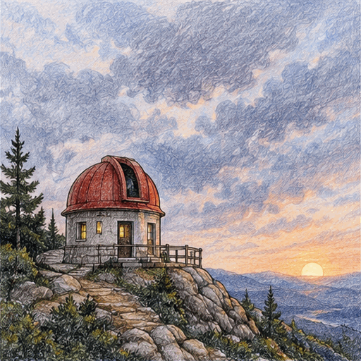

<!-- Generated by scripts/build_readme.py. Edit source data, locale catalogs and generator scripts. -->

<a id="top"></a>

[](https://raphael.app/?utm_source=github&utm_medium=repository&utm_campaign=gpt_image_2_6_launch&utm_content=hero&utm_term=th-TH)

# 🚀 รวมพรอมป์ต์ GPT Image 2.6

[](https://github.com/sindresorhus/awesome)
[](https://github.com/RaphaelAI-OpenLab/awesome-gpt-image-2.6-prompts)
[](LICENSE)
[](https://github.com/RaphaelAI-OpenLab/awesome-gpt-image-2.6-prompts/actions/workflows/validate.yml)
[](CONTRIBUTING.md)

> 🎨 รวมพรอมต์และตัวอย่างภาพคัดสรรสำหรับ GPT Image 2.6 และ ChatGPT Images 2.6 ครอบคลุม Flare & Sunburst, พรอมต์ GIF เนทีฟ, พรอมต์เวกเตอร์ SVG และการแก้ไขภาพด้วยมาร์กอัป

> ⚠️ **ประกาศลิขสิทธิ์**: คอลเลกชันนี้ประกอบด้วยพรอมป์ต์และตัวอย่างจากแหล่งข้อมูลสาธารณะ รวมถึงภาพที่สร้างขึ้นอย่างอิสระ โดยทั้งหมดมีไว้เพื่อการศึกษาเท่านั้น หากคุณเห็นว่าเนื้อหาใดละเมิดสิทธิ์ของคุณ โปรด [เปิด Issue](https://github.com/RaphaelAI-OpenLab/awesome-gpt-image-2.6-prompts/issues/new?template=report-problem.yml) แล้วเราจะนำเนื้อหานั้นออกทันที

---

<a href="README.md"></a> <a href="README.zh-CN.md"></a> <a href="README.zh-TW.md"></a> <a href="README.ja-JP.md"></a><br />
<a href="README.ko-KR.md"></a> <a href="README.th-TH.md"></a> <a href="README.vi-VN.md"></a> <a href="README.hi-IN.md"></a><br />
<a href="README.es-ES.md"></a> <a href="README.es-419.md"></a> <a href="README.de-DE.md"></a> <a href="README.fr-FR.md"></a><br />
<a href="README.it-IT.md"></a> <a href="README.pt-BR.md"></a> <a href="README.pt-PT.md"></a> <a href="README.tr-TR.md"></a>

---

ฉบับภาษานี้แปลส่วนอินเทอร์เฟซของคลังโค้ด ขณะนี้รายละเอียดกรณีตัวอย่างฉบับเต็มมีให้ในภาษาอังกฤษและภาษาจีนตัวย่อ

ชื่อ คำอธิบาย และหน้ารายละเอียดของกรณีตัวอย่างจะแสดงเป็นภาษาอังกฤษเมื่อยังไม่มีคำแปล พรอมป์ต์ต้นฉบับและข้อความอ้างอิงจากแหล่งที่มาจะไม่ถูกแปล

<a id="gallery"></a>

## 🌐 ดูในแกลเลอรีบนเว็บ

**[👉 ดูแกลเลอรีพรอมต์ GPT Image 2.6 บน Raphael](https://raphael.app/gpt-image-2-6-prompts?utm_source=github&utm_medium=repository&utm_campaign=gpt_image_2_6_launch&utm_content=top_cta&utm_term=th-TH)**

**[📝 พรอมป์ต์ฉบับเต็ม](README.md#collection)**

ทำไมจึงควรสร้างผลงานบนเว็บไซต์?

| ฟีเจอร์ | GitHub README | เว็บไซต์ Raphael |
| --- | --- | --- |
| 🆓 สร้างภาพฟรี | ดูตัวอย่างและพรอมป์ต์ | สร้างภาพในโหมดพื้นฐานฟรี ไม่ต้องเข้าสู่ระบบหรือผูกบัตรเครดิต |
| ✍️ การใช้พรอมป์ต์ | คัดลอกพรอมป์ต์ที่เผยแพร่แล้ว | วางพรอมป์ต์แล้วสร้างภาพได้ทันที |
| 🖼️ แก้ไขด้วยภาพอ้างอิง | ดูภาพอ้างอิงและข้อมูลที่ต้องใช้ | อัปโหลดภาพอ้างอิงเพื่อช่วยสร้างและแก้ไขภาพ |
| 🤖 เลือกโมเดล | ดูว่าแต่ละตัวอย่างใช้โมเดลใด | เลือก GPT Image, Seedream, Nano Banana และโมเดลอื่น ๆ |
| 🎨 สไตล์และขนาด | ดูสไตล์และการตั้งค่าที่แหล่งข้อมูลบันทึกไว้ | เลือกสไตล์ อัตราส่วนภาพ และรูปแบบไฟล์ |
| 🔄 ลองหลายเวอร์ชัน | เปรียบเทียบผลลัพธ์ของตัวอย่างที่รวบรวมไว้ | สร้างได้สูงสุด 4 ภาพต่อพรอมป์ต์ในครั้งเดียว |
| 🛠️ เครื่องมือภาพ | อ่านขั้นตอนการแก้ไขภาพ | ลบพื้นหลัง เพิ่มความละเอียด ขยายขอบภาพ และแก้ไขเฉพาะจุด |
| 📱 มือถือ | อ่านตัวอย่าง | สร้างและแก้ไขภาพผ่านเบราว์เซอร์บนมือถือ |

การสร้างภาพฟรีใช้โหมดพื้นฐาน ส่วนโมเดลอื่นมีข้อกำหนดเรื่องเครดิตและแพ็กเกจตามที่แสดงบนเว็บไซต์

[ดูกรณีตัวอย่างทั้งหมดในคลังโค้ดนี้ →](#all-cases)

<a id="categories"></a>

## 🏷️ ดูตามหมวดหมู่

[ทั้งหมด (202)](README.md#all-cases) · [GIF และแอนิเมชัน (90)](README.md#category-gif-animation) · [ตัวละครและความสม่ำเสมอ (27)](README.md#category-characters-consistency) · [อินโฟกราฟิก (21)](README.md#category-infographics) · [ภาพสำหรับแบรนด์และผลิตภัณฑ์ (16)](README.md#category-brand-products) · [โปสเตอร์และการจัดวางตัวอักษร (16)](README.md#category-posters-typography) · [SVG และทรัพยากรงานออกแบบ (13)](README.md#category-svg-design-assets) · [การทำเครื่องหมายและการแก้ไขเฉพาะจุด (11)](README.md#category-markup-edits) · [การตกแต่งภายในและสถาปัตยกรรม (8)](README.md#category-interiors-architecture)

<a id="contents"></a>

## 📖 สารบัญ

- [GPT Image 2.6 (ChatGPT Images 2.6) คืออะไร?](#about)
- [คู่มือเริ่มต้นเร็ว OpenAI API (Flare & Sunburst)](#api-quickstart)
- [สถิติ](#statistics)
- [กรณีตัวอย่างเด่น](#featured)
- [กรณีตัวอย่างทั้งหมด](#all-cases)
- [เพิ่มล่าสุด](#cms-latest)
- [พรอมป์ต์ฉบับเต็ม](README.md#collection)
- [วิธีใช้](#using)
- [ร่วมพัฒนา](#contribute)
- [สัญญาอนุญาต](#license)
- [กิตติกรรมประกาศ](#acknowledgements)
- [ประวัติดาว](#star-history)

<a id="about"></a>

## 🤔 GPT Image 2.6 (ChatGPT Images 2.6) คืออะไร?

OpenAI เปิดตัว Images 2.6 (ChatGPT Images 2.6 / GPT Image 2.6) เมื่อวันที่ 4 พฤศจิกายน 2026 พร้อมโมเดล API สองรุ่นคือ `gpt-image-2.6-sunburst` และ `gpt-image-2.6-flare` คอลเลกชันนี้รวบรวมพรอมต์ที่คัดลอกได้และตัวอย่างภาพสำหรับการสร้างภาพ การแก้ไขด้วยมาร์กอัป พรอมต์ GIF เนทีฟ และพรอมต์เวกเตอร์ SVG โดยบันทึกรุ่นที่รองรับแยกตามแต่ละกรณีโดยไม่คาดเดา

[ประกาศอย่างเป็นทางการ](https://openai.com/index/introducing-images-2-6/) · [เอกสารโมเดล](https://developers.openai.com/api/docs/guides/image-generation)

### เปรียบเทียบ GPT-Image-2.6 Flare vs Sunburst และเวิร์กโฟลว์หลัก

| รุ่น / เวิร์กโฟลว์ | เหมาะสำหรับ | ดูตัวอย่าง |
| --- | --- | --- |
| GPT-Image-2.6 Sunburst (`gpt-image-2.6-sunburst`) | รายละเอียดสูง เลย์เอาต์ซับซ้อน ตัวอักษรคมชัด ความต่อเนื่องของตัวละครหลายขั้นตอน รวมถึง GIF และ SVG เนทีฟ | [กรณีตัวอย่างเด่น](#featured) |
| GPT-Image-2.6 Flare (`gpt-image-2.6-flare`) | ความหน่วงต่ำ ทดลองปรับแก้เร็ว ร่างภาพไว สร้างจำนวนมาก แก้ไขด้วยมาร์กอัป รวมถึง GIF และ SVG | [กรณีตัวอย่างทั้งหมด](README.md#all-cases) |
| พรอมต์ GIF เนทีฟ (Native GIF Prompts) | GIF เคลื่อนไหววนซ้ำแบบเนียน (`output_format: gif`, 2–16 เฟรม) สำหรับสติกเกอร์ เดโม และสตอรี่บอร์ด | [GIF และแอนิเมชัน](README.md#category-gif-animation) |
| พรอมต์เวกเตอร์ SVG (SVG Vector Prompts) | โลโก้เวกเตอร์ ไอคอน แนวคิด UI และชิ้นงานดีไซน์ที่แก้ไขได้สะอาดตา (`output_format: svg`) | [SVG และทรัพยากรงานออกแบบ](README.md#category-svg-design-assets) |
| การแก้ไขภาพด้วยมาร์กอัป (Markup-Guided Editing) | วงกลมหรือทำเครื่องหมายบนภาพอ้างอิงเพื่อเปลี่ยนสี สลับวัตถุ หรือแปลเลย์เอาต์อย่างแม่นยำ | [การทำเครื่องหมายและการแก้ไขเฉพาะจุด](README.md#category-markup-edits) |

<a id="api-quickstart"></a>

## ⚡ คู่มือเริ่มต้นเร็ว OpenAI API (Flare & Sunburst)

คัดลอกพรอมต์จากคอลเลกชันนี้ไปรันกับ OpenAI Images API ได้ทันที (`gpt-image-2.6-flare` เน้นความเร็ว หรือ `gpt-image-2.6-sunburst` เน้นรายละเอียดสูง)

```python
import base64
from openai import OpenAI

client = OpenAI()  # Reads OPENAI_API_KEY from environment

# 1) High-detail still image with GPT-Image-2.6 Sunburst (or "gpt-image-2.6-flare" for speed)
image = client.images.generate(
    model="gpt-image-2.6-sunburst",
    prompt="Editorial studio photo of a cobalt ceramic vase on warm oak, soft morning light",
    size="1024x1024",
    quality="high",
)

# 2) Native looping GIF prompt (output_format="gif", 2-16 frames)
gif = client.images.generate(
    model="gpt-image-2.6-flare",
    prompt="A tiny lantern-carrying monkey in a snowy pine forest at dusk, seamless loop animation",
    output_format="gif",
    frame_count=8,
    frame_duration_ms=150,
)
with open("loop.gif", "wb") as f:
    f.write(base64.b64decode(gif.data[0].b64_json))

# 3) Editable SVG vector prompt (output_format="svg")
svg = client.images.generate(
    model="gpt-image-2.6-sunburst",
    prompt="Minimalist bakery logo 'Field & Flour', clean vector silhouette, warm balanced negative space",
    output_format="svg",
)
with open("logo.svg", "wb") as f:
    f.write(base64.b64decode(svg.data[0].b64_json))
```

```bash
curl https://api.openai.com/v1/images/generations \
  -H "Content-Type: application/json" \
  -H "Authorization: Bearer $OPENAI_API_KEY" \
  -d '{
    "model": "gpt-image-2.6-flare",
    "prompt": "Minimalist geometric bakery logo on cream paper, clean vector aesthetic",
    "size": "1024x1024",
    "output_format": "svg"
  }'
```

<a id="statistics"></a>

## 📊 สถิติ

| **ตัวชี้วัด** | **จำนวน** |
| --- | --- |
| 📝 พรอมป์ต์ทั้งหมด | **156** |
| ⭐ คัดสรร | **12** |
| 🗂️ จำนวนสื่อใน CMS | **56** |
| 🔄 อัปเดตล่าสุด | **2026-11-28 UTC 00:02:43** |

<!-- cms-stats 56 2026-11-28T00:02:43Z -->

<a id="featured"></a>

## 🔥 กรณีตัวอย่างเด่น

<a id="featured-case-launch-higgsfield"></a>

### 38. [Knight scene and clothing edit sequence](README.md#source-case-launch-higgsfield)

<div align="center">
<a href="assets/examples/launch-higgsfield/source-01.webp"></a><br /><sub>Source image 1</sub>
</div>

<div align="center">
<a href="assets/examples/launch-higgsfield/source-02.webp"></a><br /><sub>Source image 2</sub>
</div>

<div align="center">
<a href="assets/examples/launch-higgsfield/source-03.webp"></a><br /><sub>Source image 3</sub>
</div>

**พรอมป์ต์ต้นฉบับ**

**Starting image · Character and scene**

```text
Epic high fantasy anime key visual, mature seinen style like a modern high-budget anime film. A young woman sorceress-knight in her twenties with long crimson hair and sharp golden eyes stands on the edge of a cliff in ornate silver and emerald armor with a flowing royal blue cape, a glowing runic sword planted in front of her, magic sparks around her hands. Behind her a vast fantasy kingdom: floating islands with waterfalls pouring into the clouds, a white castle with spires, a huge ancient dragon flying in the distance, giant blooming sakura and golden autumn forests in the valley below. Sunset sky with vivid orange, magenta, turquoise and violet clouds, god rays, glowing magic particles in the air. Extremely vibrant saturated colors, dramatic rim lighting, cel shading with detailed painted backgrounds, crisp clean line art, depth and atmosphere, dynamic low camera angle, wide cinematic composition. Adult, elegant, serious heroic mood, not childish, no chibi, no sci-fi, no neon, no text, no watermark.
```

**Edit 1 · Sunset valley**

```text
Replace the moonlit landscape with a golden sunset over a misty mountain valley, winding river, waterfalls and ancient ruins. Keep the background softly blurred and the knight, armor, sword, rock and composition unchanged.
```

**Edit 2 · Floating castle**

```text
Replace the background with a majestic floating castle, smaller floating islands, cascading waterfalls and a dragon flying overhead. Preserve the warm sunset, atmospheric haze and shallow depth of field. Keep the knight and foreground unchanged.
```

**Edit 3 · Recolor armor**

```text
Recolor the armor to ivory white with rich gold trim, replace emerald gemstones with rubies, and change green fabric panels to deep crimson. Preserve the armor design, blue cape, red hair, golden sword glow, pose and background.
```

Use the edits in order, passing the previous output into the next edit. The official page includes the starting-image prompt alongside Edit 1; the three archived images show the edited results.

[พรอมป์ต์ต้นฉบับที่แหล่งที่มา](https://openai.com/index/introducing-images-2-6/#more-ways-to-create-and-edit-in-the-api)

**ผู้สร้าง**: [Higgsfield](https://openai.com/index/introducing-images-2-6/#more-ways-to-create-and-edit-in-the-api)

**แหล่งที่มาต้นฉบับ**: [เดโมเปิดตัวอย่างเป็นทางการ](https://openai.com/index/introducing-images-2-6/#more-ways-to-create-and-edit-in-the-api) · [รายละเอียดแหล่งที่มา](cases/launch-higgsfield/README.md)

**[👉 ลองเลย →](https://raphael.app/gpt-image-2-6-prompts?utm_source=github&utm_medium=repository&utm_campaign=gpt_image_2_6_launch&utm_content=case_gallery_launch-higgsfield&utm_term=th-TH)**

---

<a id="featured-case-raphael-observatory-weather-cycle"></a>

### 95. [Observatory through four skies](README.md#source-case-raphael-observatory-weather-cycle)

<div align="center">
<a href="assets/examples/raphael-observatory-weather-cycle/observatory-weather-cycle.gif"></a><br /><sub>Observatory through four skies</sub>
</div>

**พรอมป์ต์ต้นฉบับ**

```text
A small red-domed observatory on a rocky bluff against a locked circular composition, illustrated as colored pencil over paper. Clouds give way to a shower, dawn rainbow, clear starry sky and then back to drifting clouds. Preserve the building and horizon in every frame. Soft weather transitions in a short square loop.
```

[พรอมป์ต์ต้นฉบับ (.txt)](cases/raphael-observatory-weather-cycle/prompt.txt)


**ผู้สร้าง**: Raphael

[รายละเอียดแหล่งที่มา](cases/raphael-observatory-weather-cycle/README.md)

**[👉 ลองเลย →](https://raphael.app/gpt-image-2-6-prompts?utm_source=github&utm_medium=repository&utm_campaign=gpt_image_2_6_launch&utm_content=case_gallery_raphael-observatory-weather-cycle&utm_term=th-TH)**

---

<a id="featured-case-docs-bakery-svg"></a>

### 66. [Bakery SVG logo](README.md#source-case-docs-bakery-svg)

<div align="center">
<a href="assets/examples/docs-bakery-svg/field-and-flour-gpt-image-2-6-flare.svg"></a><br /><sub>Flare SVG logo</sub>
</div>

<div align="center">
<a href="assets/examples/docs-bakery-svg/field-and-flour-gpt-image-2-6-sunburst.svg"></a><br /><sub>Sunburst SVG logo</sub>
</div>

**พรอมป์ต์ต้นฉบับ**

```text
Create an original, non-infringing logo for a company called Field & Flour, a local bakery.
The logo should feel warm, simple, and timeless. Use clean, vector-like shapes, a strong silhouette, and balanced negative space.
Favor simplicity over detail so it reads clearly at small and large sizes. Flat design, minimal strokes, no gradients unless essential.
Fully transparent background. Deliver a single centered logo with generous padding, clean alpha edges, and no solid backdrop, scenery, checkerboard, or watermark.
```

[พรอมป์ต์ต้นฉบับที่แหล่งที่มา](https://developers.openai.com/api/docs/guides/image-prompting#generate-svg-output)

**ผู้สร้าง**: [OpenAI](https://developers.openai.com/api/docs/guides/image-prompting#generate-svg-output)

**แหล่งที่มาต้นฉบับ**: [เอกสารอย่างเป็นทางการ](https://developers.openai.com/api/docs/guides/image-prompting#generate-svg-output) · [รายละเอียดแหล่งที่มา](cases/docs-bakery-svg/README.md)

**[👉 ลองเลย →](https://raphael.app/gpt-image-2-6-prompts?utm_source=github&utm_medium=repository&utm_campaign=gpt_image_2_6_launch&utm_content=case_gallery_docs-bakery-svg&utm_term=th-TH)**

---

<a id="featured-case-raphael-greenhouse-day-to-night"></a>

### 97. [Greenhouse from dawn through night](README.md#source-case-raphael-greenhouse-day-to-night)

<div align="center">
<a href="assets/examples/raphael-greenhouse-day-to-night/greenhouse-day-to-night.gif"></a><br /><sub>Greenhouse from dawn through night</sub>
</div>

**พรอมป์ต์ต้นฉบับ**

```text
Seen from outside, a tiny steel-framed desert greenhouse holds several tall cacti. Pink dawn sweeps into turquoise afternoon glass, then deep violet night with a single interior grow lamp and back to dawn. Fixed wide composition and architecture, softly textured gouache, smooth light changes in a brief ambient loop, no text.
```

[พรอมป์ต์ต้นฉบับ (.txt)](cases/raphael-greenhouse-day-to-night/prompt.txt)


**ผู้สร้าง**: Raphael

[รายละเอียดแหล่งที่มา](cases/raphael-greenhouse-day-to-night/README.md)

**[👉 ลองเลย →](https://raphael.app/gpt-image-2-6-prompts?utm_source=github&utm_medium=repository&utm_campaign=gpt_image_2_6_launch&utm_content=case_gallery_raphael-greenhouse-day-to-night&utm_term=th-TH)**

---

<a id="featured-case-social-cyan-poetry-wet-portrait"></a>

### 46. [Glowing cyan poetry and equations on wet skin](README.md#source-case-social-cyan-poetry-wet-portrait)

<div align="center">
<a href="assets/examples/social-cyan-poetry-wet-portrait/source-01.jpg"></a><br /><sub>Glowing cyan poetry and equations on wet skin</sub>
</div>

**พรอมป์ต์ต้นฉบับ**

```text
A cinematic, ultra-realistic close-up portrait of a young woman with wet, tousled dark hair and luminous skin, staring directly into the camera with an intense, introspective expression. Glowing cyan handwritten text and symbols are projected across her face, neck, and shoulders, resembling poetic phrases, equations, and abstract handwriting. The light reflections shimmer on her damp skin, creating a futuristic, cyber-poetry aesthetic. Dark,moody background with soft shadows, shallow depth of field, sharp focus on the eyes, high contrast lighting, teal and blue color palette, hyper-detailed skin texture, photorealistic, dramatic atmosphere, cyberpunk meets fine-art portrait photography, 8K quality, cinematic lighting.
```

[พรอมป์ต์ต้นฉบับ (.txt)](cases/social-cyan-poetry-wet-portrait/prompt.txt)

[พรอมป์ต์ต้นฉบับที่แหล่งที่มา](https://x.com/iamsofiaijaz/status/2118561558511132918)

**ผู้สร้าง**: [iamsofiaijaz](https://x.com/iamsofiaijaz)

**แหล่งที่มาต้นฉบับ**: [โมเดลที่ผู้สร้างระบุ](https://x.com/iamsofiaijaz/status/2118561513879507399) · [รายละเอียดแหล่งที่มา](cases/social-cyan-poetry-wet-portrait/README.md)

**[👉 ลองเลย →](https://raphael.app/gpt-image-2-6-prompts?utm_source=github&utm_medium=repository&utm_campaign=gpt_image_2_6_launch&utm_content=case_gallery_social-cyan-poetry-wet-portrait&utm_term=th-TH)**

---

<a id="featured-case-raphael-moon-jelly-aquarium"></a>

### 100. [Moon jelly aquarium](README.md#source-case-raphael-moon-jelly-aquarium)

<div align="center">
<a href="assets/examples/raphael-moon-jelly-aquarium/moon-jelly-aquarium.gif"></a><br /><sub>Moon jelly aquarium</sub>
</div>

**พรอมป์ต์ต้นฉบับ**

```text
A pair of tiny moon jellies drift in a tall cylindrical aquarium, backlit in pale aqua and lavender against indigo. Their bells pulse in a gently offset rhythm and fine suspended specks drift upward as the two jellyfish return to their original arrangement. Macro photography look, camera locked, no type, ambient loop.
```

[พรอมป์ต์ต้นฉบับ (.txt)](cases/raphael-moon-jelly-aquarium/prompt.txt)


**ผู้สร้าง**: Raphael

[รายละเอียดแหล่งที่มา](cases/raphael-moon-jelly-aquarium/README.md)

**[👉 ลองเลย →](https://raphael.app/gpt-image-2-6-prompts?utm_source=github&utm_medium=repository&utm_campaign=gpt_image_2_6_launch&utm_content=case_gallery_raphael-moon-jelly-aquarium&utm_term=th-TH)**

---

<a id="featured-case-docs-pixel-style"></a>

### 57. [Transfer a pixel-art style](README.md#source-case-docs-pixel-style)

<div align="center">
<a href="assets/examples/docs-pixel-style/motorcycle-gpt-image-2-6-flare.webp"></a><br /><sub>Pixel-art motorcycle rider using the reference style — GPT Image 2.6 Flare (official model output)</sub>
</div>

<div align="center">
<a href="assets/examples/docs-pixel-style/motorcycle-gpt-image-2-6-sunburst.webp"></a><br /><sub>Pixel-art motorcycle rider using the reference style — GPT Image 2.6 Sunburst (official model output)</sub>
</div>

**ภาพอ้างอิง**

ภาพอ้างอิง / ภาพนำเข้า ไม่ใช่ผลลัพธ์ที่สร้างด้วยโมเดล

<div align="center">
<a href="assets/references/docs-pixel-style/pixels.webp"></a><br /><sub>Reference input: Pixel-art game screen used as a style reference</sub>
</div>


**พรอมป์ต์ต้นฉบับ**

```text
Use the same style from the input image and generate a man riding a motorcycle on a white background.
```

[พรอมป์ต์ต้นฉบับที่แหล่งที่มา](https://developers.openai.com/api/docs/guides/image-prompting#transfer-a-visual-style)

**ผู้สร้าง**: [OpenAI](https://developers.openai.com/api/docs/guides/image-prompting#transfer-a-visual-style)

**แหล่งที่มาต้นฉบับ**: [เอกสารอย่างเป็นทางการ](https://developers.openai.com/api/docs/guides/image-prompting#transfer-a-visual-style) · [รายละเอียดแหล่งที่มา](cases/docs-pixel-style/README.md)

**[👉 ลองเลย →](https://raphael.app/gpt-image-2-6-prompts?utm_source=github&utm_medium=repository&utm_campaign=gpt_image_2_6_launch&utm_content=case_gallery_docs-pixel-style&utm_term=th-TH)**

---

<a id="featured-case-raphael-sketchbook-bicycle"></a>

### 108. [Sketchbook bicycle comes alive](README.md#source-case-raphael-sketchbook-bicycle)

<div align="center">
<a href="assets/examples/raphael-sketchbook-bicycle/sketchbook-bicycle.gif"></a><br /><sub>Sketchbook bicycle comes alive</sub>
</div>

**พรอมป์ต์ต้นฉบับ**

```text
A sketchbook close-up with a simple cobalt pen doodle of a tiny bicycle. The wheels start spinning and a pennant flutters, then the bicycle rides in one small circle on the page and returns to its original outline. Keep the paper and camera fixed, no hands or text, whimsical looping animation.
```

[พรอมป์ต์ต้นฉบับ (.txt)](cases/raphael-sketchbook-bicycle/prompt.txt)


**ผู้สร้าง**: Raphael

[รายละเอียดแหล่งที่มา](cases/raphael-sketchbook-bicycle/README.md)

**[👉 ลองเลย →](https://raphael.app/gpt-image-2-6-prompts?utm_source=github&utm_medium=repository&utm_campaign=gpt_image_2_6_launch&utm_content=case_gallery_raphael-sketchbook-bicycle&utm_term=th-TH)**

---

<a id="featured-case-docs-market-ui"></a>

### 67. [Farmers market mobile interface](README.md#source-case-docs-market-ui)

<div align="center">
<a href="assets/examples/docs-market-ui/ui-farmers-market-gpt-image-2-6-flare.webp"></a><br /><sub>Farmers market mobile app mockup — GPT Image 2.6 Flare (official model output)</sub>
</div>

<div align="center">
<a href="assets/examples/docs-market-ui/ui-farmers-market-gpt-image-2-6-sunburst.webp"></a><br /><sub>Farmers market mobile app mockup — GPT Image 2.6 Sunburst (official model output)</sub>
</div>

**พรอมป์ต์ต้นฉบับ**

```text
Create a realistic mobile app UI mockup for a local farmers market.
Show today’s market with a simple header, a short list of vendors with small photos and categories, a small “Today’s specials” section, and basic information for location and hours.
Design it to be practical, and easy to use. White background, subtle natural accent colors, clear typography, and minimal decoration.
It should look like a real, well-designed, beautiful app for a small local market.
Place the UI mockup in an iPhone frame.
```

[พรอมป์ต์ต้นฉบับที่แหล่งที่มา](https://developers.openai.com/api/docs/guides/image-prompting#create-an-interface-preview)

**ผู้สร้าง**: [OpenAI](https://developers.openai.com/api/docs/guides/image-prompting#create-an-interface-preview)

**แหล่งที่มาต้นฉบับ**: [เอกสารอย่างเป็นทางการ](https://developers.openai.com/api/docs/guides/image-prompting#create-an-interface-preview) · [รายละเอียดแหล่งที่มา](cases/docs-market-ui/README.md)

**[👉 ลองเลย →](https://raphael.app/gpt-image-2-6-prompts?utm_source=github&utm_medium=repository&utm_campaign=gpt_image_2_6_launch&utm_content=case_gallery_docs-market-ui&utm_term=th-TH)**

---

<a id="featured-case-raphael-pixel-greenhouse-sprinkler"></a>

### 109. [Pixel greenhouse sprinkler](README.md#source-case-raphael-pixel-greenhouse-sprinkler)

<div align="center">
<a href="assets/examples/raphael-pixel-greenhouse-sprinkler/pixel-greenhouse-sprinkler.gif"></a><br /><sub>Pixel greenhouse sprinkler</sub>
</div>

**พรอมป์ต์ต้นฉบับ**

```text
A cozy pixel-art greenhouse at dusk: mint roof panes, terra-cotta pots and a tiny sprinkler rotating above a shelf of seedlings. The sprinkler sprays a few bright pixels in two directions and returns to its first angle. Stable scene, limited 16-bit palette, crisp square pixels, no text, seamless loop.
```

[พรอมป์ต์ต้นฉบับ (.txt)](cases/raphael-pixel-greenhouse-sprinkler/prompt.txt)


**ผู้สร้าง**: Raphael

[รายละเอียดแหล่งที่มา](cases/raphael-pixel-greenhouse-sprinkler/README.md)

**[👉 ลองเลย →](https://raphael.app/gpt-image-2-6-prompts?utm_source=github&utm_medium=repository&utm_campaign=gpt_image_2_6_launch&utm_content=case_gallery_raphael-pixel-greenhouse-sprinkler&utm_term=th-TH)**

---

<a id="featured-case-docs-vase-markup"></a>

### 55. [Recolor a marked vase](README.md#source-case-docs-vase-markup)

<div align="center">
<a href="assets/examples/docs-vase-markup/markup-vase-gpt-image-2-6-flare.webp"></a><br /><sub>GPT Image 2.6 Flare output: Flare edit of the kitchen with a blue vase and dried stems on the table</sub>
</div>

<div align="center">
<a href="assets/examples/docs-vase-markup/markup-vase-gpt-image-2-6-sunburst.webp"></a><br /><sub>GPT Image 2.6 Sunburst output: Sunburst edit of the kitchen with the same vase in cobalt blue and the red circle removed</sub>
</div>

**ภาพอ้างอิง**

ภาพอ้างอิง / ภาพนำเข้า ไม่ใช่ผลลัพธ์ที่สร้างด้วยโมเดล

<div align="center">
<a href="assets/references/docs-vase-markup/markup-vase-input-gpt-image-2-6.webp"></a><br /><sub>Reference input: Kitchen photo with a red circle around the striped vase on the dining table</sub>
</div>


**พรอมป์ต์ต้นฉบับ**

```text
Recolor the striped vase inside the red circle to solid cobalt blue ceramic. Keep its shape, the dried stems, and the rest of the kitchen unchanged. Remove the red circle from the finished photo.
```

[พรอมป์ต์ต้นฉบับที่แหล่งที่มา](https://developers.openai.com/api/docs/guides/image-prompting#guide-an-edit-with-markup)

**ผู้สร้าง**: [OpenAI](https://developers.openai.com/api/docs/guides/image-prompting#guide-an-edit-with-markup)

**แหล่งที่มาต้นฉบับ**: [เอกสารอย่างเป็นทางการ](https://developers.openai.com/api/docs/guides/image-prompting#guide-an-edit-with-markup) · [รายละเอียดแหล่งที่มา](cases/docs-vase-markup/README.md)

**[👉 ลองเลย →](https://raphael.app/gpt-image-2-6-prompts?utm_source=github&utm_medium=repository&utm_campaign=gpt_image_2_6_launch&utm_content=case_gallery_docs-vase-markup&utm_term=th-TH)**

---

<a id="featured-case-community-struggle-sailor-dance"></a>

### 121. [Moonlit magical-girl dance](README.md#source-case-community-struggle-sailor-dance)

<div align="center">
<a href="assets/examples/community-struggle-sailor-dance/9ff4f428146eff32d28f14d3db8d46d1.gif"></a><br /><sub>Magical girl dancing at night</sub>
</div>

**พรอมป์ต์ต้นฉบับ**

```text
创建一个 GIF，内容是 一位美少女战士在跳舞
```

[พรอมป์ต์ต้นฉบับที่แหล่งที่มา](https://tianqi.csdn.net/6aebfbae40858c2d8818a1fd.html#devmenu4)

**ผู้สร้าง**: [STRUGGLE_xlf](https://tianqi.csdn.net/6aebfbae40858c2d8818a1fd.html#devmenu4)

**แหล่งที่มาต้นฉบับ**: [โมเดลที่ผู้สร้างระบุ](https://tianqi.csdn.net/6aebfbae40858c2d8818a1fd.html#devmenu4) · [รายละเอียดแหล่งที่มา](cases/community-struggle-sailor-dance/README.md)

**[👉 ลองเลย →](https://raphael.app/gpt-image-2-6-prompts?utm_source=github&utm_medium=repository&utm_campaign=gpt_image_2_6_launch&utm_content=case_gallery_community-struggle-sailor-dance&utm_term=th-TH)**

---

ภาพตัวอย่างวิดีโอเป็นเฟรมแรก เปิดไฟล์ที่ลิงก์ไว้เพื่อดูการเคลื่อนไหว ภาพอ้างอิงและโปสเตอร์ต้นฉบับระบุแยกกัน

<a id="all-cases"></a>

## 📋 กรณีตัวอย่างทั้งหมด

ฉบับภาษานี้ประกอบด้วยภาพรวมที่แปลแล้ว คู่มือเริ่มต้นเร็ว API สถิติล่าสุด และเคสเด่นทั้งหมด เพื่อไม่ให้มีพรอมต์ภาษาอังกฤษซ้ำซ้อนกัน 14 ไฟล์ กรุณาเลือกดูดัชนีครบ 202 เคสตามหมวดหมู่ด้านล่างหรือเปิดแกลเลอรีบนเว็บ

| หมวดหมู่ | จำนวนเคส | ดูตัวอย่าง |
| --- | ---: | --- |
| GIF และแอนิเมชัน | **90** | [อ่านเป็นภาษาอังกฤษ](README.md#category-gif-animation) |
| ตัวละครและความสม่ำเสมอ | **27** | [อ่านเป็นภาษาอังกฤษ](README.md#category-characters-consistency) |
| อินโฟกราฟิก | **21** | [อ่านเป็นภาษาอังกฤษ](README.md#category-infographics) |
| ภาพสำหรับแบรนด์และผลิตภัณฑ์ | **16** | [อ่านเป็นภาษาอังกฤษ](README.md#category-brand-products) |
| โปสเตอร์และการจัดวางตัวอักษร | **16** | [อ่านเป็นภาษาอังกฤษ](README.md#category-posters-typography) |
| SVG และทรัพยากรงานออกแบบ | **13** | [อ่านเป็นภาษาอังกฤษ](README.md#category-svg-design-assets) |
| การทำเครื่องหมายและการแก้ไขเฉพาะจุด | **11** | [อ่านเป็นภาษาอังกฤษ](README.md#category-markup-edits) |
| การตกแต่งภายในและสถาปัตยกรรม | **8** | [อ่านเป็นภาษาอังกฤษ](README.md#category-interiors-architecture) |

**[👉 ดูคอลเลกชันฉบับเต็มภาษาอังกฤษ (ครบทั้ง 202 เคส) →](README.md#all-cases)**

[เปิดเว็บแกลเลอรี Raphael ภาษาไทย ↗](https://raphael.app/th/gpt-image-2-6-prompts?utm_source=github&utm_medium=repository&utm_campaign=gpt_image_2_6_launch&utm_content=localized_all_cases&utm_term=th-TH)

<a id="cms-latest"></a>

## 🆕 เพิ่มล่าสุด (56)

[เพิ่มล่าสุด (56) →](README.md#cms-latest)

<a id="using"></a>

## 📚 วิธีใช้

1. เปิดกรณีตัวอย่างจากหมวดหมู่หรือการ์ดกรณีตัวอย่างเด่น
2. อ่านหลักฐานเกี่ยวกับโมเดล ข้อมูลนำเข้าที่จำเป็น แหล่งที่มา และข้อจำกัดการนำกลับมาใช้
3. เปิดลิงก์พรอมป์ต์ต้นฉบับเมื่อมีให้ หากไม่มีพรอมป์ต์ ให้ระบุว่าไม่มีต่อไป อย่าคาดเดาจากภาพ

<a id="contribute"></a>

## 🤝 วิธีร่วมพัฒนา

เพิ่มตัวอย่างที่มีแหล่งที่มาใน content/source-cases.json และพรอมป์ต์ฉบับเต็มใน content/prompts.json ตัวสร้างจะสร้างดัชนีและหน้ารายละเอียดภาษาอังกฤษและจีน

[คู่มือการร่วมพัฒนา](CONTRIBUTING.md) · [คู่มือกรณีตัวอย่างจากแหล่งที่มาและสื่อ](docs/SOURCE_CASES.md) · [คู่มือหลายภาษา](docs/LANGUAGES.md)

<a id="license"></a>

## 📄 สัญญาอนุญาต

โค้ด เอกสารที่เขียนขึ้นเอง และภาพ SVG สำหรับตกแต่งที่ใช้เป็นตัวแทนชั่วคราวใช้สัญญาอนุญาต MIT พรอมป์ต์และสื่อของบุคคลที่สามยังอยู่ภายใต้เงื่อนไขของเจ้าของ โดยมีการบันทึกที่มาและสถานะการนำกลับมาใช้แยกตามรายการ ส่วนรูปแบบ README ที่ดัดแปลงมาจะระบุที่มาแยกไว้ด้านล่าง

[สัญญาอนุญาตของคลังโค้ด](LICENSE) · [หมายเหตุเกี่ยวกับการระบุที่มา](docs/ATTRIBUTION.md)

<a id="acknowledgements"></a>

## 🙏 กิตติกรรมประกาศ

โครงสร้าง README ดัดแปลงจาก awesome-nano-banana-pro-prompts ของ YouMind OpenLab ภายใต้ CC BY 4.0 โดยปรับให้เหมาะกับ GPT Image 2.6 ด้วยข้อความ ข้อมูล และหน้ารายละเอียดในเครื่องที่สร้างขึ้นใหม่ พร้อมระบุส่วนสำรองชั่วคราวอย่างชัดเจน ไม่มีการคัดลอกตัวอย่างผลงานสร้างสรรค์หรือสื่อ

[YouMind README](https://github.com/YouMind-OpenLab/awesome-nano-banana-pro-prompts/blob/main/README_zh.md) · [CC BY 4.0](https://creativecommons.org/licenses/by/4.0/) · [หมายเหตุเกี่ยวกับการระบุที่มา](docs/ATTRIBUTION.md)

ขอขอบคุณ OpenAI และผู้สร้างต้นฉบับที่ระบุเครดิตไว้ในแต่ละหน้ากรณีตัวอย่าง

<a id="star-history"></a>

## ⭐ ประวัติดาว

[ประวัติดาว](https://star-history.com/#RaphaelAI-OpenLab/awesome-gpt-image-2.6-prompts&Date) · [ดูผู้ที่กดดาว](https://github.com/RaphaelAI-OpenLab/awesome-gpt-image-2.6-prompts/stargazers)

[กดดาว / ติดตามคลังโค้ดนี้](https://github.com/RaphaelAI-OpenLab/awesome-gpt-image-2.6-prompts)

[↑ กลับด้านบน](#top)

---

รวบรวมและคัดสรรโดย Raphael [หน้าแรก](https://raphael.app/?utm_source=github&utm_medium=repository&utm_campaign=gpt_image_2_6_launch&utm_content=footer&utm_term=th-TH)

สร้างจากข้อมูลแหล่งที่มาแบบมีโครงสร้าง ให้แก้ไขชุดข้อมูลแล้วสร้างใหม่ อย่าแก้ไขไฟล์นี้โดยตรง
