<!-- Generated by scripts/build_readme.py. Edit source data, locale catalogs and generator scripts. -->

<a id="top"></a>

[](https://raphael.app/?utm_source=github&utm_medium=repository&utm_campaign=gpt_image_2_6_launch&utm_content=hero&utm_term=zh-CN)

# 🚀 GPT Image 2.6 提示词大全

[](https://github.com/sindresorhus/awesome)
[](https://github.com/RaphaelAI-OpenLab/awesome-gpt-image-2.6-prompts)
[](LICENSE)
[](https://github.com/RaphaelAI-OpenLab/awesome-gpt-image-2.6-prompts/actions/workflows/validate.yml)
[](CONTRIBUTING.md)

> 🎨 GPT Image 2.6（ChatGPT Images 2.6）创意提示词与视觉案例精选合集，涵盖 Flare 与 Sunburst、原生 GIF 提示词、SVG 矢量提示词与标注引导局部编辑。

> ⚠️ **版权声明**：本仓库收录公开来源的提示词与案例，以及独立生成的图片，仅供教育目的使用。如果您认为任何内容侵犯了您的权利，请[提交 issue](https://github.com/RaphaelAI-OpenLab/awesome-gpt-image-2.6-prompts/issues/new?template=report-problem.yml)，我们将立即移除。

---

<a href="README.md"></a> <a href="README.zh-CN.md"></a> <a href="README.zh-TW.md"></a> <a href="README.ja-JP.md"></a><br />
<a href="README.ko-KR.md"></a> <a href="README.th-TH.md"></a> <a href="README.vi-VN.md"></a> <a href="README.hi-IN.md"></a><br />
<a href="README.es-ES.md"></a> <a href="README.es-419.md"></a> <a href="README.de-DE.md"></a> <a href="README.fr-FR.md"></a><br />
<a href="README.it-IT.md"></a> <a href="README.pt-BR.md"></a> <a href="README.pt-PT.md"></a> <a href="README.tr-TR.md"></a>

---

<a id="gallery"></a>

## 🌐 在网页图库中查看

**[👉 浏览 Raphael GPT Image 2.6 提示词图库](https://raphael.app/gpt-image-2-6-prompts?utm_source=github&utm_medium=repository&utm_campaign=gpt_image_2_6_launch&utm_content=top_cta&utm_term=zh-CN)**

**[📝 完整提示词](#collection)**

为什么去网站创作？

| 功能 | GitHub README | Raphael 网页端 |
| --- | --- | --- |
| 🆓 免费生图 | 浏览案例与提示词 | 基础生图免费，免登录、免绑卡 |
| ✍️ 提示词使用 | 复制已公开的提示词 | 粘贴提示词，直接生成图片 |
| 🖼️ 参考图编辑 | 查看参考图与输入要求 | 上传参考图，辅助生成与修改图片 |
| 🤖 模型选择 | 查看每个案例使用的模型 | 选择 GPT Image、Seedream、Nano Banana 等模型 |
| 🎨 风格与尺寸 | 参考来源记录的风格与参数 | 选择风格、画幅与输出格式 |
| 🔄 多版本尝试 | 对照已收录的案例效果 | 每条提示词一次最多生成 4 张图 |
| 🛠️ 图片工具 | 阅读图片编辑工作流 | 去背景、放大、扩图与局部修改 |
| 📱 移动端 | 阅读案例 | 在手机浏览器中生成与编辑图片 |

免费生图使用基础模式；其他模型按网页显示的积分与套餐要求使用。

[浏览仓库内全部案例 →](#all-cases)

<a id="categories"></a>

## 🏷️ 按分类浏览

[全部 (202)](#all-cases) · [GIF 与动画 (90)](#category-gif-animation) · [角色与一致性 (27)](#category-characters-consistency) · [信息图 (21)](#category-infographics) · [品牌与商品 (16)](#category-brand-products) · [海报与文字排版 (16)](#category-posters-typography) · [SVG 与设计素材 (13)](#category-svg-design-assets) · [标注与局部编辑 (11)](#category-markup-edits) · [室内与建筑 (8)](#category-interiors-architecture)

<a id="contents"></a>

## 📖 目录

- [什么是 GPT Image 2.6（ChatGPT Images 2.6）？](#about)
- [OpenAI API 速查（Flare 与 Sunburst）](#api-quickstart)
- [统计数据](#statistics)
- [精选案例](#featured)
- [全部案例](#all-cases)
- [最近收录](#cms-latest)
- [完整提示词](#collection)
- [如何使用](#using)
- [如何贡献](#contribute)
- [许可证](#license)
- [致谢](#acknowledgements)
- [Star 历史](#star-history)

<a id="about"></a>

## 🤔 什么是 GPT Image 2.6（ChatGPT Images 2.6）？

OpenAI 于 2026 年 11 月 4 日发布 Images 2.6（ChatGPT Images 2.6 / GPT Image 2.6），提供 `gpt-image-2.6-sunburst` 与 `gpt-image-2.6-flare` 两个 API 模型版本。本合集整理了可复制的图像生成、标注引导局部编辑、原生 GIF 动图与 SVG 矢量提示词及案例；具体版本支持情况按每个案例记录，不作推定。

[官方发布说明](https://openai.com/index/introducing-images-2-6/) · [模型文档](https://developers.openai.com/api/docs/guides/image-generation)

### GPT-Image-2.6 Flare vs Sunburst 与核心工作流

| 版本 / 工作流 | 适用场景 | 查看案例 |
| --- | --- | --- |
| GPT-Image-2.6 Sunburst（`gpt-image-2.6-sunburst`） | 高细节画面、复杂排版与精准文字渲染、多轮角色一致性、原生 GIF 与 SVG 输出 | [精选案例](#featured) |
| GPT-Image-2.6 Flare（`gpt-image-2.6-flare`） | 低延迟快速迭代、草图探索、批量高吞吐出图、局部标注编辑、GIF 与 SVG 输出 | [全部案例](#all-cases) |
| 原生 GIF 提示词（Native GIF Prompts） | 无缝循环动图（`output_format: gif`，2–16 帧），适合表情包、产品演示与动态分镜 | [GIF 与动画](#category-gif-animation) |
| SVG 矢量提示词（SVG Vector Prompts） | 清晰可编辑的矢量 Logo、图标、界面概念稿与设计素材（`output_format: svg`） | [SVG 与设计素材](#category-svg-design-assets) |
| 标注引导局部编辑（Markup-Guided Editing） | 在参考图上画圈或标注，精准完成局部换色、物件替换与多语言版式本地化 | [标注与局部编辑](#category-markup-edits) |

<a id="api-quickstart"></a>

## ⚡ OpenAI API 速查（Flare 与 Sunburst）

从本合集复制任意提示词，即可直接通过 OpenAI Images API 调用（追求速度选 `gpt-image-2.6-flare`，追求高细节选 `gpt-image-2.6-sunburst`）。

```python
import base64
from openai import OpenAI

client = OpenAI()  # Reads OPENAI_API_KEY from environment

# 1) High-detail still image with GPT-Image-2.6 Sunburst (or "gpt-image-2.6-flare" for speed)
image = client.images.generate(
    model="gpt-image-2.6-sunburst",
    prompt="Editorial studio photo of a cobalt ceramic vase on warm oak, soft morning light",
    size="1024x1024",
    quality="high",
)

# 2) Native looping GIF prompt (output_format="gif", 2-16 frames)
gif = client.images.generate(
    model="gpt-image-2.6-flare",
    prompt="A tiny lantern-carrying monkey in a snowy pine forest at dusk, seamless loop animation",
    output_format="gif",
    frame_count=8,
    frame_duration_ms=150,
)
with open("loop.gif", "wb") as f:
    f.write(base64.b64decode(gif.data[0].b64_json))

# 3) Editable SVG vector prompt (output_format="svg")
svg = client.images.generate(
    model="gpt-image-2.6-sunburst",
    prompt="Minimalist bakery logo 'Field & Flour', clean vector silhouette, warm balanced negative space",
    output_format="svg",
)
with open("logo.svg", "wb") as f:
    f.write(base64.b64decode(svg.data[0].b64_json))
```

```bash
curl https://api.openai.com/v1/images/generations \
  -H "Content-Type: application/json" \
  -H "Authorization: Bearer $OPENAI_API_KEY" \
  -d '{
    "model": "gpt-image-2.6-flare",
    "prompt": "Minimalist geometric bakery logo on cream paper, clean vector aesthetic",
    "size": "1024x1024",
    "output_format": "svg"
  }'
```

<a id="statistics"></a>

## 📊 统计数据

| **指标** | **数量** |
| --- | --- |
| 📝 提示词总数 | **156** |
| ⭐ 精选 | **12** |
| 🗂️ CMS 素材总数 | **56** |
| 🔄 最后更新 | **2026年11月28日星期六 UTC 00:02:43** |

<!-- cms-stats 56 2026-11-28T00:02:43Z -->

<a id="featured"></a>

## 🔥 精选案例

<a id="featured-case-launch-higgsfield"></a>

### 38. [骑士连续换景换装](#source-case-launch-higgsfield)

<div align="center">
<a href="assets/examples/launch-higgsfield/source-01.webp"></a><br /><sub>第 1 步</sub>
</div>

<div align="center">
<a href="assets/examples/launch-higgsfield/source-02.webp"></a><br /><sub>第 2 步</sub>
</div>

<div align="center">
<a href="assets/examples/launch-higgsfield/source-03.webp"></a><br /><sub>第 3 步</sub>
</div>

**原始提示词**

**起始图 · 角色与场景**

```text
Epic high fantasy anime key visual, mature seinen style like a modern high-budget anime film. A young woman sorceress-knight in her twenties with long crimson hair and sharp golden eyes stands on the edge of a cliff in ornate silver and emerald armor with a flowing royal blue cape, a glowing runic sword planted in front of her, magic sparks around her hands. Behind her a vast fantasy kingdom: floating islands with waterfalls pouring into the clouds, a white castle with spires, a huge ancient dragon flying in the distance, giant blooming sakura and golden autumn forests in the valley below. Sunset sky with vivid orange, magenta, turquoise and violet clouds, god rays, glowing magic particles in the air. Extremely vibrant saturated colors, dramatic rim lighting, cel shading with detailed painted backgrounds, crisp clean line art, depth and atmosphere, dynamic low camera angle, wide cinematic composition. Adult, elegant, serious heroic mood, not childish, no chibi, no sci-fi, no neon, no text, no watermark.
```

**编辑 1 · 夕阳山谷**

```text
Replace the moonlit landscape with a golden sunset over a misty mountain valley, winding river, waterfalls and ancient ruins. Keep the background softly blurred and the knight, armor, sword, rock and composition unchanged.
```

**编辑 2 · 浮空城堡**

```text
Replace the background with a majestic floating castle, smaller floating islands, cascading waterfalls and a dragon flying overhead. Preserve the warm sunset, atmospheric haze and shallow depth of field. Keep the knight and foreground unchanged.
```

**编辑 3 · 盔甲换色**

```text
Recolor the armor to ivory white with rich gold trim, replace emerald gemstones with rubies, and change green fabric panels to deep crimson. Preserve the armor design, blue cape, red hair, golden sword glow, pose and background.
```

按顺序使用编辑指令，将上一轮输出作为下一轮输入。官方页面在编辑 1 旁同时列出起始图提示词；已入库的三张图片是编辑结果。

[原提示词见来源](https://openai.com/index/introducing-images-2-6/#more-ways-to-create-and-edit-in-the-api)

**作者**: [Higgsfield](https://openai.com/index/introducing-images-2-6/#more-ways-to-create-and-edit-in-the-api)

**原始来源**: [官方发布演示](https://openai.com/index/introducing-images-2-6/#more-ways-to-create-and-edit-in-the-api) · [来源详情](cases/launch-higgsfield/README.zh-CN.md)

**[👉 立即尝试 →](https://raphael.app/gpt-image-2-6-prompts?utm_source=github&utm_medium=repository&utm_campaign=gpt_image_2_6_launch&utm_content=case_gallery_launch-higgsfield&utm_term=zh-CN)**

---

<a id="featured-case-raphael-observatory-weather-cycle"></a>

### 95. [天文台的四种天空](#source-case-raphael-observatory-weather-cycle)

<div align="center">
<a href="assets/examples/raphael-observatory-weather-cycle/observatory-weather-cycle.gif"></a><br /><sub>天文台的四种天空</sub>
</div>

**原始提示词**

```text
A small red-domed observatory on a rocky bluff against a locked circular composition, illustrated as colored pencil over paper. Clouds give way to a shower, dawn rainbow, clear starry sky and then back to drifting clouds. Preserve the building and horizon in every frame. Soft weather transitions in a short square loop.
```

[原始提示词 (.txt)](cases/raphael-observatory-weather-cycle/prompt.txt)


**作者**: Raphael

[来源详情](cases/raphael-observatory-weather-cycle/README.zh-CN.md)

**[👉 立即尝试 →](https://raphael.app/gpt-image-2-6-prompts?utm_source=github&utm_medium=repository&utm_campaign=gpt_image_2_6_launch&utm_content=case_gallery_raphael-observatory-weather-cycle&utm_term=zh-CN)**

---

<a id="featured-case-docs-bakery-svg"></a>

### 66. [面包店 SVG 标志](#source-case-docs-bakery-svg)

<div align="center">
<a href="assets/examples/docs-bakery-svg/field-and-flour-gpt-image-2-6-flare.svg"></a><br /><sub>Flare SVG 标志</sub>
</div>

<div align="center">
<a href="assets/examples/docs-bakery-svg/field-and-flour-gpt-image-2-6-sunburst.svg"></a><br /><sub>Sunburst SVG 标志</sub>
</div>

**原始提示词**

```text
Create an original, non-infringing logo for a company called Field & Flour, a local bakery.
The logo should feel warm, simple, and timeless. Use clean, vector-like shapes, a strong silhouette, and balanced negative space.
Favor simplicity over detail so it reads clearly at small and large sizes. Flat design, minimal strokes, no gradients unless essential.
Fully transparent background. Deliver a single centered logo with generous padding, clean alpha edges, and no solid backdrop, scenery, checkerboard, or watermark.
```

[原提示词见来源](https://developers.openai.com/api/docs/guides/image-prompting#generate-svg-output)

**作者**: [OpenAI](https://developers.openai.com/api/docs/guides/image-prompting#generate-svg-output)

**原始来源**: [官方文档](https://developers.openai.com/api/docs/guides/image-prompting#generate-svg-output) · [来源详情](cases/docs-bakery-svg/README.zh-CN.md)

**[👉 立即尝试 →](https://raphael.app/gpt-image-2-6-prompts?utm_source=github&utm_medium=repository&utm_campaign=gpt_image_2_6_launch&utm_content=case_gallery_docs-bakery-svg&utm_term=zh-CN)**

---

<a id="featured-case-raphael-greenhouse-day-to-night"></a>

### 97. [玻璃温室从清晨到深夜](#source-case-raphael-greenhouse-day-to-night)

<div align="center">
<a href="assets/examples/raphael-greenhouse-day-to-night/greenhouse-day-to-night.gif"></a><br /><sub>玻璃温室从清晨到深夜</sub>
</div>

**原始提示词**

```text
Seen from outside, a tiny steel-framed desert greenhouse holds several tall cacti. Pink dawn sweeps into turquoise afternoon glass, then deep violet night with a single interior grow lamp and back to dawn. Fixed wide composition and architecture, softly textured gouache, smooth light changes in a brief ambient loop, no text.
```

[原始提示词 (.txt)](cases/raphael-greenhouse-day-to-night/prompt.txt)


**作者**: Raphael

[来源详情](cases/raphael-greenhouse-day-to-night/README.zh-CN.md)

**[👉 立即尝试 →](https://raphael.app/gpt-image-2-6-prompts?utm_source=github&utm_medium=repository&utm_campaign=gpt_image_2_6_launch&utm_content=case_gallery_raphael-greenhouse-day-to-night&utm_term=zh-CN)**

---

<a id="featured-case-social-cyan-poetry-wet-portrait"></a>

### 46. [湿润皮肤上的发光青色诗句与公式](#source-case-social-cyan-poetry-wet-portrait)

<div align="center">
<a href="assets/examples/social-cyan-poetry-wet-portrait/source-01.jpg"></a><br /><sub>湿润皮肤上的发光青色诗句与公式</sub>
</div>

**原始提示词**

```text
A cinematic, ultra-realistic close-up portrait of a young woman with wet, tousled dark hair and luminous skin, staring directly into the camera with an intense, introspective expression. Glowing cyan handwritten text and symbols are projected across her face, neck, and shoulders, resembling poetic phrases, equations, and abstract handwriting. The light reflections shimmer on her damp skin, creating a futuristic, cyber-poetry aesthetic. Dark,moody background with soft shadows, shallow depth of field, sharp focus on the eyes, high contrast lighting, teal and blue color palette, hyper-detailed skin texture, photorealistic, dramatic atmosphere, cyberpunk meets fine-art portrait photography, 8K quality, cinematic lighting.
```

[原始提示词 (.txt)](cases/social-cyan-poetry-wet-portrait/prompt.txt)

[原提示词见来源](https://x.com/iamsofiaijaz/status/2118561558511132918)

**作者**: [iamsofiaijaz](https://x.com/iamsofiaijaz)

**原始来源**: [作者自报模型](https://x.com/iamsofiaijaz/status/2118561513879507399) · [来源详情](cases/social-cyan-poetry-wet-portrait/README.zh-CN.md)

**[👉 立即尝试 →](https://raphael.app/gpt-image-2-6-prompts?utm_source=github&utm_medium=repository&utm_campaign=gpt_image_2_6_launch&utm_content=case_gallery_social-cyan-poetry-wet-portrait&utm_term=zh-CN)**

---

<a id="featured-case-raphael-moon-jelly-aquarium"></a>

### 100. [月亮水母玻璃缸](#source-case-raphael-moon-jelly-aquarium)

<div align="center">
<a href="assets/examples/raphael-moon-jelly-aquarium/moon-jelly-aquarium.gif"></a><br /><sub>月亮水母玻璃缸</sub>
</div>

**原始提示词**

```text
A pair of tiny moon jellies drift in a tall cylindrical aquarium, backlit in pale aqua and lavender against indigo. Their bells pulse in a gently offset rhythm and fine suspended specks drift upward as the two jellyfish return to their original arrangement. Macro photography look, camera locked, no type, ambient loop.
```

[原始提示词 (.txt)](cases/raphael-moon-jelly-aquarium/prompt.txt)


**作者**: Raphael

[来源详情](cases/raphael-moon-jelly-aquarium/README.zh-CN.md)

**[👉 立即尝试 →](https://raphael.app/gpt-image-2-6-prompts?utm_source=github&utm_medium=repository&utm_campaign=gpt_image_2_6_launch&utm_content=case_gallery_raphael-moon-jelly-aquarium&utm_term=zh-CN)**

---

<a id="featured-case-docs-pixel-style"></a>

### 57. [像素风格迁移](#source-case-docs-pixel-style)

<div align="center">
<a href="assets/examples/docs-pixel-style/motorcycle-gpt-image-2-6-flare.webp"></a><br /><sub>采用参考像素风格的摩托车骑手图像（GPT Image 2.6 Flare 输出）</sub>
</div>

<div align="center">
<a href="assets/examples/docs-pixel-style/motorcycle-gpt-image-2-6-sunburst.webp"></a><br /><sub>采用参考像素风格的摩托车骑手图像（GPT Image 2.6 Sunburst 输出）</sub>
</div>

**参考图**

参考 / 输入图，不是生成结果。

<div align="center">
<a href="assets/references/docs-pixel-style/pixels.webp"></a><br /><sub>参考输入图：用于像素艺术风格参考的游戏画面</sub>
</div>


**原始提示词**

```text
Use the same style from the input image and generate a man riding a motorcycle on a white background.
```

[原提示词见来源](https://developers.openai.com/api/docs/guides/image-prompting#transfer-a-visual-style)

**作者**: [OpenAI](https://developers.openai.com/api/docs/guides/image-prompting#transfer-a-visual-style)

**原始来源**: [官方文档](https://developers.openai.com/api/docs/guides/image-prompting#transfer-a-visual-style) · [来源详情](cases/docs-pixel-style/README.zh-CN.md)

**[👉 立即尝试 →](https://raphael.app/gpt-image-2-6-prompts?utm_source=github&utm_medium=repository&utm_campaign=gpt_image_2_6_launch&utm_content=case_gallery_docs-pixel-style&utm_term=zh-CN)**

---

<a id="featured-case-raphael-sketchbook-bicycle"></a>

### 108. [速写本里的单车转了起来](#source-case-raphael-sketchbook-bicycle)

<div align="center">
<a href="assets/examples/raphael-sketchbook-bicycle/sketchbook-bicycle.gif"></a><br /><sub>速写本里的单车转了起来</sub>
</div>

**原始提示词**

```text
A sketchbook close-up with a simple cobalt pen doodle of a tiny bicycle. The wheels start spinning and a pennant flutters, then the bicycle rides in one small circle on the page and returns to its original outline. Keep the paper and camera fixed, no hands or text, whimsical looping animation.
```

[原始提示词 (.txt)](cases/raphael-sketchbook-bicycle/prompt.txt)


**作者**: Raphael

[来源详情](cases/raphael-sketchbook-bicycle/README.zh-CN.md)

**[👉 立即尝试 →](https://raphael.app/gpt-image-2-6-prompts?utm_source=github&utm_medium=repository&utm_campaign=gpt_image_2_6_launch&utm_content=case_gallery_raphael-sketchbook-bicycle&utm_term=zh-CN)**

---

<a id="featured-case-docs-market-ui"></a>

### 67. [农夫市场手机界面](#source-case-docs-market-ui)

<div align="center">
<a href="assets/examples/docs-market-ui/ui-farmers-market-gpt-image-2-6-flare.webp"></a><br /><sub>农夫市集手机应用界面样稿（GPT Image 2.6 Flare 输出）</sub>
</div>

<div align="center">
<a href="assets/examples/docs-market-ui/ui-farmers-market-gpt-image-2-6-sunburst.webp"></a><br /><sub>农夫市集手机应用界面样稿（GPT Image 2.6 Sunburst 输出）</sub>
</div>

**原始提示词**

```text
Create a realistic mobile app UI mockup for a local farmers market.
Show today’s market with a simple header, a short list of vendors with small photos and categories, a small “Today’s specials” section, and basic information for location and hours.
Design it to be practical, and easy to use. White background, subtle natural accent colors, clear typography, and minimal decoration.
It should look like a real, well-designed, beautiful app for a small local market.
Place the UI mockup in an iPhone frame.
```

[原提示词见来源](https://developers.openai.com/api/docs/guides/image-prompting#create-an-interface-preview)

**作者**: [OpenAI](https://developers.openai.com/api/docs/guides/image-prompting#create-an-interface-preview)

**原始来源**: [官方文档](https://developers.openai.com/api/docs/guides/image-prompting#create-an-interface-preview) · [来源详情](cases/docs-market-ui/README.zh-CN.md)

**[👉 立即尝试 →](https://raphael.app/gpt-image-2-6-prompts?utm_source=github&utm_medium=repository&utm_campaign=gpt_image_2_6_launch&utm_content=case_gallery_docs-market-ui&utm_term=zh-CN)**

---

<a id="featured-case-raphael-pixel-greenhouse-sprinkler"></a>

### 109. [像素温室的喷淋装置](#source-case-raphael-pixel-greenhouse-sprinkler)

<div align="center">
<a href="assets/examples/raphael-pixel-greenhouse-sprinkler/pixel-greenhouse-sprinkler.gif"></a><br /><sub>像素温室的喷淋装置</sub>
</div>

**原始提示词**

```text
A cozy pixel-art greenhouse at dusk: mint roof panes, terra-cotta pots and a tiny sprinkler rotating above a shelf of seedlings. The sprinkler sprays a few bright pixels in two directions and returns to its first angle. Stable scene, limited 16-bit palette, crisp square pixels, no text, seamless loop.
```

[原始提示词 (.txt)](cases/raphael-pixel-greenhouse-sprinkler/prompt.txt)


**作者**: Raphael

[来源详情](cases/raphael-pixel-greenhouse-sprinkler/README.zh-CN.md)

**[👉 立即尝试 →](https://raphael.app/gpt-image-2-6-prompts?utm_source=github&utm_medium=repository&utm_campaign=gpt_image_2_6_launch&utm_content=case_gallery_raphael-pixel-greenhouse-sprinkler&utm_term=zh-CN)**

---

<a id="featured-case-docs-vase-markup"></a>

### 55. [标注花瓶后局部换色](#source-case-docs-vase-markup)

<div align="center">
<a href="assets/examples/docs-vase-markup/markup-vase-gpt-image-2-6-flare.webp"></a><br /><sub>将餐桌花瓶改为钴蓝色并移除红色标记的厨房图像（GPT Image 2.6 Flare 输出）</sub>
</div>

<div align="center">
<a href="assets/examples/docs-vase-markup/markup-vase-gpt-image-2-6-sunburst.webp"></a><br /><sub>将餐桌花瓶改为钴蓝色并移除红色标记的厨房图像（GPT Image 2.6 Sunburst 输出）</sub>
</div>

**参考图**

参考 / 输入图，不是生成结果。

<div align="center">
<a href="assets/references/docs-vase-markup/markup-vase-input-gpt-image-2-6.webp"></a><br /><sub>参考输入图：餐桌上条纹花瓶被红圈标记的厨房照片</sub>
</div>


**原始提示词**

```text
Recolor the striped vase inside the red circle to solid cobalt blue ceramic. Keep its shape, the dried stems, and the rest of the kitchen unchanged. Remove the red circle from the finished photo.
```

[原提示词见来源](https://developers.openai.com/api/docs/guides/image-prompting#guide-an-edit-with-markup)

**作者**: [OpenAI](https://developers.openai.com/api/docs/guides/image-prompting#guide-an-edit-with-markup)

**原始来源**: [官方文档](https://developers.openai.com/api/docs/guides/image-prompting#guide-an-edit-with-markup) · [来源详情](cases/docs-vase-markup/README.zh-CN.md)

**[👉 立即尝试 →](https://raphael.app/gpt-image-2-6-prompts?utm_source=github&utm_medium=repository&utm_campaign=gpt_image_2_6_launch&utm_content=case_gallery_docs-vase-markup&utm_term=zh-CN)**

---

<a id="featured-case-community-struggle-sailor-dance"></a>

### 121. [月下美少女战士舞蹈](#source-case-community-struggle-sailor-dance)

<div align="center">
<a href="assets/examples/community-struggle-sailor-dance/9ff4f428146eff32d28f14d3db8d46d1.gif"></a><br /><sub>夜景中的美少女战士舞蹈</sub>
</div>

**原始提示词**

```text
创建一个 GIF，内容是 一位美少女战士在跳舞
```

[原提示词见来源](https://tianqi.csdn.net/6aebfbae40858c2d8818a1fd.html#devmenu4)

**作者**: [STRUGGLE_xlf](https://tianqi.csdn.net/6aebfbae40858c2d8818a1fd.html#devmenu4)

**原始来源**: [作者自报模型](https://tianqi.csdn.net/6aebfbae40858c2d8818a1fd.html#devmenu4) · [来源详情](cases/community-struggle-sailor-dance/README.zh-CN.md)

**[👉 立即尝试 →](https://raphael.app/gpt-image-2-6-prompts?utm_source=github&utm_medium=repository&utm_campaign=gpt_image_2_6_launch&utm_content=case_gallery_community-struggle-sailor-dance&utm_term=zh-CN)**

---

视频预览是首帧静态图，点击可打开动画文件；参考图与来源封面均单独标注。

<a id="all-cases"></a>

## 📋 全部案例

<a id="category-brand-products"></a>

### 品牌与商品

<a id="source-case-docs-bakery-raster"></a>

#### 1. 面包店透明位图标志

<table>
<tr>
<td align="center"><a href="assets/examples/docs-bakery-raster/logo-generation-1-gpt-image-2-6-flare.webp"></a><br /><sub>含面包、麦穗或田垄图形的 Field &amp; Flour 烘焙品牌标志（GPT Image 2.6 Flare 输出）</sub></td>
<td align="center"><a href="assets/examples/docs-bakery-raster/logo-generation-1-gpt-image-2-6-sunburst.webp"></a><br /><sub>含面包、麦穗或田垄图形的 Field &amp; Flour 烘焙品牌标志（GPT Image 2.6 Sunburst 输出）</sub></td>
</tr>
</table>

**原始提示词**

```text
Create an original, non-infringing logo for a company called Field & Flour, a local bakery.
The logo should feel warm, simple, and timeless. Use clean, vector-like shapes, a strong silhouette, and balanced negative space.
Favor simplicity over detail so it reads clearly at small and large sizes. Flat design, minimal strokes, no gradients unless essential.
Fully transparent background. Deliver a single centered logo with generous padding, clean alpha edges, and no solid backdrop, scenery, checkerboard, or watermark.
```

[原提示词见来源](https://developers.openai.com/api/docs/guides/image-prompting#design-a-reusable-logo)

**作者**: [OpenAI](https://developers.openai.com/api/docs/guides/image-prompting#design-a-reusable-logo)

**原始来源**: [官方文档](https://developers.openai.com/api/docs/guides/image-prompting#design-a-reusable-logo) · [来源详情](cases/docs-bakery-raster/README.zh-CN.md)

**[👉 立即尝试 →](https://raphael.app/gpt-image-2-6-prompts?utm_source=github&utm_medium=repository&utm_campaign=gpt_image_2_6_launch&utm_content=case_gallery_docs-bakery-raster&utm_term=zh-CN)**

---

<a id="source-case-docs-product-cutout"></a>

#### 2. 商品透明背景抠图

<table>
<tr>
<td align="center"><a href="assets/examples/docs-product-cutout/extract-product-gpt-image-2-6-flare.webp"></a><br /><sub>透明背景上的独立洗发水瓶产品抠图（GPT Image 2.6 Flare 输出）</sub></td>
<td align="center"><a href="assets/examples/docs-product-cutout/extract-product-gpt-image-2-6-sunburst.webp"></a><br /><sub>透明背景上的独立洗发水瓶产品抠图（GPT Image 2.6 Sunburst 输出）</sub></td>
</tr>
</table>

<details>
<summary>参考图</summary>

参考 / 输入图，不是生成结果。

- [参考输入图：原始洗发水产品照片](assets/references/docs-product-cutout/shampoo.webp)

</details>

**原始提示词**

```text
Extract the product from the input image and isolate it on a fully transparent background.
Output: centered product, crisp silhouette, no halos/fringing.
Preserve product geometry and label legibility exactly.
Add only light polishing. Do not add a solid backdrop, checkerboard, scenery, or shadow.
Do not restyle the product; remove the background and preserve clean alpha transparency.
```

[原提示词见来源](https://developers.openai.com/api/docs/guides/image-prompting#create-a-transparent-product-cutout)

**作者**: [OpenAI](https://developers.openai.com/api/docs/guides/image-prompting#create-a-transparent-product-cutout)

**原始来源**: [官方文档](https://developers.openai.com/api/docs/guides/image-prompting#create-a-transparent-product-cutout) · [来源详情](cases/docs-product-cutout/README.zh-CN.md)

**[👉 立即尝试 →](https://raphael.app/gpt-image-2-6-prompts?utm_source=github&utm_medium=repository&utm_campaign=gpt_image_2_6_launch&utm_content=case_gallery_docs-product-cutout&utm_term=zh-CN)**

---

<a id="source-case-docs-toy-package"></a>

#### 3. 玩具飞机包装

<table>
<tr>
<td align="center"><a href="assets/examples/docs-toy-package/christmas-collectible-toy-airplane-gpt-image-2-6-flare.webp"></a><br /><sub>带圣诞主题收藏包装的玩具飞机（GPT Image 2.6 Flare 输出）</sub></td>
<td align="center"><a href="assets/examples/docs-toy-package/christmas-collectible-toy-airplane-gpt-image-2-6-sunburst.webp"></a><br /><sub>带圣诞主题收藏包装的玩具飞机（GPT Image 2.6 Sunburst 输出）</sub></td>
</tr>
</table>

**原始提示词**

```text
Create a collectible action figure of a vintage-style toy propeller airplane with rounded wings, a front-mounted spinning propeller, slightly worn paint edges, classic childhood proportions, designed as a nostalgic holiday collectible, in blister packaging.

Concept:
A nostalgic holiday collectible inspired by the simple toy airplanes
children used to play with during winter holidays.
Evokes warmth, imagination, and childhood wonder.

Style:
Premium toy photography, realistic plastic and painted metal textures,
studio lighting, shallow depth of field,
sharp label printing, high-end retail presentation.

Constraints:
- Original design only
- No trademarks
- No watermarks
- No logos

Include ONLY this packaging text (verbatim):
"Christmas Memories Edition"
```

[原提示词见来源](https://developers.openai.com/api/docs/guides/image-prompting#design-collectible-merchandise)

**作者**: [OpenAI](https://developers.openai.com/api/docs/guides/image-prompting#design-collectible-merchandise)

**原始来源**: [官方文档](https://developers.openai.com/api/docs/guides/image-prompting#design-collectible-merchandise) · [来源详情](cases/docs-toy-package/README.zh-CN.md)

**[👉 立即尝试 →](https://raphael.app/gpt-image-2-6-prompts?utm_source=github&utm_medium=repository&utm_campaign=gpt_image_2_6_launch&utm_content=case_gallery_docs-toy-package&utm_term=zh-CN)**

---

<a id="source-case-launch-sable"></a>

#### 4. 品牌产品微缩场景

<table>
<tr>
<td align="center"><a href="assets/examples/launch-sable/source-01.webp"></a><br /><sub>产品场景</sub></td>
</tr>
</table>

**原始提示词**

```text
Create one exceptional finished presentation slide for Sable, not a layout template. The slide must have one powerful visual idea, the craft of a premium brand campaign and restrained, beautifully readable typography. Image 1 is a reference for the genuine Sable logo, colour palette, and light type ONLY: do not imitate its specimen-sheet layout. Image 2 is the identity reference for Aidan: a white rounded, softly textured head, subtle round spectacles, mustard knit sweater. Preserve his recognizable design when creating a new pose or scene. Aidan is a friendly AI product expert who sees, clicks and explains. The artwork should make this product idea understandable through visual storytelling. Use NB International-style Light/Regular typography, no bold or heavy fonts. Brand colours: #FFDB4D yellow, #F9F9F9 ground, #1B1D1F ink, warm neutral greys. A full black or full yellow brand pop slide is allowed when explicitly requested below. Flat, clean surrounding canvas; no grain, decorative gradients or interface drop shadows. Natural lighting and physical occlusion inside photographic artwork are allowed. Do not create a three-column feature layout, cards, bullet lists, dashboards, stock icon diagrams, a contact sheet or a fake browser screenshot. No generic floating glass panels. No invented metrics, claims, dates or brands. Use only the exact supplied copy and a small authentic Sable logo, with ample safe margins. All text must be legible. Produce the actual full-bleed slide, no external mockup frame.

Art direction: a spectacular, warm, photographically convincing miniature architectural world, shown as one continuous cutaway diorama on a flat #F9F9F9 canvas. A single generous capsule-shaped floor plate curves through three interconnected spaces: a place to explore a product, a hands-on product workshop, and a quiet learning space. The spaces have distinct heights, arches, staircases and tiny abstract product objects that make the scene reward a closer look. They form ONE inhabitable world, not three disconnected models. Aidan is a miniature physical character guiding a single visitor along a clearly continuous route through this world; include just one Aidan and one visitor, with believable scale. A giant yellow disc stands behind the entire architectural silhouette like a sun, while a capsule and circular openings are built into the architecture. Let this rich composition occupy roughly two-thirds of the slide. Beautiful daylight, tactile craftsmanship and elegant restraint, not a busy toy town or a tech isometric icon. Integrate the title in the remaining generous blank space, not on top of intricate architecture. Exact headline on two light-weight lines: "A whole product world" / "One guide". Optional tiny wayfinding inside the three spaces, exactly once each: "Explore", "Try", "Learn". No additional text.
```

提示词需要 Sable 品牌与 Aidan 形象两张来源参考图。本案例尚未收录这两张输入图，仅有结果图不构成完整复现包。

[原提示词见来源](https://openai.com/index/introducing-images-2-6/#more-ways-to-create-and-edit-in-the-api)

**作者**: [Sable](https://openai.com/index/introducing-images-2-6/#more-ways-to-create-and-edit-in-the-api)

**原始来源**: [官方发布演示](https://openai.com/index/introducing-images-2-6/#more-ways-to-create-and-edit-in-the-api) · [来源详情](cases/launch-sable/README.zh-CN.md)

**[👉 立即尝试 →](https://raphael.app/gpt-image-2-6-prompts?utm_source=github&utm_medium=repository&utm_campaign=gpt_image_2_6_launch&utm_content=case_gallery_launch-sable&utm_term=zh-CN)**

---

<a id="source-case-launch-travel"></a>

#### 5. 旅行视觉生成速度对比

<table>
<tr>
<td align="center"><a href="assets/examples/launch-travel/source-01.webp"></a><br /><sub>比较海报</sub></td>
</tr>
</table>

**原始提示词**

**提示词未公开**

**作者**: [OpenAI](https://openai.com/index/introducing-images-2-6/)

**原始来源**: [官方发布演示](https://openai.com/index/introducing-images-2-6/) · [来源详情](cases/launch-travel/README.zh-CN.md)

**[👉 立即尝试 →](https://raphael.app/gpt-image-2-6-prompts?utm_source=github&utm_medium=repository&utm_campaign=gpt_image_2_6_launch&utm_content=case_gallery_launch-travel&utm_term=zh-CN)**

---

<a id="source-case-community-hn-watchmaker"></a>

#### 6. 水中修表微距测试

<table>
<tr>
<td align="center"><a href="assets/examples/community-hn-watchmaker/output.png"></a><br /><sub>水中修表微距测试</sub></td>
</tr>
</table>

**原始提示词**

```text
A macro close-up photograph of an old watchmaker's hands carefully replacing a tiny gear inside a vintage pocket watch. The watch mechanism is partially submerged in a shallow dish of clear water, causing visible refraction and light caustics across the brass gears. A single drop of water is falling from a pair of steel tweezers, captured mid-splash on the water's surface.
Reflect the watchmaker's face, slightly distorted, in the curved glass of the watch face. Sharp focus throughout, natural window lighting from the left, shot on 100mm macro lens.
```

[原提示词见来源](https://news.ycombinator.com/item?id=50373686)

**作者**: [neom (Hacker News)](https://news.ycombinator.com/item?id=50373686)

**原始来源**: [作者自报模型](https://news.ycombinator.com/item?id=50373686) · [来源详情](cases/community-hn-watchmaker/README.zh-CN.md)

**[👉 立即尝试 →](https://raphael.app/gpt-image-2-6-prompts?utm_source=github&utm_medium=repository&utm_campaign=gpt_image_2_6_launch&utm_content=case_gallery_community-hn-watchmaker&utm_term=zh-CN)**

---

<a id="source-case-community-struggle-aurora-perfume"></a>

#### 7. AURORA橙色香水商品图

<table>
<tr>
<td align="center"><a href="assets/examples/community-struggle-aurora-perfume/95c77557e2dc3b1d95975cfe16cf3138.png"></a><br /><sub>薄荷叶旁的橙色AURORA香水瓶</sub></td>
</tr>
</table>

**原始提示词**

```text
设计一张高端电商产品主图：一个极简主义的哑光橙色玻璃香水瓶，放置在大理石台面上，周围有几片新鲜薄荷叶点缀，自然柔和侧逆光，瓶身正中心用优雅的无衬线英文字体印着‘AURORA’。
```

[原提示词见来源](https://tianqi.csdn.net/6aebfbae40858c2d8818a1fd.html#devmenu4)

**作者**: [STRUGGLE_xlf](https://tianqi.csdn.net/6aebfbae40858c2d8818a1fd.html#devmenu4)

**原始来源**: [作者自报模型](https://tianqi.csdn.net/6aebfbae40858c2d8818a1fd.html#devmenu4) · [来源详情](cases/community-struggle-aurora-perfume/README.zh-CN.md)

**[👉 立即尝试 →](https://raphael.app/gpt-image-2-6-prompts?utm_source=github&utm_medium=repository&utm_campaign=gpt_image_2_6_launch&utm_content=case_gallery_community-struggle-aurora-perfume&utm_term=zh-CN)**

---

<a id="source-case-social-perfume-dancer-light-trails"></a>

#### 8. 日常物件的日冕光丝幻形

<table>
<tr>
<td align="center"><a href="assets/examples/social-perfume-dancer-light-trails/source-01.jpg"></a><br /><sub>日常物件的日冕光丝幻形</sub></td>
<td align="center"><a href="assets/examples/social-perfume-dancer-light-trails/source-02.jpg"></a><br /><sub>日常物件的日冕光丝幻形</sub></td>
</tr>
<tr>
<td align="center"><a href="assets/examples/social-perfume-dancer-light-trails/source-03.jpg"></a><br /><sub>日常物件的日冕光丝幻形</sub></td>
<td align="center"><a href="assets/examples/social-perfume-dancer-light-trails/source-04.jpg"></a><br /><sub>日常物件的日冕光丝幻形</sub></td>
</tr>
</table>

**原始提示词**

```text
日常物件 × 隱藏形象 × 日冕弧線 × 超現實靜物攝影

每張獨立選擇一件不同的日常物件，根據它的用途、形態或情緒聯想，設計一個有趣且容易辨認的隱藏形象。

保留物件真實的材質、結構與使用痕跡。讓成束的發光絲線從物件局部延伸、彎曲、交疊，共同暗示隱藏形象的主要輪廓。絲線可以升起、向側面舒展，或環繞物件展開，與物件保持清楚的連接。

借鑒太陽日冕環的視覺形態，用疏密、跨度和亮度各異的弧線塑造形象。概括五官和內部細節，讓部分輪廓自然淡入周圍空間，保留絲線的輕盈與層次。

根據物件、隱藏形象與畫面情緒，自由選擇一種或多種協調的發光顏色。色彩沿絲線自然變化，發光結構在附近物體表面留下相應的細微映光。

根據物件與隱藏形象設計真實的生活場景。自由變化視角、物件位置、形象方向和畫面構圖，讓兩者的關係清楚可見。

竪版 9:16。

左下簽名：深藍色實心圓點在前，白色手寫體 DeepBlue 在後

n=10
```

[原始提示词 (.txt)](cases/social-perfume-dancer-light-trails/prompt.txt)

[原提示词见来源](https://x.com/DeepBlueX0/status/2118527529208455403)

**作者**: [DeepBlueX0](https://x.com/DeepBlueX0)

**原始来源**: [作者自报模型](https://x.com/DeepBlueX0/status/2118527529208455403) · [来源详情](cases/social-perfume-dancer-light-trails/README.zh-CN.md)

**[👉 立即尝试 →](https://raphael.app/gpt-image-2-6-prompts?utm_source=github&utm_medium=repository&utm_campaign=gpt_image_2_6_launch&utm_content=case_gallery_social-perfume-dancer-light-trails&utm_term=zh-CN)**

---

#### CMS 素材总数 (8)

| 收录日期 | 案例 | 作者 | 原始来源 |
| --- | --- | --- | --- |
| 2026-11-27 | [彩绘玻璃风格的运河钟楼](cases/cms-604fad8d/README.zh-CN.md) | [@churvikv](https://x.com/churvikv) | [原帖](https://x.com/churvikv/status/2122700397856834038) · [R2](https://awesome.raphael.app/materials/cc0f5081-25dd-4435-b1bb-cfb8b49ecb95.jpg) |
| 2026-11-26 | [撞色涂鸦街头穿搭](cases/cms-94293ef5/README.zh-CN.md) | [@Xaroon_x](https://x.com/Xaroon_x) | [原帖](https://x.com/Xaroon_x/status/2055513132643303935) · [R2](https://awesome.raphael.app/materials/4e544197-6999-465d-abf1-bbdc43404e9b.jpg) |
| 2026-11-26 | [1970s Vintage Slide Portrait](cases/cms-ffb9439a/README.zh-CN.md) | [@Naiknelofar788](https://x.com/Naiknelofar788) | [原帖](https://x.com/Naiknelofar788/status/2124000845410730443) · [R2](https://awesome.raphael.app/materials/3d0e4184-a79d-42c7-88e9-cba83fd53d73.jpg) |
| 2026-11-25 | [Japanese Watercolor Fashion Illustration](cases/cms-18a15c56/README.zh-CN.md) | [@Goodmanprotocol](https://x.com/Goodmanprotocol) | [原帖](https://x.com/Goodmanprotocol/status/2125586366348345532) · [R2](https://awesome.raphael.app/materials/70c6e7d2-939b-4779-a7cc-c3b01f91559c.jpg) |
| 2026-11-25 | [Ultra-Realistic Cinematic Fashion Portrait](cases/cms-d5756684/README.zh-CN.md) | [@saniaspeaks_](https://x.com/saniaspeaks_) | [原帖](https://x.com/saniaspeaks_/status/2119391748426469769) · [R2](https://awesome.raphael.app/materials/b5190288-26c3-4525-92fa-760e9ce4a244.jpg) |
| 2026-11-25 | [复古影棚人像](cases/cms-53b7efd6/README.zh-CN.md) | [@mehvishs25](https://x.com/mehvishs25) | [原帖](https://x.com/mehvishs25/status/2123408161449418956) · [R2](https://awesome.raphael.app/materials/0fbc14af-136b-472f-8118-551027ec93f4.jpg) |
| 2026-11-25 | [电影感街头时尚人像](cases/cms-b23c2093/README.zh-CN.md) | [@Goodmanprotocol](https://x.com/Goodmanprotocol) | [原帖](https://x.com/Goodmanprotocol/status/2118925189329420653) · [R2](https://awesome.raphael.app/materials/67be904b-90cf-46e2-bcf8-8c579bd705b8.jpg) |
| 2026-11-25 | [黑白照相亭拼贴](cases/cms-e2f7c7fa/README.zh-CN.md) | [@Naiknelofar788](https://x.com/Naiknelofar788) | [原帖](https://x.com/Naiknelofar788/status/2120134373630722228) · [R2](https://awesome.raphael.app/materials/908a2de5-d834-468c-95b0-9221b990eb87.jpg) |

<a id="category-posters-typography"></a>

### 海报与文字排版

<a id="source-case-docs-streetwear"></a>

#### 9. 街头服饰广告排字

<table>
<tr>
<td align="center"><a href="assets/examples/docs-streetwear/thread-ad-gpt-image-2-6-flare.webp"></a><br /><sub>含 Thread 品牌和 Yours to Create. 标语的街头服饰广告（GPT Image 2.6 Flare 输出）</sub></td>
<td align="center"><a href="assets/examples/docs-streetwear/thread-ad-gpt-image-2-6-sunburst.webp"></a><br /><sub>含 Thread 品牌和 Yours to Create. 标语的街头服饰广告（GPT Image 2.6 Sunburst 输出）</sub></td>
</tr>
</table>

**原始提示词**

```text
Give me a cool in culture ad / fashion shot for a brand called Thread.
It's a hip young street brand. The ad shows a group of friends hanging out together with the tagline "Yours to Create."
Make it feel like a polished campaign image for a youth streetwear audience: stylish, contemporary, energetic, and tasteful.
Use clean composition, strong color direction, natural poses, and premium fashion photography cues.
Render the tagline exactly once, clearly and legibly, integrated into the ad layout.
No extra text, no watermarks, no unrelated logos.
```

[原提示词见来源](https://developers.openai.com/api/docs/guides/image-prompting#render-exact-text)

**作者**: [OpenAI](https://developers.openai.com/api/docs/guides/image-prompting#render-exact-text)

**原始来源**: [官方文档](https://developers.openai.com/api/docs/guides/image-prompting#render-exact-text) · [来源详情](cases/docs-streetwear/README.zh-CN.md)

**[👉 立即尝试 →](https://raphael.app/gpt-image-2-6-prompts?utm_source=github&utm_medium=repository&utm_campaign=gpt_image_2_6_launch&utm_content=case_gallery_docs-streetwear&utm_term=zh-CN)**

---

<a id="source-case-docs-billboard"></a>

#### 10. 洗发水公路广告牌

<table>
<tr>
<td align="center"><a href="assets/examples/docs-billboard/billboard-gpt-image-2-6-flare.webp"></a><br /><sub>日落时路边的洗发水广告牌（GPT Image 2.6 Flare 输出）</sub></td>
<td align="center"><a href="assets/examples/docs-billboard/billboard-gpt-image-2-6-sunburst.webp"></a><br /><sub>日落时路边的洗发水广告牌（GPT Image 2.6 Sunburst 输出）</sub></td>
</tr>
</table>

<details>
<summary>参考图</summary>

参考 / 输入图，不是生成结果。

- [参考输入图：原始洗发水产品照片](assets/references/docs-billboard/shampoo.webp)

</details>

**原始提示词**

```text
Create a realistic billboard mockup of the shampoo on a highway scene during sunset.
Billboard text (EXACT, verbatim, no extra characters):
"Fresh and clean"
Typography: bold sans-serif, high contrast, centered, clean kerning.
Ensure text appears once and is perfectly legible.
No watermarks, no logos.
```

[原提示词见来源](https://developers.openai.com/api/docs/guides/image-prompting#create-the-starting-image)

**作者**: [OpenAI](https://developers.openai.com/api/docs/guides/image-prompting#create-the-starting-image)

**原始来源**: [官方文档](https://developers.openai.com/api/docs/guides/image-prompting#create-the-starting-image) · [来源详情](cases/docs-billboard/README.zh-CN.md)

**[👉 立即尝试 →](https://raphael.app/gpt-image-2-6-prompts?utm_source=github&utm_medium=repository&utm_campaign=gpt_image_2_6_launch&utm_content=case_gallery_docs-billboard&utm_term=zh-CN)**

---

<a id="source-case-docs-holiday-card"></a>

#### 11. 怀旧节日贺卡

<table>
<tr>
<td align="center"><a href="assets/examples/docs-holiday-card/christmas-holiday-card-teddy-gpt-image-2-6-flare.webp"></a><br /><sub>以窗边泰迪熊为主题的怀旧圣诞贺卡（GPT Image 2.6 Flare 输出）</sub></td>
<td align="center"><a href="assets/examples/docs-holiday-card/christmas-holiday-card-teddy-gpt-image-2-6-sunburst.webp"></a><br /><sub>以窗边泰迪熊为主题的怀旧圣诞贺卡（GPT Image 2.6 Sunburst 输出）</sub></td>
</tr>
</table>

**原始提示词**

```text
Create a Christmas holiday card illustration.

Scene:
a cozy Christmas scene with an old teddy bear sitting inside a keepsake box, slightly worn fur, soft stitching repairs, placed near a window with falling snow outside. The scene suggests the child has grown up, but the memories remain.

Mood:
Warm, nostalgic, gentle, emotional.

Style:
Premium holiday card photography, soft cinematic lighting,
realistic textures, shallow depth of field,
tasteful bokeh lights, high print-quality composition.

Constraints:
- Original artwork only
- No trademarks
- No watermarks
- No logos

Include ONLY this card text (verbatim):
"Merry Christmas — some memories never fade."
```

[原提示词见来源](https://developers.openai.com/api/docs/guides/image-prompting#design-a-holiday-card)

**作者**: [OpenAI](https://developers.openai.com/api/docs/guides/image-prompting#design-a-holiday-card)

**原始来源**: [官方文档](https://developers.openai.com/api/docs/guides/image-prompting#design-a-holiday-card) · [来源详情](cases/docs-holiday-card/README.zh-CN.md)

**[👉 立即尝试 →](https://raphael.app/gpt-image-2-6-prompts?utm_source=github&utm_medium=repository&utm_campaign=gpt_image_2_6_launch&utm_content=case_gallery_docs-holiday-card&utm_term=zh-CN)**

---

<a id="source-case-community-flare-slogan-comparison"></a>

#### 12. 生日蛋糕与额外标语对比

<table>
<tr>
<td align="center"><a href="assets/examples/community-flare-slogan-comparison/source-01.webp"></a><br /><sub>生日蛋糕原始对比拼图：左侧为 GPT Image 2.6 Flare (High)，右侧为带额外标语卡片的 GPT Image 2.5 Sunburst。</sub></td>
</tr>
</table>

**原始提示词**

```text
Generate a beautiful birthday cake
```

摘录自已入库来源对比图中印出的指令。

[原提示词见来源](https://x.com/DesignArena/status/2118124381155303918)

**作者**: [DesignArena (@DesignArena)](https://x.com/DesignArena)

**原始来源**: [作者自报模型](https://x.com/DesignArena/status/2118124381155303918) · [来源详情](cases/community-flare-slogan-comparison/README.zh-CN.md)

**[👉 立即尝试 →](https://raphael.app/gpt-image-2-6-prompts?utm_source=github&utm_medium=repository&utm_campaign=gpt_image_2_6_launch&utm_content=case_gallery_community-flare-slogan-comparison&utm_term=zh-CN)**

---

<a id="source-case-community-struggle-poster-edit"></a>

#### 13. AI进化论海报改为Image 2.6实测

<table>
<tr>
<td align="center"><a href="assets/examples/community-struggle-poster-edit/b1a93a6ee9e5febed5811e8e7c27ed32.png"></a><br /><sub>玻璃立方体中的火箭与AI进化论标题</sub></td>
</tr>
</table>

**原始提示词**

**第 1 步 · 生成海报**

```text
设计一张科技博客封面海报：深邃蓝紫渐变背景，中间是一个发光的透明玻璃立方体，里面悬浮着一只小火箭，海报上方用干净的白色粗体字写着“AI 进化论”。16:9 比例。
```

**第 2 步 · 编辑海报**

```text
保持玻璃立方体、小火箭的角度和背景光影完全不变，只做两处修改：1. 把里面的小火箭换成一枚金色齿轮；2. 把文字“AI 进化论”改成“Image 2.6 实测”。
```

[原提示词见来源](https://tianqi.csdn.net/6aebfbae40858c2d8818a1fd.html#devmenu4)

**作者**: [STRUGGLE_xlf](https://tianqi.csdn.net/6aebfbae40858c2d8818a1fd.html#devmenu4)

**原始来源**: [作者自报模型](https://tianqi.csdn.net/6aebfbae40858c2d8818a1fd.html#devmenu4) · [来源详情](cases/community-struggle-poster-edit/README.zh-CN.md)

**[👉 立即尝试 →](https://raphael.app/gpt-image-2-6-prompts?utm_source=github&utm_medium=repository&utm_campaign=gpt_image_2_6_launch&utm_content=case_gallery_community-struggle-poster-edit&utm_term=zh-CN)**

---

<a id="source-case-nyle-health-fair"></a>

#### 14. 2027 春季健康展传单对比

<table>
<tr>
<td align="center"><a href="assets/examples/nyle-health-fair/source-01.png"></a><br /><sub>2027 春季健康展传单对比。保留原始带标签拼图，不裁切。面板按从左至右或从上至下依次为 2.5 Sunburst、2.6 Sunburst、2.6 Flare，未展示完整确切提示词。</sub></td>
</tr>
</table>

**原始提示词**

**提示词未公开**

**作者**: [石原 / Nyle Content Studio](https://note.com/content_studio/n/ndd9ab49a6dea)

**原始来源**: [作者自报模型](https://note.com/content_studio/n/ndd9ab49a6dea) · [来源详情](cases/nyle-health-fair/README.zh-CN.md)

**[👉 立即尝试 →](https://raphael.app/gpt-image-2-6-prompts?utm_source=github&utm_medium=repository&utm_campaign=gpt_image_2_6_launch&utm_content=case_gallery_nyle-health-fair&utm_term=zh-CN)**

---

<a id="source-case-nyle-skincare-ad"></a>

#### 15. 敏感肌化妆水广告对比

<table>
<tr>
<td align="center"><a href="assets/examples/nyle-skincare-ad/source-01.png"></a><br /><sub>敏感肌化妆水广告对比。保留原始带标签拼图，不裁切。面板按从左至右或从上至下依次为 2.5 Sunburst、2.6 Sunburst、2.6 Flare，未展示完整确切提示词。</sub></td>
</tr>
</table>

**原始提示词**

**提示词未公开**

**作者**: [石原 / Nyle Content Studio](https://note.com/content_studio/n/ndd9ab49a6dea)

**原始来源**: [作者自报模型](https://note.com/content_studio/n/ndd9ab49a6dea) · [来源详情](cases/nyle-skincare-ad/README.zh-CN.md)

**[👉 立即尝试 →](https://raphael.app/gpt-image-2-6-prompts?utm_source=github&utm_medium=repository&utm_campaign=gpt_image_2_6_launch&utm_content=case_gallery_nyle-skincare-ad&utm_term=zh-CN)**

---

<a id="source-case-nyle-kanji-cover"></a>

#### 16. 密集日文商务封面对比

<table>
<tr>
<td align="center"><a href="assets/examples/nyle-kanji-cover/source-01.png"></a><br /><sub>密集日文商务封面对比。保留原始带标签拼图，不裁切。面板按从左至右或从上至下依次为 2.5 Sunburst、2.6 Sunburst、2.6 Flare，未展示完整确切提示词。</sub></td>
</tr>
</table>

**原始提示词**

**提示词未公开**

**作者**: [石原 / Nyle Content Studio](https://note.com/content_studio/n/ndd9ab49a6dea)

**原始来源**: [作者自报模型](https://note.com/content_studio/n/ndd9ab49a6dea) · [来源详情](cases/nyle-kanji-cover/README.zh-CN.md)

**[👉 立即尝试 →](https://raphael.app/gpt-image-2-6-prompts?utm_source=github&utm_medium=repository&utm_campaign=gpt_image_2_6_launch&utm_content=case_gallery_nyle-kanji-cover&utm_term=zh-CN)**

---

<a id="source-case-social-tifa-lockhart-peeling-poster"></a>

#### 17. 千禧年动漫游戏海报的街墙剥蚀拼贴

<table>
<tr>
<td align="center"><a href="assets/examples/social-tifa-lockhart-peeling-poster/source-01.jpg"></a><br /><sub>千禧年动漫游戏海报的街墙剥蚀拼贴</sub></td>
<td align="center"><a href="assets/examples/social-tifa-lockhart-peeling-poster/source-02.jpg"></a><br /><sub>千禧年动漫游戏海报的街墙剥蚀拼贴</sub></td>
</tr>
<tr>
<td align="center"><a href="assets/examples/social-tifa-lockhart-peeling-poster/source-03.jpg"></a><br /><sub>千禧年动漫游戏海报的街墙剥蚀拼贴</sub></td>
<td align="center"><a href="assets/examples/social-tifa-lockhart-peeling-poster/source-04.jpg"></a><br /><sub>千禧年动漫游戏海报的街墙剥蚀拼贴</sub></td>
</tr>
</table>

**原始提示词**

```text
經典動漫遊戲女性角色 × 城市自然剝蝕拼貼 × 千禧年廣告海報

一面真實城市街頭的舊牆壁，
表面覆蓋著多個年代的動漫、遊戲和商業廣告海報。

最上層是一張具有千禧年日本動漫遊戲雜誌風格的
成年女性角色宣傳海報。

海報經過自然風化，
出現真實的撕裂、捲曲、褪色和局部剝落。

破損區域露出下方不同年代的舊海報，
包括殘缺的角色肖像、日文字體、
復古廣告圖案和大面積印刷色塊。

所有紙張具有真實厚度，
破損邊緣露出纖維斷面，
局部可見膠水殘留和細小陰影。

圖像之間的關係由真實紙層覆蓋決定，
形成意外而有趣的抽象構圖。

畫面具有自然形成的街頭視覺檔案感，
避免刻意設計的規則拼貼。

真實iPhone街頭攝影質感，
自然光，細膩紙張紋理，低AI感。

n=6，9:16竪版。

左下簽名：深藍色實心圓點在前，
白色手寫體 DeepBlue 在後。
```

[原始提示词 (.txt)](cases/social-tifa-lockhart-peeling-poster/prompt.txt)

[原提示词见来源](https://x.com/DeepBlueX0/status/2118602386172465509)

**作者**: [DeepBlueX0](https://x.com/DeepBlueX0)

**原始来源**: [作者自报模型](https://x.com/DeepBlueX0/status/2118602386172465509) · [来源详情](cases/social-tifa-lockhart-peeling-poster/README.zh-CN.md)

**[👉 立即尝试 →](https://raphael.app/gpt-image-2-6-prompts?utm_source=github&utm_medium=repository&utm_campaign=gpt_image_2_6_launch&utm_content=case_gallery_social-tifa-lockhart-peeling-poster&utm_term=zh-CN)**

---

#### CMS 素材总数 (7)

| 收录日期 | 案例 | 作者 | 原始来源 |
| --- | --- | --- | --- |
| 2026-11-27 | [粉色花束撕纸拼贴](cases/cms-0b84b257/README.zh-CN.md) | [@Goodmanprotocol](https://x.com/Goodmanprotocol) | [原帖](https://x.com/Goodmanprotocol/status/2122624949466923407) · [R2](https://awesome.raphael.app/materials/938b7744-70ae-4160-ae04-d797abdd340a.jpg) |
| 2026-11-27 | [复古收音机撕纸拼贴](cases/cms-ed159d79/README.zh-CN.md) | [@Goodmanprotocol](https://x.com/Goodmanprotocol) | [原帖](https://x.com/Goodmanprotocol/status/2122624949466923407) · [R2](https://awesome.raphael.app/materials/fcab077d-37bb-435a-b6cb-859bb213eee3.jpg) |
| 2026-11-26 | [立冬宋式封面（工作模式）](cases/cms-c70f047a/README.zh-CN.md) | [@DeepBlueX0](https://x.com/DeepBlueX0) | [原帖](https://x.com/DeepBlueX0/status/2118893793797914959) · [R2](https://awesome.raphael.app/materials/ea33e2af-9a43-46d9-85d8-0607a85d23e6.jpg) |
| 2026-11-26 | [立冬宋式封面（聊天模式）](cases/cms-9b8aa37f/README.zh-CN.md) | [@DeepBlueX0](https://x.com/DeepBlueX0) | [原帖](https://x.com/DeepBlueX0/status/2118893793797914959) · [R2](https://awesome.raphael.app/materials/fca56efb-2019-4819-b997-2a6fd65055bb.jpg) |
| 2026-11-26 | [Visual DNA Wild Strawberry Botanical Poster](cases/cms-b91773f8/README.zh-CN.md) | [@Just_sharon7](https://x.com/Just_sharon7) | [原帖](https://x.com/Just_sharon7/status/2124201696830386391) · [R2](https://awesome.raphael.app/materials/62c37c26-1710-451e-a83d-20f5c0c63d97.jpg) |
| 2026-11-26 | [Visual DNA Pomegranate Botanical Poster](cases/cms-cf3d07f5/README.zh-CN.md) | [@Just_sharon7](https://x.com/Just_sharon7) | [原帖](https://x.com/Just_sharon7/status/2124201696830386391) · [R2](https://awesome.raphael.app/materials/8deefa24-5167-4a8d-af45-05cd861a00b6.jpg) |
| 2026-11-25 | [东京霓虹赛车海报](cases/cms-52e04192/README.zh-CN.md) | [@Goodmanprotocol](https://x.com/Goodmanprotocol) | [原帖](https://x.com/Goodmanprotocol/status/2124534963249009058) · [R2](https://awesome.raphael.app/materials/53670fbb-52bb-4fc5-8666-2584db8ca396.jpg) |

<a id="category-infographics"></a>

### 信息图

<a id="source-case-docs-coffee-diagram"></a>

#### 18. 咖啡机工作流程图

<table>
<tr>
<td align="center"><a href="assets/examples/docs-coffee-diagram/infographic-coffee-machine-gpt-image-2-6-flare.webp"></a><br /><sub>展示自动咖啡机工作流程的示意图（GPT Image 2.6 Flare 输出）</sub></td>
<td align="center"><a href="assets/examples/docs-coffee-diagram/infographic-coffee-machine-gpt-image-2-6-sunburst.webp"></a><br /><sub>展示自动咖啡机工作流程的示意图（GPT Image 2.6 Sunburst 输出）</sub></td>
</tr>
</table>

**原始提示词**

```text
Create a detailed Infographic of the functioning and flow of an automatic coffee machine like a Jura.
From bean basket, to grinding, to scale, water tank, boiler, etc.
I'd like to understand technically and visually the flow.
```

[原提示词见来源](https://developers.openai.com/api/docs/guides/image-prompting#explain-a-process-visually)

**作者**: [OpenAI](https://developers.openai.com/api/docs/guides/image-prompting#explain-a-process-visually)

**原始来源**: [官方文档](https://developers.openai.com/api/docs/guides/image-prompting#explain-a-process-visually) · [来源详情](cases/docs-coffee-diagram/README.zh-CN.md)

**[👉 立即尝试 →](https://raphael.app/gpt-image-2-6-prompts?utm_source=github&utm_medium=repository&utm_campaign=gpt_image_2_6_launch&utm_content=case_gallery_docs-coffee-diagram&utm_term=zh-CN)**

---

<a id="source-case-docs-cell-respiration"></a>

#### 19. 细胞呼吸教学图

<table>
<tr>
<td align="center"><a href="assets/examples/docs-cell-respiration/scientific-educational-cellular-respiration-gpt-image-2-6-flare.webp"></a><br /><sub>介绍细胞呼吸过程的课堂教学示意图（GPT Image 2.6 Flare 输出）</sub></td>
<td align="center"><a href="assets/examples/docs-cell-respiration/scientific-educational-cellular-respiration-gpt-image-2-6-sunburst.webp"></a><br /><sub>介绍细胞呼吸过程的课堂教学示意图（GPT Image 2.6 Sunburst 输出）</sub></td>
</tr>
</table>

**原始提示词**

```text
Create a simple biology diagram titled "Cellular Respiration at a Glance" for high school students.

Show how glucose turns into energy inside a cell. Include glycolysis, the Krebs cycle, and the electron transport chain.
Use arrows to connect the steps, and label the main molecules: glucose, pyruvate, ATP, NADH, FADH2, CO2, O2, and H2O.
Make it look like a clean classroom handout or slide, with a white background, simple icons, clear labels, and easy-to-read text.

Avoid tiny text, extra decoration, or anything that makes the diagram hard to understand.
```

[原提示词见来源](https://developers.openai.com/api/docs/guides/image-prompting#create-scientific-and-educational-visuals)

**作者**: [OpenAI](https://developers.openai.com/api/docs/guides/image-prompting#create-scientific-and-educational-visuals)

**原始来源**: [官方文档](https://developers.openai.com/api/docs/guides/image-prompting#create-scientific-and-educational-visuals) · [来源详情](cases/docs-cell-respiration/README.zh-CN.md)

**[👉 立即尝试 →](https://raphael.app/gpt-image-2-6-prompts?utm_source=github&utm_medium=repository&utm_campaign=gpt_image_2_6_launch&utm_content=case_gallery_docs-cell-respiration&utm_term=zh-CN)**

---

<a id="source-case-docs-pitch-slide"></a>

#### 20. 市场规模演示页

<table>
<tr>
<td align="center"><a href="assets/examples/docs-pitch-slide/market-opportunity-slide-gpt-image-2-6-flare.webp"></a><br /><sub>含示例市场规模数据和图表的 Market Opportunity 幻灯片（GPT Image 2.6 Flare 输出）</sub></td>
<td align="center"><a href="assets/examples/docs-pitch-slide/market-opportunity-slide-gpt-image-2-6-sunburst.webp"></a><br /><sub>含示例市场规模数据和图表的 Market Opportunity 幻灯片（GPT Image 2.6 Sunburst 输出）</sub></td>
</tr>
</table>

**原始提示词**

```text
Create one pitch-deck slide titled **"Market Opportunity"** that feels like a real Series A fundraising slide from a YC-backed startup.

Use a clean white background, modern sans-serif typography like Inter, and a crisp, minimal layout. The slide should include:

* A TAM/SAM/SOM concentric-circle diagram in muted blues and grays
* Specific, believable market sizing numbers:

  * **TAM:** $42B
  * **SAM:** $8.7B
  * **SOM:** $340M
* A clean bar chart below showing market growth from **2021 to 2026**, with a subtle upward trend
* Small footnotes: **"AGI Research, 2024"** and **"Internal analysis"**
* A company logo placeholder in the bottom-right corner

The design should look like it belongs in a deck that actually raised money: highly readable text, clear data hierarchy, polished spacing, and professional startup-style visual language.

Avoid clip art, stock photography, gradients, shadows, decorative elements, or anything that feels generic or overdesigned.
```

[原提示词见来源](https://developers.openai.com/api/docs/guides/image-prompting#build-slides-diagrams-and-charts)

**作者**: [OpenAI](https://developers.openai.com/api/docs/guides/image-prompting#build-slides-diagrams-and-charts)

**原始来源**: [官方文档](https://developers.openai.com/api/docs/guides/image-prompting#build-slides-diagrams-and-charts) · [来源详情](cases/docs-pitch-slide/README.zh-CN.md)

**[👉 立即尝试 →](https://raphael.app/gpt-image-2-6-prompts?utm_source=github&utm_medium=repository&utm_campaign=gpt_image_2_6_launch&utm_content=case_gallery_docs-pitch-slide&utm_term=zh-CN)**

---

<a id="source-case-social-revenue-chart-loop"></a>

#### 21. 季度营收动态图

<table>
<tr>
<td align="center"><a href="assets/examples/social-revenue-chart-loop/source-01.mp4"><br />视频首帧预览 · 打开动画</a><br /><sub>季度营收动态图</sub></td>
<td align="center"><a href="assets/examples/social-revenue-chart-loop/preview-01.gif"></a><br /><sub>季度营收动态图——由原MP4转码的GIF展示副本</sub></td>
</tr>
</table>

**原始提示词**

```text
文生 GIF 动图，16:9，用于业绩汇报。清爽的二维扁平矢量信息图风格：暖白色背景、轻微纸张质感、大量留白，深海军蓝细线与明亮蓝色为主，珊瑚橙只用于强调增长。画面中央是一张大幅上升折线图，展示季度营收：Q1 120 万、Q2 168 万、Q3 215 万、Q4 306 万。
动画开始时，浅灰色网格和坐标轴轻轻浮现；蓝色折线从 Q1 向 Q4 快速但顺滑地绘制，线下方出现半透明蓝色渐变填充。每到一个数据节点，圆点弹跳一下，对应的数值卡片弹出；线条经过时留下一小段发光轨迹。到达 Q4 时，终点出现珊瑚橙色上升箭头和“增长 155%”卡片，周围有少量星形闪光与圆环扩散。随后高亮、卡片和填充平滑收回，回到初始画面，形成首尾一致的 4 秒无缝循环 GIF。图表位置始终固定，动效有节奏感但不杂乱。不要人物、实拍质感、3D 效果、镜头运动或声音。
```

[原始提示词 (.txt)](cases/social-revenue-chart-loop/prompt.txt)

来源为作者在X发布的长文，按该段独立指令与紧接其后的媒体对应收录。作者的价格、模型能力、历史准确性等论断未独立验证。

[原提示词见来源](https://x.com/aiwarts/status/2119435411667980473)

**作者**: [aiwarts](https://x.com/aiwarts)

**原始来源**: [作者自报模型](https://x.com/aiwarts/status/2119435411667980473) · [来源详情](cases/social-revenue-chart-loop/README.zh-CN.md)

**[👉 立即尝试 →](https://raphael.app/gpt-image-2-6-prompts?utm_source=github&utm_medium=repository&utm_campaign=gpt_image_2_6_launch&utm_content=case_gallery_social-revenue-chart-loop&utm_term=zh-CN)**

---

<a id="source-case-social-web-summary-interaction-loop"></a>

#### 22. 网页生成摘要交互动画

<table>
<tr>
<td align="center"><a href="assets/examples/social-web-summary-interaction-loop/source-01.mp4"><br />视频首帧预览 · 打开动画</a><br /><sub>网页生成摘要交互动画</sub></td>
<td align="center"><a href="assets/examples/social-web-summary-interaction-loop/preview-01.gif"></a><br /><sub>网页生成摘要交互动画——由原MP4转码的GIF展示副本</sub></td>
</tr>
</table>

**原始提示词**

```text
制作一段 3 秒、可无缝循环的网页产品演示动图。鼠标点击文章右上角的“生成摘要”按钮，按钮短暂显示加载状态，右侧随即展开简洁的摘要卡片。镜头固定，保留真实界面布局，让点击和结果清晰可见；动画轻快、克制，不添加其他操作或虚构文案。
```

[原始提示词 (.txt)](cases/social-web-summary-interaction-loop/prompt.txt)

来源为作者在X发布的长文，按该段独立指令与紧接其后的媒体对应收录。作者的价格、模型能力、历史准确性等论断未独立验证。

[原提示词见来源](https://x.com/aiwarts/status/2119435411667980473)

**作者**: [aiwarts](https://x.com/aiwarts)

**原始来源**: [作者自报模型](https://x.com/aiwarts/status/2119435411667980473) · [来源详情](cases/social-web-summary-interaction-loop/README.zh-CN.md)

**[👉 立即尝试 →](https://raphael.app/gpt-image-2-6-prompts?utm_source=github&utm_medium=repository&utm_campaign=gpt_image_2_6_launch&utm_content=case_gallery_social-web-summary-interaction-loop&utm_term=zh-CN)**

---

<a id="source-case-social-camera-exploded-loop"></a>

#### 23. 相机爆炸拆解动画

<table>
<tr>
<td align="center"><a href="assets/examples/social-camera-exploded-loop/source-01.mp4"><br />视频首帧预览 · 打开动画</a><br /><sub>相机爆炸拆解动画</sub></td>
<td align="center"><a href="assets/examples/social-camera-exploded-loop/preview-01.gif"></a><br /><sub>相机爆炸拆解动画——由原MP4转码的GIF展示副本</sub></td>
</tr>
</table>

**原始提示词**

```text
等轴测 2.5D 爆炸拆解视图，一台经典的单反相机。拆成金属机身外壳、镜头零件、等等拆件的爆炸镜头，生成从完整相机到拆件的无缝循环 GIF 动图。
```

[原始提示词 (.txt)](cases/social-camera-exploded-loop/prompt.txt)

来源为作者在X发布的长文，按该段独立指令与紧接其后的媒体对应收录。作者的价格、模型能力、历史准确性等论断未独立验证。 原作者展示视频包含相机与键盘并排拆解；公开指令针对相机，本仓库保留完整来源视频，不裁成虚构的独立原件。

[原提示词见来源](https://x.com/aiwarts/status/2119435411667980473)

**作者**: [aiwarts](https://x.com/aiwarts)

**原始来源**: [作者自报模型](https://x.com/aiwarts/status/2119435411667980473) · [来源详情](cases/social-camera-exploded-loop/README.zh-CN.md)

**[👉 立即尝试 →](https://raphael.app/gpt-image-2-6-prompts?utm_source=github&utm_medium=repository&utm_campaign=gpt_image_2_6_launch&utm_content=case_gallery_social-camera-exploded-loop&utm_term=zh-CN)**

---

<a id="source-case-social-ink-history-timeline-loop"></a>

#### 24. 水墨历史长卷动态时间轴

<table>
<tr>
<td align="center"><a href="assets/examples/social-ink-history-timeline-loop/source-01.mp4"><br />视频首帧预览 · 打开动画</a><br /><sub>水墨历史长卷动态时间轴</sub></td>
<td align="center"><a href="assets/examples/social-ink-history-timeline-loop/preview-01.gif"></a><br /><sub>水墨历史长卷动态时间轴——由原MP4转码的GIF展示副本</sub></td>
</tr>
</table>

**原始提示词**

```text
历史科普长卷动态时间轴，动态 GIF，泛黄水墨宣纸质感底纹，手绘水墨写意风格，一支饱蘸浓墨的毛笔自左向右极速扫过划出一条起伏有力的墨迹时间线，墨迹划过之处依次如盖章般晕染浮现出四个朝代关键节点的微缩手绘插画：商周青铜司母戊鼎、秦代陶俑战车、盛唐飞天壁画阁楼与大明宝船，节点带有毛笔小楷年代标注，墨韵流动，首尾相接无缝循环
```

[原始提示词 (.txt)](cases/social-ink-history-timeline-loop/prompt.txt)

来源为作者在X发布的长文，按该段独立指令与紧接其后的媒体对应收录。作者的价格、模型能力、历史准确性等论断未独立验证。

[原提示词见来源](https://x.com/aiwarts/status/2119435411667980473)

**作者**: [aiwarts](https://x.com/aiwarts)

**原始来源**: [作者自报模型](https://x.com/aiwarts/status/2119435411667980473) · [来源详情](cases/social-ink-history-timeline-loop/README.zh-CN.md)

**[👉 立即尝试 →](https://raphael.app/gpt-image-2-6-prompts?utm_source=github&utm_medium=repository&utm_campaign=gpt_image_2_6_launch&utm_content=case_gallery_social-ink-history-timeline-loop&utm_term=zh-CN)**

---

<a id="source-case-social-treasure-map-route-loop"></a>

#### 25. 寻宝地图路线动画

<table>
<tr>
<td align="center"><a href="assets/examples/social-treasure-map-route-loop/source-01.mp4"><br />视频首帧预览 · 打开动画</a><br /><sub>寻宝地图路线动画</sub></td>
<td align="center"><a href="assets/examples/social-treasure-map-route-loop/preview-01.gif"></a><br /><sub>寻宝地图路线动画——由原MP4转码的GIF展示副本</sub></td>
</tr>
</table>

**原始提示词**

```text
复古探险寻宝手绘路线图，动态 GIF，泛黄古老牛皮纸羊皮纸地图质感，手绘等高线与山川河流，一条红色的虚线轨迹从左下角出发像活蛇般沿着山谷快速向前蜿蜒穿梭，轨迹前端是一辆可爱的复古小越野车在颠簸狂奔，每到达一个补给站地标，一枚立体红色图钉便伴随微小冲击波咚地一声精准扎在地图上，最终在右上角的大红叉宝藏点画圈点亮，冒险故事感
```

[原始提示词 (.txt)](cases/social-treasure-map-route-loop/prompt.txt)

来源为作者在X发布的长文，按该段独立指令与紧接其后的媒体对应收录。作者的价格、模型能力、历史准确性等论断未独立验证。

[原提示词见来源](https://x.com/aiwarts/status/2119435411667980473)

**作者**: [aiwarts](https://x.com/aiwarts)

**原始来源**: [作者自报模型](https://x.com/aiwarts/status/2119435411667980473) · [来源详情](cases/social-treasure-map-route-loop/README.zh-CN.md)

**[👉 立即尝试 →](https://raphael.app/gpt-image-2-6-prompts?utm_source=github&utm_medium=repository&utm_campaign=gpt_image_2_6_launch&utm_content=case_gallery_social-treasure-map-route-loop&utm_term=zh-CN)**

---

#### CMS 素材总数 (13)

| 收录日期 | 案例 | 作者 | 原始来源 |
| --- | --- | --- | --- |
| 2026-11-27 | [粉色郁金香的象征解剖海报](cases/cms-8214056c/README.zh-CN.md) | [@Just_sharon7](https://x.com/Just_sharon7) | [原帖](https://x.com/Just_sharon7/status/2124546208442069073) · [R2](https://awesome.raphael.app/materials/0badfded-0b01-4367-b106-e71e410130ee.jpg) |
| 2026-11-27 | [卡通小熊蛋糕的象征解剖海报](cases/cms-67afca68/README.zh-CN.md) | [@Just_sharon7](https://x.com/Just_sharon7) | [原帖](https://x.com/Just_sharon7/status/2124546208442069073) · [R2](https://awesome.raphael.app/materials/37fc3a69-110f-4973-9870-86a5847aafef.jpg) |
| 2026-11-27 | [香蕉树的象征解剖海报](cases/cms-5b569108/README.zh-CN.md) | [@Just_sharon7](https://x.com/Just_sharon7) | [原帖](https://x.com/Just_sharon7/status/2124546208442069073) · [R2](https://awesome.raphael.app/materials/9daec806-f749-4b32-be9d-5a921e92c837.jpg) |
| 2026-11-27 | [草莓的象征解剖海报](cases/cms-b0511efc/README.zh-CN.md) | [@Just_sharon7](https://x.com/Just_sharon7) | [原帖](https://x.com/Just_sharon7/status/2124546208442069073) · [R2](https://awesome.raphael.app/materials/e01ae1ac-afbc-4db8-946e-f3a851323911.jpg) |
| 2026-11-27 | [金色花穗的象征解剖海报](cases/cms-f52405fe/README.zh-CN.md) | [@Just_sharon7](https://x.com/Just_sharon7) | [原帖](https://x.com/Just_sharon7/status/2124546208442069073) · [R2](https://awesome.raphael.app/materials/df04aebe-3017-4c8e-97a9-ddeaf4236fc1.jpg) |
| 2026-11-26 | [蕨叶的彩色 X 光](cases/cms-da8cb788/README.zh-CN.md) | [@DeepBlueX0](https://x.com/DeepBlueX0) | [原帖](https://x.com/DeepBlueX0/status/2119956809909965014) · [R2](https://awesome.raphael.app/materials/017f5f99-c312-4f21-a238-b6bba8946ee1.jpg) |
| 2026-11-26 | [圆形种荚的彩色 X 光](cases/cms-ceb74c25/README.zh-CN.md) | [@DeepBlueX0](https://x.com/DeepBlueX0) | [原帖](https://x.com/DeepBlueX0/status/2119956809909965014) · [R2](https://awesome.raphael.app/materials/d16411cf-320e-42f7-86cd-b5242fe6ea7b.jpg) |
| 2026-11-26 | [紫鸢尾的彩色 X 光](cases/cms-70de75d1/README.zh-CN.md) | [@DeepBlueX0](https://x.com/DeepBlueX0) | [原帖](https://x.com/DeepBlueX0/status/2119956809909965014) · [R2](https://awesome.raphael.app/materials/8b39fe88-5d0f-40b9-b4dc-cba24eae471c.jpg) |
| 2026-11-26 | [银杏枝的彩色 X 光](cases/cms-754b3754/README.zh-CN.md) | [@DeepBlueX0](https://x.com/DeepBlueX0) | [原帖](https://x.com/DeepBlueX0/status/2119956809909965014) · [R2](https://awesome.raphael.app/materials/db3d85bb-db30-4021-9b42-eea062dacd92.jpg) |
| 2026-11-26 | [马蹄莲的彩色 X 光](cases/cms-33a6f2a3/README.zh-CN.md) | [@DeepBlueX0](https://x.com/DeepBlueX0) | [原帖](https://x.com/DeepBlueX0/status/2119956797301923945) · [R2](https://awesome.raphael.app/materials/5d9f65f9-0916-4995-af10-cf1e0703cf6c.jpg) |
| 2026-11-26 | [虞美人花的彩色 X 光](cases/cms-b1ffe239/README.zh-CN.md) | [@DeepBlueX0](https://x.com/DeepBlueX0) | [原帖](https://x.com/DeepBlueX0/status/2119956797301923945) · [R2](https://awesome.raphael.app/materials/7aa1f6e0-0248-4d8c-a96d-616419dcf95d.jpg) |
| 2026-11-26 | [蒲公英的彩色 X 光](cases/cms-b8e67b2e/README.zh-CN.md) | [@DeepBlueX0](https://x.com/DeepBlueX0) | [原帖](https://x.com/DeepBlueX0/status/2119956797301923945) · [R2](https://awesome.raphael.app/materials/1c2fa375-4ccf-4bac-a03e-2bacc9418a10.jpg) |
| 2026-11-26 | [酸浆果实的彩色 X 光](cases/cms-63b92f16/README.zh-CN.md) | [@DeepBlueX0](https://x.com/DeepBlueX0) | [原帖](https://x.com/DeepBlueX0/status/2119956797301923945) · [R2](https://awesome.raphael.app/materials/1dcc1f1d-985a-4895-ab79-315092c2c40c.jpg) |

<a id="category-interiors-architecture"></a>

### 室内与建筑

<a id="source-case-docs-room-chairs"></a>

#### 26. 室内更换椅子

<table>
<tr>
<td align="center"><a href="assets/examples/docs-room-chairs/kitchen-chairs-gpt-image-2-6-flare.webp"></a><br /><sub>将白色椅子替换为木椅的厨房图像（GPT Image 2.6 Flare 输出）</sub></td>
<td align="center"><a href="assets/examples/docs-room-chairs/kitchen-chairs-gpt-image-2-6-sunburst.webp"></a><br /><sub>将白色椅子替换为木椅的厨房图像（GPT Image 2.6 Sunburst 输出）</sub></td>
</tr>
</table>

<details>
<summary>参考图</summary>

参考 / 输入图，不是生成结果。

- [参考输入图：放有白色椅子的原始厨房照片](assets/references/docs-room-chairs/kitchen.webp)

</details>

**原始提示词**

```text
In this room photo, replace ONLY the white chairs with chairs made of wood.
Preserve camera angle, room lighting, floor shadows, and surrounding objects.
Keep all other aspects of the image unchanged.
Photorealistic contact shadows and fabric texture.
```

[原提示词见来源](https://developers.openai.com/api/docs/guides/image-prompting#change-furniture-in-a-room)

**作者**: [OpenAI](https://developers.openai.com/api/docs/guides/image-prompting#change-furniture-in-a-room)

**原始来源**: [官方文档](https://developers.openai.com/api/docs/guides/image-prompting#change-furniture-in-a-room) · [来源详情](cases/docs-room-chairs/README.zh-CN.md)

**[👉 立即尝试 →](https://raphael.app/gpt-image-2-6-prompts?utm_source=github&utm_medium=repository&utm_campaign=gpt_image_2_6_launch&utm_content=case_gallery_docs-room-chairs&utm_term=zh-CN)**

---

<a id="source-case-launch-fal"></a>

#### 27. 客厅标注编辑

<table>
<tr>
<td align="center"><a href="assets/examples/launch-fal/source-02.png"></a><br /><sub>编辑后</sub></td>
</tr>
</table>

<details>
<summary>参考图</summary>

参考 / 输入图，不是生成结果。

- [编辑前](assets/references/launch-fal/source-01.png)

</details>

**原始提示词**

```text
Follow the red markup on this photo. Each number marks a spot and the legend box explains what to do there. Apply every instruction, then remove all of the markup, including the numbers and the legend box, so the result is a clean photo.
```

[原提示词见来源](https://openai.com/index/introducing-images-2-6/#more-ways-to-create-and-edit-in-the-api)

**作者**: [fal](https://openai.com/index/introducing-images-2-6/#more-ways-to-create-and-edit-in-the-api)

**原始来源**: [官方发布演示](https://openai.com/index/introducing-images-2-6/#more-ways-to-create-and-edit-in-the-api) · [来源详情](cases/launch-fal/README.zh-CN.md)

**[👉 立即尝试 →](https://raphael.app/gpt-image-2-6-prompts?utm_source=github&utm_medium=repository&utm_campaign=gpt_image_2_6_launch&utm_content=case_gallery_launch-fal&utm_term=zh-CN)**

---

<a id="source-case-community-sunburst-dust-detail"></a>

#### 28. 尘埃仓库提示细节对比

<table>
<tr>
<td align="center"><a href="assets/examples/community-sunburst-dust-detail/source-01.webp"></a><br /><sub>尘埃仓库原始对比拼图：左侧为 GPT Image 2.6 Sunburst（质量 auto、复杂度 high），右侧为 MAI-Image-2.6 Flash。</sub></td>
</tr>
</table>

**原始提示词**

**提示词公开状态待核验**

**作者**: [DesignArena (@DesignArena)](https://x.com/DesignArena)

**原始来源**: [作者自报模型](https://x.com/DesignArena/status/2118124393843106154) · [来源详情](cases/community-sunburst-dust-detail/README.zh-CN.md)

**[👉 立即尝试 →](https://raphael.app/gpt-image-2-6-prompts?utm_source=github&utm_medium=repository&utm_campaign=gpt_image_2_6_launch&utm_content=case_gallery_community-sunburst-dust-detail&utm_term=zh-CN)**

---

#### CMS 素材总数 (5)

| 收录日期 | 案例 | 作者 | 原始来源 |
| --- | --- | --- | --- |
| 2026-11-27 | [维港夜景阳台自拍](cases/cms-9d336cff/README.zh-CN.md) | [@VibeEverything](https://x.com/VibeEverything) | [原帖](https://x.com/VibeEverything/status/2120470049672826952) · [R2](https://awesome.raphael.app/materials/ee723dcc-f3da-45bc-9690-5b25ea5491a7.jpg) |
| 2026-11-27 | [电梯镜面全身自拍](cases/cms-829fb924/README.zh-CN.md) | [@simonecanciello](https://x.com/simonecanciello) | [原帖](https://x.com/simonecanciello/status/2120189335194706023) · [R2](https://awesome.raphael.app/materials/69ef97fe-973d-4575-ad60-cc9abaee530f.jpg) |
| 2026-11-27 | [卧室超广角俯拍自拍](cases/cms-4c58d26c/README.zh-CN.md) | [@johnAGI168](https://x.com/johnAGI168) | [原帖](https://x.com/johnAGI168/status/2118247837683044650) · [R2](https://awesome.raphael.app/materials/68c1903b-2027-40b4-a8e0-bf453a0a8a4d.jpg) |
| 2026-11-25 | [夏日时尚大片](cases/cms-c1778327/README.zh-CN.md) | [@Goodmanprotocol](https://x.com/Goodmanprotocol) | [原帖](https://x.com/Goodmanprotocol/status/2124189756578033684) · [R2](https://awesome.raphael.app/materials/63cd9757-db62-4a80-8230-71b62caf1fc4.jpg) |
| 2026-11-25 | [现实照片与想象世界](cases/cms-10315e4b/README.zh-CN.md) | [@Goodmanprotocol](https://x.com/Goodmanprotocol) | [原帖](https://x.com/Goodmanprotocol/status/2122379105413013674) · [R2](https://awesome.raphael.app/materials/95f53dd0-38d9-4c34-bfe5-970106069d5a.jpg) |

<a id="category-characters-consistency"></a>

### 角色与一致性

<a id="source-case-docs-complexity"></a>

#### 29. 纸艺夺冠场景：复杂度比较

<table>
<tr>
<td align="center"><a href="assets/examples/docs-complexity/paper-cut-football-effort-high-gpt-image-2-6-sunburst.webp"></a><br /><sub>纸艺足球冠军庆祝场景（GPT Image 2.6 Sunburst 输出，高复杂度）</sub></td>
<td align="center"><a href="assets/examples/docs-complexity/paper-cut-football-effort-low-gpt-image-2-6-sunburst.webp"></a><br /><sub>纸艺足球冠军庆祝场景（GPT Image 2.6 Sunburst 输出，低复杂度）</sub></td>
</tr>
<tr>
<td align="center"><a href="assets/examples/docs-complexity/paper-cut-football-effort-medium-gpt-image-2-6-sunburst.webp"></a><br /><sub>纸艺足球冠军庆祝场景（GPT Image 2.6 Sunburst 输出，中复杂度）</sub></td>
</tr>
</table>

**原始提示词**

```text
A premium handcrafted layered paper-cut illustration of a football team celebrating a championship victory inside a packed stadium.
```

[原提示词见来源](https://developers.openai.com/api/docs/guides/image-prompting#compare-complexity)

**作者**: [OpenAI](https://developers.openai.com/api/docs/guides/image-prompting#compare-complexity)

**原始来源**: [官方文档](https://developers.openai.com/api/docs/guides/image-prompting#compare-complexity) · [来源详情](cases/docs-complexity/README.zh-CN.md)

**[👉 立即尝试 →](https://raphael.app/gpt-image-2-6-prompts?utm_source=github&utm_medium=repository&utm_campaign=gpt_image_2_6_launch&utm_content=case_gallery_docs-complexity&utm_term=zh-CN)**

---

<a id="source-case-docs-sailor"></a>

#### 30. 渔船水手写实人像

<table>
<tr>
<td align="center"><a href="assets/examples/docs-sailor/photorealism-gpt-image-2-6-flare.webp"></a><br /><sub>写实的渔船水手修补渔网肖像（GPT Image 2.6 Flare 输出）</sub></td>
<td align="center"><a href="assets/examples/docs-sailor/photorealism-gpt-image-2-6-sunburst.webp"></a><br /><sub>写实的渔船水手修补渔网肖像（GPT Image 2.6 Sunburst 输出）</sub></td>
</tr>
</table>

**原始提示词**

```text
Create a photorealistic candid photograph of an elderly sailor standing on a small fishing boat.
He has weathered skin with visible wrinkles, pores, and sun texture, and a few faded traditional sailor tattoos on his arms.
He is calmly adjusting a net while his dog sits nearby on the deck. Shot like a 35mm film photograph, medium close-up at eye level, using a 50mm lens.
Soft coastal daylight, shallow depth of field, subtle film grain, natural color balance.
The image should feel honest and unposed, with real skin texture, worn materials, and everyday detail. No glamorization, no heavy retouching.
```

[原提示词见来源](https://developers.openai.com/api/docs/guides/image-prompting#control-style-and-lighting)

**作者**: [OpenAI](https://developers.openai.com/api/docs/guides/image-prompting#control-style-and-lighting)

**原始来源**: [官方文档](https://developers.openai.com/api/docs/guides/image-prompting#control-style-and-lighting) · [来源详情](cases/docs-sailor/README.zh-CN.md)

**[👉 立即尝试 →](https://raphael.app/gpt-image-2-6-prompts?utm_source=github&utm_medium=repository&utm_campaign=gpt_image_2_6_launch&utm_content=case_gallery_docs-sailor&utm_term=zh-CN)**

---

<a id="source-case-docs-historical-crowd"></a>

#### 31. 1969 年历史人群场景

<table>
<tr>
<td align="center"><a href="assets/examples/docs-historical-crowd/world-knowledge-gpt-image-2-6-flare.webp"></a><br /><sub>1969 年 8 月纽约州贝瑟尔音乐节人群场景（GPT Image 2.6 Flare 输出）</sub></td>
<td align="center"><a href="assets/examples/docs-historical-crowd/world-knowledge-gpt-image-2-6-sunburst.webp"></a><br /><sub>1969 年 8 月纽约州贝瑟尔音乐节人群场景（GPT Image 2.6 Sunburst 输出）</sub></td>
</tr>
</table>

**原始提示词**

```text
Create a realistic outdoor crowd scene in Bethel, New York on August 16, 1969.
Photorealistic, period-accurate clothing, staging, and environment.
```

[原提示词见来源](https://developers.openai.com/api/docs/guides/image-prompting#use-historical-and-real-world-context)

**作者**: [OpenAI](https://developers.openai.com/api/docs/guides/image-prompting#use-historical-and-real-world-context)

**原始来源**: [官方文档](https://developers.openai.com/api/docs/guides/image-prompting#use-historical-and-real-world-context) · [来源详情](cases/docs-historical-crowd/README.zh-CN.md)

**[👉 立即尝试 →](https://raphael.app/gpt-image-2-6-prompts?utm_source=github&utm_medium=repository&utm_campaign=gpt_image_2_6_launch&utm_content=case_gallery_docs-historical-crowd&utm_term=zh-CN)**

---

<a id="source-case-docs-pet-comic"></a>

#### 32. 宠物四格漫画

<table>
<tr>
<td align="center"><a href="assets/examples/docs-pet-comic/comic-reel-gpt-image-2-6-flare.webp"></a><br /><sub>描绘宠物独自在家故事的四格漫画（GPT Image 2.6 Flare 输出）</sub></td>
<td align="center"><a href="assets/examples/docs-pet-comic/comic-reel-gpt-image-2-6-sunburst.webp"></a><br /><sub>描绘宠物独自在家故事的四格漫画（GPT Image 2.6 Sunburst 输出）</sub></td>
</tr>
</table>

**原始提示词**

```text
Create a short vertical comic-style reel with 4 panels.
Panel 1: The owner leaves through the front door. The pet is framed in the window behind them, small against the glass, eyes wide, paws pressed high, the house suddenly quiet.
Panel 2: The door clicks shut. Silence breaks. The pet slowly turns toward the empty house, posture shifting, eyes sharp with possibility.
Panel 3: The house transformed. The pet sprawls across the couch like it owns the place, crumbs nearby, sunlight cutting across the room like a spotlight.
Panel 4: The door opens. The pet is seated perfectly by the entrance, alert and composed, as if nothing happened.
```

[原提示词见来源](https://developers.openai.com/api/docs/guides/image-prompting#turn-a-story-into-a-comic-strip)

**作者**: [OpenAI](https://developers.openai.com/api/docs/guides/image-prompting#turn-a-story-into-a-comic-strip)

**原始来源**: [官方文档](https://developers.openai.com/api/docs/guides/image-prompting#turn-a-story-into-a-comic-strip) · [来源详情](cases/docs-pet-comic/README.zh-CN.md)

**[👉 立即尝试 →](https://raphael.app/gpt-image-2-6-prompts?utm_source=github&utm_medium=repository&utm_campaign=gpt_image_2_6_launch&utm_content=case_gallery_docs-pet-comic&utm_term=zh-CN)**

---

<a id="source-case-docs-outfit"></a>

#### 33. 保留人物身份换装

<table>
<tr>
<td align="center"><a href="assets/examples/docs-outfit/outfit-gpt-image-2-6-flare.webp"></a><br /><sub>博物馆中的女子换上参考服装后的图像（GPT Image 2.6 Flare 输出）</sub></td>
<td align="center"><a href="assets/examples/docs-outfit/outfit-gpt-image-2-6-sunburst.webp"></a><br /><sub>博物馆中的女子换上参考服装后的图像（GPT Image 2.6 Sunburst 输出）</sub></td>
</tr>
</table>

<details>
<summary>参考图</summary>

参考 / 输入图，不是生成结果。

- [参考输入图：灰色长靴服装参考](assets/references/docs-outfit/boots.webp)
- [参考输入图：米色西装外套服装参考](assets/references/docs-outfit/jacket.webp)
- [参考输入图：白色背心服装参考](assets/references/docs-outfit/tank-top.webp)
- [参考输入图：用作人物身份参考的博物馆女子照片](assets/references/docs-outfit/woman-in-museum.webp)

</details>

**原始提示词**

```text
Edit the image to dress the woman using the provided clothing images. Do not change her face, facial features, skin tone, body shape, pose, or identity in any way. Preserve her exact likeness, expression, hairstyle, and proportions. Replace only the clothing, fitting the garments naturally to her existing pose and body geometry with realistic fabric behavior. Match lighting, shadows, and color temperature to the original photo so the outfit integrates photorealistically, without looking pasted on. Do not change the background, camera angle, framing, or image quality, and do not add accessories, text, logos, or watermarks.
```

[原提示词见来源](https://developers.openai.com/api/docs/guides/image-prompting#preserve-identity-and-change-clothing)

**作者**: [OpenAI](https://developers.openai.com/api/docs/guides/image-prompting#preserve-identity-and-change-clothing)

**原始来源**: [官方文档](https://developers.openai.com/api/docs/guides/image-prompting#preserve-identity-and-change-clothing) · [来源详情](cases/docs-outfit/README.zh-CN.md)

**[👉 立即尝试 →](https://raphael.app/gpt-image-2-6-prompts?utm_source=github&utm_medium=repository&utm_campaign=gpt_image_2_6_launch&utm_content=case_gallery_docs-outfit&utm_term=zh-CN)**

---

<a id="source-case-docs-person-scene"></a>

#### 34. 人物放入露营逃跑场景

<table>
<tr>
<td align="center"><a href="assets/examples/docs-person-scene/scene-gpt-image-2-6-flare.webp"></a><br /><sub>女子在营地逃离熊的场景（GPT Image 2.6 Flare 输出）</sub></td>
<td align="center"><a href="assets/examples/docs-person-scene/scene-gpt-image-2-6-sunburst.webp"></a><br /><sub>女子在营地逃离熊的场景（GPT Image 2.6 Sunburst 输出）</sub></td>
</tr>
</table>

**原始提示词**

```text
Generate a highly realistic action scene where this person is running away from a large, realistic brown bear attacking a campsite. The image should look like a real photograph someone could have taken, not an overly enhanced or cinematic movie-poster image.
She is centered in the image but looking away from the camera, wearing outdoorsy camping attire, with dirt on her face and tears in her clothing. She is clearly afraid but focused on escaping, running away from the bear as it destroys the campsite behind her.
The campsite is in Yosemite National Park, with believable natural details. The time of day is dusk, with natural lighting and realistic colors. Everything should feel grounded, authentic, and unstyled, as if captured in a real moment. Avoid cinematic lighting, dramatic color grading, or stylized composition.
```

[原提示词见来源](https://developers.openai.com/api/docs/guides/image-prompting#insert-a-person-into-a-scene)

**作者**: [OpenAI](https://developers.openai.com/api/docs/guides/image-prompting#insert-a-person-into-a-scene)

**原始来源**: [官方文档](https://developers.openai.com/api/docs/guides/image-prompting#insert-a-person-into-a-scene) · [来源详情](cases/docs-person-scene/README.zh-CN.md)

**[👉 立即尝试 →](https://raphael.app/gpt-image-2-6-prompts?utm_source=github&utm_medium=repository&utm_campaign=gpt_image_2_6_launch&utm_content=case_gallery_docs-person-scene&utm_term=zh-CN)**

---

<a id="source-case-docs-character-start"></a>

#### 35. 建立童书角色

<table>
<tr>
<td align="center"><a href="assets/examples/docs-character-start/childrens-book-illustration-1-gpt-image-2-6-flare.webp"></a><br /><sub>童话森林中穿绿色斗篷的小英雄（GPT Image 2.6 Flare 输出）</sub></td>
<td align="center"><a href="assets/examples/docs-character-start/childrens-book-illustration-1-gpt-image-2-6-sunburst.webp"></a><br /><sub>童话森林中穿绿色斗篷的小英雄（GPT Image 2.6 Sunburst 输出）</sub></td>
</tr>
</table>

**原始提示词**

```text
Create a children’s book illustration introducing a main character.

Character:
A young, storybook-style hero inspired by a little forest outlaw,
wearing a simple green hooded tunic, soft brown boots, and a small belt pouch.
The character has a kind expression, gentle eyes, and a brave but warm demeanor.
Carries a small wooden bow used only for helping, never harming.

Theme:
The character protects and rescues small forest animals like squirrels, birds, and rabbits.

Style:
Children’s book illustration, hand-painted watercolor look,
soft outlines, warm earthy colors, whimsical and friendly.
Proportions suitable for picture books (slightly oversized head, expressive face).

Constraints:
- Original character (no copyrighted characters)
- No text
- No watermarks
- Plain forest background to clearly showcase the character
```

[原提示词见来源](https://developers.openai.com/api/docs/guides/image-prompting#establish-the-character)

**作者**: [OpenAI](https://developers.openai.com/api/docs/guides/image-prompting#establish-the-character)

**原始来源**: [官方文档](https://developers.openai.com/api/docs/guides/image-prompting#establish-the-character) · [来源详情](cases/docs-character-start/README.zh-CN.md)

**[👉 立即尝试 →](https://raphael.app/gpt-image-2-6-prompts?utm_source=github&utm_medium=repository&utm_campaign=gpt_image_2_6_launch&utm_content=case_gallery_docs-character-start&utm_term=zh-CN)**

---

<a id="source-case-docs-character-story"></a>

#### 36. 同一角色续写故事

<table>
<tr>
<td align="center"><a href="assets/examples/docs-character-story/childrens-book-illustration-2-gpt-image-2-6-flare.webp"></a><br /><sub>同一位森林小英雄在冬季帮助松鼠的故事场景（GPT Image 2.6 Flare 输出）</sub></td>
<td align="center"><a href="assets/examples/docs-character-story/childrens-book-illustration-2-gpt-image-2-6-sunburst.webp"></a><br /><sub>同一位森林小英雄在冬季帮助松鼠的故事场景（GPT Image 2.6 Sunburst 输出）</sub></td>
</tr>
</table>

**原始提示词**

```text
Continue the children’s book story using the same character.

Scene:
The same young forest hero is gently helping a frightened squirrel
out of a fallen tree after a winter storm.
The character kneels beside the squirrel, offering reassurance.

Character Consistency:
- Same green hooded tunic
- Same facial features, proportions, and color palette
- Same gentle, heroic personality

Style:
Children’s book watercolor illustration,
soft lighting, snowy forest environment,
warm and comforting mood.

Constraints:
- Do not redesign the character
- No text
- No watermarks
```

[原提示词见来源](https://developers.openai.com/api/docs/guides/image-prompting#continue-the-story)

**作者**: [OpenAI](https://developers.openai.com/api/docs/guides/image-prompting#continue-the-story)

**原始来源**: [官方文档](https://developers.openai.com/api/docs/guides/image-prompting#continue-the-story) · [来源详情](cases/docs-character-story/README.zh-CN.md)

**[👉 立即尝试 →](https://raphael.app/gpt-image-2-6-prompts?utm_source=github&utm_medium=repository&utm_campaign=gpt_image_2_6_launch&utm_content=case_gallery_docs-character-story&utm_term=zh-CN)**

---

<a id="source-case-launch-picsart"></a>

#### 37. 彩色玻璃鲸鱼

<table>
<tr>
<td align="center"><a href="assets/examples/launch-picsart/source-01.webp"></a><br /><sub>鲸鱼图</sub></td>
</tr>
</table>

**原始提示词**

**提示词未公开**

**作者**: [Picsart](https://openai.com/index/introducing-images-2-6/#more-ways-to-create-and-edit-in-the-api)

**原始来源**: [官方发布演示](https://openai.com/index/introducing-images-2-6/#more-ways-to-create-and-edit-in-the-api) · [来源详情](cases/launch-picsart/README.zh-CN.md)

**[👉 立即尝试 →](https://raphael.app/gpt-image-2-6-prompts?utm_source=github&utm_medium=repository&utm_campaign=gpt_image_2_6_launch&utm_content=case_gallery_launch-picsart&utm_term=zh-CN)**

---

<a id="source-case-launch-higgsfield"></a>

#### 38. 骑士连续换景换装

<table>
<tr>
<td align="center"><a href="assets/examples/launch-higgsfield/source-01.webp"></a><br /><sub>第 1 步</sub></td>
<td align="center"><a href="assets/examples/launch-higgsfield/source-02.webp"></a><br /><sub>第 2 步</sub></td>
</tr>
<tr>
<td align="center"><a href="assets/examples/launch-higgsfield/source-03.webp"></a><br /><sub>第 3 步</sub></td>
</tr>
</table>

**原始提示词**

**起始图 · 角色与场景**

```text
Epic high fantasy anime key visual, mature seinen style like a modern high-budget anime film. A young woman sorceress-knight in her twenties with long crimson hair and sharp golden eyes stands on the edge of a cliff in ornate silver and emerald armor with a flowing royal blue cape, a glowing runic sword planted in front of her, magic sparks around her hands. Behind her a vast fantasy kingdom: floating islands with waterfalls pouring into the clouds, a white castle with spires, a huge ancient dragon flying in the distance, giant blooming sakura and golden autumn forests in the valley below. Sunset sky with vivid orange, magenta, turquoise and violet clouds, god rays, glowing magic particles in the air. Extremely vibrant saturated colors, dramatic rim lighting, cel shading with detailed painted backgrounds, crisp clean line art, depth and atmosphere, dynamic low camera angle, wide cinematic composition. Adult, elegant, serious heroic mood, not childish, no chibi, no sci-fi, no neon, no text, no watermark.
```

**编辑 1 · 夕阳山谷**

```text
Replace the moonlit landscape with a golden sunset over a misty mountain valley, winding river, waterfalls and ancient ruins. Keep the background softly blurred and the knight, armor, sword, rock and composition unchanged.
```

**编辑 2 · 浮空城堡**

```text
Replace the background with a majestic floating castle, smaller floating islands, cascading waterfalls and a dragon flying overhead. Preserve the warm sunset, atmospheric haze and shallow depth of field. Keep the knight and foreground unchanged.
```

**编辑 3 · 盔甲换色**

```text
Recolor the armor to ivory white with rich gold trim, replace emerald gemstones with rubies, and change green fabric panels to deep crimson. Preserve the armor design, blue cape, red hair, golden sword glow, pose and background.
```

按顺序使用编辑指令，将上一轮输出作为下一轮输入。官方页面在编辑 1 旁同时列出起始图提示词；已入库的三张图片是编辑结果。

[原提示词见来源](https://openai.com/index/introducing-images-2-6/#more-ways-to-create-and-edit-in-the-api)

**作者**: [Higgsfield](https://openai.com/index/introducing-images-2-6/#more-ways-to-create-and-edit-in-the-api)

**原始来源**: [官方发布演示](https://openai.com/index/introducing-images-2-6/#more-ways-to-create-and-edit-in-the-api) · [来源详情](cases/launch-higgsfield/README.zh-CN.md)

**[👉 立即尝试 →](https://raphael.app/gpt-image-2-6-prompts?utm_source=github&utm_medium=repository&utm_campaign=gpt_image_2_6_launch&utm_content=case_gallery_launch-higgsfield&utm_term=zh-CN)**

---

<a id="source-case-community-marco-reference-photo-board"></a>

#### 39. 参考图引导的庭院摄影组图

<table>
<tr>
<td align="center"><a href="assets/examples/community-marco-reference-photo-board/reference-output-board.webp"></a><br /><sub>作者拼图：左上为标注的 Runway 参考图，其余为 GPT 2.6 庭院视角</sub></td>
</tr>
</table>

**原始提示词**

**提示词未公开**

**作者**: [Marco (@ai_artworkgen)](https://x.com/ai_artworkgen)

**原始来源**: [作者自报模型](https://x.com/ai_artworkgen/status/2118235673727500369) · [来源详情](cases/community-marco-reference-photo-board/README.zh-CN.md)

**[👉 立即尝试 →](https://raphael.app/gpt-image-2-6-prompts?utm_source=github&utm_medium=repository&utm_campaign=gpt_image_2_6_launch&utm_content=case_gallery_community-marco-reference-photo-board&utm_term=zh-CN)**

---

<a id="source-case-community-marco-sunburst-courtyard-comparison"></a>

#### 40. Sunburst 庭院对比

<table>
<tr>
<td align="center"><a href="assets/examples/community-marco-sunburst-courtyard-comparison/comparison.webp"></a><br /><sub>上：GPT 2.6 Sunburst 庭院人像；下：GPT 2.5 Sunburst 基线</sub></td>
</tr>
</table>

**原始提示词**

**提示词未公开**

**作者**: [Marco (@ai_artworkgen)](https://x.com/ai_artworkgen)

**原始来源**: [作者自报模型](https://x.com/ai_artworkgen/status/2118235678328893803) · [来源详情](cases/community-marco-sunburst-courtyard-comparison/README.zh-CN.md)

**[👉 立即尝试 →](https://raphael.app/gpt-image-2-6-prompts?utm_source=github&utm_medium=repository&utm_campaign=gpt_image_2_6_launch&utm_content=case_gallery_community-marco-sunburst-courtyard-comparison&utm_term=zh-CN)**

---

<a id="source-case-community-marco-mushroom-fashion-portrait"></a>

#### 41. 蘑菇光影时装人像

<table>
<tr>
<td align="center"><a href="assets/examples/community-marco-mushroom-fashion-portrait/portrait.webp"></a><br /><sub>金属装饰服装与巨大蘑菇背景的时装人像</sub></td>
</tr>
</table>

<details>
<summary>参考图</summary>

参考 / 输入图，不是生成结果。

- [发布方模型设置截图，用作证据，不是生成输入或额外输出](assets/references/community-marco-mushroom-fashion-portrait/model-settings.webp)

</details>

**原始提示词**

**提示词未公开**

**作者**: [Marco (@ai_artworkgen)](https://x.com/ai_artworkgen)

**原始来源**: [作者自报模型](https://x.com/ai_artworkgen/status/2118235684217692275) · [来源详情](cases/community-marco-mushroom-fashion-portrait/README.zh-CN.md)

**[👉 立即尝试 →](https://raphael.app/gpt-image-2-6-prompts?utm_source=github&utm_medium=repository&utm_campaign=gpt_image_2_6_launch&utm_content=case_gallery_community-marco-mushroom-fashion-portrait&utm_term=zh-CN)**

---

<a id="source-case-nyle-sunburst-style-gallery"></a>

#### 42. Sunburst 六种风格样例集

<table>
<tr>
<td align="center"><a href="assets/examples/nyle-sunburst-style-gallery/source-01.png"></a><br /><sub>Sunburst 六种风格样例集。一个六宫格风格系列：商务人像、美食照片、水彩街景、3D 插画、柱状图及像素街景。该全部归于 2.6 的拼图计为一个系列；明确标注的对照另计案例，排除评分统计图。未展示确切提示词。</sub></td>
</tr>
</table>

**原始提示词**

**提示词未公开**

**作者**: [石原 / Nyle Content Studio](https://note.com/content_studio/n/ndd9ab49a6dea)

**原始来源**: [作者自报模型](https://note.com/content_studio/n/ndd9ab49a6dea) · [来源详情](cases/nyle-sunburst-style-gallery/README.zh-CN.md)

**[👉 立即尝试 →](https://raphael.app/gpt-image-2-6-prompts?utm_source=github&utm_medium=repository&utm_campaign=gpt_image_2_6_launch&utm_content=case_gallery_nyle-sunburst-style-gallery&utm_term=zh-CN)**

---

<a id="source-case-community-kokone-sunburst-calico"></a>

#### 43. Sunburst 窗边三花猫

<table>
<tr>
<td align="center"><a href="assets/examples/community-kokone-sunburst-calico/calico-window.png"></a><br /><sub>三花猫卧在阳光下的木质窗台上</sub></td>
</tr>
</table>

**原始提示词**

**提示词未公开**

**作者**: [ここね｜AI学習中](https://note.com/kokone_ailab/n/n58ea583f8d45)

**原始来源**: [作者自报模型](https://note.com/kokone_ailab/n/n58ea583f8d45) · [来源详情](cases/community-kokone-sunburst-calico/README.zh-CN.md)

**[👉 立即尝试 →](https://raphael.app/gpt-image-2-6-prompts?utm_source=github&utm_medium=repository&utm_campaign=gpt_image_2_6_launch&utm_content=case_gallery_community-kokone-sunburst-calico&utm_term=zh-CN)**

---

<a id="source-case-social-woman-holding-tea-mug"></a>

#### 44. 女子在家中手持花纹茶杯

<table>
<tr>
<td align="center"><a href="assets/examples/social-woman-holding-tea-mug/source-01.jpg"></a><br /><sub>女子在家中手持花纹茶杯</sub></td>
</tr>
</table>

**原始提示词**

```text
a realistic photo of a woman holding a cup of tea inside her home
```

[原始提示词 (.txt)](cases/social-woman-holding-tea-mug/prompt.txt)

[原提示词见来源](https://x.com/v3rt0x_/status/2118147596891901957)

**作者**: [v3rt0x_](https://x.com/v3rt0x_)

**原始来源**: [作者自报模型](https://x.com/v3rt0x_/status/2118147596891901957) · [来源详情](cases/social-woman-holding-tea-mug/README.zh-CN.md)

**[👉 立即尝试 →](https://raphael.app/gpt-image-2-6-prompts?utm_source=github&utm_medium=repository&utm_campaign=gpt_image_2_6_launch&utm_content=case_gallery_social-woman-holding-tea-mug&utm_term=zh-CN)**

---

<a id="source-case-social-90s-film-snapshot-woman"></a>

#### 45. 浅蓝色卫衣女孩站在拍立得照片墙前

<table>
<tr>
<td align="center"><a href="assets/examples/social-90s-film-snapshot-woman/source-01.jpg"></a><br /><sub>浅蓝色卫衣女孩站在拍立得照片墙前</sub></td>
</tr>
</table>

**原始提示词**

```text
A young woman with the same unchanged face and soft natural complexion, captured in a spontaneous 90s film snapshot. Her loose black hair falls over the shoulders of a baby-blue cropped zip-up sweatshirt worn over a white ribbed tank top. She looks directly into the camera with a relaxed expression and a faint smile. The dim beige wall behind her is covered with colorful polaroids, tiny stickers, music flyers, and handwritten messages. Bright on-camera flash, slightly cool color temperature, natural skin texture, subtle motion blur, authentic disposable-camera grain, imperfect vintage composition, nostalgic bedroom photography.
```

[原始提示词 (.txt)](cases/social-90s-film-snapshot-woman/prompt.txt)

[原提示词见来源](https://x.com/AIwithSarah_/status/2118202866448077182)

**作者**: [AIwithSarah_](https://x.com/AIwithSarah_)

**原始来源**: [作者自报模型](https://x.com/AIwithSarah_/status/2118202866448077182) · [来源详情](cases/social-90s-film-snapshot-woman/README.zh-CN.md)

**[👉 立即尝试 →](https://raphael.app/gpt-image-2-6-prompts?utm_source=github&utm_medium=repository&utm_campaign=gpt_image_2_6_launch&utm_content=case_gallery_social-90s-film-snapshot-woman&utm_term=zh-CN)**

---

<a id="source-case-social-cyan-poetry-wet-portrait"></a>

#### 46. 湿润皮肤上的发光青色诗句与公式

<table>
<tr>
<td align="center"><a href="assets/examples/social-cyan-poetry-wet-portrait/source-01.jpg"></a><br /><sub>湿润皮肤上的发光青色诗句与公式</sub></td>
</tr>
</table>

**原始提示词**

```text
A cinematic, ultra-realistic close-up portrait of a young woman with wet, tousled dark hair and luminous skin, staring directly into the camera with an intense, introspective expression. Glowing cyan handwritten text and symbols are projected across her face, neck, and shoulders, resembling poetic phrases, equations, and abstract handwriting. The light reflections shimmer on her damp skin, creating a futuristic, cyber-poetry aesthetic. Dark,moody background with soft shadows, shallow depth of field, sharp focus on the eyes, high contrast lighting, teal and blue color palette, hyper-detailed skin texture, photorealistic, dramatic atmosphere, cyberpunk meets fine-art portrait photography, 8K quality, cinematic lighting.
```

[原始提示词 (.txt)](cases/social-cyan-poetry-wet-portrait/prompt.txt)

[原提示词见来源](https://x.com/iamsofiaijaz/status/2118561558511132918)

**作者**: [iamsofiaijaz](https://x.com/iamsofiaijaz)

**原始来源**: [作者自报模型](https://x.com/iamsofiaijaz/status/2118561513879507399) · [来源详情](cases/social-cyan-poetry-wet-portrait/README.zh-CN.md)

**[👉 立即尝试 →](https://raphael.app/gpt-image-2-6-prompts?utm_source=github&utm_medium=repository&utm_campaign=gpt_image_2_6_launch&utm_content=case_gallery_social-cyan-poetry-wet-portrait&utm_term=zh-CN)**

---

<a id="source-case-social-sleepy-star-eyed-emoji-fusion"></a>

#### 47. Emoji 与颜文字融合表情海报

<table>
<tr>
<td align="center"><a href="assets/examples/social-sleepy-star-eyed-emoji-fusion/source-01.jpg"></a><br /><sub>Emoji 与颜文字融合表情海报</sub></td>
<td align="center"><a href="assets/examples/social-sleepy-star-eyed-emoji-fusion/source-02.jpg"></a><br /><sub>Emoji 与颜文字融合表情海报</sub></td>
</tr>
<tr>
<td align="center"><a href="assets/examples/social-sleepy-star-eyed-emoji-fusion/source-03.jpg"></a><br /><sub>Emoji 与颜文字融合表情海报</sub></td>
<td align="center"><a href="assets/examples/social-sleepy-star-eyed-emoji-fusion/source-04.jpg"></a><br /><sub>Emoji 与颜文字融合表情海报</sub></td>
</tr>
</table>

**原始提示词**

```text
iOS 系統Emoji × 顏文字× 全新表情設計

每張獨立選擇兩個或多個不同的 Emoji 或顏文字進行融合，開放探索人物、動物、食物、物件、自然元素與各種情緒。

整組變化來源類別與組合方式，探索 Emoji 與 Emoji、Emoji 與顏文字、多個顏文字等不同搭配，讓顏文字多次參與融合。每張選擇不同組合與心情，減少主體和表達重復。

先確定本張的融合配方，提取各來源最有辨識度的五官、神態、輪廓、動作或字符特徵，將它們融合成一個完整的新表情，表達一種有趣的情緒或狀態。

根據來源自身形態設計結果：臉部表情重點融合五官與神態；帶手勢或全身形態的表情保留有助於識別的身體結構；動物、物件和自然元素保留關鍵外形；顏文字的眼睛、嘴巴、符號或字符排列自然融入新表情。身體、四肢與動作由組合和表達需要決定。

融合結果保持簡潔的表情圖標感，以主體輪廓和關鍵特徵傳達心情，細節適度，縮小後仍清晰可辨。

畫面從上到下展示融合公式：上方用「×」連接所選來源，中間將「＝」旋轉90°，呈現為兩條並排的細竪線，下方展示融合後的新表情。新表情明顯大於來源，是畫面的視覺重點。

公式中的 Emoji 參照 iOS 系統對應表情的外觀，保留容易辨認的造型、顏色、神態與動作。公式中的顏文字以清晰字符原樣呈現，保持所選字符及排列完整。

融合後的新表情採用與 iOS Emoji 協調的視覺風格：造型簡潔圓潤，表情鮮明，色彩飽滿，具有柔和漸變、細膩高光與輕微立體感。人物、動物與物件保留各自適合的形態，整體如同同一套系統表情。

根據新表情的情緒與主體配色，自由選擇協調的低飽和漸變背景，在新表情後方加入柔和的主題色光暈。光暈與主體保持適當的明度或色相差異，讓表情輪廓清楚可辨。

在新表情附近寫一句簡短自然的中文心情短句，準確表達融合後的意思。字體形態與筆畫氣質呼應情緒，文字完整清晰，與表情和公式保持適當間距。

公式符號、顏文字與背景保持足夠對比。畫面疏密協調，留白自然。

竪版 9:16，n=10。每張為獨立單圖，逐張生成，不拼圖。

左下簽名：深藍色實心圓點在前，白色手寫體 DeepBlue 在後
```

[原始提示词 (.txt)](cases/social-sleepy-star-eyed-emoji-fusion/prompt.txt)

[原提示词见来源](https://x.com/DeepBlueX0/status/2118276577322750086)

**作者**: [DeepBlueX0](https://x.com/DeepBlueX0)

**原始来源**: [作者自报模型](https://x.com/DeepBlueX0/status/2118276577322750086) · [来源详情](cases/social-sleepy-star-eyed-emoji-fusion/README.zh-CN.md)

**[👉 立即尝试 →](https://raphael.app/gpt-image-2-6-prompts?utm_source=github&utm_medium=repository&utm_campaign=gpt_image_2_6_launch&utm_content=case_gallery_social-sleepy-star-eyed-emoji-fusion&utm_term=zh-CN)**

---

<a id="source-case-social-moonlit-lake-hanfu-portrait"></a>

#### 48. 月夜湖畔水中端坐的古风女子

<table>
<tr>
<td align="center"><a href="assets/examples/social-moonlit-lake-hanfu-portrait/source-01.jpg"></a><br /><sub>月夜湖畔水中端坐的古风女子</sub></td>
</tr>
</table>

**原始提示词**

```text
9:16竖版，超写实人像摄影，月夜湖畔清冷氛围。成年东亚女性侧坐于湖边湿润岩石上，双腿垂入浅水，身形高挑纤细，胸部饱满，腰身收束流畅。身穿月白色纱质褙子，内衬淡青色抹胸，纱质披帛垂入水中。月光从右上方照射，形成冷银色轮廓光。

【人物】
成年东亚女性，清冷孤傲气质。瓜子脸（下巴尖，额头宽，清冷孤傲），丹凤眼（细长上挑，眼尾飞扬，妩媚冷艳），剑眉（粗直上扬，英气飒爽），薄唇（纤薄精致，清冷克制），尖鼻（鼻尖尖锐，冷艳凌厉）。五官严格匀称，透视关系正确：双眼大小一致对称，两眼间距等于单眼宽度，鼻翼宽度等于眼距，嘴唇宽度等于瞳孔间距，面部中线左右对称。眉心一颗小痣（增加辨识度）。乌黑低髻，简单银簪，素雅淡妆。

【姿势】
侧坐于湖边湿润岩石上，身体微微后仰，双手撑在身后岩石上。双腿向前伸展，垂入浅水中，水面泛起微微涟漪。头部微微抬起，丹凤眼直视镜头，眼神清冷孤傲。

【服装】
月白色纱质褙子，半透明，绣有淡墨色水纹和云纹。内衬淡青色抹胸，贴合承托。纱质披帛从肩部垂落，末端垂入水中，被水浸湿。整体修长含蓄，简洁内敛。

【环境】
月夜湖畔：深蓝色夜空，明月高悬，月光洒在湖面上形成银色光路。湖边有湿润的黑色岩石，水面平静如镜，倒映着月亮和人物。远处有模糊的柳树剪影。薄雾弥漫在湖面上，营造空灵氛围。

【光影】
月光从右上方照射，形成冷银色轮廓光，照亮发丝和纱质服装边缘。面部使用柔和的月光补光，保持清冷色调。水面反射月光，形成银色光路。整体色调：深蓝+银白+月白+淡青。

【构图】
中景构图，人物占据画面中央，双腿垂入水中形成纵向线条。月亮位于画面上方1/4处。水面倒影和薄雾营造层次。

Negative: anime, CGI, plastic skin, over-smoothing, hard shadows, revealing clothing, wrong anatomy, extra fingers, text, watermark, logo, modern elements, Western fantasy, oversaturated, thick legs, chubby body, overweight, flat chest, asymmetric eyes, uneven facial features, distorted proportions, deformed face, warm lighting, golden hour, sunny day.

Add the exact watermark "AI art gallery | @sandmrk" at the bottom center. Montserrat Regular, pure white, slightly expanded letter spacing (+1.5px), medium-small size (2% of image height), maximum 25% image width, positioned 10% above the bottom edge. Crisp, elegant, consistent typography. No shadow, outline, glow or background.
```

[原始提示词 (.txt)](cases/social-moonlit-lake-hanfu-portrait/prompt.txt)

[原提示词见来源](https://x.com/sandmrk/status/2118269433626124798)

**作者**: [sandmrk](https://x.com/sandmrk)

**原始来源**: [作者自报模型](https://x.com/sandmrk/status/2118269430014599535) · [来源详情](cases/social-moonlit-lake-hanfu-portrait/README.zh-CN.md)

**[👉 立即尝试 →](https://raphael.app/gpt-image-2-6-prompts?utm_source=github&utm_medium=repository&utm_campaign=gpt_image_2_6_launch&utm_content=case_gallery_social-moonlit-lake-hanfu-portrait&utm_term=zh-CN)**

---

<a id="source-case-social-seated-hanfu-woman-lotus-pond"></a>

#### 49. 夕阳下荷塘边坐着的汉服女子

<table>
<tr>
<td align="center"><a href="assets/examples/social-seated-hanfu-woman-lotus-pond/source-01.jpg"></a><br /><sub>夕阳下荷塘边坐着的汉服女子</sub></td>
</tr>
</table>

**原始提示词**

```text
An original cinematic semi-realistic fantasy portrait of a clearly adult East Asian woman, age 28, seated on a lakeside stone beneath trailing willow branches at golden hour. Long black hair with delicate pale lotus ornaments, elegant silver-blue embroidered silk hanfu with opaque bodice and modest neckline, airy outer sleeves, long skirt naturally draped over her legs. Three-quarter seated composition, vertical 9:16 framing. Warm golden backlight through leaves, soft mist, distant mountain silhouettes, a tranquil reflective pond and small pink lotus blossoms. Natural skin texture, individual hair strands, intricate silver embroidery, believable hands and anatomy, soft atmospheric depth. No text, no watermark, no logos.
```

[原始提示词 (.txt)](cases/social-seated-hanfu-woman-lotus-pond/prompt.txt)

[原提示词见来源](https://x.com/fengnian_ai/status/2118386725676552194)

**作者**: [fengnian_ai](https://x.com/fengnian_ai)

**原始来源**: [作者自报模型](https://x.com/fengnian_ai/status/2118386725676552194) · [来源详情](cases/social-seated-hanfu-woman-lotus-pond/README.zh-CN.md)

**[👉 立即尝试 →](https://raphael.app/gpt-image-2-6-prompts?utm_source=github&utm_medium=repository&utm_campaign=gpt_image_2_6_launch&utm_content=case_gallery_social-seated-hanfu-woman-lotus-pond&utm_term=zh-CN)**

---

<a id="source-case-social-sunset-beach-look-back"></a>

#### 50. 夕阳海边回头的女子

<table>
<tr>
<td align="center"><a href="assets/examples/social-sunset-beach-look-back/source-01.jpg"></a><br /><sub>夕阳海边回头的女子</sub></td>
<td align="center"><a href="assets/examples/social-sunset-beach-look-back/source-02.jpg"></a><br /><sub>夕阳海边回头的女子</sub></td>
</tr>
<tr>
<td align="center"><a href="assets/examples/social-sunset-beach-look-back/source-03.jpg"></a><br /><sub>夕阳海边回头的女子</sub></td>
<td align="center"><a href="assets/examples/social-sunset-beach-look-back/source-04.jpg"></a><br /><sub>夕阳海边回头的女子</sub></td>
</tr>
</table>

**原始提示词**

```text
【首图】
生成一张4:5竖版写实人像照片。一位25岁的成年东亚美女，黑色长发，五官精致，身材修长匀称，穿黑色连体泳衣，外搭敞开的白色亚麻衬衫。傍晚赤脚走在海边浅水中，被身后的人叫住，回头看向镜头，露出刚开始笑的自然表情，一只手轻轻按住被海风吹起的头发。拍到大腿，人物占画面主体，前景有细碎浪花，夕阳从侧后方照亮发丝。像旅行时偶然拍到的漂亮瞬间，保留真实皮肤纹理、衣料褶皱和轻微抓拍感，色彩自然，无文字、水印。

【续图方法】
上传首图作参考，保持同一成年女性的五官、发型、服装、海边夕阳和真实肤质。每次单独生成一张，分别追加：
①近景：胸口以上，拨头发，轻轻微笑。
②全身：赤脚走在浅水里，低头看浪花。
③坐姿：白衬衫扣好，坐在海边岩石上，半身构图，自然大笑。
```

[原始提示词 (.txt)](cases/social-sunset-beach-look-back/prompt.txt)

[原提示词见来源](https://x.com/sonny_eacc/status/2118216507025187281)

**作者**: [sonny_eacc](https://x.com/sonny_eacc)

**原始来源**: [作者自报模型](https://x.com/sonny_eacc/status/2118216234445791408) · [来源详情](cases/social-sunset-beach-look-back/README.zh-CN.md)

**[👉 立即尝试 →](https://raphael.app/gpt-image-2-6-prompts?utm_source=github&utm_medium=repository&utm_campaign=gpt_image_2_6_launch&utm_content=case_gallery_social-sunset-beach-look-back&utm_term=zh-CN)**

---

<a id="source-case-social-streetwear-cap-headphones-portrait"></a>

#### 51. 棒球帽与耳机女子的阳光街拍

<table>
<tr>
<td align="center"><a href="assets/examples/social-streetwear-cap-headphones-portrait/source-01.jpg"></a><br /><sub>棒球帽与耳机女子的阳光街拍</sub></td>
</tr>
</table>

**原始提示词**

```text
A cinematic 35mm street-snap photograph captured at eye level — a three-quarter medium portrait of a cool, stylish young East Asian woman on a sunlit urban sidewalk, turning in profile toward camera-left.

She possesses top-tier model beauty with sharp facial features, defined cheekbones, amber-tinted eyes, and dark hair falling from beneath a clean white baseball cap as her right hand lifts the brim. She wears retro green metallic over-ear wired headphones, a silver dog-tag necklace, and a fitted white cropped tank top displaying athletic toned abs. An oversized light-wash blue denim trucker jacket drapes loosely off her shoulders, paired with low-rise baggy jeans and a black belt, her left hand casually tucked into her pocket.

The setting is a vibrant metropolitan avenue in bright daylight. Natural afternoon sun creates soft rim lighting along her hair strands and denim fabric, with the bustling street and modern architecture softly blurred into natural depth of field behind her.

Shot on a 35mm prime lens at f/2.2 with gentle highlight halation and fine organic film grain in an M1 street narrative register. Real human skin with visible fine pores, subtle natural warmth, and authentic heavy cotton denim weave — strictly no CGI, no 3D render, no plastic skin, no artificial smoothing, no waxy AI look.
```

[原始提示词 (.txt)](cases/social-streetwear-cap-headphones-portrait/prompt.txt)

提示词按原文保存；同一工作流的多张结果与展示副本合并计数。

[原提示词见来源](https://x.com/johnAGI168/status/2118581030781382805)

**作者**: [johnAGI168](https://x.com/johnAGI168)

**原始来源**: [作者自报模型](https://x.com/johnAGI168/status/2118581030781382805) · [来源详情](cases/social-streetwear-cap-headphones-portrait/README.zh-CN.md)

**[👉 立即尝试 →](https://raphael.app/gpt-image-2-6-prompts?utm_source=github&utm_medium=repository&utm_campaign=gpt_image_2_6_launch&utm_content=case_gallery_social-streetwear-cap-headphones-portrait&utm_term=zh-CN)**

---

<a id="source-case-social-kimono-door-peephole-portrait"></a>

#### 52. 门镜中的和服女子

<table>
<tr>
<td align="center"><a href="assets/examples/social-kimono-door-peephole-portrait/source-01.jpg"></a><br /><sub>门镜中的和服女子</sub></td>
<td align="center"><a href="assets/examples/social-kimono-door-peephole-portrait/source-02.jpg"></a><br /><sub>门镜中的和服女子</sub></td>
</tr>
</table>

**原始提示词**

```text
玄関先でこちらを見るキャラ。
[＊＊＊]
キャラは、アップロード画像を参照。
顔・髪型・服装まで忠実に再現。
晴れた住宅街、自然光。
アスペクト比縦4:5。
```

[原始提示词 (.txt)](cases/social-kimono-door-peephole-portrait/prompt.txt)

原帖提供“ドアスコープ”或“インターホン室内モニター”两个占位选项；保留原文占位符。两张附件为同一工作流的不同观察视角；未提供单独参考输入。

[原提示词见来源](https://x.com/kabumira862571/status/2118220107487051883)

**作者**: [kabumira862571](https://x.com/kabumira862571)

**原始来源**: [作者自报模型](https://x.com/kabumira862571/status/2118220107487051883) · [来源详情](cases/social-kimono-door-peephole-portrait/README.zh-CN.md)

**[👉 立即尝试 →](https://raphael.app/gpt-image-2-6-prompts?utm_source=github&utm_medium=repository&utm_campaign=gpt_image_2_6_launch&utm_content=case_gallery_social-kimono-door-peephole-portrait&utm_term=zh-CN)**

---

<a id="source-case-social-keor-elevator-mirror-portrait"></a>

#### 53. 镜面电梯中的Keor刺绣服装女子

<table>
<tr>
<td align="center"><a href="assets/examples/social-keor-elevator-mirror-portrait/source-01.jpg"></a><br /><sub>镜面电梯中的Keor刺绣服装女子</sub></td>
</tr>
</table>

**原始提示词**

```text
{"subject": {"description": "A beautiful young woman with long straight dark brown hair, tanned skin, and a confident expression. She has a toned, curvaceous figure.", "pose": "Standing in an elevator, looking at her reflection in the mirrored wall while holding a pair of black sunglasses. Her body is slightly turned toward the mirror.", "clothing": {"main": "Black leather-style crop top with deep V-neck, black mini skirt with chain details, black arm sleeves/gloves with cut-outs, black thigh-high stockings, and black high heels stilettos. Black choker necklace.", "modifications": "Add a small, elegant 'Keor' embroidery in refined script on the border or hem of her black top or skirt, subtly visible."}}, "setting": {"environment": "Modern elevator interior with mirrored walls, metal panels, and a digital display.", "lighting": "Bright indoor elevator lighting creating reflections on the metal and mirrors."}, "style": {"photography": "Realistic, high-resolution candid-style photograph with sharp details on skin, hair, leather textures, and reflections.", "mood": "Edgy, confident, and stylish.", "composition": "Medium full-body shot capturing the subject and her mirror reflection."}, "full_prompt": "Photorealistic image of a beautiful woman with long dark hair in a black leather crop top, mini skirt, thigh-high stockings, and boots, standing in an elevator looking at her reflection while holding sunglasses. Add small elegant 'Keor' embroidery on the border of her outfit. Bright elevator lighting with mirror reflections, highly detailed skin, hair, and fabric textures."}
```

[原始提示词 (.txt)](cases/social-keor-elevator-mirror-portrait/prompt.txt)

原帖明确左图2.5、右图2.6；仅保存右侧2.6结果。保留作者JSON指令中高跟鞋与靴子用词不一致的原文，不代改。

[原提示词见来源](https://x.com/tadasgedgaudas/status/2118284291381875124)

**作者**: [tadasgedgaudas](https://x.com/tadasgedgaudas)

**原始来源**: [作者自报模型](https://x.com/tadasgedgaudas/status/2118284291381875124) · [来源详情](cases/social-keor-elevator-mirror-portrait/README.zh-CN.md)

**[👉 立即尝试 →](https://raphael.app/gpt-image-2-6-prompts?utm_source=github&utm_medium=repository&utm_campaign=gpt_image_2_6_launch&utm_content=case_gallery_social-keor-elevator-mirror-portrait&utm_term=zh-CN)**

---

<a id="source-case-social-japanese-office-short-prompts"></a>

#### 54. 日本办公室随拍的简短提示词对照

<table>
<tr>
<td align="center"><a href="assets/examples/social-japanese-office-short-prompts/source-01.jpg"></a><br /><sub>日本办公室随拍的简短提示词对照</sub></td>
<td align="center"><a href="assets/examples/social-japanese-office-short-prompts/source-02.jpg"></a><br /><sub>日本办公室随拍的简短提示词对照</sub></td>
</tr>
<tr>
<td align="center"><a href="assets/examples/social-japanese-office-short-prompts/source-03.jpg"></a><br /><sub>日本办公室随拍的简短提示词对照</sub></td>
<td align="center"><a href="assets/examples/social-japanese-office-short-prompts/source-04.jpg"></a><br /><sub>日本办公室随拍的简短提示词对照</sub></td>
</tr>
</table>

**原始提示词**

```text
1,2枚目:縦長9:16の超写実的な実写写真。
成人日本人女性。日本の一般的なオフィス。

3,4枚目:縦長9:16の超写実的な実写写真スマホ画質のスナップショット。
成人日本人女性。日本の一般的なオフィス。
```

[原始提示词 (.txt)](cases/social-japanese-office-short-prompts/prompt.txt)

两组简短指令对应原帖第1/2张与第3/4张；四张输出属于同一提示词对照实验，合并一例。

[原提示词见来源](https://x.com/buusk4/status/2118543259257712714)

**作者**: [buusk4](https://x.com/buusk4)

**原始来源**: [作者自报模型](https://x.com/buusk4/status/2118543259257712714) · [来源详情](cases/social-japanese-office-short-prompts/README.zh-CN.md)

**[👉 立即尝试 →](https://raphael.app/gpt-image-2-6-prompts?utm_source=github&utm_medium=repository&utm_campaign=gpt_image_2_6_launch&utm_content=case_gallery_social-japanese-office-short-prompts&utm_term=zh-CN)**

---

#### CMS 素材总数 (1)

| 收录日期 | 案例 | 作者 | 原始来源 |
| --- | --- | --- | --- |
| 2026-11-27 | [翠鸟入水捕猎](cases/cms-c6ce066a/README.zh-CN.md) | [@NovaXCode](https://x.com/NovaXCode) | [原帖](https://x.com/NovaXCode/status/2118381855166881928) · [R2](https://awesome.raphael.app/materials/15bc5239-2b24-4534-bba1-33239f1c38d5.jpg) |

<a id="category-markup-edits"></a>

### 标注与局部编辑

<a id="source-case-docs-vase-markup"></a>

#### 55. 标注花瓶后局部换色

<table>
<tr>
<td align="center"><a href="assets/examples/docs-vase-markup/markup-vase-gpt-image-2-6-flare.webp"></a><br /><sub>将餐桌花瓶改为钴蓝色并移除红色标记的厨房图像（GPT Image 2.6 Flare 输出）</sub></td>
<td align="center"><a href="assets/examples/docs-vase-markup/markup-vase-gpt-image-2-6-sunburst.webp"></a><br /><sub>将餐桌花瓶改为钴蓝色并移除红色标记的厨房图像（GPT Image 2.6 Sunburst 输出）</sub></td>
</tr>
</table>

<details>
<summary>参考图</summary>

参考 / 输入图，不是生成结果。

- [参考输入图：餐桌上条纹花瓶被红圈标记的厨房照片](assets/references/docs-vase-markup/markup-vase-input-gpt-image-2-6.webp)

</details>

**原始提示词**

```text
Recolor the striped vase inside the red circle to solid cobalt blue ceramic. Keep its shape, the dried stems, and the rest of the kitchen unchanged. Remove the red circle from the finished photo.
```

[原提示词见来源](https://developers.openai.com/api/docs/guides/image-prompting#guide-an-edit-with-markup)

**作者**: [OpenAI](https://developers.openai.com/api/docs/guides/image-prompting#guide-an-edit-with-markup)

**原始来源**: [官方文档](https://developers.openai.com/api/docs/guides/image-prompting#guide-an-edit-with-markup) · [来源详情](cases/docs-vase-markup/README.zh-CN.md)

**[👉 立即尝试 →](https://raphael.app/gpt-image-2-6-prompts?utm_source=github&utm_medium=repository&utm_campaign=gpt_image_2_6_launch&utm_content=case_gallery_docs-vase-markup&utm_term=zh-CN)**

---

<a id="source-case-docs-spanish-edit"></a>

#### 56. 信息图改为西班牙语

<table>
<tr>
<td align="center"><a href="assets/examples/docs-spanish-edit/infographic-coffee-machine-sp-gpt-image-2-6-flare.webp"></a><br /><sub>翻译成西班牙语的咖啡机流程示意图（GPT Image 2.6 Flare 输出）</sub></td>
<td align="center"><a href="assets/examples/docs-spanish-edit/infographic-coffee-machine-sp-gpt-image-2-6-sunburst.webp"></a><br /><sub>翻译成西班牙语的咖啡机流程示意图（GPT Image 2.6 Sunburst 输出）</sub></td>
</tr>
</table>

**原始提示词**

```text
Translate the text in the infographic to Spanish. Do not change any other aspect of the image.
```

[原提示词见来源](https://developers.openai.com/api/docs/guides/image-prompting#translate-while-preserving-layout)

**作者**: [OpenAI](https://developers.openai.com/api/docs/guides/image-prompting#translate-while-preserving-layout)

**原始来源**: [官方文档](https://developers.openai.com/api/docs/guides/image-prompting#translate-while-preserving-layout) · [来源详情](cases/docs-spanish-edit/README.zh-CN.md)

**[👉 立即尝试 →](https://raphael.app/gpt-image-2-6-prompts?utm_source=github&utm_medium=repository&utm_campaign=gpt_image_2_6_launch&utm_content=case_gallery_docs-spanish-edit&utm_term=zh-CN)**

---

<a id="source-case-docs-pixel-style"></a>

#### 57. 像素风格迁移

<table>
<tr>
<td align="center"><a href="assets/examples/docs-pixel-style/motorcycle-gpt-image-2-6-flare.webp"></a><br /><sub>采用参考像素风格的摩托车骑手图像（GPT Image 2.6 Flare 输出）</sub></td>
<td align="center"><a href="assets/examples/docs-pixel-style/motorcycle-gpt-image-2-6-sunburst.webp"></a><br /><sub>采用参考像素风格的摩托车骑手图像（GPT Image 2.6 Sunburst 输出）</sub></td>
</tr>
</table>

<details>
<summary>参考图</summary>

参考 / 输入图，不是生成结果。

- [参考输入图：用于像素艺术风格参考的游戏画面](assets/references/docs-pixel-style/pixels.webp)

</details>

**原始提示词**

```text
Use the same style from the input image and generate a man riding a motorcycle on a white background.
```

[原提示词见来源](https://developers.openai.com/api/docs/guides/image-prompting#transfer-a-visual-style)

**作者**: [OpenAI](https://developers.openai.com/api/docs/guides/image-prompting#transfer-a-visual-style)

**原始来源**: [官方文档](https://developers.openai.com/api/docs/guides/image-prompting#transfer-a-visual-style) · [来源详情](cases/docs-pixel-style/README.zh-CN.md)

**[👉 立即尝试 →](https://raphael.app/gpt-image-2-6-prompts?utm_source=github&utm_medium=repository&utm_campaign=gpt_image_2_6_launch&utm_content=case_gallery_docs-pixel-style&utm_term=zh-CN)**

---

<a id="source-case-docs-dog-composite"></a>

#### 58. 跨图合成宠物

<table>
<tr>
<td align="center"><a href="assets/examples/docs-dog-composite/test-woman-with-dog-gpt-image-2-6-flare.webp"></a><br /><sub>将参考狗合成到街景女子身旁的图像（GPT Image 2.6 Flare 输出）</sub></td>
<td align="center"><a href="assets/examples/docs-dog-composite/test-woman-with-dog-gpt-image-2-6-sunburst.webp"></a><br /><sub>将参考狗合成到街景女子身旁的图像（GPT Image 2.6 Sunburst 输出）</sub></td>
</tr>
</table>

<details>
<summary>参考图</summary>

参考 / 输入图，不是生成结果。

- [参考输入图：女子与狗的照片，第二张合成输入图](assets/references/docs-dog-composite/test-woman-2.webp)
- [参考输入图：街景女子照片，第一张合成输入图](assets/references/docs-dog-composite/test-woman.webp)

</details>

**原始提示词**

```text
Place the dog from the second image into the setting of image 1, right next to the woman, use the same style of lighting, composition and background. Do not change anything else.
```

[原提示词见来源](https://developers.openai.com/api/docs/guides/image-prompting#combine-references)

**作者**: [OpenAI](https://developers.openai.com/api/docs/guides/image-prompting#combine-references)

**原始来源**: [官方文档](https://developers.openai.com/api/docs/guides/image-prompting#combine-references) · [来源详情](cases/docs-dog-composite/README.zh-CN.md)

**[👉 立即尝试 →](https://raphael.app/gpt-image-2-6-prompts?utm_source=github&utm_medium=repository&utm_campaign=gpt_image_2_6_launch&utm_content=case_gallery_docs-dog-composite&utm_term=zh-CN)**

---

<a id="source-case-docs-sketch-render"></a>

#### 59. 线稿转写实场景

<table>
<tr>
<td align="center"><a href="assets/examples/docs-sketch-render/realistic-valley-gpt-image-2-6-flare.webp"></a><br /><sub>从线稿转换成写实风格的日出河谷图像（GPT Image 2.6 Flare 输出）</sub></td>
<td align="center"><a href="assets/examples/docs-sketch-render/realistic-valley-gpt-image-2-6-sunburst.webp"></a><br /><sub>从线稿转换成写实风格的日出河谷图像（GPT Image 2.6 Sunburst 输出）</sub></td>
</tr>
</table>

<details>
<summary>参考图</summary>

参考 / 输入图，不是生成结果。

- [参考输入图：河谷场景线稿](assets/references/docs-sketch-render/drawings.webp)

</details>

**原始提示词**

```text
Turn this drawing into a photorealistic image.
Preserve the exact layout, proportions, and perspective.
Choose realistic materials and lighting consistent with the sketch intent.
Do not add new elements or text.
```

[原提示词见来源](https://developers.openai.com/api/docs/guides/image-prompting#turn-a-drawing-into-a-realistic-image)

**作者**: [OpenAI](https://developers.openai.com/api/docs/guides/image-prompting#turn-a-drawing-into-a-realistic-image)

**原始来源**: [官方文档](https://developers.openai.com/api/docs/guides/image-prompting#turn-a-drawing-into-a-realistic-image) · [来源详情](cases/docs-sketch-render/README.zh-CN.md)

**[👉 立即尝试 →](https://raphael.app/gpt-image-2-6-prompts?utm_source=github&utm_medium=repository&utm_campaign=gpt_image_2_6_launch&utm_content=case_gallery_docs-sketch-render&utm_term=zh-CN)**

---

<a id="source-case-docs-remove-flower"></a>

#### 60. 移除手持花朵

<table>
<tr>
<td align="center"><a href="assets/examples/docs-remove-flower/man-with-no-flower-gpt-image-2-6-flare.webp"></a><br /><sub>移除手持花朵后的蓝帽男子图像（GPT Image 2.6 Flare 输出）</sub></td>
<td align="center"><a href="assets/examples/docs-remove-flower/man-with-no-flower-gpt-image-2-6-sunburst.webp"></a><br /><sub>移除手持花朵后的蓝帽男子图像（GPT Image 2.6 Sunburst 输出）</sub></td>
</tr>
</table>

<details>
<summary>参考图</summary>

参考 / 输入图，不是生成结果。

- [参考输入图：戴蓝帽、手持花朵的男子照片](assets/references/docs-remove-flower/man-with-blue-hat.webp)

</details>

**原始提示词**

```text
Remove the flower from man's hand. Do not change anything else.
```

[原提示词见来源](https://developers.openai.com/api/docs/guides/image-prompting#remove-an-object)

**作者**: [OpenAI](https://developers.openai.com/api/docs/guides/image-prompting#remove-an-object)

**原始来源**: [官方文档](https://developers.openai.com/api/docs/guides/image-prompting#remove-an-object) · [来源详情](cases/docs-remove-flower/README.zh-CN.md)

**[👉 立即尝试 →](https://raphael.app/gpt-image-2-6-prompts?utm_source=github&utm_medium=repository&utm_campaign=gpt_image_2_6_launch&utm_content=case_gallery_docs-remove-flower&utm_term=zh-CN)**

---

<a id="source-case-docs-snow-edit"></a>

#### 61. 广告牌场景改为雪夜

<table>
<tr>
<td align="center"><a href="assets/examples/docs-snow-edit/billboard-winter-gpt-image-2-6-flare.webp"></a><br /><sub>改为下雪傍晚的洗发水广告牌场景（GPT Image 2.6 Flare 输出）</sub></td>
<td align="center"><a href="assets/examples/docs-snow-edit/billboard-winter-gpt-image-2-6-sunburst.webp"></a><br /><sub>改为下雪傍晚的洗发水广告牌场景（GPT Image 2.6 Sunburst 输出）</sub></td>
</tr>
</table>

**原始提示词**

```text
Make it look like a winter evening with snowfall.
```

[原提示词见来源](https://developers.openai.com/api/docs/guides/image-prompting#change-one-condition)

**作者**: [OpenAI](https://developers.openai.com/api/docs/guides/image-prompting#change-one-condition)

**原始来源**: [官方文档](https://developers.openai.com/api/docs/guides/image-prompting#change-one-condition) · [来源详情](cases/docs-snow-edit/README.zh-CN.md)

**[👉 立即尝试 →](https://raphael.app/gpt-image-2-6-prompts?utm_source=github&utm_medium=repository&utm_campaign=gpt_image_2_6_launch&utm_content=case_gallery_docs-snow-edit&utm_term=zh-CN)**

---

<a id="source-case-community-flare-day-dusk-edit"></a>

#### 62. 兔子绘本场景日暮编辑

<table>
<tr>
<td align="center"><a href="assets/examples/community-flare-day-dusk-edit/source-01.webp"></a><br /><sub>兔子场景编辑原始对比拼图，含输入缩略图：左侧为 GPT Image 2.6 Flare (High)，右侧为 FLUX.2 Klein 4B Distilled Edit。</sub></td>
</tr>
</table>

**原始提示词**

**提示词公开状态待核验**

**作者**: [DesignArena (@DesignArena)](https://x.com/DesignArena)

**原始来源**: [作者自报模型](https://x.com/DesignArena/status/2118124387639693686) · [来源详情](cases/community-flare-day-dusk-edit/README.zh-CN.md)

**[👉 立即尝试 →](https://raphael.app/gpt-image-2-6-prompts?utm_source=github&utm_medium=repository&utm_campaign=gpt_image_2_6_launch&utm_content=case_gallery_community-flare-day-dusk-edit&utm_term=zh-CN)**

---

<a id="source-case-nyle-webinar-date-edit"></a>

#### 63. 网络研讨会日期替换对比

<table>
<tr>
<td align="center"><a href="assets/examples/nyle-webinar-date-edit/source-01.png"></a><br /><sub>网络研讨会日期替换对比。保留原始带标签拼图，不裁切。从上至下为输入、2.5 Sunburst 对照、2.6 Sunburst 结果及日期错误的 2.6 Flare 结果。原图底部公开了简短编辑指令。</sub></td>
</tr>
</table>

**原始提示词**

```text
実施日時を「2027年1月21日（木）」に差し替える。ほかは変えない。
```

摘录自已入库来源对比图中印出的指令。

[原提示词见来源](https://note.com/content_studio/n/ndd9ab49a6dea)

**作者**: [石原 / Nyle Content Studio](https://note.com/content_studio/n/ndd9ab49a6dea)

**原始来源**: [作者自报模型](https://note.com/content_studio/n/ndd9ab49a6dea) · [来源详情](cases/nyle-webinar-date-edit/README.zh-CN.md)

**[👉 立即尝试 →](https://raphael.app/gpt-image-2-6-prompts?utm_source=github&utm_medium=repository&utm_campaign=gpt_image_2_6_launch&utm_content=case_gallery_nyle-webinar-date-edit&utm_term=zh-CN)**

---

<a id="source-case-social-portugal-folk-christmas-card"></a>

#### 64. 照片转民间艺术风圣诞贺卡

<table>
<tr>
<td align="center"><a href="assets/examples/social-portugal-folk-christmas-card/source-01.jpg"></a><br /><sub>照片转民间艺术风圣诞贺卡</sub></td>
<td align="center"><a href="assets/examples/social-portugal-folk-christmas-card/source-02.jpg"></a><br /><sub>照片转民间艺术风圣诞贺卡</sub></td>
</tr>
</table>

**原始提示词**

```text
Transform the uploaded photograph into a beautiful, contemporary hand-drawn naïve Christmas illustration, inspired by premium vintage holiday greeting cards and modern folk-art poster design.

ART STYLE:

- Authentic hand-drawn illustration with a charming, playful naïve-art aesthetic.
- Slightly exaggerated, whimsical proportions.
- Imperfect, irregular outlines and organic hand-drawn contours.
- Simplified shapes with carefully selected decorative details.
- Flat, bold, contrasting colours with a warm Christmas palette.
- Subtle vintage paper texture with a refined printed-card finish.
- Delicate hand-drawn decorative marks, patterns and festive accents.
- Minimalist yet visually rich composition.

COLOUR PALETTE:
Use traditional Christmas colours: deep forest green, warm red, cream, muted beige, golden yellow and earthy brown. Maintain strong colour contrast and a cohesive vintage aesthetic.

PRESERVE THE ORIGINAL PHOTOGRAPH:
Retain the person's recognisable facial features, hairstyle, clothing, pose, expression and body proportions. Preserve the main objects, their arrangement and the essential details of the original environment. Translate everything into the illustrated style rather than replacing it with unrelated elements.

DESIGN & COMPOSITION:
Create an elegant, charming Christmas postcard illustration. Simplify the background into tasteful decorative shapes while retaining recognizable elements from the original photograph. Add small festive decorative details only where they naturally complement the existing scene.

STRICT VISUAL RULES:

- No photorealism.
- No 3D rendering.
- No realistic lighting or shadows.
- No gradients.
- No glossy or metallic effects.
- No artificial digital painting appearance.
- No excessive detail or visual clutter.

The final result should look like an authentic, professionally illustrated Christmas greeting card, with the charm of handmade folk art and the sophistication of a premium designer postcard.

FORMAT: A6 portrait orientation, 2:3 aspect ratio, print-ready composition.
```

[原始提示词 (.txt)](cases/social-portugal-folk-christmas-card/prompt.txt)

[原提示词见来源](https://x.com/Goodmanprotocol/status/2118562099987398753)

**作者**: [Goodmanprotocol](https://x.com/Goodmanprotocol)

**原始来源**: [作者自报模型](https://x.com/Goodmanprotocol/status/2118562099987398753) · [来源详情](cases/social-portugal-folk-christmas-card/README.zh-CN.md)

**[👉 立即尝试 →](https://raphael.app/gpt-image-2-6-prompts?utm_source=github&utm_medium=repository&utm_campaign=gpt_image_2_6_launch&utm_content=case_gallery_social-portugal-folk-christmas-card&utm_term=zh-CN)**

---

<a id="source-case-social-circle-markup-santa-gift-edit"></a>

#### 65. 红蓝圈标注编辑圣诞帽与礼物盒

<table>
<tr>
<td align="center"><a href="assets/examples/social-circle-markup-santa-gift-edit/source-01.jpg"></a><br /><sub>红蓝圈标注编辑圣诞帽与礼物盒</sub></td>
</tr>
</table>

**原始提示词**

```text
赤丸にサンタ帽、青丸の本はプレゼントに
```

[原始提示词 (.txt)](cases/social-circle-markup-santa-gift-edit/prompt.txt)

保存原帖标注编辑对照图；同帖另一段眨眼动画和成本图解不属于本例输出。原提示词为作者公开的局部编辑短句。

[原提示词见来源](https://x.com/IHayato/status/2118151619212890291)

**作者**: [IHayato](https://x.com/IHayato)

**原始来源**: [作者自报模型](https://x.com/IHayato/status/2118151619212890291) · [来源详情](cases/social-circle-markup-santa-gift-edit/README.zh-CN.md)

**[👉 立即尝试 →](https://raphael.app/gpt-image-2-6-prompts?utm_source=github&utm_medium=repository&utm_campaign=gpt_image_2_6_launch&utm_content=case_gallery_social-circle-markup-santa-gift-edit&utm_term=zh-CN)**

---

<a id="category-svg-design-assets"></a>

### SVG 与设计素材

<a id="source-case-docs-bakery-svg"></a>

#### 66. 面包店 SVG 标志

<table>
<tr>
<td align="center"><a href="assets/examples/docs-bakery-svg/field-and-flour-gpt-image-2-6-flare.svg"></a><br /><sub>Flare SVG 标志</sub></td>
<td align="center"><a href="assets/examples/docs-bakery-svg/field-and-flour-gpt-image-2-6-sunburst.svg"></a><br /><sub>Sunburst SVG 标志</sub></td>
</tr>
</table>

**原始提示词**

```text
Create an original, non-infringing logo for a company called Field & Flour, a local bakery.
The logo should feel warm, simple, and timeless. Use clean, vector-like shapes, a strong silhouette, and balanced negative space.
Favor simplicity over detail so it reads clearly at small and large sizes. Flat design, minimal strokes, no gradients unless essential.
Fully transparent background. Deliver a single centered logo with generous padding, clean alpha edges, and no solid backdrop, scenery, checkerboard, or watermark.
```

[原提示词见来源](https://developers.openai.com/api/docs/guides/image-prompting#generate-svg-output)

**作者**: [OpenAI](https://developers.openai.com/api/docs/guides/image-prompting#generate-svg-output)

**原始来源**: [官方文档](https://developers.openai.com/api/docs/guides/image-prompting#generate-svg-output) · [来源详情](cases/docs-bakery-svg/README.zh-CN.md)

**[👉 立即尝试 →](https://raphael.app/gpt-image-2-6-prompts?utm_source=github&utm_medium=repository&utm_campaign=gpt_image_2_6_launch&utm_content=case_gallery_docs-bakery-svg&utm_term=zh-CN)**

---

<a id="source-case-docs-market-ui"></a>

#### 67. 农夫市场手机界面

<table>
<tr>
<td align="center"><a href="assets/examples/docs-market-ui/ui-farmers-market-gpt-image-2-6-flare.webp"></a><br /><sub>农夫市集手机应用界面样稿（GPT Image 2.6 Flare 输出）</sub></td>
<td align="center"><a href="assets/examples/docs-market-ui/ui-farmers-market-gpt-image-2-6-sunburst.webp"></a><br /><sub>农夫市集手机应用界面样稿（GPT Image 2.6 Sunburst 输出）</sub></td>
</tr>
</table>

**原始提示词**

```text
Create a realistic mobile app UI mockup for a local farmers market.
Show today’s market with a simple header, a short list of vendors with small photos and categories, a small “Today’s specials” section, and basic information for location and hours.
Design it to be practical, and easy to use. White background, subtle natural accent colors, clear typography, and minimal decoration.
It should look like a real, well-designed, beautiful app for a small local market.
Place the UI mockup in an iPhone frame.
```

[原提示词见来源](https://developers.openai.com/api/docs/guides/image-prompting#create-an-interface-preview)

**作者**: [OpenAI](https://developers.openai.com/api/docs/guides/image-prompting#create-an-interface-preview)

**原始来源**: [官方文档](https://developers.openai.com/api/docs/guides/image-prompting#create-an-interface-preview) · [来源详情](cases/docs-market-ui/README.zh-CN.md)

**[👉 立即尝试 →](https://raphael.app/gpt-image-2-6-prompts?utm_source=github&utm_medium=repository&utm_campaign=gpt_image_2_6_launch&utm_content=case_gallery_docs-market-ui&utm_term=zh-CN)**

---

<a id="source-case-community-bear-svg-comparison"></a>

#### 68. 熊吉祥物：SVG 与 PNG 输出预览对比

<table>
<tr>
<td align="center"><a href="assets/examples/community-bear-svg-comparison/source-01.webp"></a><br /><sub>作者所称 SVG 熊吉祥物输出的栅格预览</sub></td>
<td align="center"><a href="assets/examples/community-bear-svg-comparison/source-02.webp"></a><br /><sub>作者所称 PNG 熊吉祥物输出的栅格预览</sub></td>
</tr>
</table>

**原始提示词**

**提示词未公开**

**作者**: [pixexid (@pixexid)](https://x.com/pixexid)

**原始来源**: [作者自报模型](https://x.com/pixexid/status/2118153375464505689) · [来源详情](cases/community-bear-svg-comparison/README.zh-CN.md)

**[👉 立即尝试 →](https://raphael.app/gpt-image-2-6-prompts?utm_source=github&utm_medium=repository&utm_campaign=gpt_image_2_6_launch&utm_content=case_gallery_community-bear-svg-comparison&utm_term=zh-CN)**

---

<a id="source-case-community-struggle-code-lightning-svg"></a>

#### 69. 代码闪电矢量标志

<table>
<tr>
<td align="center"><a href="assets/examples/community-struggle-code-lightning-svg/62de72dff63229a2552216ee58ec142b.svg"></a><br /><sub>蓝色方块上的白色括号与闪电</sub></td>
</tr>
</table>

**原始提示词**

```text
设计一个极简扁平化风格的个人技术博客 Logo 图标：结合“代码括号 </>”与“闪电”元素，蓝白配色，线条干净利落，并直接导出为可编辑的 SVG 矢量文件给我。
```

[原提示词见来源](https://tianqi.csdn.net/6aebfbae40858c2d8818a1fd.html#devmenu4)

**作者**: [STRUGGLE_xlf](https://tianqi.csdn.net/6aebfbae40858c2d8818a1fd.html#devmenu4)

**原始来源**: [作者自报模型](https://tianqi.csdn.net/6aebfbae40858c2d8818a1fd.html#devmenu4) · [来源详情](cases/community-struggle-code-lightning-svg/README.zh-CN.md)

**[👉 立即尝试 →](https://raphael.app/gpt-image-2-6-prompts?utm_source=github&utm_medium=repository&utm_campaign=gpt_image_2_6_launch&utm_content=case_gallery_community-struggle-code-lightning-svg&utm_term=zh-CN)**

---

#### CMS 素材总数 (9)

| 收录日期 | 案例 | 作者 | 原始来源 |
| --- | --- | --- | --- |
| 2026-11-27 | [粉色拉面手绘贴纸卡](cases/cms-46c05547/README.zh-CN.md) | [@Just_sharon7](https://x.com/Just_sharon7) | [原帖](https://x.com/Just_sharon7/status/2124824781715624023) · [R2](https://awesome.raphael.app/materials/335d2afb-cd94-495b-a74b-321dc888fdf1.jpg) |
| 2026-11-27 | [冰淇淋圣代手绘贴纸卡](cases/cms-94611a32/README.zh-CN.md) | [@Just_sharon7](https://x.com/Just_sharon7) | [原帖](https://x.com/Just_sharon7/status/2124824781715624023) · [R2](https://awesome.raphael.app/materials/a7e97460-c61c-4dd8-a1bd-78a430d962c5.jpg) |
| 2026-11-27 | [绣球花园手绘贴纸卡](cases/cms-0ec3add5/README.zh-CN.md) | [@Just_sharon7](https://x.com/Just_sharon7) | [原帖](https://x.com/Just_sharon7/status/2124824781715624023) · [R2](https://awesome.raphael.app/materials/03b4d878-b31f-4151-9e90-2b91b1db58e0.jpg) |
| 2026-11-27 | [蒲公英草地上的母鸡贴纸卡](cases/cms-bc20b771/README.zh-CN.md) | [@Just_sharon7](https://x.com/Just_sharon7) | [原帖](https://x.com/Just_sharon7/status/2124824781715624023) · [R2](https://awesome.raphael.app/materials/09231bd8-df20-4b72-bc0d-5a8117eefe49.jpg) |
| 2026-11-26 | [Fanta Orange Winter Beverage Poster](cases/cms-fd3ee717/README.zh-CN.md) | [@Goodmanprotocol](https://x.com/Goodmanprotocol) | [原帖](https://x.com/Goodmanprotocol/status/2125636346048053529) · [R2](https://awesome.raphael.app/materials/d65c0d2d-58eb-4cde-9e0f-8286087713fb.jpg) |
| 2026-11-26 | [International City Travel Art Print Collection](cases/cms-c0d2e01e/README.zh-CN.md) | [@Aiwithkami](https://x.com/Aiwithkami) | [原帖](https://x.com/Aiwithkami/status/2124401464932184540) · [R2](https://awesome.raphael.app/materials/1871f02c-94f6-4aa0-8f08-f99c53fc0ad4.jpg) |
| 2026-11-25 | [Dreamlike Miniature City](cases/cms-12bf03ac/README.zh-CN.md) | [@Goodmanprotocol](https://x.com/Goodmanprotocol) | [原帖](https://x.com/Goodmanprotocol/status/2121291447706255657) · [R2](https://awesome.raphael.app/materials/dd983876-2868-43b4-ae57-e4d767b7ef11.jpg) |
| 2026-11-25 | [旅行明信片](cases/cms-d7d4465b/README.zh-CN.md) | [@Naiknelofar788](https://x.com/Naiknelofar788) | [原帖](https://x.com/Naiknelofar788/status/2124723328414048351) · [R2](https://awesome.raphael.app/materials/ec6cc3bb-7fb2-4e5c-8ad5-aea345b23398.jpg) |
| 2026-11-25 | [手工微缩城市](cases/cms-9f2801ae/README.zh-CN.md) | [@Goodmanprotocol](https://x.com/Goodmanprotocol) | [原帖](https://x.com/Goodmanprotocol/status/2120887954801635549) · [R2](https://awesome.raphael.app/materials/4110836a-1978-4090-be92-22374f2114d1.jpg) |

<a id="category-gif-animation"></a>

### GIF 与动画

<a id="source-case-docs-lantern-gif"></a>

#### 70. 提灯猴循环 GIF

<table>
<tr>
<td align="center"><a href="assets/examples/docs-lantern-gif/monkey-lantern-gpt-image-2-6-sunburst.gif"></a><br /><sub>提灯猴原始 GIF</sub></td>
</tr>
</table>

**原始提示词**

```text
A little monkey in an olive-green hooded coat stands in a snowy pine forest at dusk. A wooden cabin glows in the background. The monkey holds a glowing amber paper lantern at chest height, slowly lifts it, looks up and blinks, then lowers it back to its starting pose. Keep the lantern in its hands and the camera still. Make the motion loop smoothly.
```

[原提示词见来源](https://developers.openai.com/api/docs/guides/image-prompting#generate-a-looping-gif)

**作者**: [OpenAI](https://developers.openai.com/api/docs/guides/image-prompting#generate-a-looping-gif)

**原始来源**: [官方文档](https://developers.openai.com/api/docs/guides/image-prompting#generate-a-looping-gif) · [来源详情](cases/docs-lantern-gif/README.zh-CN.md)

**[👉 立即尝试 →](https://raphael.app/gpt-image-2-6-prompts?utm_source=github&utm_medium=repository&utm_campaign=gpt_image_2_6_launch&utm_content=case_gallery_docs-lantern-gif&utm_term=zh-CN)**

---

<a id="source-case-launch-openart-down"></a>

#### 71. 股价下跌的办公角色 GIF

<table>
<tr>
<td align="center"><a href="assets/examples/launch-openart-down/source-01.webp"></a><br /><sub>下跌版海报</sub></td>
</tr>
</table>

**原始提示词**

```text
Create a single animation sprite sheet for a seamless looping GIF. A super-cute chibi adult office worker sits at a desk watching a computer monitor with a clearly plunging stock-market line chart. The sequence: hopeful expression, notices the chart falling, eyes widen, face crumples, large cartoon tears stream down both cheeks, then quietly wipes tears while still staring at the falling chart.
Oversized round head, tiny body, big expressive eyes, soft rounded features, messy fluffy hair, white shirt and loosened tie. Exactly 6 sequential frames arranged in a precise 3-column by 2-row grid, read left-to-right then top-to-bottom. Every panel has identical dimensions. Fixed front three-quarter camera, same character, same desk, monitor, outfit, and cozy miniature office background. Clear incremental facial and tear motion; sixth frame transitions smoothly toward the first.
Polished kawaii chibi 3D toy-like style, warm pastel lighting, funny and sympathetic mood. No captions, no words, no numbers, no logos, no speech bubbles, no panel labels, no borders, no gutters.
```

[原提示词见来源](https://openai.com/index/introducing-images-2-6/)

**作者**: [OpenArt](https://openai.com/index/introducing-images-2-6/)

**原始来源**: [官方发布演示](https://openai.com/index/introducing-images-2-6/) · [来源详情](cases/launch-openart-down/README.zh-CN.md)

**[👉 立即尝试 →](https://raphael.app/gpt-image-2-6-prompts?utm_source=github&utm_medium=repository&utm_campaign=gpt_image_2_6_launch&utm_content=case_gallery_launch-openart-down&utm_term=zh-CN)**

---

<a id="source-case-launch-openart-up"></a>

#### 72. 股价上涨的办公角色 GIF

<table>
<tr>
<td align="center"><a href="assets/examples/launch-openart-up/source-01.webp"></a><br /><sub>上涨版海报</sub></td>
</tr>
</table>

**原始提示词**

```text
Create a single animation sprite sheet for a seamless looping GIF. A super-cute chibi adult office worker sits at a desk watching a computer monitor with a clearly soaring stock-market line chart and a large upward arrow. The sequence: notices the chart rising, eyes widen with delight, jumps up cheering, grabs a handful of generic paper banknotes with no readable currency markings, then happily tosses the banknotes into the air like confetti while laughing.
Oversized round head, tiny body, big sparkling expressive eyes, soft rounded features, messy fluffy hair, white shirt and loosened tie. Exactly 6 sequential frames arranged in a precise 3-column by 2-row grid, read left-to-right then top-to-bottom. Every panel has identical dimensions. Fixed front three-quarter camera, same character, desk, monitor, outfit, and cozy miniature office background. Clear incremental body, arm, and flying-paper motion; sixth frame transitions smoothly toward the first.
Polished kawaii chibi 3D toy-like style, bright celebratory pastel lighting, funny joyful mood. No captions, no words, no numbers, no logos, no real currency symbols, no speech bubbles, no panel labels, no borders, no gutters.
```

[原提示词见来源](https://openai.com/index/introducing-images-2-6/)

**作者**: [OpenArt](https://openai.com/index/introducing-images-2-6/)

**原始来源**: [官方发布演示](https://openai.com/index/introducing-images-2-6/) · [来源详情](cases/launch-openart-up/README.zh-CN.md)

**[👉 立即尝试 →](https://raphael.app/gpt-image-2-6-prompts?utm_source=github&utm_medium=repository&utm_campaign=gpt_image_2_6_launch&utm_content=case_gallery_launch-openart-up&utm_term=zh-CN)**

---

<a id="source-case-launch-owl"></a>

#### 73. 猫头鹰草图变动画

<table>
<tr>
<td align="center"><a href="assets/examples/launch-owl/source-02.webp"></a><br /><sub>动画海报</sub></td>
</tr>
</table>

<details>
<summary>参考图</summary>

参考 / 输入图，不是生成结果。

- [草图](assets/references/launch-owl/source-01.webp)

</details>

**原始提示词**

**提示词未公开**

**作者**: [OpenAI](https://openai.com/index/introducing-images-2-6/)

**原始来源**: [官方发布演示](https://openai.com/index/introducing-images-2-6/) · [来源详情](cases/launch-owl/README.zh-CN.md)

**[👉 立即尝试 →](https://raphael.app/gpt-image-2-6-prompts?utm_source=github&utm_medium=repository&utm_campaign=gpt_image_2_6_launch&utm_content=case_gallery_launch-owl&utm_term=zh-CN)**

---

<a id="source-case-launch-town"></a>

#### 74. Monty 打字状态动画

<table>
<tr>
<td align="center"><a href="assets/examples/launch-town/source-01.webp"></a><br /><sub>动画海报</sub></td>
</tr>
</table>

**原始提示词**

**提示词未公开**

**作者**: [Town](https://openai.com/index/introducing-images-2-6/)

**原始来源**: [官方发布演示](https://openai.com/index/introducing-images-2-6/) · [来源详情](cases/launch-town/README.zh-CN.md)

**[👉 立即尝试 →](https://raphael.app/gpt-image-2-6-prompts?utm_source=github&utm_medium=repository&utm_campaign=gpt_image_2_6_launch&utm_content=case_gallery_launch-town&utm_term=zh-CN)**

---

<a id="source-case-community-malfoid"></a>

#### 75. 夏日角色插画动画

**图片暂未入库** · [到原始来源查看作品](https://www.reddit.com/r/mAIfoid/comments/1xo9cd2/a_little_summer_malfoid_animation/)

**原始提示词**

**提示词未公开**

**作者**: [u/Junior-Grade-2965](https://www.reddit.com/r/mAIfoid/comments/1xo9cd2/a_little_summer_malfoid_animation/)

**原始来源**: [作者自报模型](https://www.reddit.com/r/mAIfoid/comments/1xo9cd2/a_little_summer_malfoid_animation/) · [来源详情](cases/community-malfoid/README.zh-CN.md)

**[👉 立即尝试 →](https://raphael.app/gpt-image-2-6-prompts?utm_source=github&utm_medium=repository&utm_campaign=gpt_image_2_6_launch&utm_content=case_gallery_community-malfoid&utm_term=zh-CN)**

---

<a id="source-case-community-gifts"></a>

#### 76. Images 2.6 brings GIF(T)S :D

**图片暂未入库** · [到原始来源查看作品](https://www.reddit.com/r/ChatGPT/comments/1xo6c69/images_26_brings_gifts_d/)

**原始提示词**

**提示词未公开**

**作者**: [u/Algoartist](https://www.reddit.com/r/ChatGPT/comments/1xo6c69/images_26_brings_gifts_d/)

**原始来源**: [作者自报模型](https://www.reddit.com/r/ChatGPT/comments/1xo6c69/images_26_brings_gifts_d/) · [来源详情](cases/community-gifts/README.zh-CN.md)

**[👉 立即尝试 →](https://raphael.app/gpt-image-2-6-prompts?utm_source=github&utm_medium=repository&utm_campaign=gpt_image_2_6_launch&utm_content=case_gallery_community-gifts&utm_term=zh-CN)**

---

<a id="source-case-community-boxing-tiger"></a>

#### 77. 拳击老虎动画

<table>
<tr>
<td align="center"><a href="assets/examples/community-boxing-tiger/source-01.mp4"><br />视频首帧预览 · 打开动画</a><br /><sub>X 提供的拳击老虎动画 MP4</sub></td>
<td align="center"><a href="assets/examples/community-boxing-tiger/source-02.webp"></a><br /><sub>拳击老虎静态预览，不是 GIF</sub></td>
</tr>
</table>

**原始提示词**

**提示词未公开**

**作者**: [Archiefff (@baiji57165)](https://x.com/baiji57165)

**原始来源**: [作者自报模型](https://x.com/baiji57165/status/2118176730079007145) · [来源详情](cases/community-boxing-tiger/README.zh-CN.md)

**[👉 立即尝试 →](https://raphael.app/gpt-image-2-6-prompts?utm_source=github&utm_medium=repository&utm_campaign=gpt_image_2_6_launch&utm_content=case_gallery_community-boxing-tiger&utm_term=zh-CN)**

---

<a id="source-case-community-hummingbird-variants"></a>

#### 78. 蜂鸟与翠鸟动画多版本

<table>
<tr>
<td align="center"><a href="assets/examples/community-hummingbird-variants/source-01.mp4"><br />视频首帧预览 · 打开动画</a><br /><sub>蜂鸟动画版本 1，X 提供的 MP4</sub></td>
<td align="center"><a href="assets/examples/community-hummingbird-variants/source-02.mp4"><br />视频首帧预览 · 打开动画</a><br /><sub>蜂鸟动画版本 2，X 提供的 MP4</sub></td>
</tr>
<tr>
<td align="center"><a href="assets/examples/community-hummingbird-variants/source-03.mp4"><br />视频首帧预览 · 打开动画</a><br /><sub>翠鸟动画版本 3，X 提供的 MP4</sub></td>
<td align="center"><a href="assets/examples/community-hummingbird-variants/source-04.mp4"><br />视频首帧预览 · 打开动画</a><br /><sub>翠鸟动画版本 4，X 提供的 MP4</sub></td>
</tr>
<tr>
<td align="center"><a href="assets/examples/community-hummingbird-variants/source-05.webp"></a><br /><sub>蜂鸟与朱槿花静态预览，不是 GIF</sub></td>
</tr>
</table>

**原始提示词**

**提示词未公开**

**作者**: [Dheepan Ratnam (@Dheepanratnam)](https://x.com/Dheepanratnam)

**原始来源**: [作者自报模型](https://x.com/Dheepanratnam/status/2118138765487100027) · [来源详情](cases/community-hummingbird-variants/README.zh-CN.md)

**[👉 立即尝试 →](https://raphael.app/gpt-image-2-6-prompts?utm_source=github&utm_medium=repository&utm_campaign=gpt_image_2_6_launch&utm_content=case_gallery_community-hummingbird-variants&utm_term=zh-CN)**

---

<a id="source-case-community-rosebud-animation"></a>

#### 79. 玫瑰花蕾动画

<table>
<tr>
<td align="center"><a href="assets/examples/community-rosebud-animation/source-01.mp4"><br />视频首帧预览 · 打开动画</a><br /><sub>X 提供的玫瑰花蕾动画 MP4</sub></td>
<td align="center"><a href="assets/examples/community-rosebud-animation/source-02.webp"></a><br /><sub>玫瑰花蕾静态预览，不是 GIF</sub></td>
</tr>
</table>

**原始提示词**

**提示词未公开**

**作者**: [Michael Guo (@Michaelzsguo)](https://x.com/Michaelzsguo)

**原始来源**: [作者自报模型](https://x.com/Michaelzsguo/status/2118134837357744435) · [来源详情](cases/community-rosebud-animation/README.zh-CN.md)

**[👉 立即尝试 →](https://raphael.app/gpt-image-2-6-prompts?utm_source=github&utm_medium=repository&utm_campaign=gpt_image_2_6_launch&utm_content=case_gallery_community-rosebud-animation&utm_term=zh-CN)**

---

<a id="source-case-raphael-ceramic-octopus-stretch"></a>

#### 80. 陶瓷章鱼伸懒腰

<table>
<tr>
<td align="center"><a href="assets/examples/raphael-ceramic-octopus-stretch/ceramic-octopus-stretch.gif"></a><br /><sub>陶瓷章鱼伸懒腰</sub></td>
</tr>
</table>

**原始提示词**

```text
A short square animated sticker of a glossy orange ceramic octopus with eight rubber-hose arms on a flat cobalt backdrop. It compresses like an accordion, stretches tall to fan its arms with a delighted expression, then settles into the original crouch. Smooth pose-to-pose motion, centered silhouette, locked camera, clean side light, no lettering. Loop back naturally to the opening pose.
```

[原始提示词 (.txt)](cases/raphael-ceramic-octopus-stretch/prompt.txt)


**作者**: Raphael

[来源详情](cases/raphael-ceramic-octopus-stretch/README.zh-CN.md)

**[👉 立即尝试 →](https://raphael.app/gpt-image-2-6-prompts?utm_source=github&utm_medium=repository&utm_campaign=gpt_image_2_6_launch&utm_content=case_gallery_raphael-ceramic-octopus-stretch&utm_term=zh-CN)**

---

<a id="source-case-raphael-teapot-reactions"></a>

#### 81. 茶壶反应贴纸三连

<table>
<tr>
<td align="center"><a href="assets/examples/raphael-teapot-reactions/teapot-approval.gif"></a><br /><sub>茶壶伸出赞</sub></td>
<td align="center"><a href="assets/examples/raphael-teapot-reactions/teapot-giggle.gif"></a><br /><sub>茶壶笑到冒泡</sub></td>
</tr>
<tr>
<td align="center"><a href="assets/examples/raphael-teapot-reactions/teapot-snooze.gif"></a><br /><sub>茶壶打瞌睡</sub></td>
</tr>
</table>

**原始提示词**

**茶壶伸出赞**

```text
A butter-yellow teapot character with a purple lid and small mitten hands stands against soft lilac. It lifts one mitten in a decisive thumbs-up as the lid pops once, then lowers the hand and settles. Bold screen-printed edges, a few accent rays, fixed square composition. Seamless sticker loop, no letters.
```

[原始提示词 (.txt)](cases/raphael-teapot-reactions/prompt-teapot-approval.txt)

**茶壶笑到冒泡**

```text
A yellow teapot with a purple lid and mitten hands chuckles on a flat lilac field. Its belly rocks twice while two little puffs curl out of the spout, vanish, and leave the pot back in its first pose. Textured screen-print sticker, fixed camera, keep the design consistent, no letters, continuous loop.
```

[原始提示词 (.txt)](cases/raphael-teapot-reactions/prompt-teapot-giggle.txt)

**茶壶打瞌睡**

```text
A sleepy butter-yellow teapot with a purple lid on lilac. The lid droops like an eyelid and a single round steam bubble swells above the spout, quietly pops, and the character settles back into its starting pose. Screen-printed sticker with thick outlines, fixed framing, no typography, gentle GIF loop.
```

[原始提示词 (.txt)](cases/raphael-teapot-reactions/prompt-teapot-snooze.txt)


**作者**: Raphael

[来源详情](cases/raphael-teapot-reactions/README.zh-CN.md)

**[👉 立即尝试 →](https://raphael.app/gpt-image-2-6-prompts?utm_source=github&utm_medium=repository&utm_campaign=gpt_image_2_6_launch&utm_content=case_gallery_raphael-teapot-reactions&utm_term=zh-CN)**

---

<a id="source-case-raphael-mailbox-hello"></a>

#### 82. 邮筒挥手打招呼

<table>
<tr>
<td align="center"><a href="assets/examples/raphael-mailbox-hello/mailbox-hello.gif"></a><br /><sub>邮筒挥手打招呼</sub></td>
</tr>
</table>

**原始提示词**

```text
A squat seafoam mailbox with red gumboots greets the viewer by raising its little hinged flag and waving an envelope like a hand. Put it on a coral background with a dark offset print shadow. The flag and envelope return to rest. Centered looping sticker, linocut texture, no words, static camera.
```

[原始提示词 (.txt)](cases/raphael-mailbox-hello/prompt.txt)


**作者**: Raphael

[来源详情](cases/raphael-mailbox-hello/README.zh-CN.md)

**[👉 立即尝试 →](https://raphael.app/gpt-image-2-6-prompts?utm_source=github&utm_medium=repository&utm_campaign=gpt_image_2_6_launch&utm_content=case_gallery_raphael-mailbox-hello&utm_term=zh-CN)**

---

<a id="source-case-raphael-meerkat-double-take"></a>

#### 83. 狐獴愣了一下

<table>
<tr>
<td align="center"><a href="assets/examples/raphael-meerkat-double-take/meerkat-double-take.gif"></a><br /><sub>狐獴愣了一下</sub></td>
</tr>
</table>

**原始提示词**

```text
A felted meerkat with a turquoise scarf peers from a terracotta burrow against a peach studio background. Its ears perk, it glances right, then snaps its gaze back with wide eyes before relaxing into the opening pose. Handcrafted wool fibers, medium close-up, no question marks or captions, short looping reaction GIF.
```

[原始提示词 (.txt)](cases/raphael-meerkat-double-take/prompt.txt)


**作者**: Raphael

[来源详情](cases/raphael-meerkat-double-take/README.zh-CN.md)

**[👉 立即尝试 →](https://raphael.app/gpt-image-2-6-prompts?utm_source=github&utm_medium=repository&utm_campaign=gpt_image_2_6_launch&utm_content=case_gallery_raphael-meerkat-double-take&utm_term=zh-CN)**

---

<a id="source-case-raphael-raccoon-radio-repair"></a>

#### 84. 浣熊抢修收音机

<table>
<tr>
<td align="center"><a href="assets/examples/raphael-raccoon-radio-repair/raccoon-radio-repair.gif">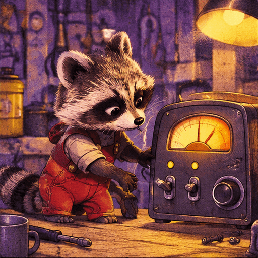</a><br /><sub>浣熊抢修收音机</sub></td>
</tr>
</table>

**原始提示词**

```text
A tiny raccoon mechanic in red overalls flips two toggles on a retro tabletop radio; the amber dial flickers, a spring pops up, and the raccoon catches it and resets. Risograph grain with violet shadows and acid-yellow highlights. Static square framing, one readable burst of activity, no lettering, short looping GIF.
```

[原始提示词 (.txt)](cases/raphael-raccoon-radio-repair/prompt.txt)


**作者**: Raphael

[来源详情](cases/raphael-raccoon-radio-repair/README.zh-CN.md)

**[👉 立即尝试 →](https://raphael.app/gpt-image-2-6-prompts?utm_source=github&utm_medium=repository&utm_campaign=gpt_image_2_6_launch&utm_content=case_gallery_raphael-raccoon-radio-repair&utm_term=zh-CN)**

---

<a id="source-case-raphael-moth-moon-postcard"></a>

#### 85. 飞蛾寄来一轮月亮

<table>
<tr>
<td align="center"><a href="assets/examples/raphael-moth-moon-postcard/moth-moon-postcard.gif">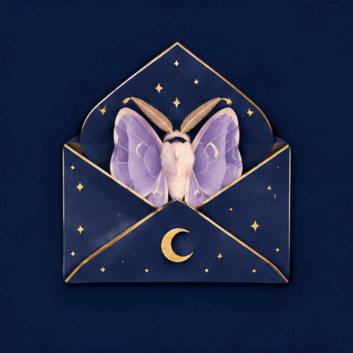</a><br /><sub>飞蛾寄来一轮月亮</sub></td>
</tr>
</table>

**原始提示词**

```text
A small lavender luna moth in a navy envelope opens its wings, releases one tiny gold crescent charm, then folds back into the envelope as the charm disappears behind the flap. Flat midnight-blue field, gold-foil accents, paper-cut sticker, fixed camera, no text, seamless short animation.
```

[原始提示词 (.txt)](cases/raphael-moth-moon-postcard/prompt.txt)


**作者**: Raphael

[来源详情](cases/raphael-moth-moon-postcard/README.zh-CN.md)

**[👉 立即尝试 →](https://raphael.app/gpt-image-2-6-prompts?utm_source=github&utm_medium=repository&utm_campaign=gpt_image_2_6_launch&utm_content=case_gallery_raphael-moth-moon-postcard&utm_term=zh-CN)**

---

<a id="source-case-raphael-heron-umbrella-mishap"></a>

#### 86. 苍鹭的雨伞翻面了

<table>
<tr>
<td align="center"><a href="assets/examples/raphael-heron-umbrella-mishap/heron-umbrella-mishap.gif">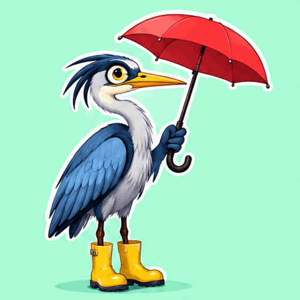</a><br /><sub>苍鹭的雨伞翻面了</sub></td>
</tr>
</table>

**原始提示词**

```text
A blue heron wearing yellow rain boots and holding a tiny red umbrella on a mint backdrop. A gust flips the umbrella inside out, the heron freezes in embarrassment for one beat, then flicks it open again and takes the opening stance. Bold cut-paper sticker, fixed framing, no captions, repeating GIF.
```

[原始提示词 (.txt)](cases/raphael-heron-umbrella-mishap/prompt.txt)


**作者**: Raphael

[来源详情](cases/raphael-heron-umbrella-mishap/README.zh-CN.md)

**[👉 立即尝试 →](https://raphael.app/gpt-image-2-6-prompts?utm_source=github&utm_medium=repository&utm_campaign=gpt_image_2_6_launch&utm_content=case_gallery_raphael-heron-umbrella-mishap&utm_term=zh-CN)**

---

<a id="source-case-raphael-arcade-claw-victory"></a>

#### 87. 抓娃娃机抓到了月亮

<table>
<tr>
<td align="center"><a href="assets/examples/raphael-arcade-claw-victory/arcade-claw-victory.gif">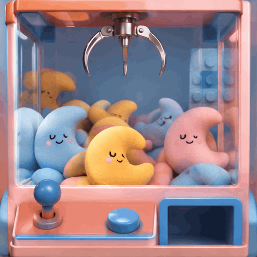</a><br /><sub>抓娃娃机抓到了月亮</sub></td>
</tr>
</table>

**原始提示词**

```text
View a chunky arcade claw through the glass of a miniature candy-colored cabinet. It descends to pick up one plush crescent, carries it toward the prize chute, and reappears overhead for a loop. Peach and blue toy-brick palette, locked front camera, distinct claw motion, blank cabinet panels, no text.
```

[原始提示词 (.txt)](cases/raphael-arcade-claw-victory/prompt.txt)


**作者**: Raphael

[来源详情](cases/raphael-arcade-claw-victory/README.zh-CN.md)

**[👉 立即尝试 →](https://raphael.app/gpt-image-2-6-prompts?utm_source=github&utm_medium=repository&utm_campaign=gpt_image_2_6_launch&utm_content=case_gallery_raphael-arcade-claw-victory&utm_term=zh-CN)**

---

<a id="source-case-raphael-otter-pancake-flip"></a>

#### 88. 水獭翻松饼

<table>
<tr>
<td align="center"><a href="assets/examples/raphael-otter-pancake-flip/otter-pancake-flip.gif"></a><br /><sub>水獭翻松饼</sub></td>
</tr>
</table>

**原始提示词**

```text
A claymation river otter in a blue gingham apron flips a miniature pancake from a cast-iron skillet at a sunflower-yellow breakfast counter. The pancake makes one visible airborne turn, lands back in the pan, and the otter resets its wrist. Stable medium shot, chunky crafted forms, no text, looping GIF.
```

[原始提示词 (.txt)](cases/raphael-otter-pancake-flip/prompt.txt)


**作者**: Raphael

[来源详情](cases/raphael-otter-pancake-flip/README.zh-CN.md)

**[👉 立即尝试 →](https://raphael.app/gpt-image-2-6-prompts?utm_source=github&utm_medium=repository&utm_campaign=gpt_image_2_6_launch&utm_content=case_gallery_raphael-otter-pancake-flip&utm_term=zh-CN)**

---

<a id="source-case-raphael-sea-lion-ball-save"></a>

#### 89. 海狮顶回球

<table>
<tr>
<td align="center"><a href="assets/examples/raphael-sea-lion-ball-save/sea-lion-ball-save.gif"></a><br /><sub>海狮顶回球</sub></td>
</tr>
</table>

**原始提示词**

```text
A round blue sea lion in a tangerine swim cap stands on a pink pool deck. A striped beach ball drops into frame, taps its nose, and rebounds out along the same path while the seal dips and rises. Glossy inflatable toy aesthetic, strong silhouette, no captions, square reaction loop.
```

[原始提示词 (.txt)](cases/raphael-sea-lion-ball-save/prompt.txt)


**作者**: Raphael

[来源详情](cases/raphael-sea-lion-ball-save/README.zh-CN.md)

**[👉 立即尝试 →](https://raphael.app/gpt-image-2-6-prompts?utm_source=github&utm_medium=repository&utm_campaign=gpt_image_2_6_launch&utm_content=case_gallery_raphael-sea-lion-ball-save&utm_term=zh-CN)**

---

<a id="source-case-raphael-desk-plant-workday"></a>

#### 90. 办公盆栽的上班与下班

<table>
<tr>
<td align="center"><a href="assets/examples/raphael-desk-plant-workday/desk-plant-low-battery.gif">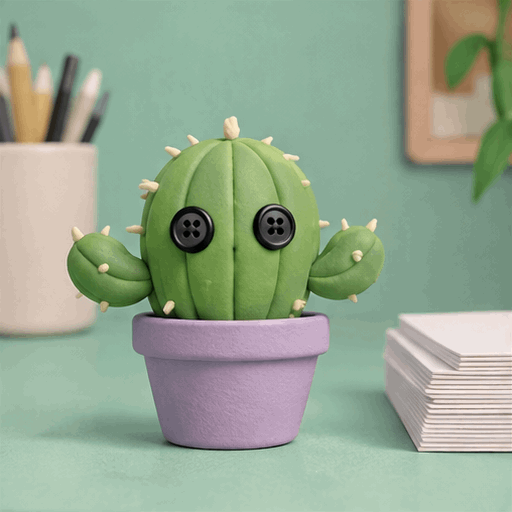</a><br /><sub>办公桌上的盆栽累趴了</sub></td>
<td align="center"><a href="assets/examples/raphael-desk-plant-workday/desk-plant-clock-out.gif">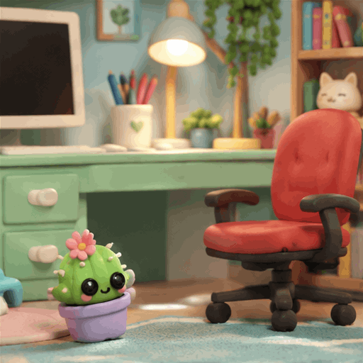</a><br /><sub>盆栽打卡下班</sub></td>
</tr>
</table>

**原始提示词**

**办公桌上的盆栽累趴了**

```text
A tiny lilac potted cactus with two button eyes sits beside a blank stack of papers on a mint desk. Its arms sag, face sinks briefly behind the rim, then it straightens to neutral. Studio-lit polymer clay, static front view, readable silhouette, no type, looping reaction GIF.
```

[原始提示词 (.txt)](cases/raphael-desk-plant-workday/prompt-desk-plant-low-battery.txt)

**盆栽打卡下班**

```text
A tiny lilac potted cactus with button eyes in a home office hops into a red rolling desk chair and scoots toward the right. A quick circular wipe returns to the original setup as the pot sits down again. Mint desk, polymer-clay aesthetic, playful lettering-free loop with legible motions.
```

[原始提示词 (.txt)](cases/raphael-desk-plant-workday/prompt-desk-plant-clock-out.txt)


**作者**: Raphael

[来源详情](cases/raphael-desk-plant-workday/README.zh-CN.md)

**[👉 立即尝试 →](https://raphael.app/gpt-image-2-6-prompts?utm_source=github&utm_medium=repository&utm_campaign=gpt_image_2_6_launch&utm_content=case_gallery_raphael-desk-plant-workday&utm_term=zh-CN)**

---

<a id="source-case-raphael-opera-pufferfish"></a>

#### 91. 河豚开嗓

<table>
<tr>
<td align="center"><a href="assets/examples/raphael-opera-pufferfish/opera-pufferfish.gif"></a><br /><sub>河豚开嗓</sub></td>
</tr>
</table>

**原始提示词**

```text
A lemon-yellow pufferfish floats just above a lilac opera stage, wearing a tiny velvet bow tie. It takes a breath, puffs into a ball, opens its mouth for a silent high note and settles back to its small size. Glossy hand-painted clay, blue spotlight, fixed camera, no typography, loop.
```

[原始提示词 (.txt)](cases/raphael-opera-pufferfish/prompt.txt)


**作者**: Raphael

[来源详情](cases/raphael-opera-pufferfish/README.zh-CN.md)

**[👉 立即尝试 →](https://raphael.app/gpt-image-2-6-prompts?utm_source=github&utm_medium=repository&utm_campaign=gpt_image_2_6_launch&utm_content=case_gallery_raphael-opera-pufferfish&utm_term=zh-CN)**

---

<a id="source-case-raphael-citrus-macro-rhythm"></a>

#### 92. 柑橘微距快切

<table>
<tr>
<td align="center"><a href="assets/examples/raphael-citrus-macro-rhythm/citrus-macro-rhythm.gif">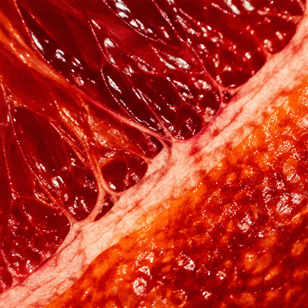</a><br /><sub>柑橘微距快切</sub></td>
</tr>
</table>

**原始提示词**

```text
An editorial rapid-cut GIF of blood-orange pulp, grapefruit membranes and yuzu peel at extreme macro scale. Match each cut along the same diagonal ridge, alternating ruby, blush and ochre in a fixed graphic rhythm. Sharp analog flash and fine film grain. Match the final red frame to the opening; no type.
```

[原始提示词 (.txt)](cases/raphael-citrus-macro-rhythm/prompt.txt)


**作者**: Raphael

[来源详情](cases/raphael-citrus-macro-rhythm/README.zh-CN.md)

**[👉 立即尝试 →](https://raphael.app/gpt-image-2-6-prompts?utm_source=github&utm_medium=repository&utm_campaign=gpt_image_2_6_launch&utm_content=case_gallery_raphael-citrus-macro-rhythm&utm_term=zh-CN)**

---

<a id="source-case-raphael-soap-launch-loop"></a>

#### 93. 海盐手工皂产品短片

<table>
<tr>
<td align="center"><a href="assets/examples/raphael-soap-launch-loop/soap-launch-loop.gif">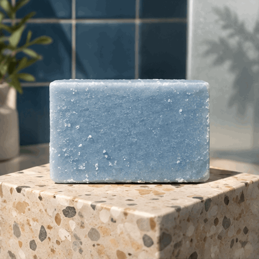</a><br /><sub>海盐手工皂产品短片</sub></td>
</tr>
</table>

**原始提示词**

```text
A pale blue rectangular bar of unbranded sea-salt soap turns slowly on a sand-colored terrazzo plinth. Cut on the rotation through three matching views: wet blue tiles, frosted glass, then the original terrazzo. Hard directional light brings out salt crystals, tactile premium product styling, clean geometry, no lettering or logos, rhythmically looped.
```

[原始提示词 (.txt)](cases/raphael-soap-launch-loop/prompt.txt)


**作者**: Raphael

[来源详情](cases/raphael-soap-launch-loop/README.zh-CN.md)

**[👉 立即尝试 →](https://raphael.app/gpt-image-2-6-prompts?utm_source=github&utm_medium=repository&utm_campaign=gpt_image_2_6_launch&utm_content=case_gallery_raphael-soap-launch-loop&utm_term=zh-CN)**

---

<a id="source-case-raphael-trail-bottle-colorways"></a>

#### 94. 户外水壶配色快切

<table>
<tr>
<td align="center"><a href="assets/examples/raphael-trail-bottle-colorways/trail-bottle-colorways.gif">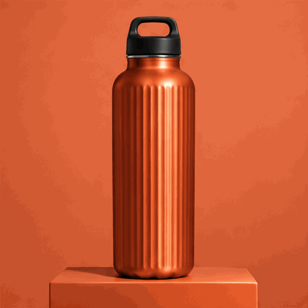</a><br /><sub>户外水壶配色快切</sub></td>
</tr>
</table>

**原始提示词**

```text
A compact ribbed aluminum trail bottle centered on a stationary plinth. Flash from persimmon to ultramarine to chalk to moss while each background shifts to a complementary flat tone. Keep cap, bottle silhouette, camera, scale and shadows aligned across all cuts. Editorial product GIF, no labels or text, cycle to orange.
```

[原始提示词 (.txt)](cases/raphael-trail-bottle-colorways/prompt.txt)


**作者**: Raphael

[来源详情](cases/raphael-trail-bottle-colorways/README.zh-CN.md)

**[👉 立即尝试 →](https://raphael.app/gpt-image-2-6-prompts?utm_source=github&utm_medium=repository&utm_campaign=gpt_image_2_6_launch&utm_content=case_gallery_raphael-trail-bottle-colorways&utm_term=zh-CN)**

---

<a id="source-case-raphael-observatory-weather-cycle"></a>

#### 95. 天文台的四种天空

<table>
<tr>
<td align="center"><a href="assets/examples/raphael-observatory-weather-cycle/observatory-weather-cycle.gif"></a><br /><sub>天文台的四种天空</sub></td>
</tr>
</table>

**原始提示词**

```text
A small red-domed observatory on a rocky bluff against a locked circular composition, illustrated as colored pencil over paper. Clouds give way to a shower, dawn rainbow, clear starry sky and then back to drifting clouds. Preserve the building and horizon in every frame. Soft weather transitions in a short square loop.
```

[原始提示词 (.txt)](cases/raphael-observatory-weather-cycle/prompt.txt)


**作者**: Raphael

[来源详情](cases/raphael-observatory-weather-cycle/README.zh-CN.md)

**[👉 立即尝试 →](https://raphael.app/gpt-image-2-6-prompts?utm_source=github&utm_medium=repository&utm_campaign=gpt_image_2_6_launch&utm_content=case_gallery_raphael-observatory-weather-cycle&utm_term=zh-CN)**

---

<a id="source-case-raphael-sound-garden-risograph"></a>

#### 96. 声波花园拼贴动效

<table>
<tr>
<td align="center"><a href="assets/examples/raphael-sound-garden-risograph/sound-garden-risograph.gif">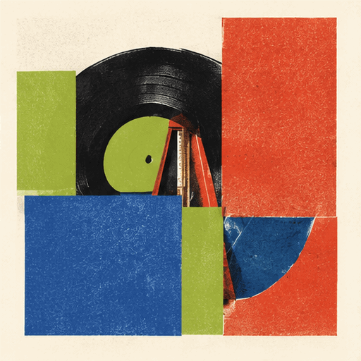</a><br /><sub>声波花园拼贴动效</sub></td>
</tr>
</table>

**原始提示词**

```text
A screen-printed collage of a lime record, a cobalt ficus leaf and a vermilion metronome, arranged like an art-school editorial on ivory stock. Small blocks slide outward in sequence to reveal the objects, then glide back together. Sharp risograph registration, playful layering, fixed page boundaries, no readable type, looping GIF.
```

[原始提示词 (.txt)](cases/raphael-sound-garden-risograph/prompt.txt)


**作者**: Raphael

[来源详情](cases/raphael-sound-garden-risograph/README.zh-CN.md)

**[👉 立即尝试 →](https://raphael.app/gpt-image-2-6-prompts?utm_source=github&utm_medium=repository&utm_campaign=gpt_image_2_6_launch&utm_content=case_gallery_raphael-sound-garden-risograph&utm_term=zh-CN)**

---

<a id="source-case-raphael-greenhouse-day-to-night"></a>

#### 97. 玻璃温室从清晨到深夜

<table>
<tr>
<td align="center"><a href="assets/examples/raphael-greenhouse-day-to-night/greenhouse-day-to-night.gif"></a><br /><sub>玻璃温室从清晨到深夜</sub></td>
</tr>
</table>

**原始提示词**

```text
Seen from outside, a tiny steel-framed desert greenhouse holds several tall cacti. Pink dawn sweeps into turquoise afternoon glass, then deep violet night with a single interior grow lamp and back to dawn. Fixed wide composition and architecture, softly textured gouache, smooth light changes in a brief ambient loop, no text.
```

[原始提示词 (.txt)](cases/raphael-greenhouse-day-to-night/prompt.txt)


**作者**: Raphael

[来源详情](cases/raphael-greenhouse-day-to-night/README.zh-CN.md)

**[👉 立即尝试 →](https://raphael.app/gpt-image-2-6-prompts?utm_source=github&utm_medium=repository&utm_campaign=gpt_image_2_6_launch&utm_content=case_gallery_raphael-greenhouse-day-to-night&utm_term=zh-CN)**

---

<a id="source-case-raphael-ginger-tea-steam"></a>

#### 98. 姜茶冒热气

<table>
<tr>
<td align="center"><a href="assets/examples/raphael-ginger-tea-steam/ginger-tea-steam.gif"></a><br /><sub>姜茶冒热气</sub></td>
</tr>
</table>

**原始提示词**

```text
A low glass cup of ginger tea on a deep-red lacquer tray, seen from the side in a close studio shot. Two translucent strands of steam slowly uncurl and fade while the cup, sliced ginger and reflected daylight remain still. Cozy shallow depth of field, no text, quiet repeating cinemagraph GIF.
```

[原始提示词 (.txt)](cases/raphael-ginger-tea-steam/prompt.txt)


**作者**: Raphael

[来源详情](cases/raphael-ginger-tea-steam/README.zh-CN.md)

**[👉 立即尝试 →](https://raphael.app/gpt-image-2-6-prompts?utm_source=github&utm_medium=repository&utm_campaign=gpt_image_2_6_launch&utm_content=case_gallery_raphael-ginger-tea-steam&utm_term=zh-CN)**

---

<a id="source-case-raphael-raindrops-bus-shelter"></a>

#### 99. 雨滴滑过公交站玻璃

<table>
<tr>
<td align="center"><a href="assets/examples/raphael-raindrops-bus-shelter/raindrops-bus-shelter.gif">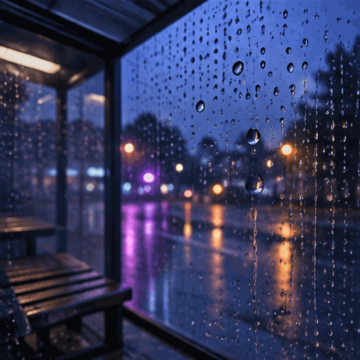</a><br /><sub>雨滴滑过公交站玻璃</sub></td>
</tr>
</table>

**原始提示词**

```text
Blue-hour rain on the slanted glass of an empty bus shelter, lit by distant violet and amber traffic bokeh. Two sharp drops meet and glide down the foreground pane while new beads gather higher up. Stationary composition, no people, signs or lettering, muted photographic palette, looping cinemagraph.
```

[原始提示词 (.txt)](cases/raphael-raindrops-bus-shelter/prompt.txt)


**作者**: Raphael

[来源详情](cases/raphael-raindrops-bus-shelter/README.zh-CN.md)

**[👉 立即尝试 →](https://raphael.app/gpt-image-2-6-prompts?utm_source=github&utm_medium=repository&utm_campaign=gpt_image_2_6_launch&utm_content=case_gallery_raphael-raindrops-bus-shelter&utm_term=zh-CN)**

---

<a id="source-case-raphael-moon-jelly-aquarium"></a>

#### 100. 月亮水母玻璃缸

<table>
<tr>
<td align="center"><a href="assets/examples/raphael-moon-jelly-aquarium/moon-jelly-aquarium.gif"></a><br /><sub>月亮水母玻璃缸</sub></td>
</tr>
</table>

**原始提示词**

```text
A pair of tiny moon jellies drift in a tall cylindrical aquarium, backlit in pale aqua and lavender against indigo. Their bells pulse in a gently offset rhythm and fine suspended specks drift upward as the two jellyfish return to their original arrangement. Macro photography look, camera locked, no type, ambient loop.
```

[原始提示词 (.txt)](cases/raphael-moon-jelly-aquarium/prompt.txt)


**作者**: Raphael

[来源详情](cases/raphael-moon-jelly-aquarium/README.zh-CN.md)

**[👉 立即尝试 →](https://raphael.app/gpt-image-2-6-prompts?utm_source=github&utm_medium=repository&utm_campaign=gpt_image_2_6_launch&utm_content=case_gallery_raphael-moon-jelly-aquarium&utm_term=zh-CN)**

---

<a id="source-case-raphael-red-train-in-fog"></a>

#### 101. 晨雾中的红色列车

<table>
<tr>
<td align="center"><a href="assets/examples/raphael-red-train-in-fog/red-train-in-fog.gif"></a><br /><sub>晨雾中的红色列车</sub></td>
</tr>
</table>

**原始提示词**

```text
A little ruby funicular crosses an alpine viaduct at dawn; mist parts as its warm windows pass between two black pines. Let a dense bank of fog obscure the track at the end and reopen onto the starting view. Charcoal and gouache, textured cool palette, no signage, wide locked camera, short loop.
```

[原始提示词 (.txt)](cases/raphael-red-train-in-fog/prompt.txt)


**作者**: Raphael

[来源详情](cases/raphael-red-train-in-fog/README.zh-CN.md)

**[👉 立即尝试 →](https://raphael.app/gpt-image-2-6-prompts?utm_source=github&utm_medium=repository&utm_campaign=gpt_image_2_6_launch&utm_content=case_gallery_raphael-red-train-in-fog&utm_term=zh-CN)**

---

<a id="source-case-raphael-sheep-in-a-cabin"></a>

#### 102. 木屋里打盹的小羊

<table>
<tr>
<td align="center"><a href="assets/examples/raphael-sheep-in-a-cabin/sheep-in-a-cabin.gif"></a><br /><sub>木屋里打盹的小羊</sub></td>
</tr>
</table>

**原始提示词**

```text
A hand-sewn felt sheep sleeps in a wicker chair beneath a teal quilt, beside a small iron stove. Breathe life into the quilt with slow rises and falls and let a warm stove glow flicker gently. Still camera at floor level, real felt texture, no typography, subtle square looping GIF.
```

[原始提示词 (.txt)](cases/raphael-sheep-in-a-cabin/prompt.txt)


**作者**: Raphael

[来源详情](cases/raphael-sheep-in-a-cabin/README.zh-CN.md)

**[👉 立即尝试 →](https://raphael.app/gpt-image-2-6-prompts?utm_source=github&utm_medium=repository&utm_campaign=gpt_image_2_6_launch&utm_content=case_gallery_raphael-sheep-in-a-cabin&utm_term=zh-CN)**

---

<a id="source-case-raphael-hare-under-aurora"></a>

#### 103. 极光下的白兔

<table>
<tr>
<td align="center"><a href="assets/examples/raphael-hare-under-aurora/hare-under-aurora.gif">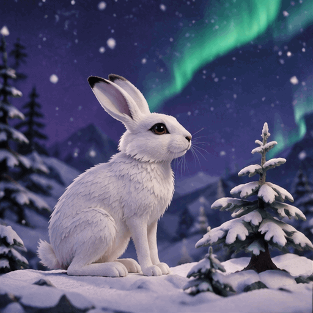</a><br /><sub>极光下的白兔</sub></td>
</tr>
</table>

**原始提示词**

```text
A white arctic hare beside frosted spruce seedlings turns its head upward while a ribbon of green aurora passes behind it. Its ears pick up, relax, then sink back to the first pose as slow snowflakes drift. Tactile paper-layer diorama, purple night, stationary scene, no words, ambient repeat.
```

[原始提示词 (.txt)](cases/raphael-hare-under-aurora/prompt.txt)


**作者**: Raphael

[来源详情](cases/raphael-hare-under-aurora/README.zh-CN.md)

**[👉 立即尝试 →](https://raphael.app/gpt-image-2-6-prompts?utm_source=github&utm_medium=repository&utm_campaign=gpt_image_2_6_launch&utm_content=case_gallery_raphael-hare-under-aurora&utm_term=zh-CN)**

---

<a id="source-case-raphael-pocket-dragon-snooze"></a>

#### 104. 口袋小龙打盹

<table>
<tr>
<td align="center"><a href="assets/examples/raphael-pocket-dragon-snooze/pocket-dragon-snooze.gif">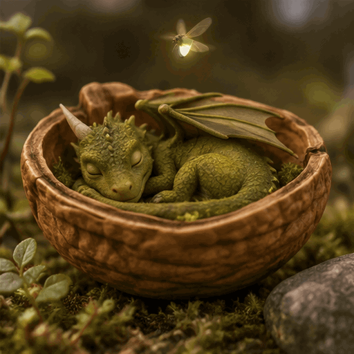</a><br /><sub>口袋小龙打盹</sub></td>
</tr>
</table>

**原始提示词**

```text
A tiny moss-green dragon sleeps curled inside an empty walnut shell, with both wings folded and one little horn visible. Its side rises and falls and a firefly circles just above it once. Make it feel like a macro photograph of a handmade miniature. No text or camera drift. Short quiet loop.
```

[原始提示词 (.txt)](cases/raphael-pocket-dragon-snooze/prompt.txt)


**作者**: Raphael

[来源详情](cases/raphael-pocket-dragon-snooze/README.zh-CN.md)

**[👉 立即尝试 →](https://raphael.app/gpt-image-2-6-prompts?utm_source=github&utm_medium=repository&utm_campaign=gpt_image_2_6_launch&utm_content=case_gallery_raphael-pocket-dragon-snooze&utm_term=zh-CN)**

---

<a id="source-case-raphael-late-night-print-room"></a>

#### 105. 深夜版画工作室

<table>
<tr>
<td align="center"><a href="assets/examples/raphael-late-night-print-room/late-night-print-room.gif">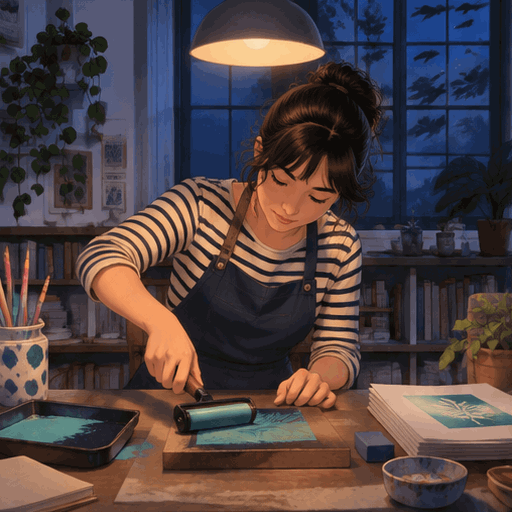</a><br /><sub>深夜版画工作室</sub></td>
</tr>
</table>

**原始提示词**

```text
A quiet illustration of a late-night printmaker in striped sleeves rolling turquoise ink onto a small block at a cluttered desk. The roller rocks forward and back, a warm pendant light stays centered, and a few leaves move behind the studio window. Pastel pencils and blue shadows, fixed frame, no text, loop.
```

[原始提示词 (.txt)](cases/raphael-late-night-print-room/prompt.txt)


**作者**: Raphael

[来源详情](cases/raphael-late-night-print-room/README.zh-CN.md)

**[👉 立即尝试 →](https://raphael.app/gpt-image-2-6-prompts?utm_source=github&utm_medium=repository&utm_campaign=gpt_image_2_6_launch&utm_content=case_gallery_raphael-late-night-print-room&utm_term=zh-CN)**

---

<a id="source-case-raphael-laundromat-cinemagraph"></a>

#### 106. 蓝调时刻的自助洗衣店

<table>
<tr>
<td align="center"><a href="assets/examples/raphael-laundromat-cinemagraph/laundromat-cinemagraph.gif">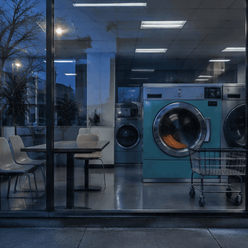</a><br /><sub>蓝调时刻的自助洗衣店</sub></td>
</tr>
</table>

**原始提示词**

```text
An empty neighborhood laundromat at blue hour, photographed from the sidewalk through a wide front window. Only the drum of one teal washing machine turns slowly, revealing a small orange garment once per rotation. Quiet reflected lights, locked camera, no pedestrians or legible signs, subtle repeating GIF.
```

[原始提示词 (.txt)](cases/raphael-laundromat-cinemagraph/prompt.txt)


**作者**: Raphael

[来源详情](cases/raphael-laundromat-cinemagraph/README.zh-CN.md)

**[👉 立即尝试 →](https://raphael.app/gpt-image-2-6-prompts?utm_source=github&utm_medium=repository&utm_campaign=gpt_image_2_6_launch&utm_content=case_gallery_raphael-laundromat-cinemagraph&utm_term=zh-CN)**

---

<a id="source-case-raphael-ink-crane-bows"></a>

#### 107. 水墨仙鹤俯首

<table>
<tr>
<td align="center"><a href="assets/examples/raphael-ink-crane-bows/ink-crane-bows.gif">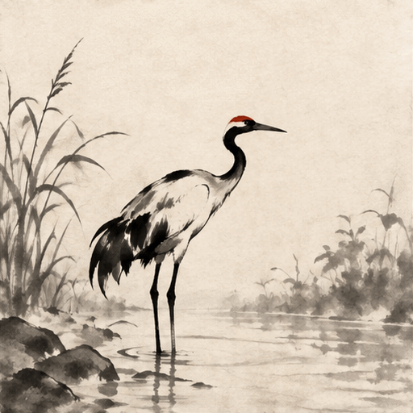</a><br /><sub>水墨仙鹤俯首</sub></td>
</tr>
</table>

**原始提示词**

```text
A black ink-wash crane with a vermilion crown bows once at a reed-fringed pond, sending one ring of ink outward. The ripples fade into the textured ivory paper as the crane straightens. Reserve empty paper above the bird, retain expressive brush edges, no seals or calligraphy, looping locked scene.
```

[原始提示词 (.txt)](cases/raphael-ink-crane-bows/prompt.txt)


**作者**: Raphael

[来源详情](cases/raphael-ink-crane-bows/README.zh-CN.md)

**[👉 立即尝试 →](https://raphael.app/gpt-image-2-6-prompts?utm_source=github&utm_medium=repository&utm_campaign=gpt_image_2_6_launch&utm_content=case_gallery_raphael-ink-crane-bows&utm_term=zh-CN)**

---

<a id="source-case-raphael-sketchbook-bicycle"></a>

#### 108. 速写本里的单车转了起来

<table>
<tr>
<td align="center"><a href="assets/examples/raphael-sketchbook-bicycle/sketchbook-bicycle.gif"></a><br /><sub>速写本里的单车转了起来</sub></td>
</tr>
</table>

**原始提示词**

```text
A sketchbook close-up with a simple cobalt pen doodle of a tiny bicycle. The wheels start spinning and a pennant flutters, then the bicycle rides in one small circle on the page and returns to its original outline. Keep the paper and camera fixed, no hands or text, whimsical looping animation.
```

[原始提示词 (.txt)](cases/raphael-sketchbook-bicycle/prompt.txt)


**作者**: Raphael

[来源详情](cases/raphael-sketchbook-bicycle/README.zh-CN.md)

**[👉 立即尝试 →](https://raphael.app/gpt-image-2-6-prompts?utm_source=github&utm_medium=repository&utm_campaign=gpt_image_2_6_launch&utm_content=case_gallery_raphael-sketchbook-bicycle&utm_term=zh-CN)**

---

<a id="source-case-raphael-pixel-greenhouse-sprinkler"></a>

#### 109. 像素温室的喷淋装置

<table>
<tr>
<td align="center"><a href="assets/examples/raphael-pixel-greenhouse-sprinkler/pixel-greenhouse-sprinkler.gif"></a><br /><sub>像素温室的喷淋装置</sub></td>
</tr>
</table>

**原始提示词**

```text
A cozy pixel-art greenhouse at dusk: mint roof panes, terra-cotta pots and a tiny sprinkler rotating above a shelf of seedlings. The sprinkler sprays a few bright pixels in two directions and returns to its first angle. Stable scene, limited 16-bit palette, crisp square pixels, no text, seamless loop.
```

[原始提示词 (.txt)](cases/raphael-pixel-greenhouse-sprinkler/prompt.txt)


**作者**: Raphael

[来源详情](cases/raphael-pixel-greenhouse-sprinkler/README.zh-CN.md)

**[👉 立即尝试 →](https://raphael.app/gpt-image-2-6-prompts?utm_source=github&utm_medium=repository&utm_campaign=gpt_image_2_6_launch&utm_content=case_gallery_raphael-pixel-greenhouse-sprinkler&utm_term=zh-CN)**

---

<a id="source-case-raphael-paper-plane-loader"></a>

#### 110. 纸飞机加载动效

<table>
<tr>
<td align="center"><a href="assets/examples/raphael-paper-plane-loader/paper-plane-loader.gif">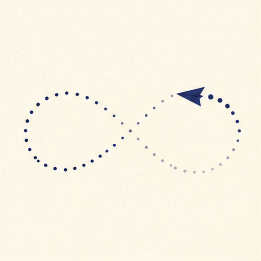</a><br /><sub>纸飞机加载动效</sub></td>
</tr>
</table>

**原始提示词**

```text
A clean microinteraction on pale cream. A tiny indigo paper airplane follows a dotted figure-eight path, banking gently at the center, while its tail dots appear and disappear in sequence. Use flat two-color vector-like shapes, generous margins and a stable camera. Seamless square GIF; no type or UI chrome.
```

[原始提示词 (.txt)](cases/raphael-paper-plane-loader/prompt.txt)


**作者**: Raphael

[来源详情](cases/raphael-paper-plane-loader/README.zh-CN.md)

**[👉 立即尝试 →](https://raphael.app/gpt-image-2-6-prompts?utm_source=github&utm_medium=repository&utm_campaign=gpt_image_2_6_launch&utm_content=case_gallery_raphael-paper-plane-loader&utm_term=zh-CN)**

---

<a id="source-case-raphael-pixel-courier-cycle"></a>

#### 111. 像素邮差骑行循环

<table>
<tr>
<td align="center"><a href="assets/examples/raphael-pixel-courier-cycle/pixel-courier-cycle.gif">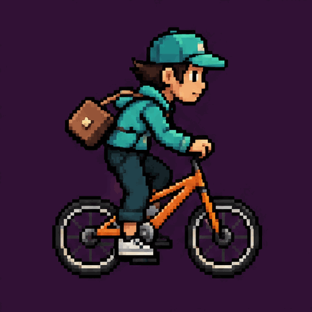</a><br /><sub>像素邮差骑行循环</sub></td>
</tr>
</table>

**原始提示词**

```text
A side-view pixel sprite of a teal-clad courier on a small orange bicycle, pedaling in place with a satchel bouncing behind the shoulder. Show a clean leg and wheel cycle on a single solid dark-plum field. Retro handheld game palette, crisp pixels, a fixed center point, no platform, UI or type; loop.
```

[原始提示词 (.txt)](cases/raphael-pixel-courier-cycle/prompt.txt)


**作者**: Raphael

[来源详情](cases/raphael-pixel-courier-cycle/README.zh-CN.md)

**[👉 立即尝试 →](https://raphael.app/gpt-image-2-6-prompts?utm_source=github&utm_medium=repository&utm_campaign=gpt_image_2_6_launch&utm_content=case_gallery_raphael-pixel-courier-cycle&utm_term=zh-CN)**

---

<a id="source-case-raphael-confetti-stamp-feedback"></a>

#### 112. 确认印章与彩纸反馈

<table>
<tr>
<td align="center"><a href="assets/examples/raphael-confetti-stamp-feedback/confetti-stamp-feedback.gif"></a><br /><sub>确认印章与彩纸反馈</sub></td>
</tr>
</table>

**原始提示词**

```text
A round apricot button with a simple cream checkmark presses inward, rebounds, and sends five flat confetti diamonds outward before they fade. Keep the icon centered and readable, photographed as nothing: this is a flat two-dimensional microinteraction on pale lavender, with no labels. Return to the unpressed button in a loop.
```

[原始提示词 (.txt)](cases/raphael-confetti-stamp-feedback/prompt.txt)


**作者**: Raphael

[来源详情](cases/raphael-confetti-stamp-feedback/README.zh-CN.md)

**[👉 立即尝试 →](https://raphael.app/gpt-image-2-6-prompts?utm_source=github&utm_medium=repository&utm_campaign=gpt_image_2_6_launch&utm_content=case_gallery_raphael-confetti-stamp-feedback&utm_term=zh-CN)**

---

<a id="source-case-raphael-compass-needle-reset"></a>

#### 113. 指南针回正

<table>
<tr>
<td align="center"><a href="assets/examples/raphael-compass-needle-reset/compass-needle-reset.gif">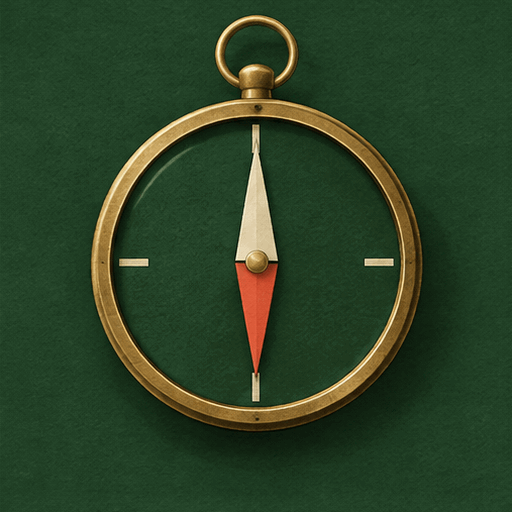</a><br /><sub>指南针回正</sub></td>
</tr>
</table>

**原始提示词**

```text
A minimal overhead view of a brass pocket compass with four clean ticks on forest green. The cream and coral needle makes a single springy swing past north and settles into the original alignment; the brass casing remains still. Paper-textured diagram, no letters or numerals, seamless GIF.
```

[原始提示词 (.txt)](cases/raphael-compass-needle-reset/prompt.txt)


**作者**: Raphael

[来源详情](cases/raphael-compass-needle-reset/README.zh-CN.md)

**[👉 立即尝试 →](https://raphael.app/gpt-image-2-6-prompts?utm_source=github&utm_medium=repository&utm_campaign=gpt_image_2_6_launch&utm_content=case_gallery_raphael-compass-needle-reset&utm_term=zh-CN)**

---

<a id="source-case-raphael-arcade-start-light"></a>

#### 114. 街机开跑信号灯

<table>
<tr>
<td align="center"><a href="assets/examples/raphael-arcade-start-light/arcade-start-light.gif"></a><br /><sub>街机开跑信号灯</sub></td>
</tr>
</table>

**原始提示词**

```text
A low-resolution arcade starting-light animation: three bright red bulbs above a navy track turn off in order, one lime bulb lights, and two little racers launch from either side. A brisk scan-line wipe resets the scene on the last beat. Original 16-bit pixel art, no lettering, no borrowed game UI.
```

[原始提示词 (.txt)](cases/raphael-arcade-start-light/prompt.txt)


**作者**: Raphael

[来源详情](cases/raphael-arcade-start-light/README.zh-CN.md)

**[👉 立即尝试 →](https://raphael.app/gpt-image-2-6-prompts?utm_source=github&utm_medium=repository&utm_campaign=gpt_image_2_6_launch&utm_content=case_gallery_raphael-arcade-start-light&utm_term=zh-CN)**

---

<a id="source-case-raphael-pixel-mushroom-guardian"></a>

#### 115. 像素蘑菇守卫

<table>
<tr>
<td align="center"><a href="assets/examples/raphael-pixel-mushroom-guardian/pixel-mushroom-guardian.gif">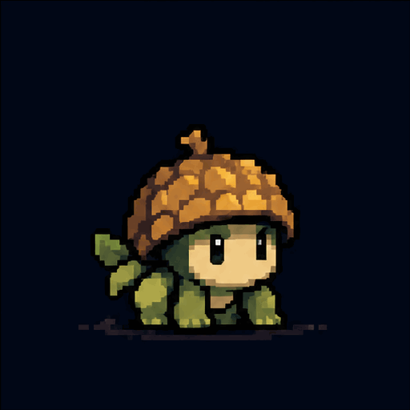</a><br /><sub>像素蘑菇守卫</sub></td>
</tr>
</table>

**原始提示词**

```text
A side-on pixel sprite of a squat mushroom guardian wearing an acorn-shell helmet, on a solid midnight field. It crouches, springs upward, releases a ring of three amber spore pixels and lands in its starting stance. Limited jade and gold palette, consistent scale, crisp edges, no game interface, square loop.
```

[原始提示词 (.txt)](cases/raphael-pixel-mushroom-guardian/prompt.txt)


**作者**: Raphael

[来源详情](cases/raphael-pixel-mushroom-guardian/README.zh-CN.md)

**[👉 立即尝试 →](https://raphael.app/gpt-image-2-6-prompts?utm_source=github&utm_medium=repository&utm_campaign=gpt_image_2_6_launch&utm_content=case_gallery_raphael-pixel-mushroom-guardian&utm_term=zh-CN)**

---

<a id="source-case-raphael-starlight-shield-loop"></a>

#### 116. 像素星光护盾

<table>
<tr>
<td align="center"><a href="assets/examples/raphael-starlight-shield-loop/starlight-shield-loop.gif">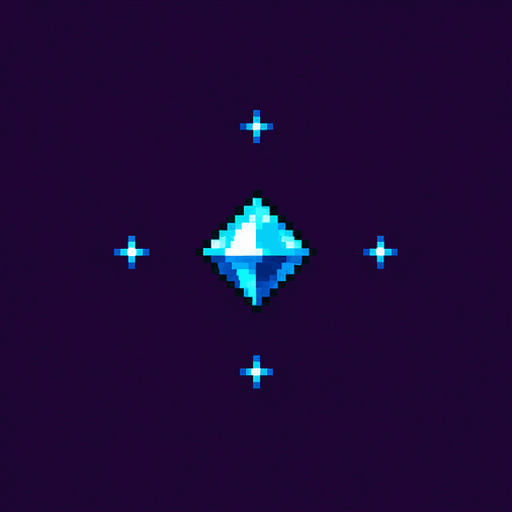</a><br /><sub>像素星光护盾</sub></td>
</tr>
</table>

**原始提示词**

```text
A small cyan diamond crystal hovers at the center of a dark plum field. Four pixel sparks draw an octagonal ring of starlight around it, flash once, then retract into the diamond. Keep the center locked, sharp 16-bit sprite effect, high-contrast silhouette, seamless looping GIF, no text.
```

[原始提示词 (.txt)](cases/raphael-starlight-shield-loop/prompt.txt)


**作者**: Raphael

[来源详情](cases/raphael-starlight-shield-loop/README.zh-CN.md)

**[👉 立即尝试 →](https://raphael.app/gpt-image-2-6-prompts?utm_source=github&utm_medium=repository&utm_campaign=gpt_image_2_6_launch&utm_content=case_gallery_raphael-starlight-shield-loop&utm_term=zh-CN)**

---

<a id="source-case-raphael-clockwork-crab-walk"></a>

#### 117. 发条螃蟹横移循环

<table>
<tr>
<td align="center"><a href="assets/examples/raphael-clockwork-crab-walk/clockwork-crab-walk.gif">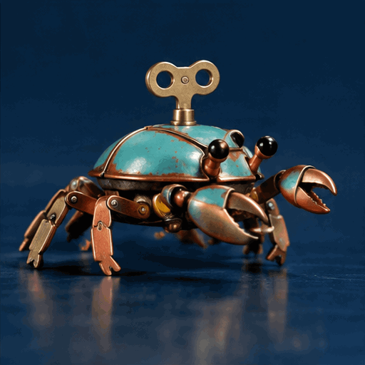</a><br /><sub>发条螃蟹横移循环</sub></td>
</tr>
</table>

**原始提示词**

```text
A toy clockwork crab assembled from copper tin and turquoise enamel takes four sideways steps on a dark blue tabletop. Its little wind-up key turns and alternating leg pairs lift visibly. Use a side silhouette, fixed camera and an invisible moving-belt effect to keep it centered. Clean mechanical loop, no words.
```

[原始提示词 (.txt)](cases/raphael-clockwork-crab-walk/prompt.txt)


**作者**: Raphael

[来源详情](cases/raphael-clockwork-crab-walk/README.zh-CN.md)

**[👉 立即尝试 →](https://raphael.app/gpt-image-2-6-prompts?utm_source=github&utm_medium=repository&utm_campaign=gpt_image_2_6_launch&utm_content=case_gallery_raphael-clockwork-crab-walk&utm_term=zh-CN)**

---

<a id="source-case-community-ozan-robin-wink-hat"></a>

#### 118. Robin 猫眨眼与落下的姓名帽

<table>
<tr>
<td align="center"><a href="assets/examples/community-ozan-robin-wink-hat/animation.mp4"><br />视频首帧预览 · 打开动画</a><br /><sub>灰猫眨眼并戴上 Robin 帽子</sub></td>
<td align="center"><a href="assets/examples/community-ozan-robin-wink-hat/poster.webp"></a><br /><sub>《Robin 猫眨眼与落下的姓名帽》的原始静态海报</sub></td>
</tr>
</table>

**原始提示词**

```text
Kedimiz Robin’in GIF'ini oluştur. Kameraya baksın göz tek gözünü kırpsın ve kafasına Robin yazan bir şapka düşsün.
```

[原提示词见来源](https://x.com/ozansihay/status/2118238946412953985)

**作者**: [Ozan Sihay (@ozansihay)](https://x.com/ozansihay)

**原始来源**: [作者自报模型](https://x.com/ozansihay/status/2118238946412953985) · [来源详情](cases/community-ozan-robin-wink-hat/README.zh-CN.md)

**[👉 立即尝试 →](https://raphael.app/gpt-image-2-6-prompts?utm_source=github&utm_medium=repository&utm_campaign=gpt_image_2_6_launch&utm_content=case_gallery_community-ozan-robin-wink-hat&utm_term=zh-CN)**

---

<a id="source-case-community-mirochill-anime-dialogue-prototype"></a>

#### 119. 蓝发女仆对话动画原型

<table>
<tr>
<td align="center"><a href="assets/examples/community-mirochill-anime-dialogue-prototype/animation.mp4"><br />视频首帧预览 · 打开动画</a><br /><sub>蓝发动漫女仆改变表情并出现英文对白字幕</sub></td>
</tr>
</table>

**原始提示词**

**提示词未公开**

**作者**: [Mirochill (@mirochill)](https://x.com/mirochill)

**原始来源**: [作者自报模型](https://x.com/mirochill/status/2118328887348191491) · [来源详情](cases/community-mirochill-anime-dialogue-prototype/README.zh-CN.md)

**[👉 立即尝试 →](https://raphael.app/gpt-image-2-6-prompts?utm_source=github&utm_medium=repository&utm_campaign=gpt_image_2_6_launch&utm_content=case_gallery_community-mirochill-anime-dialogue-prototype&utm_term=zh-CN)**

---

<a id="source-case-community-mirochill-ram-altman-animation"></a>

#### 120. Ram Altman 内存条恶搞动画

<table>
<tr>
<td align="center"><a href="assets/examples/community-mirochill-ram-altman-animation/animation.mp4"><br />视频首帧预览 · 打开动画</a><br /><sub>Sam Altman 咬电脑内存条的 AI 恶搞画面</sub></td>
</tr>
</table>

**原始提示词**

**提示词未公开**

**作者**: [Mirochill (@mirochill)](https://x.com/mirochill)

**原始来源**: [作者自报模型](https://x.com/mirochill/status/2118267971025944955) · [来源详情](cases/community-mirochill-ram-altman-animation/README.zh-CN.md)

**[👉 立即尝试 →](https://raphael.app/gpt-image-2-6-prompts?utm_source=github&utm_medium=repository&utm_campaign=gpt_image_2_6_launch&utm_content=case_gallery_community-mirochill-ram-altman-animation&utm_term=zh-CN)**

---

<a id="source-case-community-struggle-sailor-dance"></a>

#### 121. 月下美少女战士舞蹈

<table>
<tr>
<td align="center"><a href="assets/examples/community-struggle-sailor-dance/9ff4f428146eff32d28f14d3db8d46d1.gif"></a><br /><sub>夜景中的美少女战士舞蹈</sub></td>
</tr>
</table>

**原始提示词**

```text
创建一个 GIF，内容是 一位美少女战士在跳舞
```

[原提示词见来源](https://tianqi.csdn.net/6aebfbae40858c2d8818a1fd.html#devmenu4)

**作者**: [STRUGGLE_xlf](https://tianqi.csdn.net/6aebfbae40858c2d8818a1fd.html#devmenu4)

**原始来源**: [作者自报模型](https://tianqi.csdn.net/6aebfbae40858c2d8818a1fd.html#devmenu4) · [来源详情](cases/community-struggle-sailor-dance/README.zh-CN.md)

**[👉 立即尝试 →](https://raphael.app/gpt-image-2-6-prompts?utm_source=github&utm_medium=repository&utm_campaign=gpt_image_2_6_launch&utm_content=case_gallery_community-struggle-sailor-dance&utm_term=zh-CN)**

---

<a id="source-case-community-struggle-cat-programmer"></a>

#### 122. 黏土橘猫敲键盘

<table>
<tr>
<td align="center"><a href="assets/examples/community-struggle-cat-programmer/8ed3d79aa8c9de6c2722d2426f9a406f.gif"></a><br /><sub>橘猫敲键盘，旁边放着咖啡</sub></td>
</tr>
</table>

**原始提示词**

```text
帮我生成一个无缝循环的 GIF 动图：一只穿格子衫的橘猫坐在电脑前疯狂敲键盘，屏幕反光映在脸上，旁边放着一杯冒热气的咖啡。3D 黏土动画风格，要求动作自然连贯，首尾帧无缝循环。
```

[原提示词见来源](https://tianqi.csdn.net/6aebfbae40858c2d8818a1fd.html#devmenu4)

**作者**: [STRUGGLE_xlf](https://tianqi.csdn.net/6aebfbae40858c2d8818a1fd.html#devmenu4)

**原始来源**: [作者自报模型](https://tianqi.csdn.net/6aebfbae40858c2d8818a1fd.html#devmenu4) · [来源详情](cases/community-struggle-cat-programmer/README.zh-CN.md)

**[👉 立即尝试 →](https://raphael.app/gpt-image-2-6-prompts?utm_source=github&utm_medium=repository&utm_campaign=gpt_image_2_6_launch&utm_content=case_gallery_community-struggle-cat-programmer&utm_term=zh-CN)**

---

<a id="source-case-community-struggle-desk-animation"></a>

#### 123. 桌面照片清理并转动图

<table>
<tr>
<td align="center"><a href="assets/examples/community-struggle-desk-animation/a4f35dfc424561c644adc7533b89ff8e.gif"></a><br /><sub>清理后的桌面上向日葵与玩偶动图</sub></td>
</tr>
</table>

<details>
<summary>参考图</summary>

参考 / 输入图，不是生成结果。

- [桌面实拍参考照片](https://i-blog.csdnimg.cn/img_convert/28c1519fce92a17d56fef731dcf02691.jpeg)

</details>

**原始提示词**

```text
严格保留我上传照片里的主体外观和桌面环境不变，把黑色的线删掉，保留向日葵和玩偶，后面的蓝色背景优化成干净一点的背景，把它变成一张有趣的循环 GIF 动图：让画面里的主体轻轻弹跳并眨眼打招呼。
```

[原提示词见来源](https://tianqi.csdn.net/6aebfbae40858c2d8818a1fd.html#devmenu4)

**作者**: [STRUGGLE_xlf](https://tianqi.csdn.net/6aebfbae40858c2d8818a1fd.html#devmenu4)

**原始来源**: [作者自报模型](https://tianqi.csdn.net/6aebfbae40858c2d8818a1fd.html#devmenu4) · [来源详情](cases/community-struggle-desk-animation/README.zh-CN.md)

**[👉 立即尝试 →](https://raphael.app/gpt-image-2-6-prompts?utm_source=github&utm_medium=repository&utm_campaign=gpt_image_2_6_launch&utm_content=case_gallery_community-struggle-desk-animation&utm_term=zh-CN)**

---

<a id="source-case-community-zunbeho-parody-ad-gifs"></a>

#### 124. 十款戏仿网页广告 GIF：日本创作者测试

<table>
<tr>
<td align="center"><a href="assets/examples/community-zunbeho-parody-ad-gifs/ad-01.gif"></a><br /><sub>英语课程戏仿横幅，讲师与关闭按钮随帧变化。</sub></td>
<td align="center"><a href="assets/examples/community-zunbeho-parody-ad-gifs/ad-02.gif"></a><br /><sub>脱毛沙龙戏仿横幅，倒计时循环并闪烁优惠文字。</sub></td>
</tr>
<tr>
<td align="center"><a href="assets/examples/community-zunbeho-parody-ad-gifs/ad-03.gif"></a><br /><sub>房地产投资研讨会戏仿横幅，展示讲师、上涨图表及放大推销文字。</sub></td>
<td align="center"><a href="assets/examples/community-zunbeho-parody-ad-gifs/ad-05.gif"></a><br /><sub>AI 伴侣戏仿广告，动漫角色在循环中改变表情。</sub></td>
</tr>
<tr>
<td align="center"><a href="assets/examples/community-zunbeho-parody-ad-gifs/ad-06.gif"></a><br /><sub>安全软件戏仿广告，虚假威胁计数与扫描按钮随帧变化。</sub></td>
<td align="center"><a href="assets/examples/community-zunbeho-parody-ad-gifs/ad-07.gif"></a><br /><sub>招聘机构戏仿广告，主持人改变手势并滚动新闻式薪资字幕。</sub></td>
</tr>
<tr>
<td align="center"><a href="assets/examples/community-zunbeho-parody-ad-gifs/ad-08.gif"></a><br /><sub>网购优惠券戏仿，弹窗重新出现且人物表情变化。</sub></td>
<td align="center"><a href="assets/examples/community-zunbeho-parody-ad-gifs/ad-09.gif"></a><br /><sub>在线健身戏仿横幅，肌肉讲师改变姿势和表情。</sub></td>
</tr>
<tr>
<td align="center"><a href="assets/examples/community-zunbeho-parody-ad-gifs/ad-10.gif"></a><br /><sub>流媒体服务戏仿横幅，促销卡片依次出现。</sub></td>
</tr>
</table>

**原始提示词**

**提示词公开状态待核验**

**作者**: [Zun-Beho](https://note.com/akikito/n/ne6232185c3c4)

**原始来源**: [作者自报模型](https://note.com/akikito/n/ne6232185c3c4) · [来源详情](cases/community-zunbeho-parody-ad-gifs/README.zh-CN.md)

**[👉 立即尝试 →](https://raphael.app/gpt-image-2-6-prompts?utm_source=github&utm_medium=repository&utm_campaign=gpt_image_2_6_launch&utm_content=case_gallery_community-zunbeho-parody-ad-gifs&utm_term=zh-CN)**

---

<a id="source-case-community-temae-pixel-love-swimming-sheet"></a>

#### 125. Pixel♡Love：游泳角色动画帧表

<table>
<tr>
<td align="center"><a href="assets/examples/community-temae-pixel-love-swimming-sheet/swimming-frames.png"></a><br /><sub>静态双排帧表：深色头发、粉色服装的像素角色展示十六个游泳姿势。</sub></td>
</tr>
</table>

**原始提示词**

**提示词未公开**

**作者**: [❐てまえ❐ (temae)](https://note.com/temae/n/n5b9b365d8c99)

**原始来源**: [作者自报模型](https://note.com/temae/n/n5b9b365d8c99) · [来源详情](cases/community-temae-pixel-love-swimming-sheet/README.zh-CN.md)

**[👉 立即尝试 →](https://raphael.app/gpt-image-2-6-prompts?utm_source=github&utm_medium=repository&utm_campaign=gpt_image_2_6_launch&utm_content=case_gallery_community-temae-pixel-love-swimming-sheet&utm_term=zh-CN)**

---

<a id="source-case-community-kiki-tanjiro-pixel-loop"></a>

#### 126. 炭治郎像素风水刃循环动画

<table>
<tr>
<td align="center"><a href="assets/examples/community-kiki-tanjiro-pixel-loop/source-01.mp4"><br />视频首帧预览 · 打开动画</a><br /><sub>像素风剑士挥刀穿过弯曲蓝色水流效果。</sub></td>
</tr>
</table>

<details>
<summary>参考图</summary>

参考 / 输入图，不是生成结果。

- [来源附带角色参考图，文件获取尚未完成。](https://pbs.twimg.com/media/HWWEpmba0AAmqWc?format=webp&name=large)

</details>

**原始提示词**

```text
Use the character I uploaded as the reference and make a downloadable looping pixel-art GIF of them performing a signature move.

[Keep the character consistent]
Study the reference and keep every key feature: hairstyle and hair color, face and eye color, marks or scars, outfit colors and patterns, accessories, and their weapon or prop. Same proportions and same look in every frame.

[Pixel art style]
Highly detailed HD pixel art, like premium 2D fighting game sprites: crisp hard-edged pixels, rich palette with pixel shading and highlights, visible fabric folds and hair strands, no anti-aliasing.
Full body, side 3/4 view, same size and same ground line in every frame.

[Design the move]
Pick a move that fits the character's personality, power or weapon (or use the one I give below).
Make it a short, punchy attack anyone can read at a glance: ready stance → wind-up → strike → follow-through → back to ready.
Add an elemental or energy effect that matches the character, rendered as pixel art (e.g. water waves, fire, lightning, petals).
Hair, clothes and effects react naturally to the motion. First and last frame match so it loops seamlessly.

[Output]
Pure white background, fixed camera, character centered with enough margin. No text.
About 12 frames, 1.5–2 seconds, infinite loop.
Deliver an actual multi-frame GIF file I can download.
```

[原提示词见来源](https://x.com/Mayz1169/status/2118246507128541553)

**作者**: [Kiki / Mayz (@Mayz1169)](https://x.com/Mayz1169)

**原始来源**: [作者自报模型](https://x.com/Mayz1169/status/2118245929505669260) · [来源详情](cases/community-kiki-tanjiro-pixel-loop/README.zh-CN.md)

**[👉 立即尝试 →](https://raphael.app/gpt-image-2-6-prompts?utm_source=github&utm_medium=repository&utm_campaign=gpt_image_2_6_launch&utm_content=case_gallery_community-kiki-tanjiro-pixel-loop&utm_term=zh-CN)**

---

<a id="source-case-community-kiki-heartbeat-dance-comparison"></a>

#### 127. 心跳舞模式对比：来源封面

<table>
<tr>
<td align="center"><a href="assets/examples/community-kiki-heartbeat-dance-comparison/poster-01.webp"></a><br /><sub>粉发角色按 Low、Medium、High 三列排列的静态封面。</sub></td>
</tr>
</table>

**原始提示词**

**提示词公开状态待核验**

**作者**: [Kiki / Mayz (@Mayz1169)](https://x.com/Mayz1169)

**原始来源**: [作者自报模型](https://x.com/Mayz1169/status/2118241781074862569) · [来源详情](cases/community-kiki-heartbeat-dance-comparison/README.zh-CN.md)

**[👉 立即尝试 →](https://raphael.app/gpt-image-2-6-prompts?utm_source=github&utm_medium=repository&utm_campaign=gpt_image_2_6_launch&utm_content=case_gallery_community-kiki-heartbeat-dance-comparison&utm_term=zh-CN)**

---

<a id="source-case-community-kiki-malfoid-mood-stickers"></a>

#### 128. 六段 Miss Malfoid 情绪贴纸循环动画

<table>
<tr>
<td align="center"><a href="assets/examples/community-kiki-malfoid-mood-stickers/source-01.mp4"><br />视频首帧预览 · 打开动画</a><br /><sub>猫耳 Q 版角色脸红并遮住脸。</sub></td>
<td align="center"><a href="assets/examples/community-kiki-malfoid-mood-stickers/source-02.mp4"><br />视频首帧预览 · 打开动画</a><br /><sub>猫耳 Q 版角色炸毛生气。</sub></td>
</tr>
<tr>
<td align="center"><a href="assets/examples/community-kiki-malfoid-mood-stickers/source-03.mp4"><br />视频首帧预览 · 打开动画</a><br /><sub>猫耳 Q 版角色抱臂表现不屑。</sub></td>
<td align="center"><a href="assets/examples/community-kiki-malfoid-mood-stickers/source-04.mp4"><br />视频首帧预览 · 打开动画</a><br /><sub>猫耳 Q 版角色流下大颗泪水哭泣。</sub></td>
</tr>
<tr>
<td align="center"><a href="assets/examples/community-kiki-malfoid-mood-stickers/source-05.mp4"><br />视频首帧预览 · 打开动画</a><br /><sub>猫耳 Q 版角色做出得意反应。</sub></td>
<td align="center"><a href="assets/examples/community-kiki-malfoid-mood-stickers/source-06.mp4"><br />视频首帧预览 · 打开动画</a><br /><sub>猫耳 Q 版角色做出绿色爱心手势。</sub></td>
</tr>
</table>

**原始提示词**

**提示词公开状态待核验**

**作者**: [Kiki / Mayz (@Mayz1169)](https://x.com/Mayz1169)

**原始来源**: [作者自报模型](https://x.com/Mayz1169/status/2118355858208010412) · [来源详情](cases/community-kiki-malfoid-mood-stickers/README.zh-CN.md)

**[👉 立即尝试 →](https://raphael.app/gpt-image-2-6-prompts?utm_source=github&utm_medium=repository&utm_campaign=gpt_image_2_6_launch&utm_content=case_gallery_community-kiki-malfoid-mood-stickers&utm_term=zh-CN)**

---

<a id="source-case-social-blue-hair-chibi-eating-rice-gif"></a>

#### 129. Q版角色用筷子吃白米饭

<table>
<tr>
<td align="center"><a href="assets/examples/social-blue-hair-chibi-eating-rice-gif/source-01.mp4"><br />视频首帧预览 · 打开动画</a><br /><sub>Q版角色用筷子吃白米饭</sub></td>
<td align="center"><a href="assets/examples/social-blue-hair-chibi-eating-rice-gif/preview-01.gif"></a><br /><sub>Q版角色用筷子吃白米饭</sub></td>
</tr>
</table>

<details>
<summary>参考图</summary>

参考 / 输入图，不是生成结果。

- [参考输入：Q版角色用筷子吃白米饭](assets/references/social-blue-hair-chibi-eating-rice-gif/source-02.jpg)

</details>

**原始提示词**

```text
使用这个角色，生成一张GIF图，内容是她吃大白米饭，图片里有文字：真香！
```

[原始提示词 (.txt)](cases/social-blue-hair-chibi-eating-rice-gif/prompt.txt)

[原提示词见来源](https://x.com/Gorden_Sun/status/2118166046175908016)

**作者**: [Gorden_Sun](https://x.com/Gorden_Sun)

**原始来源**: [作者自报模型](https://x.com/Gorden_Sun/status/2118166046175908016) · [来源详情](cases/social-blue-hair-chibi-eating-rice-gif/README.zh-CN.md)

**[👉 立即尝试 →](https://raphael.app/gpt-image-2-6-prompts?utm_source=github&utm_medium=repository&utm_campaign=gpt_image_2_6_launch&utm_content=case_gallery_social-blue-hair-chibi-eating-rice-gif&utm_term=zh-CN)**

---

<a id="source-case-social-chibi-cheongsam-girl-gif"></a>

#### 130. 穿旗袍的Q版少女做可爱跳跃动作

<table>
<tr>
<td align="center"><a href="assets/examples/social-chibi-cheongsam-girl-gif/source-01.mp4"><br />视频首帧预览 · 打开动画</a><br /><sub>穿旗袍的Q版少女做可爱跳跃动作</sub></td>
<td align="center"><a href="assets/examples/social-chibi-cheongsam-girl-gif/preview-01.gif"></a><br /><sub>穿旗袍的Q版少女做可爱跳跃动作</sub></td>
</tr>
</table>

<details>
<summary>参考图</summary>

参考 / 输入图，不是生成结果。

- [参考输入：穿旗袍的Q版少女做可爱跳跃动作](assets/references/social-chibi-cheongsam-girl-gif/source-02.jpg)

</details>

**原始提示词**

```text
このキャラクターをちびキャラ化して、何か可愛らしい動きをしているところをGIF画像にしてください。
```

[原始提示词 (.txt)](cases/social-chibi-cheongsam-girl-gif/prompt.txt)

[原提示词见来源](https://x.com/shinshin86/status/2118225428976705908)

**作者**: [shinshin86](https://x.com/shinshin86)

**原始来源**: [作者自报模型](https://x.com/shinshin86/status/2118225428976705908) · [来源详情](cases/social-chibi-cheongsam-girl-gif/README.zh-CN.md)

**[👉 立即尝试 →](https://raphael.app/gpt-image-2-6-prompts?utm_source=github&utm_medium=repository&utm_campaign=gpt_image_2_6_launch&utm_content=case_gallery_social-chibi-cheongsam-girl-gif&utm_term=zh-CN)**

---

<a id="source-case-social-dancing-frog-top-hat"></a>

#### 131. 戴礼帽跳舞的卡通青蛙

<table>
<tr>
<td align="center"><a href="assets/examples/social-dancing-frog-top-hat/source-01.mp4"><br />视频首帧预览 · 打开动画</a><br /><sub>戴礼帽跳舞的卡通青蛙</sub></td>
<td align="center"><a href="assets/examples/social-dancing-frog-top-hat/preview-01.gif"></a><br /><sub>戴礼帽跳舞的卡通青蛙</sub></td>
</tr>
</table>

**原始提示词**

```text
dancing frog with a top hat on, with ego be gone! written at the top
```

[原始提示词 (.txt)](cases/social-dancing-frog-top-hat/prompt.txt)

[原提示词见来源](https://x.com/princess414141/status/2118144125354877152)

**作者**: [princess414141](https://x.com/princess414141)

**原始来源**: [作者自报模型](https://x.com/princess414141/status/2118144125354877152) · [来源详情](cases/social-dancing-frog-top-hat/README.zh-CN.md)

**[👉 立即尝试 →](https://raphael.app/gpt-image-2-6-prompts?utm_source=github&utm_medium=repository&utm_campaign=gpt_image_2_6_launch&utm_content=case_gallery_social-dancing-frog-top-hat&utm_term=zh-CN)**

---

<a id="source-case-social-heisei-flip-phone-decomail-gif"></a>

#### 132. 东京街头折叠手机屏幕播放平成风格动画

<table>
<tr>
<td align="center"><a href="assets/examples/social-heisei-flip-phone-decomail-gif/source-01.mp4"><br />视频首帧预览 · 打开动画</a><br /><sub>东京街头折叠手机屏幕播放平成风格动画</sub></td>
<td align="center"><a href="assets/examples/social-heisei-flip-phone-decomail-gif/preview-01.gif"></a><br /><sub>东京街头折叠手机屏幕播放平成风格动画</sub></td>
</tr>
</table>

**原始提示词**

```text
平成を象徴する何か。SNS向けのGIF画像を生成して下さい。
```

[原始提示词 (.txt)](cases/social-heisei-flip-phone-decomail-gif/prompt.txt)

[原提示词见来源](https://x.com/rem_rev/status/2118252486360498485)

**作者**: [rem_rev](https://x.com/rem_rev)

**原始来源**: [作者自报模型](https://x.com/rem_rev/status/2118252486360498485) · [来源详情](cases/social-heisei-flip-phone-decomail-gif/README.zh-CN.md)

**[👉 立即尝试 →](https://raphael.app/gpt-image-2-6-prompts?utm_source=github&utm_medium=repository&utm_campaign=gpt_image_2_6_launch&utm_content=case_gallery_social-heisei-flip-phone-decomail-gif&utm_term=zh-CN)**

---

<a id="source-case-social-diligent-bee-daily-checkin-gif"></a>

#### 133. 卡通小蜜蜂在手机上发帖打卡

<table>
<tr>
<td align="center"><a href="assets/examples/social-diligent-bee-daily-checkin-gif/source-01.mp4"><br />视频首帧预览 · 打开动画</a><br /><sub>卡通小蜜蜂在手机上发帖打卡</sub></td>
<td align="center"><a href="assets/examples/social-diligent-bee-daily-checkin-gif/preview-01.gif"></a><br /><sub>卡通小蜜蜂在手机上发帖打卡</sub></td>
</tr>
</table>

**原始提示词**

```text
生成一个GIF，用于在𝕏 平台每日签到打卡，寓意我是一个发贴的勤劳小蜜蜂
```

[原始提示词 (.txt)](cases/social-diligent-bee-daily-checkin-gif/prompt.txt)

[原提示词见来源](https://x.com/MrGafish/status/2118217749680025722)

**作者**: [MrGafish](https://x.com/MrGafish)

**原始来源**: [作者自报模型](https://x.com/MrGafish/status/2118217749680025722) · [来源详情](cases/social-diligent-bee-daily-checkin-gif/README.zh-CN.md)

**[👉 立即尝试 →](https://raphael.app/gpt-image-2-6-prompts?utm_source=github&utm_medium=repository&utm_campaign=gpt_image_2_6_launch&utm_content=case_gallery_social-diligent-bee-daily-checkin-gif&utm_term=zh-CN)**

---

<a id="source-case-social-snowy-yard-wood-chopping"></a>

#### 134. 雪中庭院里老人劈柴

<table>
<tr>
<td align="center"><a href="assets/examples/social-snowy-yard-wood-chopping/source-01.mp4"><br />视频首帧预览 · 打开动画</a><br /><sub>雪中庭院里老人劈柴</sub></td>
<td align="center"><a href="assets/examples/social-snowy-yard-wood-chopping/preview-01.gif"></a><br /><sub>雪中庭院里老人劈柴——由原MP4转码的GIF展示副本</sub></td>
</tr>
</table>

**原始提示词**

```text
冬の寒い中、家の庭で薪割りをするおじいさんのGIF
```

[原始提示词 (.txt)](cases/social-snowy-yard-wood-chopping/prompt.txt)

原帖左侧为劈柴动画，右侧女子转身动画未计入本案例。

[原提示词见来源](https://x.com/koe_ai414/status/2118153765094351279)

**作者**: [koe_ai414](https://x.com/koe_ai414)

**原始来源**: [作者自报模型](https://x.com/koe_ai414/status/2118153765094351279) · [来源详情](cases/social-snowy-yard-wood-chopping/README.zh-CN.md)

**[👉 立即尝试 →](https://raphael.app/gpt-image-2-6-prompts?utm_source=github&utm_medium=repository&utm_campaign=gpt_image_2_6_launch&utm_content=case_gallery_social-snowy-yard-wood-chopping&utm_term=zh-CN)**

---

<a id="source-case-social-pixel-purple-lightning-bolts"></a>

#### 135. 紫色闪电击飞螺母与螺栓的像素角色

<table>
<tr>
<td align="center"><a href="assets/examples/social-pixel-purple-lightning-bolts/source-01.mp4"><br />视频首帧预览 · 打开动画</a><br /><sub>紫色闪电击飞螺母与螺栓的像素角色</sub></td>
<td align="center"><a href="assets/examples/social-pixel-purple-lightning-bolts/preview-01.gif"></a><br /><sub>紫色闪电击飞螺母与螺栓的像素角色——由原MP4转码的GIF展示副本</sub></td>
</tr>
</table>

**原始提示词**

```text
このキャラをドット化して、紫の電光エフェクトでボルトをナットを吹き飛ばすGIFを作成
```

[原始提示词 (.txt)](cases/social-pixel-purple-lightning-bolts/prompt.txt)

原帖说明使用角色三视图；未找到该参考图的单独附件，不重建或冒充参考图。引用帖的勇者动画单独对应清单第27项。

[原提示词见来源](https://x.com/YaReYaRu30Life/status/2118167174053597233)

**作者**: [YaReYaRu30Life](https://x.com/YaReYaRu30Life)

**原始来源**: [作者自报模型](https://x.com/YaReYaRu30Life/status/2118167174053597233) · [来源详情](cases/social-pixel-purple-lightning-bolts/README.zh-CN.md)

**[👉 立即尝试 →](https://raphael.app/gpt-image-2-6-prompts?utm_source=github&utm_medium=repository&utm_campaign=gpt_image_2_6_launch&utm_content=case_gallery_social-pixel-purple-lightning-bolts&utm_term=zh-CN)**

---

<a id="source-case-social-robot-pouring-coffee"></a>

#### 136. 可爱机器人倒咖啡

<table>
<tr>
<td align="center"><a href="assets/examples/social-robot-pouring-coffee/source-01.mp4"><br />视频首帧预览 · 打开动画</a><br /><sub>可爱机器人倒咖啡</sub></td>
<td align="center"><a href="assets/examples/social-robot-pouring-coffee/preview-01.gif"></a><br /><sub>可爱机器人倒咖啡——由原MP4转码的GIF展示副本</sub></td>
</tr>
</table>

**原始提示词**

```text
コーヒーを淹れるロボット
```

[原始提示词 (.txt)](cases/social-robot-pouring-coffee/prompt.txt)

提示词按原文保存；同一工作流的多张结果与展示副本合并计数。

[原提示词见来源](https://x.com/sousoccer6/status/2118210705585537226)

**作者**: [sousoccer6](https://x.com/sousoccer6)

**原始来源**: [作者自报模型](https://x.com/sousoccer6/status/2118210705585537226) · [来源详情](cases/social-robot-pouring-coffee/README.zh-CN.md)

**[👉 立即尝试 →](https://raphael.app/gpt-image-2-6-prompts?utm_source=github&utm_medium=repository&utm_campaign=gpt_image_2_6_launch&utm_content=case_gallery_social-robot-pouring-coffee&utm_term=zh-CN)**

---

<a id="source-case-social-red-character-music-video-gif"></a>

#### 137. 红衣角色的MV风格动画

<table>
<tr>
<td align="center"><a href="assets/examples/social-red-character-music-video-gif/source-01.mp4"><br />视频首帧预览 · 打开动画</a><br /><sub>红衣角色的MV风格动画</sub></td>
<td align="center"><a href="assets/examples/social-red-character-music-video-gif/preview-01.gif"></a><br /><sub>红衣角色的MV风格动画——由原MP4转码的GIF展示副本</sub></td>
</tr>
</table>

**原始提示词**

```text
添付した画像を使ってかっこいいMV風のGIFアニメにして
```

[原始提示词 (.txt)](cases/social-red-character-music-video-gif/prompt.txt)

作者说明以附件图为输入；原帖未提供独立输入图，只保存该帖公开动画。

[原提示词见来源](https://x.com/Ayu_AI_0912/status/2118138025024839939)

**作者**: [Ayu_AI_0912](https://x.com/Ayu_AI_0912)

**原始来源**: [作者自报模型](https://x.com/Ayu_AI_0912/status/2118138025024839939) · [来源详情](cases/social-red-character-music-video-gif/README.zh-CN.md)

**[👉 立即尝试 →](https://raphael.app/gpt-image-2-6-prompts?utm_source=github&utm_medium=repository&utm_campaign=gpt_image_2_6_launch&utm_content=case_gallery_social-red-character-music-video-gif&utm_term=zh-CN)**

---

<a id="source-case-social-sunglasses-cat-dance"></a>

#### 138. 紫光房间里戴墨镜跳舞的猫

<table>
<tr>
<td align="center"><a href="assets/examples/social-sunglasses-cat-dance/source-01.mp4"><br />视频首帧预览 · 打开动画</a><br /><sub>紫光房间里戴墨镜跳舞的猫</sub></td>
<td align="center"><a href="assets/examples/social-sunglasses-cat-dance/preview-01.gif"></a><br /><sub>紫光房间里戴墨镜跳舞的猫——由原MP4转码的GIF展示副本</sub></td>
</tr>
</table>

**原始提示词**

```text
次の内容で GIF を作成して: サングラスをかけた猫がダンスをするミームっぽいGIF
```

[原始提示词 (.txt)](cases/social-sunglasses-cat-dance/prompt.txt)

提示词按原文保存；同一工作流的多张结果与展示副本合并计数。

[原提示词见来源](https://x.com/SSSS_CRYPTOMAN/status/2118144429848748108)

**作者**: [SSSS_CRYPTOMAN](https://x.com/SSSS_CRYPTOMAN)

**原始来源**: [作者自报模型](https://x.com/SSSS_CRYPTOMAN/status/2118144429848748108) · [来源详情](cases/social-sunglasses-cat-dance/README.zh-CN.md)

**[👉 立即尝试 →](https://raphael.app/gpt-image-2-6-prompts?utm_source=github&utm_medium=repository&utm_campaign=gpt_image_2_6_launch&utm_content=case_gallery_social-sunglasses-cat-dance&utm_term=zh-CN)**

---

<a id="source-case-social-pelican-riding-bicycle"></a>

#### 139. 戴头盔的鹈鹕骑自行车

<table>
<tr>
<td align="center"><a href="assets/examples/social-pelican-riding-bicycle/source-01.mp4"><br />视频首帧预览 · 打开动画</a><br /><sub>戴头盔的鹈鹕骑自行车</sub></td>
<td align="center"><a href="assets/examples/social-pelican-riding-bicycle/preview-01.gif"></a><br /><sub>戴头盔的鹈鹕骑自行车——由原MP4转码的GIF展示副本</sub></td>
</tr>
</table>

**原始提示词**

```text
generate a gif of a pelican riding a bicycle
```

[原始提示词 (.txt)](cases/social-pelican-riding-bicycle/prompt.txt)

提示词按原文保存；同一工作流的多张结果与展示副本合并计数。

[原提示词见来源](https://x.com/SSHCodes/status/2118127375481504100)

**作者**: [SSHCodes](https://x.com/SSHCodes)

**原始来源**: [作者自报模型](https://x.com/SSHCodes/status/2118127375481504100) · [来源详情](cases/social-pelican-riding-bicycle/README.zh-CN.md)

**[👉 立即尝试 →](https://raphael.app/gpt-image-2-6-prompts?utm_source=github&utm_medium=repository&utm_campaign=gpt_image_2_6_launch&utm_content=case_gallery_social-pelican-riding-bicycle&utm_term=zh-CN)**

---

<a id="source-case-social-paper-boat-water-loop"></a>

#### 140. 蓝色水面上摇晃的白色纸船

<table>
<tr>
<td align="center"><a href="assets/examples/social-paper-boat-water-loop/source-01.mp4"><br />视频首帧预览 · 打开动画</a><br /><sub>蓝色水面上摇晃的白色纸船</sub></td>
<td align="center"><a href="assets/examples/social-paper-boat-water-loop/preview-01.gif"></a><br /><sub>蓝色水面上摇晃的白色纸船——由原MP4转码的GIF展示副本</sub></td>
</tr>
</table>

**原始提示词**

```text
Make a looping GIF of a paper boat bobbing on the water.
```

[原始提示词 (.txt)](cases/social-paper-boat-water-loop/prompt.txt)

仅保留作者公开的纸船指令及对应动画。原帖关于版本识别、性能、价格或模型能力的论断不作为本仓库核验结论。

[原提示词见来源](https://x.com/thinkszyg/status/2118166234495947044)

**作者**: [thinkszyg](https://x.com/thinkszyg)

**原始来源**: [作者自报模型](https://x.com/thinkszyg/status/2118166234495947044) · [来源详情](cases/social-paper-boat-water-loop/README.zh-CN.md)

**[👉 立即尝试 →](https://raphael.app/gpt-image-2-6-prompts?utm_source=github&utm_medium=repository&utm_campaign=gpt_image_2_6_launch&utm_content=case_gallery_social-paper-boat-water-loop&utm_term=zh-CN)**

---

<a id="source-case-social-osaka-castle-construction"></a>

#### 141. 大阪城逐层建成天守阁

<table>
<tr>
<td align="center"><a href="assets/examples/social-osaka-castle-construction/source-01.mp4"><br />视频首帧预览 · 打开动画</a><br /><sub>大阪城逐层建成天守阁</sub></td>
<td align="center"><a href="assets/examples/social-osaka-castle-construction/preview-01.gif"></a><br /><sub>大阪城逐层建成天守阁——由原MP4转码的GIF展示副本</sub></td>
</tr>
</table>

**原始提示词**

```text
大阪城を建築する流れをGIFにして
```

[原始提示词 (.txt)](cases/social-osaka-castle-construction/prompt.txt)

提示词按原文保存；同一工作流的多张结果与展示副本合并计数。

[原提示词见来源](https://x.com/jammaru_lab/status/2118153279821787623)

**作者**: [jammaru_lab](https://x.com/jammaru_lab)

**原始来源**: [作者自报模型](https://x.com/jammaru_lab/status/2118153279821787623) · [来源详情](cases/social-osaka-castle-construction/README.zh-CN.md)

**[👉 立即尝试 →](https://raphael.app/gpt-image-2-6-prompts?utm_source=github&utm_medium=repository&utm_campaign=gpt_image_2_6_launch&utm_content=case_gallery_social-osaka-castle-construction&utm_term=zh-CN)**

---

<a id="source-case-social-character-wave-laugh"></a>

#### 142. 卡通角色挥手大笑

<table>
<tr>
<td align="center"><a href="assets/examples/social-character-wave-laugh/source-01.mp4"><br />视频首帧预览 · 打开动画</a><br /><sub>卡通角色挥手大笑</sub></td>
<td align="center"><a href="assets/examples/social-character-wave-laugh/preview-01.gif"></a><br /><sub>卡通角色挥手大笑——由原MP4转码的GIF展示副本</sub></td>
</tr>
</table>

**原始提示词**

```text
このキャラをGIFで動かして。手を振って笑う
```

[原始提示词 (.txt)](cases/social-character-wave-laugh/prompt.txt)

原帖另附两张更新功能图解，不把功能图解计为模型输出或独立案例。未公开独立的角色输入图。

[原提示词见来源](https://x.com/okan_aitool/status/2118201578406772887)

**作者**: [okan_aitool](https://x.com/okan_aitool)

**原始来源**: [作者自报模型](https://x.com/okan_aitool/status/2118201578406772887) · [来源详情](cases/social-character-wave-laugh/README.zh-CN.md)

**[👉 立即尝试 →](https://raphael.app/gpt-image-2-6-prompts?utm_source=github&utm_medium=repository&utm_campaign=gpt_image_2_6_launch&utm_content=case_gallery_social-character-wave-laugh&utm_term=zh-CN)**

---

<a id="source-case-social-pixel-hero-glowing-sword"></a>

#### 143. 像素勇者挥舞发光剑

<table>
<tr>
<td align="center"><a href="assets/examples/social-pixel-hero-glowing-sword/source-01.mp4"><br />视频首帧预览 · 打开动画</a><br /><sub>像素勇者挥舞发光剑</sub></td>
<td align="center"><a href="assets/examples/social-pixel-hero-glowing-sword/preview-01.gif"></a><br /><sub>像素勇者挥舞发光剑——由原MP4转码的GIF展示副本</sub></td>
</tr>
</table>

**原始提示词**

```text
GIFを作成。ドット絵の勇者。
剣にエフェクトをつけて振り回す
```

[原始提示词 (.txt)](cases/social-pixel-hero-glowing-sword/prompt.txt)

提示词按原文保存；同一工作流的多张结果与展示副本合并计数。

[原提示词见来源](https://x.com/YaReYaRu30Life/status/2118166505603153922)

**作者**: [YaReYaRu30Life](https://x.com/YaReYaRu30Life)

**原始来源**: [作者自报模型](https://x.com/YaReYaRu30Life/status/2118166505603153922) · [来源详情](cases/social-pixel-hero-glowing-sword/README.zh-CN.md)

**[👉 立即尝试 →](https://raphael.app/gpt-image-2-6-prompts?utm_source=github&utm_medium=repository&utm_campaign=gpt_image_2_6_launch&utm_content=case_gallery_social-pixel-hero-glowing-sword&utm_term=zh-CN)**

---

<a id="source-case-social-falling-apple-frame-comparison"></a>

#### 144. 苹果落下的GIF帧数对照

<table>
<tr>
<td align="center"><a href="assets/examples/social-falling-apple-frame-comparison/source-01.mp4"><br />视频首帧预览 · 打开动画</a><br /><sub>苹果落下的GIF帧数对照</sub></td>
<td align="center"><a href="assets/examples/social-falling-apple-frame-comparison/source-02.mp4"><br />视频首帧预览 · 打开动画</a><br /><sub>苹果落下的GIF帧数对照</sub></td>
</tr>
<tr>
<td align="center"><a href="assets/examples/social-falling-apple-frame-comparison/source-03.mp4"><br />视频首帧预览 · 打开动画</a><br /><sub>苹果落下的GIF帧数对照</sub></td>
<td align="center"><a href="assets/examples/social-falling-apple-frame-comparison/source-04.jpg"></a><br /><sub>苹果落下的GIF帧数对照</sub></td>
</tr>
<tr>
<td align="center"><a href="assets/examples/social-falling-apple-frame-comparison/preview-01.gif"></a><br /><sub>苹果落下的GIF帧数对照——由原MP4转码的GIF展示副本</sub></td>
<td align="center"><a href="assets/examples/social-falling-apple-frame-comparison/preview-02.gif"></a><br /><sub>苹果落下的GIF帧数对照——由原MP4转码的GIF展示副本</sub></td>
</tr>
<tr>
<td align="center"><a href="assets/examples/social-falling-apple-frame-comparison/preview-03.gif"></a><br /><sub>苹果落下的GIF帧数对照——由原MP4转码的GIF展示副本</sub></td>
</tr>
</table>

**原始提示词**

**64 帧原始指令**

```text
3:4.
GIF生成
frame_count = 64
frame_duration_ms = 30
3:4で木からりんごが落ちる差分
```

[原始提示词 (.txt)](cases/social-falling-apple-frame-comparison/prompt-01.txt)

**32 帧参数改动**

```text
frame_count = 32
frame_duration_ms = 60
```

[原始提示词 (.txt)](cases/social-falling-apple-frame-comparison/prompt-02.txt)

**8 帧参数改动**

```text
frame_count = 8
frame_duration_ms = 120
```

[原始提示词 (.txt)](cases/social-falling-apple-frame-comparison/prompt-03.txt)

同一苹果动画实验的64/32/8帧输出合并为一例；第二与第三段为作者公开的参数改动，沿用首段场景。作者对实现机制的推测不作为已验证事实。

[原提示词见来源](https://x.com/rei_aitech/status/2118245102409908571)

**作者**: [rei_aitech](https://x.com/rei_aitech)

**原始来源**: [作者自报模型](https://x.com/rei_aitech/status/2118245102409908571) · [来源详情](cases/social-falling-apple-frame-comparison/README.zh-CN.md)

**[👉 立即尝试 →](https://raphael.app/gpt-image-2-6-prompts?utm_source=github&utm_medium=repository&utm_campaign=gpt_image_2_6_launch&utm_content=case_gallery_social-falling-apple-frame-comparison&utm_term=zh-CN)**

---

<a id="source-case-social-line-dog-heart-loop"></a>

#### 145. 头顶飘爱心的白色线条小狗

<table>
<tr>
<td align="center"><a href="assets/examples/social-line-dog-heart-loop/source-01.mp4"><br />视频首帧预览 · 打开动画</a><br /><sub>头顶飘爱心的白色线条小狗</sub></td>
<td align="center"><a href="assets/examples/social-line-dog-heart-loop/preview-01.gif"></a><br /><sub>头顶飘爱心的白色线条小狗——由原MP4转码的GIF展示副本</sub></td>
</tr>
</table>

**原始提示词**

```text
做一个线条小狗风格的循环 GIF 动图：一只白色圆滚滚的简笔画小狗，黑色粗线条，手绘涂鸦感，纯白背景。小狗开心地左右摇摆身体、摇尾巴，眼睛眯成弯弯的笑眼，头顶冒出一颗小爱心。画面简洁可爱，动作流畅，首尾无缝循环，正方形构图，适合做表情包。
```

[原始提示词 (.txt)](cases/social-line-dog-heart-loop/prompt.txt)

提示词按原文保存；同一工作流的多张结果与展示副本合并计数。

[原提示词见来源](https://x.com/CalosLaw/status/2118199125707547102)

**作者**: [CalosLaw](https://x.com/CalosLaw)

**原始来源**: [作者自报模型](https://x.com/CalosLaw/status/2118199125707547102) · [来源详情](cases/social-line-dog-heart-loop/README.zh-CN.md)

**[👉 立即尝试 →](https://raphael.app/gpt-image-2-6-prompts?utm_source=github&utm_medium=repository&utm_campaign=gpt_image_2_6_launch&utm_content=case_gallery_social-line-dog-heart-loop&utm_term=zh-CN)**

---

<a id="source-case-social-standing-backflip-complexity"></a>

#### 146. 站立后空翻的三种复杂度对比

<table>
<tr>
<td align="center"><a href="assets/examples/social-standing-backflip-complexity/source-01.mp4"><br />视频首帧预览 · 打开动画</a><br /><sub>站立后空翻的三种复杂度对比</sub></td>
<td align="center"><a href="assets/examples/social-standing-backflip-complexity/preview-01.gif"></a><br /><sub>站立后空翻的三种复杂度对比——由原MP4转码的GIF展示副本</sub></td>
</tr>
</table>

**原始提示词**

```text
create a GIF of a man doing a standing backflip
```

[原始提示词 (.txt)](cases/social-standing-backflip-complexity/prompt.txt)

原文明确作者用Flare并比较low/medium/high complexity。公开的是任务短句，未公开完整API请求；不把complexity改称quality，也不把对比三栏计为三个案例。

[原提示词见来源](https://x.com/gabrielchua/status/2118135343354720648)

**作者**: [gabrielchua](https://x.com/gabrielchua)

**原始来源**: [作者自报模型](https://x.com/gabrielchua/status/2118135343354720648) · [来源详情](cases/social-standing-backflip-complexity/README.zh-CN.md)

**[👉 立即尝试 →](https://raphael.app/gpt-image-2-6-prompts?utm_source=github&utm_medium=repository&utm_campaign=gpt_image_2_6_launch&utm_content=case_gallery_social-standing-backflip-complexity&utm_term=zh-CN)**

---

<a id="source-case-social-anime-floating-orb-control"></a>

#### 147. 动漫角色操控悬浮球体

<table>
<tr>
<td align="center"><a href="assets/examples/social-anime-floating-orb-control/source-01.mp4"><br />视频首帧预览 · 打开动画</a><br /><sub>动漫角色操控悬浮球体</sub></td>
<td align="center"><a href="assets/examples/social-anime-floating-orb-control/preview-01.gif"></a><br /><sub>动漫角色操控悬浮球体——由原MP4转码的GIF展示副本</sub></td>
</tr>
</table>

<details>
<summary>参考图</summary>

参考 / 输入图，不是生成结果。

- [动漫角色操控悬浮球体](assets/references/social-anime-floating-orb-control/source-02.jpg)

</details>

**原始提示词**

```text
添付画像を開始フレームとして球体をコントロールするキャラクター。
画像生成で6秒尺。100枚で構成。
ケレン味がありアニメーション12原則を意識した動き。
```

[原始提示词 (.txt)](cases/social-anime-floating-orb-control/prompt.txt)

作者要求6秒、100张是原提示词内容，不表示仓库已验证实际输出参数。第二附件为公开参考输入。

[原提示词见来源](https://x.com/MiraMusic_AI/status/2118513591490163168)

**作者**: [MiraMusic_AI](https://x.com/MiraMusic_AI)

**原始来源**: [作者自报模型](https://x.com/MiraMusic_AI/status/2118513591490163168) · [来源详情](cases/social-anime-floating-orb-control/README.zh-CN.md)

**[👉 立即尝试 →](https://raphael.app/gpt-image-2-6-prompts?utm_source=github&utm_medium=repository&utm_campaign=gpt_image_2_6_launch&utm_content=case_gallery_social-anime-floating-orb-control&utm_term=zh-CN)**

---

<a id="source-case-social-golden-gate-gouache-loop"></a>

#### 148. 金门大桥水粉旅行海报循环

<table>
<tr>
<td align="center"><a href="assets/examples/social-golden-gate-gouache-loop/source-01.mp4"><br />视频首帧预览 · 打开动画</a><br /><sub>金门大桥水粉旅行海报循环</sub></td>
<td align="center"><a href="assets/examples/social-golden-gate-gouache-loop/preview-01.gif"></a><br /><sub>金门大桥水粉旅行海报循环——由原MP4转码的GIF展示副本</sub></td>
</tr>
</table>

**原始提示词**

```text
A living mid-century gouache travel-poster painting of the Golden Gate Bridge seen from a beach, static locked-off camera, seamless looping animation. The bridge is rust-orange with two tall towers, fine suspension cables and vertical hangers, spanning to a hazy grey-blue headland on the left and a tan-grey rocky cliff on the right. In the foreground deep cobalt and teal surf rolls in with white foam lines onto a sweeping beach of sandy beige scratchy dry-brush strokes, with dark rocks, a driftwood log and tiny figures in coral, navy and mustard. Warm cream sky with fine paper grain fills the upper half. Matte opaque gouache, ragged flaking edges, visible bristle streaks, speckled worn texture. Gentle motion only: waves wash and recede, foam shimmers, seagulls glide across the sky, tiny people wander. Soft hazy daylight, vertical 3:4, perfect loop.
```

[原始提示词 (.txt)](cases/social-golden-gate-gouache-loop/prompt.txt)

提示词按原文保存；同一工作流的多张结果与展示副本合并计数。

[原提示词见来源](https://x.com/devteamdrew/status/2118538745175503130)

**作者**: [devteamdrew](https://x.com/devteamdrew)

**原始来源**: [作者自报模型](https://x.com/devteamdrew/status/2118308538564989025) · [来源详情](cases/social-golden-gate-gouache-loop/README.zh-CN.md)

**[👉 立即尝试 →](https://raphael.app/gpt-image-2-6-prompts?utm_source=github&utm_medium=repository&utm_campaign=gpt_image_2_6_launch&utm_content=case_gallery_social-golden-gate-gouache-loop&utm_term=zh-CN)**

---

<a id="source-case-social-colosseum-gouache-loop"></a>

#### 149. 罗马斗兽场水粉旅行海报循环

<table>
<tr>
<td align="center"><a href="assets/examples/social-colosseum-gouache-loop/source-01.mp4"><br />视频首帧预览 · 打开动画</a><br /><sub>罗马斗兽场水粉旅行海报循环</sub></td>
<td align="center"><a href="assets/examples/social-colosseum-gouache-loop/preview-01.gif"></a><br /><sub>罗马斗兽场水粉旅行海报循环——由原MP4转码的GIF展示副本</sub></td>
</tr>
</table>

**原始提示词**

```text
A living mid-century gouache travel-poster painting of the Roman Colosseum, locked-off static camera, a seamless looping animation. The ruined amphitheater sits low in the frame in sun-bleached ochre, sand and travertine with dusty rose and pale blue-grey arches, painted in dry-brush gouache with flaky, speckled edges and worn-away patches. A tall Italian stone pine in dark green and bottle-green leans in from the right, a vintage teal street lamp on the left, rose-coral flowering shrubs at the base. Open warm cream paper-textured sky fills the upper two thirds with fine paper grain. Gentle motion only: a few tiny birds drift across the sky, a cyclist rides slowly along the piazza, a small scooter, a couple in coral and mustard strolling, pine foliage barely sways. Soft warm afternoon light, long pale shadows, flat matte shapes, vertical 3:4, perfect loop.
```

[原始提示词 (.txt)](cases/social-colosseum-gouache-loop/prompt.txt)

提示词按原文保存；同一工作流的多张结果与展示副本合并计数。

[原提示词见来源](https://x.com/devteamdrew/status/2118538745175503130)

**作者**: [devteamdrew](https://x.com/devteamdrew)

**原始来源**: [作者自报模型](https://x.com/devteamdrew/status/2118308538564989025) · [来源详情](cases/social-colosseum-gouache-loop/README.zh-CN.md)

**[👉 立即尝试 →](https://raphael.app/gpt-image-2-6-prompts?utm_source=github&utm_medium=repository&utm_campaign=gpt_image_2_6_launch&utm_content=case_gallery_social-colosseum-gouache-loop&utm_term=zh-CN)**

---

<a id="source-case-social-fuji-gouache-loop"></a>

#### 150. 富士山水粉旅行海报循环

<table>
<tr>
<td align="center"><a href="assets/examples/social-fuji-gouache-loop/source-01.mp4"><br />视频首帧预览 · 打开动画</a><br /><sub>富士山水粉旅行海报循环</sub></td>
<td align="center"><a href="assets/examples/social-fuji-gouache-loop/preview-01.gif"></a><br /><sub>富士山水粉旅行海报循环——由原MP4转码的GIF展示副本</sub></td>
</tr>
</table>

**原始提示词**

```text
A living mid-century gouache travel-poster painting of Mount Fuji behind a five-storey Japanese pagoda, static locked-off camera, seamless looping animation. The pagoda is vermilion-orange with deep teal-slate tiled roofs, a slender spire, and a dark evergreen tree beside it. Fuji sits small and distant in dusty blue-grey with a snow-white cap and ragged dry-brush ridges, over a pale mist field. Foreground cherry trees in soft coral-pink blossom with dark trunks frame the bottom, and tiny figures stand on pale speckled ground. Warm cream paper-grain sky fills the upper half. Matte flat gouache with ragged, flaking edges, visible bristle marks and speckled holes. Subtle motion only: blossom petals drift down, branches sway faintly, tiny figures shift, a bell-like gentle shimmer on the light. Soft spring morning light, vertical 3:4, perfect loop.
```

[原始提示词 (.txt)](cases/social-fuji-gouache-loop/prompt.txt)

提示词按原文保存；同一工作流的多张结果与展示副本合并计数。

[原提示词见来源](https://x.com/devteamdrew/status/2118538745175503130)

**作者**: [devteamdrew](https://x.com/devteamdrew)

**原始来源**: [作者自报模型](https://x.com/devteamdrew/status/2118308538564989025) · [来源详情](cases/social-fuji-gouache-loop/README.zh-CN.md)

**[👉 立即尝试 →](https://raphael.app/gpt-image-2-6-prompts?utm_source=github&utm_medium=repository&utm_campaign=gpt_image_2_6_launch&utm_content=case_gallery_social-fuji-gouache-loop&utm_term=zh-CN)**

---

<a id="source-case-social-dwarf-360-turntable"></a>

#### 151. 持巨斧矮人360度旋转

<table>
<tr>
<td align="center"><a href="assets/examples/social-dwarf-360-turntable/source-01.mp4"><br />视频首帧预览 · 打开动画</a><br /><sub>持巨斧矮人360度旋转</sub></td>
<td align="center"><a href="assets/examples/social-dwarf-360-turntable/preview-01.gif"></a><br /><sub>持巨斧矮人360度旋转——由原MP4转码的GIF展示副本</sub></td>
</tr>
</table>

**原始提示词**

```text
create a gif of a "3d dwarf game model carrying a huge axe on his shoulders" spinning full 360 degrees
```

[原始提示词 (.txt)](cases/social-dwarf-360-turntable/prompt.txt)

提示词按原文保存；同一工作流的多张结果与展示副本合并计数。

[原提示词见来源](https://x.com/xikhar/status/2118409026044403849)

**作者**: [xikhar](https://x.com/xikhar)

**原始来源**: [作者自报模型](https://x.com/xikhar/status/2118407355859878352) · [来源详情](cases/social-dwarf-360-turntable/README.zh-CN.md)

**[👉 立即尝试 →](https://raphael.app/gpt-image-2-6-prompts?utm_source=github&utm_medium=repository&utm_campaign=gpt_image_2_6_launch&utm_content=case_gallery_social-dwarf-360-turntable&utm_term=zh-CN)**

---

<a id="source-case-social-sword-360-turntable"></a>

#### 152. 传奇宝剑360度旋转

<table>
<tr>
<td align="center"><a href="assets/examples/social-sword-360-turntable/source-01.mp4"><br />视频首帧预览 · 打开动画</a><br /><sub>传奇宝剑360度旋转</sub></td>
<td align="center"><a href="assets/examples/social-sword-360-turntable/preview-01.gif"></a><br /><sub>传奇宝剑360度旋转——由原MP4转码的GIF展示副本</sub></td>
</tr>
</table>

**原始提示词**

```text
create a gif of a "3d legendary sword in a stone game asset" spinning full 360 degrees
```

[原始提示词 (.txt)](cases/social-sword-360-turntable/prompt.txt)

提示词按原文保存；同一工作流的多张结果与展示副本合并计数。

[原提示词见来源](https://x.com/xikhar/status/2118409026044403849)

**作者**: [xikhar](https://x.com/xikhar)

**原始来源**: [作者自报模型](https://x.com/xikhar/status/2118407355859878352) · [来源详情](cases/social-sword-360-turntable/README.zh-CN.md)

**[👉 立即尝试 →](https://raphael.app/gpt-image-2-6-prompts?utm_source=github&utm_medium=repository&utm_campaign=gpt_image_2_6_launch&utm_content=case_gallery_social-sword-360-turntable&utm_term=zh-CN)**

---

<a id="source-case-social-motorbike-360-turntable"></a>

#### 153. 未来摩托车360度旋转

<table>
<tr>
<td align="center"><a href="assets/examples/social-motorbike-360-turntable/source-01.mp4"><br />视频首帧预览 · 打开动画</a><br /><sub>未来摩托车360度旋转</sub></td>
<td align="center"><a href="assets/examples/social-motorbike-360-turntable/preview-01.gif"></a><br /><sub>未来摩托车360度旋转——由原MP4转码的GIF展示副本</sub></td>
</tr>
</table>

**原始提示词**

```text
create a gif of a "AAA 3d futuristic motorbike game asset" spinning full 360 degrees
```

[原始提示词 (.txt)](cases/social-motorbike-360-turntable/prompt.txt)

提示词按原文保存；同一工作流的多张结果与展示副本合并计数。

[原提示词见来源](https://x.com/xikhar/status/2118409026044403849)

**作者**: [xikhar](https://x.com/xikhar)

**原始来源**: [作者自报模型](https://x.com/xikhar/status/2118407355859878352) · [来源详情](cases/social-motorbike-360-turntable/README.zh-CN.md)

**[👉 立即尝试 →](https://raphael.app/gpt-image-2-6-prompts?utm_source=github&utm_medium=repository&utm_campaign=gpt_image_2_6_launch&utm_content=case_gallery_social-motorbike-360-turntable&utm_term=zh-CN)**

---

<a id="source-case-social-cat-spinning-gif"></a>

#### 154. 旋转的猫

<table>
<tr>
<td align="center"><a href="assets/examples/social-cat-spinning-gif/source-01.mp4"><br />视频首帧预览 · 打开动画</a><br /><sub>旋转的猫</sub></td>
<td align="center"><a href="assets/examples/social-cat-spinning-gif/preview-01.gif"></a><br /><sub>旋转的猫——由原MP4转码的GIF展示副本</sub></td>
</tr>
</table>

**原始提示词**

```text
create a gif of a cat spinning
```

[原始提示词 (.txt)](cases/social-cat-spinning-gif/prompt.txt)

提示词按原文保存；同一工作流的多张结果与展示副本合并计数。

[原提示词见来源](https://x.com/xikhar/status/2118409026044403849)

**作者**: [xikhar](https://x.com/xikhar)

**原始来源**: [作者自报模型](https://x.com/xikhar/status/2118407355859878352) · [来源详情](cases/social-cat-spinning-gif/README.zh-CN.md)

**[👉 立即尝试 →](https://raphael.app/gpt-image-2-6-prompts?utm_source=github&utm_medium=repository&utm_campaign=gpt_image_2_6_launch&utm_content=case_gallery_social-cat-spinning-gif&utm_term=zh-CN)**

---

<a id="source-case-social-gray-blender-hallway-draft"></a>

#### 155. 灰色Blender走廊镜头动画草稿

<table>
<tr>
<td align="center"><a href="assets/examples/social-gray-blender-hallway-draft/source-01.mp4"><br />视频首帧预览 · 打开动画</a><br /><sub>灰色Blender走廊镜头动画草稿</sub></td>
<td align="center"><a href="assets/examples/social-gray-blender-hallway-draft/preview-01.gif"></a><br /><sub>灰色Blender走廊镜头动画草稿——由原MP4转码的GIF展示副本</sub></td>
</tr>
</table>

**原始提示词**

```text
Generate a 5-second animated GIF consisting of 10 evenly spaced animation frames. Make it look like a crude gray Blender viewport animation, not cinematic footage. A single continuous shot inside a rectangular hallway with a tiled floor and simple gray walls. The camera slowly advances toward a doorway. A black humanoid mannequin with unusually long arms emerges from behind the doorway. The camera suddenly whips right, falls onto its side, and stops. The mannequin slowly walks toward and past the fallen camera. Maintain consistent 3D geometry, character proportions, doorway placement, and spatial relationships. No cuts, no teleportation, no scene changes, no added props. Focus on exact camera movement, depth, and timing. The animation should play once as a complete sequence, not return to its starting pose.
```

[原始提示词 (.txt)](cases/social-gray-blender-hallway-draft/prompt.txt)

仅收录作者Step 1的GPT Image 2.6灰模动画原件。后续延长与H3生成的最终视频属于其他阶段，不作为本案例的2.6输出。

[原提示词见来源](https://x.com/cocktailpeanut/status/2118408801812643957)

**作者**: [cocktailpeanut](https://x.com/cocktailpeanut)

**原始来源**: [作者自报模型](https://x.com/cocktailpeanut/status/2118408795026043260) · [来源详情](cases/social-gray-blender-hallway-draft/README.zh-CN.md)

**[👉 立即尝试 →](https://raphael.app/gpt-image-2-6-prompts?utm_source=github&utm_medium=repository&utm_campaign=gpt_image_2_6_launch&utm_content=case_gallery_social-gray-blender-hallway-draft&utm_term=zh-CN)**

---

<a id="source-case-social-summer-garden-water-gun"></a>

#### 156. 夏日花园水枪动态场景

<table>
<tr>
<td align="center"><a href="assets/examples/social-summer-garden-water-gun/source-02.mp4"><br />视频首帧预览 · 打开动画</a><br /><sub>夏日花园水枪动态场景</sub></td>
<td align="center"><a href="assets/examples/social-summer-garden-water-gun/source-03.mp4"><br />视频首帧预览 · 打开动画</a><br /><sub>夏日花园水枪动态场景</sub></td>
</tr>
<tr>
<td align="center"><a href="assets/examples/social-summer-garden-water-gun/preview-02.gif"></a><br /><sub>夏日花园水枪动态场景——由原MP4转码的GIF展示副本</sub></td>
<td align="center"><a href="assets/examples/social-summer-garden-water-gun/preview-03.gif"></a><br /><sub>夏日花园水枪动态场景——由原MP4转码的GIF展示副本</sub></td>
</tr>
</table>

<details>
<summary>参考图</summary>

参考 / 输入图，不是生成结果。

- [夏日花园水枪动态场景](assets/references/social-summer-garden-water-gun/source-01.jpg)

</details>

**原始提示词**

```text
请以这个内容创建一个 GIF，内容是： # JAPANESE SUMMER｜夏日元气少女
**10秒日系青春活力MV视频提示词**

**画面规格：** 9:16 竖屏，10秒，30fps，写实摄影质感。

**人物设定：**
22岁成年东亚女性，清透冷白皮肤，短款深棕色波波头，轻薄空气刘海，五官甜美可爱，身材匀称。穿着参考图中的蓝色泳装、黄色镂空针织罩衫及牛仔短裤。人物保持统一，性格活泼俏皮，笑容自然，有青春少女的灵动感。

**整体风格：**
Japanese Youth MV / Japanese Summer Pop / Youthful Cinematic Montage。

明亮通透的夏日阳光，翠绿花园，蓝色天空，橙色充气泳圈，水花飞溅。采用日本青春电影式混剪，快速切换全景、中景、近景和人物特写。画面具有轻微胶片颗粒、柔和高光、自然镜头运动。

### 01｜10秒分镜设计

**0—1.2秒｜开场钩子**
低机位快速推进，女主坐在橙色充气泳圈上，双手拿着水枪，突然发现镜头，露出惊喜的笑容，水流突然朝镜头喷来。

**1.2—2.4秒｜俏皮特写**
快速硬切面部近景，女主被水花溅到，轻轻眯眼，随后露出调皮笑容，发丝随着动作轻轻晃动。阳光在脸颊形成漂亮的光斑。

**2.4—3.6秒｜青春动态**
侧面低机位，女主赤脚轻轻踢起草坪上的水花，镜头快速横向跟拍，橙色泳圈在前景掠过，形成自然遮挡转场。

**3.6—4.8秒｜视觉节奏**
俯拍镜头，女主拿着水枪在草坪上转身，水流划出弧线。镜头快速向下俯冲，再跟随水花向上抬起。

**4.8—6.0秒｜少女感特写**
正面近景，女主双手举起水枪，突然向镜头喷水，水珠在阳光下形成晶莹的高光，女主笑着躲避镜头。

**6.0—7.3秒｜活力爆发**
快速硬切至侧后方，女主从泳圈上轻巧起身，转身甩动头发，黄色针织罩衫随动作自然摆动，镜头进行半圈快速环绕。

**7.3—8.7秒｜夏日氛围**
广角镜头，女主在草坪上轻快地转圈，双手张开，阳光穿过树叶洒落，水花从前景飞过，画面充满夏日青春气息。

**8.7—10秒｜记忆点结尾**
突然切换正面近景，女主向镜头靠近，俏皮地歪头眨眼，随后拿起水枪再次喷水，水花覆盖整个镜头，最后定格在明亮的白色水花中。

### 02｜音乐与剪辑

原创日系青春J-POP配乐：
- 轻快的电吉他、明亮合成器、活泼贝斯与清脆鼓点。
- 约155—165 BPM，具有夏日偶像MV的轻盈节奏。
- 开场直接进入音乐，不要冗长铺垫。
- 每次鼓点配合一次硬切或动作变化。
- 中间加入少量0.3—0.5秒高速慢动作水花特写，再迅速恢复正常速度。
- 结尾音乐与水花覆盖镜头同步收束。

### 03｜摄影与画面约束

1. 混剪必须具有明显的景别变化，避免全程一个机位。
2. 人物始终是画面视觉中心，保持同一张脸、发型和服装。
3. 人物动作自然轻快，表情丰富，笑容甜美但不过度表演。
4. 保留真实皮肤纹理、自然阳光与水珠物理效果。
5. 镜头切换干净利落，利用水花、泳圈和人物动作完成匹配剪辑。
6. 不要广告片质感，不要商业产品展示，不要字幕、文字、Logo、水印。
7. 避免人物变脸、服装改变、手指畸形、肢体错位及水枪结构变形。

**最终效果：像一支10秒的日本夏日青春偶像MV，轻松、明亮、活泼、俏皮，让人感受到夏天的快乐。**
```

[原始提示词 (.txt)](cases/social-summer-garden-water-gun/prompt.txt)

保存原帖参考照片与两段GIF托管MP4，合并为一个工作流。提示词中的10秒、30fps与音乐要求为作者原文，不表示图片模型实际输出音轨或满足全部视频参数。

[原提示词见来源](https://x.com/nima2qisi2/status/2118150229811920912)

**作者**: [nima2qisi2](https://x.com/nima2qisi2)

**原始来源**: [作者自报模型](https://x.com/nima2qisi2/status/2118150226330734787) · [来源详情](cases/social-summer-garden-water-gun/README.zh-CN.md)

**[👉 立即尝试 →](https://raphael.app/gpt-image-2-6-prompts?utm_source=github&utm_medium=repository&utm_campaign=gpt_image_2_6_launch&utm_content=case_gallery_social-summer-garden-water-gun&utm_term=zh-CN)**

---

<a id="source-case-social-basketball-storyboard-to-gif"></a>

#### 157. 动作分镜参考转投篮GIF

<table>
<tr>
<td align="center"><a href="assets/examples/social-basketball-storyboard-to-gif/source-01.mp4"><br />视频首帧预览 · 打开动画</a><br /><sub>动作分镜参考转投篮GIF</sub></td>
<td align="center"><a href="assets/examples/social-basketball-storyboard-to-gif/preview-01.gif"></a><br /><sub>动作分镜参考转投篮GIF——由原MP4转码的GIF展示副本</sub></td>
</tr>
</table>

<details>
<summary>参考图</summary>

参考 / 输入图，不是生成结果。

- [动作分镜参考转投篮GIF](assets/references/social-basketball-storyboard-to-gif/source-02.jpg)

</details>

**原始提示词**

```text
创建一个gif，按照附图的动作顺序生成。
```

[原始提示词 (.txt)](cases/social-basketball-storyboard-to-gif/prompt.txt)

作者先生成动作顺序图，再作为参考生成GIF；保存公开动作分镜作为输入，不伪造第一阶段未公开指令。

[原提示词见来源](https://x.com/crayon1267/status/2118186300339892472)

**作者**: [crayon1267](https://x.com/crayon1267)

**原始来源**: [作者自报模型](https://x.com/crayon1267/status/2118186300339892472) · [来源详情](cases/social-basketball-storyboard-to-gif/README.zh-CN.md)

**[👉 立即尝试 →](https://raphael.app/gpt-image-2-6-prompts?utm_source=github&utm_medium=repository&utm_campaign=gpt_image_2_6_launch&utm_content=case_gallery_social-basketball-storyboard-to-gif&utm_term=zh-CN)**

---

<a id="source-case-social-orange-office-cat-expression-grid"></a>

#### 158. 橘猫打工人十二款表情网格

<table>
<tr>
<td align="center"><a href="assets/examples/social-orange-office-cat-expression-grid/source-01.jpg"></a><br /><sub>橘猫打工人十二款表情网格</sub></td>
<td align="center"><a href="assets/examples/social-orange-office-cat-expression-grid/source-02.mp4"><br />视频首帧预览 · 打开动画</a><br /><sub>橘猫打工人十二款表情网格</sub></td>
</tr>
<tr>
<td align="center"><a href="assets/examples/social-orange-office-cat-expression-grid/source-03.mp4"><br />视频首帧预览 · 打开动画</a><br /><sub>橘猫打工人十二款表情网格</sub></td>
<td align="center"><a href="assets/examples/social-orange-office-cat-expression-grid/source-04.mp4"><br />视频首帧预览 · 打开动画</a><br /><sub>橘猫打工人十二款表情网格</sub></td>
</tr>
<tr>
<td align="center"><a href="assets/examples/social-orange-office-cat-expression-grid/preview-02.gif"></a><br /><sub>橘猫打工人十二款表情网格——由原MP4转码的GIF展示副本</sub></td>
<td align="center"><a href="assets/examples/social-orange-office-cat-expression-grid/preview-03.gif"></a><br /><sub>橘猫打工人十二款表情网格——由原MP4转码的GIF展示副本</sub></td>
</tr>
<tr>
<td align="center"><a href="assets/examples/social-orange-office-cat-expression-grid/preview-04.gif"></a><br /><sub>橘猫打工人十二款表情网格——由原MP4转码的GIF展示副本</sub></td>
</tr>
</table>

**原始提示词**

```text
画一套12款橘猫打工人表情包，圆脸胖橘戴蓝领带，粗黑蜡笔线条、橙蓝配色、米白底，表情夸张搞笑，角色保持一致。按3列×4行排列，分别配字：开心、气成河豚、委屈巴巴、笑不活了、收到、啊？、累瘫了、我裂开了、先装死、蹲个后续、没眼看、下班！
```

[原始提示词 (.txt)](cases/social-orange-office-cat-expression-grid/prompt.txt)

保存一张12格静态表情网格与原帖公开的三段动态附件；未声称12段独立动画全部公开，同一角色集合合并为一例。 公开文字指令对应12格静图；三段动态的逐条追加指令未公开，不补造动画提示词。

[原提示词见来源](https://x.com/karanwithai/status/2118156317034693026)

**作者**: [karanwithai](https://x.com/karanwithai)

**原始来源**: [作者自报模型](https://x.com/karanwithai/status/2118156092865994837) · [来源详情](cases/social-orange-office-cat-expression-grid/README.zh-CN.md)

**[👉 立即尝试 →](https://raphael.app/gpt-image-2-6-prompts?utm_source=github&utm_medium=repository&utm_campaign=gpt_image_2_6_launch&utm_content=case_gallery_social-orange-office-cat-expression-grid&utm_term=zh-CN)**

---

#### CMS 素材总数 (1)

| 收录日期 | 案例 | 作者 | 原始来源 |
| --- | --- | --- | --- |
| 2026-11-26 | [16 帧像素精灵图循环动画提示词（GPT Image 2.5）](cases/cms-ee50d17d/README.zh-CN.md) | [@higgsfield](https://x.com/higgsfield) | [原帖](https://x.com/higgsfield/status/2097501257581965739) · [R2](https://awesome.raphael.app/materials/1997a000-1237-4c03-a981-30f12c81066c.jpg) |

<a id="collection"></a>

## 📝 完整提示词

<a id="case-recreated-vinyl-stylus-macro"></a>

#### 黑胶唱针微距 · 独立生成

**整理者已实测**

以钴蓝色点缀、展示唱针、唱片沟槽与灰尘的极微距画面。


[原始来源](https://www.made.app/models/gpt-image-2-6-sunburst#examples-heading) · 作者: Made / Made Inc.

预览图署名: 原始提示词：Made / Made Inc.；本次生成图片：RaphaelAI-OpenLab，经 Raphael GPT Image 2.6 Sunburst 生成。

**原始提示词**

```text
Extreme macro of a turntable stylus riding a vinyl groove, dust specks, groove walls and the cantilever sharply resolved, a sliver of light glancing across the record. Muted true color with one cobalt accent, shallow depth of field, subtle grain, no text, logos, or watermark.
```

**已记录参数**

| 项目 | 内容 |
| --- | --- |
| 模型系列 | GPT Image 2.6 |
| 版本 | sunburst |
| size | 2048x1360 |
| output_format | png |
| UI aspect ratio | 3:2 |
| UI resolution | 2K |
| UI quality | Standard |
| UI planning intensity | Medium |
| History quality label | Medium |
| Output count | 1 |
| AI Enhance | False |

**操作步骤**

1. 在 Raphael 文生图界面选择 GPT Image 2.6 Sunburst。
2. 粘贴原始提示词，不上传参考图，关闭 AI Enhance。
3. 选择 3:2、2K、Standard、Medium planning intensity，生成一张图片。
4. 下载 PNG 原图并检查；仓库展示副本使用像素一致的无损 WebP。

**实测说明**

Raphael web UI · GPT Image 2.6 Sunburst · 2026-11-13

已目视核对唱针、悬臂、沟槽、灰尘与浅景深。唱针几何与视觉尺度仅作图像示例，未对照真实唱头或实测微距照片验证。网页选择 3:2，实际下载尺寸为 2048×1360。

**补充说明**

原始提示词逐字使用，未上传外站原图。生成证据与哈希见 cases/recreated-vinyl-stylus-macro/generation.json。展示用无损 WebP 与原始 PNG 像素一致。未核实第三方提示词的独立转载许可证，署名不构成授权，仓库 MIT 协议不覆盖该提示词或生成图。界面参数按实际标签记录，不推定 API 模型 ID 或官方参数映射。

[独立案例页](cases/recreated-vinyl-stylus-macro/README.zh-CN.md)

**[👉 立即尝试 →](https://raphael.app/gpt-image-2-6-prompts?utm_source=github&utm_medium=repository&utm_campaign=gpt_image_2_6_launch&utm_content=case_gallery_recreated-vinyl-stylus-macro&utm_term=zh-CN)**

---

<a id="case-recreated-snowy-greenhouse"></a>

#### 雪山玻璃温室 · 独立生成

**整理者已实测**

雪山蓝调时刻的玻璃温室，内有热带植物与暖光，门边放置一只铜壶。


[原始来源](https://www.analyticsvidhya.com/blog/2026/11/gpt-image-2-6-review/#h-1-a-cinematic-editorial-photograph) · 作者: Vasu Deo Sankrityayan / Analytics Vidhya

预览图署名: 原始提示词：Vasu Deo Sankrityayan / Analytics Vidhya；本次生成图片：RaphaelAI-OpenLab，经 Raphael GPT Image 2.6 Sunburst 生成。

**原始提示词**

```text
Create a wide cinematic editorial photograph of a glass greenhouse on a snowy mountain ridge at blue hour. Inside, lush tropical plants glow under warm amber lights. Outside, snow rests naturally on the glass roof and a narrow stone path leads to the entrance. Show realistic condensation, convincing glass reflections, and physically coherent architecture. Exactly one copper watering can sits beside the door. Rich emerald and amber palette, restrained film grain. No people, text, logos, or watermark. Use only this brief. Keep the output anonymous: no personal names, account information, contact details, signatures, or references to any user. Generate the actual image, not a written prompt.
```

**已记录参数**

| 项目 | 内容 |
| --- | --- |
| 模型系列 | GPT Image 2.6 |
| 版本 | sunburst |
| size | 2048x1152 |
| output_format | png |
| UI aspect ratio | 16:9 |
| UI resolution | 2K |
| UI quality | Standard |
| UI planning intensity | Medium |
| History quality label | Medium |
| Output count | 1 |
| AI Enhance | False |

**操作步骤**

1. 在 Raphael 文生图界面选择 GPT Image 2.6 Sunburst。
2. 粘贴原始提示词，不上传参考图，关闭 AI Enhance。
3. 选择 16:9、2K、Standard、Medium planning intensity，生成一张图片。
4. 下载 PNG 原图并检查；仓库展示副本使用像素一致的无损 WebP。

**实测说明**

Raphael web UI · GPT Image 2.6 Sunburst · 2026-11-13

已目视核对积雪、温室暖光、热带绿植、玻璃凝露、入口石径与门旁的一只铜质浇水壶。近处屋顶被画面上缘裁切；本图是建筑氛围示例，未验证结构或保温可行性。

**补充说明**

原始提示词逐字使用，未上传外站原图。生成证据与哈希见 cases/recreated-snowy-greenhouse/generation.json。展示用无损 WebP 与原始 PNG 像素一致。未核实第三方提示词的独立转载许可证，署名不构成授权，仓库 MIT 协议不覆盖该提示词或生成图。界面参数按实际标签记录，不推定 API 模型 ID 或官方参数映射。

[独立案例页](cases/recreated-snowy-greenhouse/README.zh-CN.md)

**[👉 立即尝试 →](https://raphael.app/gpt-image-2-6-prompts?utm_source=github&utm_medium=repository&utm_campaign=gpt_image_2_6_launch&utm_content=case_gallery_recreated-snowy-greenhouse&utm_term=zh-CN)**

---

<a id="case-recreated-record-listening-booth"></a>

#### 唱片店双人试听间 · 独立生成

**整理者已实测**

两位朋友挤在唱片店试听角，呈现直闪抓拍与真实肤质。


[原始来源](https://www.made.app/models/gpt-image-2-6-sunburst#examples-heading) · 作者: Made / Made Inc.

预览图署名: 原始提示词：Made / Made Inc.；本次生成图片：RaphaelAI-OpenLab，使用 Codex 内置 image_gen。

**原始提示词**

```text
Two friends squeezed into a narrow record store listening booth sharing one pair of over-ear headphones, one laughing, one with eyes closed, tight framing against pegboard walls. Shot on a phone with direct on-camera flash, real skin texture, slight grain, muted true color with one orange accent, candid and unposed, no readable text, logos, or watermark.
```

**已记录参数**

| 项目 | 内容 |
| --- | --- |
| 模型系列 | 来源未注明 |
| 版本 | 来源未注明 |
| size | 1312x1199 |
| output_format | png |
| Generation tool | Codex built-in image_gen |
| Exact model returned | Not exposed |
| Output count | 1 |
| Transparent background | False |

**操作步骤**

1. 通过 Codex 内置 image_gen 工具创建新图。
2. 传入完整来源原词，不添加参考图；未指定工具未暴露的尺寸或质量参数。
3. 保存工具返回的 PNG，检查文字、构图与主体；以像素一致的无损 WebP 入库。

**实测说明**

Codex built-in image_gen · exact model not exposed · 2026-11-13

一人笑、一人闭眼及洞洞板墙符合原词；可见同一副耳机，但耳机部分落在颈侧，不能确认两人都在佩戴试听。 本次使用 Codex 内置 image_gen；工具未返回具体模型系列、版本或 API 模型 ID。

**补充说明**

完整来源原词未改写，未上传外站原图；生成证据与哈希见 cases/recreated-record-listening-booth/generation.json。无损 WebP 与原始 PNG 像素一致。来源署名不构成提示词使用授权，仓库 MIT 协议不覆盖该提示词或生成图。内置工具未回传具体模型，本条是该提示词的执行记录，不作为已核验 GPT Image 2.6 模型输出。

[独立案例页](cases/recreated-record-listening-booth/README.zh-CN.md)

**[👉 立即尝试 →](https://raphael.app/gpt-image-2-6-prompts?utm_source=github&utm_medium=repository&utm_campaign=gpt_image_2_6_launch&utm_content=case_gallery_recreated-record-listening-booth&utm_term=zh-CN)**

---

<a id="case-recreated-pottery-open-studio-banner"></a>

#### 陶艺工作室开放日横幅 · 独立生成

**整理者已实测**

陶土色开放日横幅，左侧花瓶与四组活动文字。


[原始来源](https://mossimage.studio/blog/gpt-image-2-6#round-5-exact-layout) · 作者: MossImage Studio Team

预览图署名: 原始提示词：MossImage Studio Team；本次生成图片：RaphaelAI-OpenLab，使用 Codex 内置 image_gen。

**原始提示词**

```text
A wide event banner for a pottery studio open day, flat illustrated style, warm terracotta background. A large ceramic vase with dried flowers on the left side, filling the left third from near the top to about three quarters of the way down. In the upper right, a large cream serif title: "Open Studio Day", and right below it the smaller text "Kiln & Clover Pottery". In the bottom left corner: "Saturday, May 9". In the bottom right corner: "Free tickets at the door".
```

**已记录参数**

| 项目 | 内容 |
| --- | --- |
| 模型系列 | 来源未注明 |
| 版本 | 来源未注明 |
| size | 1752x897 |
| output_format | png |
| Generation tool | Codex built-in image_gen |
| Exact model returned | Not exposed |
| Output count | 1 |
| Transparent background | False |

**操作步骤**

1. 通过 Codex 内置 image_gen 工具创建新图。
2. 传入完整来源原词，不添加参考图；未指定工具未暴露的尺寸或质量参数。
3. 保存工具返回的 PNG，检查文字、构图与主体；以像素一致的无损 WebP 入库。

**实测说明**

Codex built-in image_gen · exact model not exposed · 2026-11-13

四组文字与指定角落匹配。花瓶主体下缘约在画面 85% 高度，超过原词约 75% 的要求；呈现带明暗体积的插画，未严格保持纯平面风格。 本次使用 Codex 内置 image_gen；工具未返回具体模型系列、版本或 API 模型 ID。

**补充说明**

完整来源原词未改写，未上传外站原图；生成证据与哈希见 cases/recreated-pottery-open-studio-banner/generation.json。无损 WebP 与原始 PNG 像素一致。来源署名不构成提示词使用授权，仓库 MIT 协议不覆盖该提示词或生成图。内置工具未回传具体模型，本条是该提示词的执行记录，不作为已核验 GPT Image 2.6 模型输出。

[独立案例页](cases/recreated-pottery-open-studio-banner/README.zh-CN.md)

**[👉 立即尝试 →](https://raphael.app/gpt-image-2-6-prompts?utm_source=github&utm_medium=repository&utm_campaign=gpt_image_2_6_launch&utm_content=case_gallery_recreated-pottery-open-studio-banner&utm_term=zh-CN)**

---

<a id="case-recreated-paper-cut-forest-cabin"></a>

#### 剪纸森林小屋 · 独立生成

**整理者已实测**

层叠纸艺森林中的暖窗小屋与蜿蜒河流。


[原始来源](https://cubistai.app/zh/ai-models/gpt-image-2-6) · 作者: CubistAI

预览图署名: 原始提示词：CubistAI；本次生成图片：RaphaelAI-OpenLab，使用 Codex 内置 image_gen。

**原始提示词**

```text
Tactile paper cut illustration of a tiny forest cabin beside a winding river, layered sage and olive paper, pale cream sky, warm amber window light, sophisticated handmade editorial illustration, centered composition, no text.
```

**已记录参数**

| 项目 | 内容 |
| --- | --- |
| 模型系列 | 来源未注明 |
| 版本 | 来源未注明 |
| size | 1536x1024 |
| output_format | png |
| Generation tool | Codex built-in image_gen |
| Exact model returned | Not exposed |
| Output count | 1 |
| Transparent background | False |

**操作步骤**

1. 通过 Codex 内置 image_gen 工具创建新图。
2. 传入完整来源原词，不添加参考图；未指定工具未暴露的尺寸或质量参数。
3. 保存工具返回的 PNG，检查文字、构图与主体；以像素一致的无损 WebP 入库。

**实测说明**

Codex built-in image_gen · exact model not exposed · 2026-11-13

纸艺层次、鼠尾草绿与橄榄绿、浅奶油天空、暖窗及河流可见，没有可见文字；主体略偏右，非严格几何居中。 本次使用 Codex 内置 image_gen；工具未返回具体模型系列、版本或 API 模型 ID。

**补充说明**

完整来源原词未改写，未上传外站原图；生成证据与哈希见 cases/recreated-paper-cut-forest-cabin/generation.json。无损 WebP 与原始 PNG 像素一致。来源署名不构成提示词使用授权，仓库 MIT 协议不覆盖该提示词或生成图。内置工具未回传具体模型，本条是该提示词的执行记录，不作为已核验 GPT Image 2.6 模型输出。

[独立案例页](cases/recreated-paper-cut-forest-cabin/README.zh-CN.md)

**[👉 立即尝试 →](https://raphael.app/gpt-image-2-6-prompts?utm_source=github&utm_medium=repository&utm_campaign=gpt_image_2_6_launch&utm_content=case_gallery_recreated-paper-cut-forest-cabin&utm_term=zh-CN)**

---

<a id="case-recreated-oaken-mile-coffee-label"></a>

#### Oaken Mile 咖啡袋标签 · 独立生成

**整理者已实测**

石面上的 Oaken Mile 牛皮纸咖啡袋与产地风味标签。


[原始来源](https://mossimage.studio/blog/gpt-image-2-6#round-3-a-product-label) · 作者: MossImage Studio Team

预览图署名: 原始提示词：MossImage Studio Team；本次生成图片：RaphaelAI-OpenLab，使用 Codex 内置 image_gen。

**原始提示词**

```text
A studio product photo of a matte kraft paper coffee bag standing on a plain stone surface, soft daylight. The printed label reads: "Oaken Mile Coffee", "Yirgacheffe, Ethiopia", "Light Roast", "Notes of jasmine, peach and honey", "340 g / 12 oz".
```

**已记录参数**

| 项目 | 内容 |
| --- | --- |
| 模型系列 | 来源未注明 |
| 版本 | 来源未注明 |
| size | 1024x1536 |
| output_format | png |
| Generation tool | Codex built-in image_gen |
| Exact model returned | Not exposed |
| Output count | 1 |
| Transparent background | False |

**操作步骤**

1. 通过 Codex 内置 image_gen 工具创建新图。
2. 传入完整来源原词，不添加参考图；未指定工具未暴露的尺寸或质量参数。
3. 保存工具返回的 PNG，检查文字、构图与主体；以像素一致的无损 WebP 入库。

**实测说明**

Codex built-in image_gen · exact model not exposed · 2026-11-13

品牌、产地、风味和净重可读；原词 Light Roast 被改成 LIGHT ROAST。额外加入树木、山景及风味插画，原词未禁止这些装饰。 本次使用 Codex 内置 image_gen；工具未返回具体模型系列、版本或 API 模型 ID。

**补充说明**

完整来源原词未改写，未上传外站原图；生成证据与哈希见 cases/recreated-oaken-mile-coffee-label/generation.json。无损 WebP 与原始 PNG 像素一致。来源署名不构成提示词使用授权，仓库 MIT 协议不覆盖该提示词或生成图。内置工具未回传具体模型，本条是该提示词的执行记录，不作为已核验 GPT Image 2.6 模型输出。

[独立案例页](cases/recreated-oaken-mile-coffee-label/README.zh-CN.md)

**[👉 立即尝试 →](https://raphael.app/gpt-image-2-6-prompts?utm_source=github&utm_medium=repository&utm_campaign=gpt_image_2_6_launch&utm_content=case_gallery_recreated-oaken-mile-coffee-label&utm_term=zh-CN)**

---

<a id="case-recreated-noodle-lightbox-menu"></a>

#### 面摊灯箱菜单 · 独立生成

**整理者已实测**

直闪夜市面摊灯箱，包含标题及三道菜名与价格。


[原始来源](https://www.made.app/models/gpt-image-2-6-flare#examples-heading) · 作者: Made / Made Inc.

预览图署名: 原始提示词：Made / Made Inc.；本次生成图片：RaphaelAI-OpenLab，经 Raphael GPT Image 2.6 Sunburst 生成。

**原始提示词**

```text
Glowing lightbox menu above a night market noodle stall, reading exactly "HAND-PULLED NOODLES" with three lines below: "Beef Broth 12", "Chili Oil 10", "Wild Mushroom 11". Steam drifting past the sign. Clean editorial design, muted true color with one chili red accent, sharp legible type, no other words or logos.
```

**已记录参数**

| 项目 | 内容 |
| --- | --- |
| 模型系列 | GPT Image 2.6 |
| 版本 | sunburst |
| size | 2048x1536 |
| output_format | png |
| UI aspect ratio | 4:3 |
| UI resolution | 2K |
| UI quality | Standard |
| UI planning intensity | Medium |
| History quality label | Medium |
| Output count | 1 |
| AI Enhance | False |

**操作步骤**

1. 在 Raphael 文生图界面选择 GPT Image 2.6 Sunburst。
2. 粘贴原始提示词，不上传参考图，关闭 AI Enhance。
3. 选择 4:3、2K、Standard、Medium planning intensity，生成一张图片。
4. 下载 PNG 原图并检查；仓库展示副本使用像素一致的无损 WebP。

**实测说明**

Raphael web UI · GPT Image 2.6 Sunburst · 2026-11-13

已核对 HAND-PULLED NOODLES 与 Beef Broth 12、Chili Oil 10、Wild Mushroom 11，文字及价格匹配，蒸汽可见。

**补充说明**

完整来源原词未改写，未上传外站原图；生成证据与哈希见 cases/recreated-noodle-lightbox-menu/generation.json。无损 WebP 与原始 PNG 像素一致。来源署名不构成提示词使用授权，仓库 MIT 协议不覆盖该提示词或生成图。界面参数按观察记录，不推定 API 模型 ID 或官方参数映射。

[独立案例页](cases/recreated-noodle-lightbox-menu/README.zh-CN.md)

**[👉 立即尝试 →](https://raphael.app/gpt-image-2-6-prompts?utm_source=github&utm_medium=repository&utm_campaign=gpt_image_2_6_launch&utm_content=case_gallery_recreated-noodle-lightbox-menu&utm_term=zh-CN)**

---

<a id="case-recreated-night-market-vendor"></a>

#### 夜市摊主人像 · 独立生成

**整理者已实测**

直闪、烟雾、真实肤质与动作模糊构成的夜市摊主人像。


[原始来源](https://www.made.app/models/gpt-image-2-6-flare#examples-heading) · 作者: Made / Made Inc.

预览图署名: 原始提示词：Made / Made Inc.；本次生成图片：RaphaelAI-OpenLab，经 Raphael GPT Image 2.6 Sunburst 生成。

**原始提示词**

```text
Candid photo of a street food vendor in her fifties laughing mid-flip as she turns skewers over a charcoal grill at a crowded night market, smoke rising through strings of bare bulbs. Shot on a phone with direct on-camera flash, real skin texture, slight motion blur, muted true color with one chili red accent, candid and unposed, no text, logos, or watermark.
```

**已记录参数**

| 项目 | 内容 |
| --- | --- |
| 模型系列 | GPT Image 2.6 |
| 版本 | sunburst |
| size | 2048x2048 |
| output_format | png |
| UI aspect ratio | 1:1 |
| UI resolution | 2K |
| UI quality | Standard |
| UI planning intensity | Medium |
| History quality label | Medium |
| Output count | 1 |
| AI Enhance | False |

**操作步骤**

1. 在 Raphael 文生图界面选择 GPT Image 2.6 Sunburst。
2. 粘贴原始提示词，不上传参考图，关闭 AI Enhance。
3. 选择 1:1、2K、Standard、Medium planning intensity，生成一张图片。
4. 下载 PNG 原图并检查；仓库展示副本使用像素一致的无损 WebP。

**实测说明**

Raphael web UI · GPT Image 2.6 Sunburst · 2026-11-13

已目视核对笑着翻烤的摊主、炭火烤串、烟雾和裸灯泡。动作模糊遮挡手部细节，不宣称手指解剖完全正确。原站以 Flare 展示该提示词，本次为新生成的 Sunburst 输出，不是原图复刻或模型优劣比较。

**补充说明**

原始提示词逐字使用，未上传外站原图。生成证据与哈希见 cases/recreated-night-market-vendor/generation.json。展示用无损 WebP 与原始 PNG 像素一致。未核实第三方提示词的独立转载许可证，署名不构成授权，仓库 MIT 协议不覆盖该提示词或生成图。界面参数按实际标签记录，不推定 API 模型 ID 或官方参数映射。

[独立案例页](cases/recreated-night-market-vendor/README.zh-CN.md)

**[👉 立即尝试 →](https://raphael.app/gpt-image-2-6-prompts?utm_source=github&utm_medium=repository&utm_campaign=gpt_image_2_6_launch&utm_content=case_gallery_recreated-night-market-vendor&utm_term=zh-CN)**

---

<a id="case-recreated-night-market-map"></a>

#### 六摊位夜市地图 · 独立生成

**整理者已实测**

包含六个编号摊位、清晰英文标题与食物图例的夜市插画地图。


[原始来源](https://www.made.app/models/gpt-image-2-6-flare#examples-heading) · 作者: Made / Made Inc.

预览图署名: 原始提示词：Made / Made Inc.；本次生成图片：RaphaelAI-OpenLab，经 Raphael GPT Image 2.6 Sunburst 生成。

**原始提示词**

```text
Illustrated map poster of a night market on cream paper, titled exactly "NIGHT MARKET", six numbered stalls drawn along two aisles, with a legend reading exactly "1 Noodles", "2 Dumplings", "3 Skewers", "4 Bubble Tea", "5 Bao", "6 Mango Ice". Clean editorial design, muted earth tones with one chili red accent, subtle paper texture, sharp legible type, no other words or logos.
```

**已记录参数**

| 项目 | 内容 |
| --- | --- |
| 模型系列 | GPT Image 2.6 |
| 版本 | sunburst |
| size | 2048x2048 |
| output_format | png |
| UI aspect ratio | 1:1 |
| UI resolution | 2K |
| UI quality | Standard |
| UI planning intensity | Medium |
| History quality label | Medium |
| Output count | 1 |
| AI Enhance | False |

**操作步骤**

1. 在 Raphael 文生图界面选择 GPT Image 2.6 Sunburst。
2. 粘贴原始提示词，不上传参考图，关闭 AI Enhance。
3. 选择 1:1、2K、Standard、Medium planning intensity，生成一张图片。
4. 下载 PNG 原图并检查；仓库展示副本使用像素一致的无损 WebP。

**实测说明**

Raphael web UI · GPT Image 2.6 Sunburst · 2026-11-13

标题 NIGHT MARKET、六条英文图例及摊位编号 1–6 均清晰且与原词一致。摊位围绕一条中央通道排列成两列，未满足原词要求的两条通道。Made 原示例使用 Flare，本次新图使用 Sunburst。

**补充说明**

原始提示词逐字使用，未上传外站原图。生成证据与哈希见 cases/recreated-night-market-map/generation.json。展示用无损 WebP 与原始 PNG 像素一致。未核实第三方提示词的独立转载许可证，署名不构成授权，仓库 MIT 协议不覆盖该提示词或生成图。界面参数按实际标签记录，不推定 API 模型 ID 或官方参数映射。

[独立案例页](cases/recreated-night-market-map/README.zh-CN.md)

**[👉 立即尝试 →](https://raphael.app/gpt-image-2-6-prompts?utm_source=github&utm_medium=repository&utm_campaign=gpt_image_2_6_launch&utm_content=case_gallery_recreated-night-market-map&utm_term=zh-CN)**

---

<a id="case-recreated-monarch-life-cycle"></a>

#### 帝王蝶四阶段图谱 · 独立生成

**整理者已实测**

用四个英文标签和顺时针箭头组织的水彩蝴蝶生命周期图谱。


[原始来源](https://www.analyticsvidhya.com/blog/2026/11/gpt-image-2-6-review/#h-4-a-scientific-field-guide-illustration) · 作者: Vasu Deo Sankrityayan / Analytics Vidhya

预览图署名: 原始提示词：Vasu Deo Sankrityayan / Analytics Vidhya；本次生成图片：RaphaelAI-OpenLab，经 Raphael GPT Image 2.6 Sunburst 生成。

**原始提示词**

```text
Create an elegant natural-history field-guide plate showing the monarch butterfly life cycle, on warm ivory paper, with meticulous watercolor and fine ink detail. Four clearly separated stages arranged clockwise: upper left one tiny egg on the underside of a milkweed leaf; upper right a yellow-black-white striped monarch caterpillar eating milkweed; lower right a green chrysalis with delicate gold accents attached by its tip; lower left an adult orange-and-black monarch with white-dotted wing edges resting on milkweed. Thin unobtrusive clockwise arrows must connect egg to caterpillar to chrysalis to adult and back to egg. Exactly four labels: Egg, Caterpillar, Chrysalis, Adult. No other text. Show biologically plausible proportions and plant structures; avoid decorative butterflies or extra stages. Use only this standalone brief. Keep all outputs anonymous: no personal names, account data, contact details, signatures or references to any user. Generate the actual image, not a prompt or code.
```

**已记录参数**

| 项目 | 内容 |
| --- | --- |
| 模型系列 | GPT Image 2.6 |
| 版本 | sunburst |
| size | 2048x2048 |
| output_format | png |
| UI aspect ratio | 1:1 |
| UI resolution | 2K |
| UI quality | Standard |
| UI planning intensity | Medium |
| History quality label | Medium |
| Output count | 1 |
| AI Enhance | False |

**操作步骤**

1. 在 Raphael 文生图界面选择 GPT Image 2.6 Sunburst。
2. 粘贴原始提示词，不上传参考图，关闭 AI Enhance。
3. 选择 1:1、2K、Standard、Medium planning intensity，生成一张图片。
4. 下载 PNG 原图并检查；仓库展示副本使用像素一致的无损 WebP。

**实测说明**

Raphael web UI · GPT Image 2.6 Sunburst · 2026-11-13

四阶段位于指定象限，Egg、Caterpillar、Chrysalis、Adult 四个标签及顺时针循环箭头均可见。卵被放大展示，不宣称各阶段具有一致的生物尺度。物种形态及寄主植物结构未经昆虫学专家审校，仅作为视觉排版案例。

**补充说明**

原始提示词逐字使用，未上传外站原图。生成证据与哈希见 cases/recreated-monarch-life-cycle/generation.json。展示用无损 WebP 与原始 PNG 像素一致。未核实第三方提示词的独立转载许可证，署名不构成授权，仓库 MIT 协议不覆盖该提示词或生成图。界面参数按实际标签记录，不推定 API 模型 ID 或官方参数映射。

[独立案例页](cases/recreated-monarch-life-cycle/README.zh-CN.md)

**[👉 立即尝试 →](https://raphael.app/gpt-image-2-6-prompts?utm_source=github&utm_medium=repository&utm_campaign=gpt_image_2_6_launch&utm_content=case_gallery_recreated-monarch-life-cycle&utm_term=zh-CN)**

---

<a id="case-recreated-espresso-cup-still-life"></a>

#### 浅绿浓缩咖啡杯静物 · 独立生成

**整理者已实测**

洞石与定向阳光中的浅绿浓缩咖啡杯静物。


[原始来源](https://cubistai.app/zh/ai-models/gpt-image-2-6) · 作者: CubistAI

预览图署名: 原始提示词：CubistAI；本次生成图片：RaphaelAI-OpenLab，使用 Codex 内置 image_gen。

**原始提示词**

```text
Editorial still life photograph of a pale green ceramic espresso cup on travertine, sculptural sunlight, olive green background, refined art direction, no text.
```

**已记录参数**

| 项目 | 内容 |
| --- | --- |
| 模型系列 | 来源未注明 |
| 版本 | 来源未注明 |
| size | 1312x1199 |
| output_format | png |
| Generation tool | Codex built-in image_gen |
| Exact model returned | Not exposed |
| Output count | 1 |
| Transparent background | False |

**操作步骤**

1. 通过 Codex 内置 image_gen 工具创建新图。
2. 传入完整来源原词，不添加参考图；未指定工具未暴露的尺寸或质量参数。
3. 保存工具返回的 PNG，检查文字、构图与主体；以像素一致的无损 WebP 入库。

**实测说明**

Codex built-in image_gen · exact model not exposed · 2026-11-13

浅绿咖啡杯、洞石、橄榄绿背景与清晰投影匹配；附加杯碟和橄榄枝，原词未禁止额外道具。 本次使用 Codex 内置 image_gen；工具未返回具体模型系列、版本或 API 模型 ID。

**补充说明**

完整来源原词未改写，未上传外站原图；生成证据与哈希见 cases/recreated-espresso-cup-still-life/generation.json。无损 WebP 与原始 PNG 像素一致。来源署名不构成提示词使用授权，仓库 MIT 协议不覆盖该提示词或生成图。内置工具未回传具体模型，本条是该提示词的执行记录，不作为已核验 GPT Image 2.6 模型输出。

[独立案例页](cases/recreated-espresso-cup-still-life/README.zh-CN.md)

**[👉 立即尝试 →](https://raphael.app/gpt-image-2-6-prompts?utm_source=github&utm_medium=repository&utm_campaign=gpt_image_2_6_launch&utm_content=case_gallery_recreated-espresso-cup-still-life&utm_term=zh-CN)**

---

<a id="case-recreated-dumpling-takeaway-box"></a>

#### 饺子外卖盒 · 独立生成

**整理者已实测**

手持煎饺牛皮纸外卖盒，盒盖有 STEAMED DAILY 圆贴。


[原始来源](https://www.made.app/models/gpt-image-2-6-flare#examples-heading) · 作者: Made / Made Inc.

预览图署名: 原始提示词：Made / Made Inc.；本次生成图片：RaphaelAI-OpenLab，经 Raphael GPT Image 2.6 Sunburst 生成。

**原始提示词**

```text
Close-up of a hand holding an open kraft takeaway box of pan-fried dumplings toward the camera at a night market, a round sticker on the lid reading exactly "STEAMED DAILY". Shot on a phone with direct on-camera flash, crisp grease sheen, slight grain, muted true color with one mustard accent, sharp legible sticker, no other words or logos.
```

**已记录参数**

| 项目 | 内容 |
| --- | --- |
| 模型系列 | GPT Image 2.6 |
| 版本 | sunburst |
| size | 2048x2048 |
| output_format | png |
| UI aspect ratio | 1:1 |
| UI resolution | 2K |
| UI quality | Standard |
| UI planning intensity | Medium |
| History quality label | Medium |
| Output count | 1 |
| AI Enhance | False |

**操作步骤**

1. 在 Raphael 文生图界面选择 GPT Image 2.6 Sunburst。
2. 粘贴原始提示词，不上传参考图，关闭 AI Enhance。
3. 选择 1:1、2K、Standard、Medium planning intensity，生成一张图片。
4. 下载 PNG 原图并检查；仓库展示副本使用像素一致的无损 WebP。

**实测说明**

Raphael web UI · GPT Image 2.6 Sunburst · 2026-11-13

贴纸文字正确，煎饺油光、直闪及夜市背景可见；手仅部分入镜，不对完整手部解剖作判断。

**补充说明**

完整来源原词未改写，未上传外站原图；生成证据与哈希见 cases/recreated-dumpling-takeaway-box/generation.json。无损 WebP 与原始 PNG 像素一致。来源署名不构成提示词使用授权，仓库 MIT 协议不覆盖该提示词或生成图。界面参数按观察记录，不推定 API 模型 ID 或官方参数映射。

[独立案例页](cases/recreated-dumpling-takeaway-box/README.zh-CN.md)

**[👉 立即尝试 →](https://raphael.app/gpt-image-2-6-prompts?utm_source=github&utm_medium=repository&utm_campaign=gpt_image_2_6_launch&utm_content=case_gallery_recreated-dumpling-takeaway-box&utm_term=zh-CN)**

---

<a id="case-recreated-blue-hour-ferry"></a>

#### 蓝调时刻渡轮 · 独立生成

**整理者已实测**

蓝调渡轮栏杆旁穿旧黄雨衣的人物背影。


[原始来源](https://yir.ai/models/gpt-image-2-6) · 作者: Yir / Sungerine Labs LLC

预览图署名: 原始提示词：Yir / Sungerine Labs LLC；本次生成图片：RaphaelAI-OpenLab，使用 Codex 内置 image_gen。

**原始提示词**

```text
Film still on a commuter ferry at blue hour, 35mm lens. A woman in a worn yellow raincoat seen from behind at the rail, hood down, hair blown across her shoulder, one hand on the wet railing. Beyond her, dark water and a blurred line of harbor lights. Low-saturation teal and amber, uneven deck lighting, slight motion softness in her sleeve, rust spots on the rail, frame tilted a little to the right.
```

**已记录参数**

| 项目 | 内容 |
| --- | --- |
| 模型系列 | 来源未注明 |
| 版本 | 来源未注明 |
| size | 1536x1024 |
| output_format | png |
| Generation tool | Codex built-in image_gen |
| Exact model returned | Not exposed |
| Output count | 1 |
| Transparent background | False |

**操作步骤**

1. 通过 Codex 内置 image_gen 工具创建新图。
2. 传入完整来源原词，不添加参考图；未指定工具未暴露的尺寸或质量参数。
3. 保存工具返回的 PNG，检查文字、构图与主体；以像素一致的无损 WebP 入库。

**实测说明**

Codex built-in image_gen · exact model not exposed · 2026-11-13

背影、放下的帽兜、风吹头发、湿栏杆锈迹、手部接触及港口灯光可见；画面倾斜与低饱和氛围匹配。提示词指定 35mm，实际无法从生成图证实镜头焦距。 本次使用 Codex 内置 image_gen；工具未返回具体模型系列、版本或 API 模型 ID。

**补充说明**

完整来源原词未改写，未上传外站原图；生成证据与哈希见 cases/recreated-blue-hour-ferry/generation.json。无损 WebP 与原始 PNG 像素一致。来源署名不构成提示词使用授权，仓库 MIT 协议不覆盖该提示词或生成图。内置工具未回传具体模型，本条是该提示词的执行记录，不作为已核验 GPT Image 2.6 模型输出。

[独立案例页](cases/recreated-blue-hour-ferry/README.zh-CN.md)

**[👉 立即尝试 →](https://raphael.app/gpt-image-2-6-prompts?utm_source=github&utm_medium=repository&utm_campaign=gpt_image_2_6_launch&utm_content=case_gallery_recreated-blue-hour-ferry&utm_term=zh-CN)**

---

<a id="case-recreated-bicycle-season-sale-ad"></a>

#### 自行车季末促销广告 · 独立生成

**整理者已实测**

鼠尾草绿自行车与 END OF SEASON 季末促销排版。


[原始来源](https://yir.ai/models/gpt-image-2-6) · 作者: Yir / Sungerine Labs LLC

预览图署名: 原始提示词：Yir / Sungerine Labs LLC；本次生成图片：RaphaelAI-OpenLab，使用 Codex 内置 image_gen。

**原始提示词**

```text
Vertical social ad for a bike shop's end-of-season sale. Upper half: a sage-green steel commuter bicycle leaning on a pale brick wall, photographed side-on in flat overcast light, one pedal slightly scuffed. Lower half: a solid cream panel with the headline "END OF SEASON" in bold sans-serif, below it "Up to 30% off city bikes", and a rounded button shape reading "Shop the sale". A small round badge "-30%" overlapping the photo edge. Tidy alignment on a left margin, all text spelled exactly as written.
```

**已记录参数**

| 项目 | 内容 |
| --- | --- |
| 模型系列 | 来源未注明 |
| 版本 | 来源未注明 |
| size | 1024x1536 |
| output_format | png |
| Generation tool | Codex built-in image_gen |
| Exact model returned | Not exposed |
| Output count | 1 |
| Transparent background | False |

**操作步骤**

1. 通过 Codex 内置 image_gen 工具创建新图。
2. 传入完整来源原词，不添加参考图；未指定工具未暴露的尺寸或质量参数。
3. 保存工具返回的 PNG，检查文字、构图与主体；以像素一致的无损 WebP 入库。

**实测说明**

Codex built-in image_gen · exact model not exposed · 2026-11-13

三组文案和 -30% 徽章匹配，照片区与奶油色文字区清晰。照片实际约占画面上方 58%，并非严格上下各半；机械结构与磨损未作实测验证。 本次使用 Codex 内置 image_gen；工具未返回具体模型系列、版本或 API 模型 ID。

**补充说明**

完整来源原词未改写，未上传外站原图；生成证据与哈希见 cases/recreated-bicycle-season-sale-ad/generation.json。无损 WebP 与原始 PNG 像素一致。来源署名不构成提示词使用授权，仓库 MIT 协议不覆盖该提示词或生成图。内置工具未回传具体模型，本条是该提示词的执行记录，不作为已核验 GPT Image 2.6 模型输出。

[独立案例页](cases/recreated-bicycle-season-sale-ad/README.zh-CN.md)

**[👉 立即尝试 →](https://raphael.app/gpt-image-2-6-prompts?utm_source=github&utm_medium=repository&utm_campaign=gpt_image_2_6_launch&utm_content=case_gallery_recreated-bicycle-season-sale-ad&utm_term=zh-CN)**

---

<a id="case-recreated-after-hours-record-sleeve"></a>

#### AFTER HOURS 唱片封套 · 独立生成

**整理者已实测**

靠在唱机上的 AFTER HOURS 唱片封套与四行曲目。


[原始来源](https://www.made.app/models/gpt-image-2-6-sunburst#examples-heading) · 作者: Made / Made Inc.

预览图署名: 原始提示词：Made / Made Inc.；本次生成图片：RaphaelAI-OpenLab，经 Raphael GPT Image 2.6 Sunburst 生成。

**原始提示词**

```text
Square vinyl record sleeve leaning on a turntable, minimal Swiss design, title reading exactly "AFTER HOURS" with a smaller line "Side A · 33⅓ RPM" and a four-line tracklist: "1. Neon Rain", "2. Last Train", "3. Slow Dial", "4. Morning Static". Clean editorial design, muted earth tones with one cobalt accent, subtle paper texture, sharp legible type, no other words or logos.
```

**已记录参数**

| 项目 | 内容 |
| --- | --- |
| 模型系列 | GPT Image 2.6 |
| 版本 | sunburst |
| size | 2048x2048 |
| output_format | png |
| UI aspect ratio | 1:1 |
| UI resolution | 2K |
| UI quality | Standard |
| UI planning intensity | Medium |
| History quality label | Medium |
| Output count | 1 |
| AI Enhance | False |

**操作步骤**

1. 在 Raphael 文生图界面选择 GPT Image 2.6 Sunburst。
2. 粘贴原始提示词，不上传参考图，关闭 AI Enhance。
3. 选择 1:1、2K、Standard、Medium planning intensity，生成一张图片。
4. 下载 PNG 原图并检查；仓库展示副本使用像素一致的无损 WebP。

**实测说明**

Raphael web UI · GPT Image 2.6 Sunburst · 2026-11-13

标题、Side A · 33⅓ RPM 和四行曲目均可辨且匹配，封套采用几何色块与纸纹，未发现明显额外文字。

**补充说明**

完整来源原词未改写，未上传外站原图；生成证据与哈希见 cases/recreated-after-hours-record-sleeve/generation.json。无损 WebP 与原始 PNG 像素一致。来源署名不构成提示词使用授权，仓库 MIT 协议不覆盖该提示词或生成图。界面参数按观察记录，不推定 API 模型 ID 或官方参数映射。

[独立案例页](cases/recreated-after-hours-record-sleeve/README.zh-CN.md)

**[👉 立即尝试 →](https://raphael.app/gpt-image-2-6-prompts?utm_source=github&utm_medium=repository&utm_campaign=gpt_image_2_6_launch&utm_content=case_gallery_recreated-after-hours-record-sleeve&utm_term=zh-CN)**

---

<a id="cms-latest"></a>

## 🆕 最近收录 (56)

由 GitHub Actions 从 Directus CMS 自动拉取至 `content/cms-materials.json`。图片均使用第一方 R2 外链加载不撑爆仓库，每条素材都在 `cases/cms-*/` 生成独立详情页。

<table>
<tr>
<td width="50%" valign="top"><a href="cases/cms-acdf7ae4/README.zh-CN.md"></a><br /><strong><a href="cases/cms-acdf7ae4/README.zh-CN.md">古钥匙打开的光丝森林之门</a></strong><br /><sub>角色与一致性 · 2026-11-27 · @DeepBlueX0</sub><br /><sub>日常物件 × 隱藏形象 × 日冕弧線 × 超現實靜物攝影  每張獨立選擇一件不同的日常物件，根據它的用途、形態或情緒聯想，設計一個有趣且容易辨認的隱藏形象。  保留物件真實的材質、結構與使用痕跡。讓成束的發光絲線從物件局部延伸、彎曲、交疊，共同暗示隱藏形象的主要輪廓。絲線可…</sub></td>
<td width="50%" valign="top"><a href="cases/cms-0a4ba870/README.zh-CN.md"></a><br /><strong><a href="cases/cms-0a4ba870/README.zh-CN.md">耳机幻化的蓝紫光鲸</a></strong><br /><sub>角色与一致性 · 2026-11-27 · @DeepBlueX0</sub><br /><sub>日常物件 × 隱藏形象 × 日冕弧線 × 超現實靜物攝影  每張獨立選擇一件不同的日常物件，根據它的用途、形態或情緒聯想，設計一個有趣且容易辨認的隱藏形象。  保留物件真實的材質、結構與使用痕跡。讓成束的發光絲線從物件局部延伸、彎曲、交疊，共同暗示隱藏形象的主要輪廓。絲線可…</sub></td>
</tr>
<tr>
<td width="50%" valign="top"><a href="cases/cms-93a9a009/README.zh-CN.md"></a><br /><strong><a href="cases/cms-93a9a009/README.zh-CN.md">八音盒上方的光丝蝴蝶</a></strong><br /><sub>角色与一致性 · 2026-11-27 · @DeepBlueX0</sub><br /><sub>日常物件 × 隱藏形象 × 日冕弧線 × 超現實靜物攝影  每張獨立選擇一件不同的日常物件，根據它的用途、形態或情緒聯想，設計一個有趣且容易辨認的隱藏形象。  保留物件真實的材質、結構與使用痕跡。讓成束的發光絲線從物件局部延伸、彎曲、交疊，共同暗示隱藏形象的主要輪廓。絲線可…</sub></td>
<td width="50%" valign="top"><a href="cases/cms-691cc27d/README.zh-CN.md"></a><br /><strong><a href="cases/cms-691cc27d/README.zh-CN.md">茶杯里飞出的光丝鹤</a></strong><br /><sub>角色与一致性 · 2026-11-27 · @DeepBlueX0</sub><br /><sub>日常物件 × 隱藏形象 × 日冕弧線 × 超現實靜物攝影  每張獨立選擇一件不同的日常物件，根據它的用途、形態或情緒聯想，設計一個有趣且容易辨認的隱藏形象。  保留物件真實的材質、結構與使用痕跡。讓成束的發光絲線從物件局部延伸、彎曲、交疊，共同暗示隱藏形象的主要輪廓。絲線可…</sub></td>
</tr>
<tr>
<td width="50%" valign="top"><a href="cases/cms-0b84b257/README.zh-CN.md"></a><br /><strong><a href="cases/cms-0b84b257/README.zh-CN.md">粉色花束撕纸拼贴</a></strong><br /><sub>海报与文字排版 · 2026-11-27 · @Goodmanprotocol</sub><br /><sub>VINTAGE TORN-PAPER COLLAGE | PHOTOGRAPHIC ART EDITION  REFERENCE: Use the uploaded photograph as the primary visual source. ASPECT RATIO:…</sub></td>
<td width="50%" valign="top"><a href="cases/cms-ed159d79/README.zh-CN.md"></a><br /><strong><a href="cases/cms-ed159d79/README.zh-CN.md">复古收音机撕纸拼贴</a></strong><br /><sub>海报与文字排版 · 2026-11-27 · @Goodmanprotocol</sub><br /><sub>VINTAGE TORN-PAPER COLLAGE | PHOTOGRAPHIC ART EDITION  REFERENCE: Use the uploaded photograph as the primary visual source. ASPECT RATIO:…</sub></td>
</tr>
</table>

| # | 收录日期 | 案例 | 分类 | 作者 | 原始来源 |
| ---: | --- | --- | --- | --- | --- |
| 1 | 2026-11-27 | [古钥匙打开的光丝森林之门](cases/cms-acdf7ae4/README.zh-CN.md) | 角色与一致性 | [@DeepBlueX0](https://x.com/DeepBlueX0) | [原帖](https://x.com/DeepBlueX0/status/2118527529208455403) · [R2](https://awesome.raphael.app/materials/841c3557-557a-453a-b097-7d1bcea79f90.jpg) |
| 2 | 2026-11-27 | [耳机幻化的蓝紫光鲸](cases/cms-0a4ba870/README.zh-CN.md) | 角色与一致性 | [@DeepBlueX0](https://x.com/DeepBlueX0) | [原帖](https://x.com/DeepBlueX0/status/2118527529208455403) · [R2](https://awesome.raphael.app/materials/06003350-2fa8-4bbb-aa81-179cfa15d8a5.jpg) |
| 3 | 2026-11-27 | [八音盒上方的光丝蝴蝶](cases/cms-93a9a009/README.zh-CN.md) | 角色与一致性 | [@DeepBlueX0](https://x.com/DeepBlueX0) | [原帖](https://x.com/DeepBlueX0/status/2118527529208455403) · [R2](https://awesome.raphael.app/materials/0b8bbe41-466c-41e3-8462-930f0eb2de97.jpg) |
| 4 | 2026-11-27 | [茶杯里飞出的光丝鹤](cases/cms-691cc27d/README.zh-CN.md) | 角色与一致性 | [@DeepBlueX0](https://x.com/DeepBlueX0) | [原帖](https://x.com/DeepBlueX0/status/2118527529208455403) · [R2](https://awesome.raphael.app/materials/dc8b4966-c356-4f28-aadb-77cb3a875e26.jpg) |
| 5 | 2026-11-27 | [粉色花束撕纸拼贴](cases/cms-0b84b257/README.zh-CN.md) | 海报与文字排版 | [@Goodmanprotocol](https://x.com/Goodmanprotocol) | [原帖](https://x.com/Goodmanprotocol/status/2122624949466923407) · [R2](https://awesome.raphael.app/materials/938b7744-70ae-4160-ae04-d797abdd340a.jpg) |
| 6 | 2026-11-27 | [复古收音机撕纸拼贴](cases/cms-ed159d79/README.zh-CN.md) | 海报与文字排版 | [@Goodmanprotocol](https://x.com/Goodmanprotocol) | [原帖](https://x.com/Goodmanprotocol/status/2122624949466923407) · [R2](https://awesome.raphael.app/materials/fcab077d-37bb-435a-b6cb-859bb213eee3.jpg) |
| 7 | 2026-11-27 | [彩绘玻璃风格的运河钟楼](cases/cms-604fad8d/README.zh-CN.md) | 品牌与商品 | [@churvikv](https://x.com/churvikv) | [原帖](https://x.com/churvikv/status/2122700397856834038) · [R2](https://awesome.raphael.app/materials/cc0f5081-25dd-4435-b1bb-cfb8b49ecb95.jpg) |
| 8 | 2026-11-27 | [粉色郁金香的象征解剖海报](cases/cms-8214056c/README.zh-CN.md) | 信息图 | [@Just_sharon7](https://x.com/Just_sharon7) | [原帖](https://x.com/Just_sharon7/status/2124546208442069073) · [R2](https://awesome.raphael.app/materials/0badfded-0b01-4367-b106-e71e410130ee.jpg) |
| 9 | 2026-11-27 | [卡通小熊蛋糕的象征解剖海报](cases/cms-67afca68/README.zh-CN.md) | 信息图 | [@Just_sharon7](https://x.com/Just_sharon7) | [原帖](https://x.com/Just_sharon7/status/2124546208442069073) · [R2](https://awesome.raphael.app/materials/37fc3a69-110f-4973-9870-86a5847aafef.jpg) |
| 10 | 2026-11-27 | [香蕉树的象征解剖海报](cases/cms-5b569108/README.zh-CN.md) | 信息图 | [@Just_sharon7](https://x.com/Just_sharon7) | [原帖](https://x.com/Just_sharon7/status/2124546208442069073) · [R2](https://awesome.raphael.app/materials/9daec806-f749-4b32-be9d-5a921e92c837.jpg) |
| 11 | 2026-11-27 | [草莓的象征解剖海报](cases/cms-b0511efc/README.zh-CN.md) | 信息图 | [@Just_sharon7](https://x.com/Just_sharon7) | [原帖](https://x.com/Just_sharon7/status/2124546208442069073) · [R2](https://awesome.raphael.app/materials/e01ae1ac-afbc-4db8-946e-f3a851323911.jpg) |
| 12 | 2026-11-27 | [金色花穗的象征解剖海报](cases/cms-f52405fe/README.zh-CN.md) | 信息图 | [@Just_sharon7](https://x.com/Just_sharon7) | [原帖](https://x.com/Just_sharon7/status/2124546208442069073) · [R2](https://awesome.raphael.app/materials/df04aebe-3017-4c8e-97a9-ddeaf4236fc1.jpg) |
| 13 | 2026-11-27 | [翠鸟入水捕猎](cases/cms-c6ce066a/README.zh-CN.md) | 角色与一致性 | [@NovaXCode](https://x.com/NovaXCode) | [原帖](https://x.com/NovaXCode/status/2118381855166881928) · [R2](https://awesome.raphael.app/materials/15bc5239-2b24-4534-bba1-33239f1c38d5.jpg) |
| 14 | 2026-11-27 | [维港夜景阳台自拍](cases/cms-9d336cff/README.zh-CN.md) | 室内与建筑 | [@VibeEverything](https://x.com/VibeEverything) | [原帖](https://x.com/VibeEverything/status/2120470049672826952) · [R2](https://awesome.raphael.app/materials/ee723dcc-f3da-45bc-9690-5b25ea5491a7.jpg) |
| 15 | 2026-11-27 | [电梯镜面全身自拍](cases/cms-829fb924/README.zh-CN.md) | 室内与建筑 | [@simonecanciello](https://x.com/simonecanciello) | [原帖](https://x.com/simonecanciello/status/2120189335194706023) · [R2](https://awesome.raphael.app/materials/69ef97fe-973d-4575-ad60-cc9abaee530f.jpg) |
| 16 | 2026-11-27 | [卧室超广角俯拍自拍](cases/cms-4c58d26c/README.zh-CN.md) | 室内与建筑 | [@johnAGI168](https://x.com/johnAGI168) | [原帖](https://x.com/johnAGI168/status/2118247837683044650) · [R2](https://awesome.raphael.app/materials/68c1903b-2027-40b4-a8e0-bf453a0a8a4d.jpg) |
| 17 | 2026-11-27 | [粉色拉面手绘贴纸卡](cases/cms-46c05547/README.zh-CN.md) | SVG 与设计素材 | [@Just_sharon7](https://x.com/Just_sharon7) | [原帖](https://x.com/Just_sharon7/status/2124824781715624023) · [R2](https://awesome.raphael.app/materials/335d2afb-cd94-495b-a74b-321dc888fdf1.jpg) |
| 18 | 2026-11-27 | [冰淇淋圣代手绘贴纸卡](cases/cms-94611a32/README.zh-CN.md) | SVG 与设计素材 | [@Just_sharon7](https://x.com/Just_sharon7) | [原帖](https://x.com/Just_sharon7/status/2124824781715624023) · [R2](https://awesome.raphael.app/materials/a7e97460-c61c-4dd8-a1bd-78a430d962c5.jpg) |
| 19 | 2026-11-27 | [绣球花园手绘贴纸卡](cases/cms-0ec3add5/README.zh-CN.md) | SVG 与设计素材 | [@Just_sharon7](https://x.com/Just_sharon7) | [原帖](https://x.com/Just_sharon7/status/2124824781715624023) · [R2](https://awesome.raphael.app/materials/03b4d878-b31f-4151-9e90-2b91b1db58e0.jpg) |
| 20 | 2026-11-27 | [蒲公英草地上的母鸡贴纸卡](cases/cms-bc20b771/README.zh-CN.md) | SVG 与设计素材 | [@Just_sharon7](https://x.com/Just_sharon7) | [原帖](https://x.com/Just_sharon7/status/2124824781715624023) · [R2](https://awesome.raphael.app/materials/09231bd8-df20-4b72-bc0d-5a8117eefe49.jpg) |
| 21 | 2026-11-27 | [月夜湖畔汉服肖像](cases/cms-af096928/README.zh-CN.md) | 角色与一致性 | [@sandmrk](https://x.com/sandmrk) | [原帖](https://x.com/sandmrk/status/2118269430014599535) · [R2](https://awesome.raphael.app/materials/8b5a22cc-50bd-4c11-90d8-b2a5052ec635.jpg) |
| 22 | 2026-11-27 | [夕照莲池汉服肖像](cases/cms-a904e09f/README.zh-CN.md) | 品牌与商品 | [@fengnian_ai](https://x.com/fengnian_ai) | [原帖](https://x.com/fengnian_ai/status/2118386725676552194) · [R2](https://awesome.raphael.app/materials/4a223524-45ed-426f-913d-74203cde6de7.jpg) |
| 23 | 2026-11-27 | [白帽绿耳机街拍](cases/cms-2b03e1fc/README.zh-CN.md) | 品牌与商品 | [@johnAGI168](https://x.com/johnAGI168) | [原帖](https://x.com/johnAGI168/status/2118581030781382805) · [R2](https://awesome.raphael.app/materials/fde86b35-91cb-49e5-84ac-44a66de910b4.jpg) |
| 24 | 2026-11-27 | [金发女子手绘圣诞贺卡](cases/cms-e7ed9720/README.zh-CN.md) | 海报与文字排版 | [@Goodmanprotocol](https://x.com/Goodmanprotocol) | [原帖](https://x.com/Goodmanprotocol/status/2118562099987398753) · [R2](https://awesome.raphael.app/materials/f920c22b-9781-492a-b279-17f490076593.jpg) |
| 25 | 2026-11-27 | [葡萄牙球员手绘圣诞贺卡](cases/cms-4c6f7c49/README.zh-CN.md) | 海报与文字排版 | [@Goodmanprotocol](https://x.com/Goodmanprotocol) | [原帖](https://x.com/Goodmanprotocol/status/2118562099987398753) · [R2](https://awesome.raphael.app/materials/0248d4c1-b169-4dab-8b48-a492b04d2526.jpg) |
| 26 | 2026-11-27 | [90 年代闪光灯卧室肖像](cases/cms-08958a7d/README.zh-CN.md) | SVG 与设计素材 | [@AIwithSarah_](https://x.com/AIwithSarah_) | [原帖](https://x.com/AIwithSarah_/status/2118202866448077182) · [R2](https://awesome.raphael.app/materials/032abfd5-81fa-44db-b837-cdd50db97887.jpg) |
| 27 | 2026-11-26 | [立冬宋式封面（工作模式）](cases/cms-c70f047a/README.zh-CN.md) | 海报与文字排版 | [@DeepBlueX0](https://x.com/DeepBlueX0) | [原帖](https://x.com/DeepBlueX0/status/2118893793797914959) · [R2](https://awesome.raphael.app/materials/ea33e2af-9a43-46d9-85d8-0607a85d23e6.jpg) |
| 28 | 2026-11-26 | [立冬宋式封面（聊天模式）](cases/cms-9b8aa37f/README.zh-CN.md) | 海报与文字排版 | [@DeepBlueX0](https://x.com/DeepBlueX0) | [原帖](https://x.com/DeepBlueX0/status/2118893793797914959) · [R2](https://awesome.raphael.app/materials/fca56efb-2019-4819-b997-2a6fd65055bb.jpg) |
| 29 | 2026-11-26 | [蕨叶的彩色 X 光](cases/cms-da8cb788/README.zh-CN.md) | 信息图 | [@DeepBlueX0](https://x.com/DeepBlueX0) | [原帖](https://x.com/DeepBlueX0/status/2119956809909965014) · [R2](https://awesome.raphael.app/materials/017f5f99-c312-4f21-a238-b6bba8946ee1.jpg) |
| 30 | 2026-11-26 | [圆形种荚的彩色 X 光](cases/cms-ceb74c25/README.zh-CN.md) | 信息图 | [@DeepBlueX0](https://x.com/DeepBlueX0) | [原帖](https://x.com/DeepBlueX0/status/2119956809909965014) · [R2](https://awesome.raphael.app/materials/d16411cf-320e-42f7-86cd-b5242fe6ea7b.jpg) |
| 31 | 2026-11-26 | [紫鸢尾的彩色 X 光](cases/cms-70de75d1/README.zh-CN.md) | 信息图 | [@DeepBlueX0](https://x.com/DeepBlueX0) | [原帖](https://x.com/DeepBlueX0/status/2119956809909965014) · [R2](https://awesome.raphael.app/materials/8b39fe88-5d0f-40b9-b4dc-cba24eae471c.jpg) |
| 32 | 2026-11-26 | [银杏枝的彩色 X 光](cases/cms-754b3754/README.zh-CN.md) | 信息图 | [@DeepBlueX0](https://x.com/DeepBlueX0) | [原帖](https://x.com/DeepBlueX0/status/2119956809909965014) · [R2](https://awesome.raphael.app/materials/db3d85bb-db30-4021-9b42-eea062dacd92.jpg) |
| 33 | 2026-11-26 | [马蹄莲的彩色 X 光](cases/cms-33a6f2a3/README.zh-CN.md) | 信息图 | [@DeepBlueX0](https://x.com/DeepBlueX0) | [原帖](https://x.com/DeepBlueX0/status/2119956797301923945) · [R2](https://awesome.raphael.app/materials/5d9f65f9-0916-4995-af10-cf1e0703cf6c.jpg) |
| 34 | 2026-11-26 | [虞美人花的彩色 X 光](cases/cms-b1ffe239/README.zh-CN.md) | 信息图 | [@DeepBlueX0](https://x.com/DeepBlueX0) | [原帖](https://x.com/DeepBlueX0/status/2119956797301923945) · [R2](https://awesome.raphael.app/materials/7aa1f6e0-0248-4d8c-a96d-616419dcf95d.jpg) |
| 35 | 2026-11-26 | [蒲公英的彩色 X 光](cases/cms-b8e67b2e/README.zh-CN.md) | 信息图 | [@DeepBlueX0](https://x.com/DeepBlueX0) | [原帖](https://x.com/DeepBlueX0/status/2119956797301923945) · [R2](https://awesome.raphael.app/materials/1c2fa375-4ccf-4bac-a03e-2bacc9418a10.jpg) |
| 36 | 2026-11-26 | [酸浆果实的彩色 X 光](cases/cms-63b92f16/README.zh-CN.md) | 信息图 | [@DeepBlueX0](https://x.com/DeepBlueX0) | [原帖](https://x.com/DeepBlueX0/status/2119956797301923945) · [R2](https://awesome.raphael.app/materials/1dcc1f1d-985a-4895-ab79-315092c2c40c.jpg) |
| 37 | 2026-11-26 | [撞色涂鸦街头穿搭](cases/cms-94293ef5/README.zh-CN.md) | 品牌与商品 | [@Xaroon_x](https://x.com/Xaroon_x) | [原帖](https://x.com/Xaroon_x/status/2055513132643303935) · [R2](https://awesome.raphael.app/materials/4e544197-6999-465d-abf1-bbdc43404e9b.jpg) |
| 38 | 2026-11-26 | [门禁对讲屏里的和服肖像](cases/cms-102b7d38/README.zh-CN.md) | 室内与建筑 | [@kabumira862571](https://x.com/kabumira862571) | [原帖](https://x.com/kabumira862571/status/2118220107487051883) · [R2](https://awesome.raphael.app/materials/be21952d-4679-464e-bc6b-d7f244542b69.jpg) |
| 39 | 2026-11-26 | [猫眼视角下的和服肖像](cases/cms-8e5279ec/README.zh-CN.md) | 室内与建筑 | [@kabumira862571](https://x.com/kabumira862571) | [原帖](https://x.com/kabumira862571/status/2118220107487051883) · [R2](https://awesome.raphael.app/materials/7889b062-0985-472d-85c5-ebabe9b01db4.jpg) |
| 40 | 2026-11-26 | [16 帧像素精灵图循环动画提示词（GPT Image 2.5）](cases/cms-ee50d17d/README.zh-CN.md) | GIF 与动画 | [@higgsfield](https://x.com/higgsfield) | [原帖](https://x.com/higgsfield/status/2097501257581965739) · [R2](https://awesome.raphael.app/materials/1997a000-1237-4c03-a981-30f12c81066c.jpg) |
| 41 | 2026-11-26 | [Visual DNA Wild Strawberry Botanical Poster](cases/cms-b91773f8/README.zh-CN.md) | 海报与文字排版 | [@Just_sharon7](https://x.com/Just_sharon7) | [原帖](https://x.com/Just_sharon7/status/2124201696830386391) · [R2](https://awesome.raphael.app/materials/62c37c26-1710-451e-a83d-20f5c0c63d97.jpg) |
| 42 | 2026-11-26 | [Visual DNA Pomegranate Botanical Poster](cases/cms-cf3d07f5/README.zh-CN.md) | 海报与文字排版 | [@Just_sharon7](https://x.com/Just_sharon7) | [原帖](https://x.com/Just_sharon7/status/2124201696830386391) · [R2](https://awesome.raphael.app/materials/8deefa24-5167-4a8d-af45-05cd861a00b6.jpg) |
| 43 | 2026-11-26 | [Fanta Orange Winter Beverage Poster](cases/cms-fd3ee717/README.zh-CN.md) | SVG 与设计素材 | [@Goodmanprotocol](https://x.com/Goodmanprotocol) | [原帖](https://x.com/Goodmanprotocol/status/2125636346048053529) · [R2](https://awesome.raphael.app/materials/d65c0d2d-58eb-4cde-9e0f-8286087713fb.jpg) |
| 44 | 2026-11-26 | [1970s Vintage Slide Portrait](cases/cms-ffb9439a/README.zh-CN.md) | 品牌与商品 | [@Naiknelofar788](https://x.com/Naiknelofar788) | [原帖](https://x.com/Naiknelofar788/status/2124000845410730443) · [R2](https://awesome.raphael.app/materials/3d0e4184-a79d-42c7-88e9-cba83fd53d73.jpg) |
| 45 | 2026-11-26 | [International City Travel Art Print Collection](cases/cms-c0d2e01e/README.zh-CN.md) | SVG 与设计素材 | [@Aiwithkami](https://x.com/Aiwithkami) | [原帖](https://x.com/Aiwithkami/status/2124401464932184540) · [R2](https://awesome.raphael.app/materials/1871f02c-94f6-4aa0-8f08-f99c53fc0ad4.jpg) |
| 46 | 2026-11-25 | [Japanese Watercolor Fashion Illustration](cases/cms-18a15c56/README.zh-CN.md) | 品牌与商品 | [@Goodmanprotocol](https://x.com/Goodmanprotocol) | [原帖](https://x.com/Goodmanprotocol/status/2125586366348345532) · [R2](https://awesome.raphael.app/materials/70c6e7d2-939b-4779-a7cc-c3b01f91559c.jpg) |
| 47 | 2026-11-25 | [Dreamlike Miniature City](cases/cms-12bf03ac/README.zh-CN.md) | SVG 与设计素材 | [@Goodmanprotocol](https://x.com/Goodmanprotocol) | [原帖](https://x.com/Goodmanprotocol/status/2121291447706255657) · [R2](https://awesome.raphael.app/materials/dd983876-2868-43b4-ae57-e4d767b7ef11.jpg) |
| 48 | 2026-11-25 | [Ultra-Realistic Cinematic Fashion Portrait](cases/cms-d5756684/README.zh-CN.md) | 品牌与商品 | [@saniaspeaks_](https://x.com/saniaspeaks_) | [原帖](https://x.com/saniaspeaks_/status/2119391748426469769) · [R2](https://awesome.raphael.app/materials/b5190288-26c3-4525-92fa-760e9ce4a244.jpg) |
| 49 | 2026-11-25 | [复古影棚人像](cases/cms-53b7efd6/README.zh-CN.md) | 品牌与商品 | [@mehvishs25](https://x.com/mehvishs25) | [原帖](https://x.com/mehvishs25/status/2123408161449418956) · [R2](https://awesome.raphael.app/materials/0fbc14af-136b-472f-8118-551027ec93f4.jpg) |
| 50 | 2026-11-25 | [电影感街头时尚人像](cases/cms-b23c2093/README.zh-CN.md) | 品牌与商品 | [@Goodmanprotocol](https://x.com/Goodmanprotocol) | [原帖](https://x.com/Goodmanprotocol/status/2118925189329420653) · [R2](https://awesome.raphael.app/materials/67be904b-90cf-46e2-bcf8-8c579bd705b8.jpg) |
| 51 | 2026-11-25 | [黑白照相亭拼贴](cases/cms-e2f7c7fa/README.zh-CN.md) | 品牌与商品 | [@Naiknelofar788](https://x.com/Naiknelofar788) | [原帖](https://x.com/Naiknelofar788/status/2120134373630722228) · [R2](https://awesome.raphael.app/materials/908a2de5-d834-468c-95b0-9221b990eb87.jpg) |
| 52 | 2026-11-25 | [东京霓虹赛车海报](cases/cms-52e04192/README.zh-CN.md) | 海报与文字排版 | [@Goodmanprotocol](https://x.com/Goodmanprotocol) | [原帖](https://x.com/Goodmanprotocol/status/2124534963249009058) · [R2](https://awesome.raphael.app/materials/53670fbb-52bb-4fc5-8666-2584db8ca396.jpg) |
| 53 | 2026-11-25 | [夏日时尚大片](cases/cms-c1778327/README.zh-CN.md) | 室内与建筑 | [@Goodmanprotocol](https://x.com/Goodmanprotocol) | [原帖](https://x.com/Goodmanprotocol/status/2124189756578033684) · [R2](https://awesome.raphael.app/materials/63cd9757-db62-4a80-8230-71b62caf1fc4.jpg) |
| 54 | 2026-11-25 | [现实照片与想象世界](cases/cms-10315e4b/README.zh-CN.md) | 室内与建筑 | [@Goodmanprotocol](https://x.com/Goodmanprotocol) | [原帖](https://x.com/Goodmanprotocol/status/2122379105413013674) · [R2](https://awesome.raphael.app/materials/95f53dd0-38d9-4c34-bfe5-970106069d5a.jpg) |
| 55 | 2026-11-25 | [旅行明信片](cases/cms-d7d4465b/README.zh-CN.md) | SVG 与设计素材 | [@Naiknelofar788](https://x.com/Naiknelofar788) | [原帖](https://x.com/Naiknelofar788/status/2124723328414048351) · [R2](https://awesome.raphael.app/materials/ec6cc3bb-7fb2-4e5c-8ad5-aea345b23398.jpg) |
| 56 | 2026-11-25 | [手工微缩城市](cases/cms-9f2801ae/README.zh-CN.md) | SVG 与设计素材 | [@Goodmanprotocol](https://x.com/Goodmanprotocol) | [原帖](https://x.com/Goodmanprotocol/status/2120887954801635549) · [R2](https://awesome.raphael.app/materials/4110836a-1978-4090-be92-22374f2114d1.jpg) |

<a id="using"></a>

## 📚 如何使用

1. 从分类或精选卡片进入案例。
2. 查看模型依据、必需输入、原始来源与素材使用限制。
3. 有原始提示词时前往来源阅读。没有公开提示词时保持缺失，不根据图片臆造。

<a id="contribute"></a>

## 🤝 如何贡献

来源案例写入 content/source-cases.json，完整提示词写入 content/prompts.json。生成器维护索引与中英文详情页。

[贡献指南](CONTRIBUTING.md) · [案例与素材维护指南](docs/SOURCE_CASES.md) · [多语言说明](docs/LANGUAGES.md)

<a id="license"></a>

## 📄 许可证

代码、原创说明与装饰性 SVG 占位图采用 MIT。第三方提示词及素材保留各自条款，逐项记录来源与使用状态。改编的 README 结构另见下方署名。

[仓库许可证](LICENSE) · [署名说明](docs/ATTRIBUTION.md)

<a id="acknowledgements"></a>

## 🙏 致谢

README 结构参考并改编自 YouMind OpenLab 的 awesome-nano-banana-pro-prompts（CC BY 4.0）。已替换为 GPT Image 2.6 的文案、数据、仓库内详情页与明确占位符；未复制其创意案例或图片素材。

[YouMind README](https://github.com/YouMind-OpenLab/awesome-nano-banana-pro-prompts/blob/main/README_zh.md) · [CC BY 4.0](https://creativecommons.org/licenses/by/4.0/) · [署名说明](docs/ATTRIBUTION.md)

感谢 OpenAI 与各案例详情页标注的原作者。

<a id="star-history"></a>

## ⭐ Star 历史

[Star 历史](https://star-history.com/#RaphaelAI-OpenLab/awesome-gpt-image-2.6-prompts&Date) · [查看 Star 用户](https://github.com/RaphaelAI-OpenLab/awesome-gpt-image-2.6-prompts/stargazers)

[Star / 关注本仓库](https://github.com/RaphaelAI-OpenLab/awesome-gpt-image-2.6-prompts)

[↑ 返回顶部](#top)

---

由 Raphael 整理。 [主页](https://raphael.app/?utm_source=github&utm_medium=repository&utm_campaign=gpt_image_2_6_launch&utm_content=footer&utm_term=zh-CN)

由结构化数据自动生成。请修改数据源并重新生成，不直接编辑本文件。
