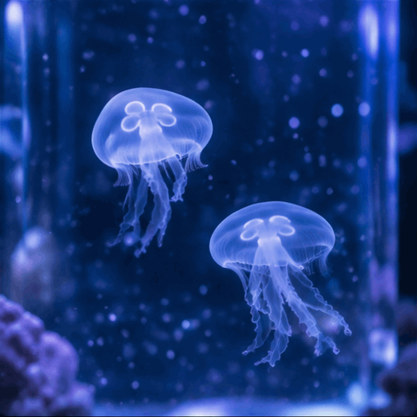

<!-- Generated by scripts/build_readme.py. Edit source data, locale catalogs and generator scripts. -->

<a id="top"></a>

[](https://raphael.app/?utm_source=github&utm_medium=repository&utm_campaign=gpt_image_2_6_launch&utm_content=hero&utm_term=zh-TW)

# 🚀 GPT Image 2.6 提示詞大全

[](https://github.com/sindresorhus/awesome)
[](https://github.com/RaphaelAI-OpenLab/awesome-gpt-image-2.6-prompts)
[](LICENSE)
[](https://github.com/RaphaelAI-OpenLab/awesome-gpt-image-2.6-prompts/actions/workflows/validate.yml)
[](CONTRIBUTING.md)

> 🎨 GPT Image 2.6（ChatGPT Images 2.6）創意提示詞與視覺案例精選合集，涵蓋 Flare 與 Sunburst、原生 GIF 提示詞、SVG 向量提示詞與標註引導局部編輯。

> ⚠️ **著作權聲明**: 本合集收錄公開來源的提示詞與案例，以及獨立生成的圖片，僅供教育用途。若您認為任何內容侵害您的權利，請 [提出 Issue](https://github.com/RaphaelAI-OpenLab/awesome-gpt-image-2.6-prompts/issues/new?template=report-problem.yml)，我們將立即移除。

---

<a href="README.md"></a> <a href="README.zh-CN.md"></a> <a href="README.zh-TW.md"></a> <a href="README.ja-JP.md"></a><br />
<a href="README.ko-KR.md"></a> <a href="README.th-TH.md"></a> <a href="README.vi-VN.md"></a> <a href="README.hi-IN.md"></a><br />
<a href="README.es-ES.md"></a> <a href="README.es-419.md"></a> <a href="README.de-DE.md"></a> <a href="README.fr-FR.md"></a><br />
<a href="README.it-IT.md"></a> <a href="README.pt-BR.md"></a> <a href="README.pt-PT.md"></a> <a href="README.tr-TR.md"></a>

---

此語言版本翻譯了儲存庫介面。完整案例詳情目前提供英文與簡體中文版。

案例標題、描述與詳細頁面若尚無翻譯，將以英文顯示。原始提示詞與來源引文不予翻譯。

<a id="gallery"></a>

## 🌐 在網頁圖庫中查看

**[👉 瀏覽 Raphael GPT Image 2.6 提示詞圖庫](https://raphael.app/gpt-image-2-6-prompts?utm_source=github&utm_medium=repository&utm_campaign=gpt_image_2_6_launch&utm_content=top_cta&utm_term=zh-TW)**

**[📝 完整提示詞](README.md#collection)**

為什麼到網站創作？

| 功能 | GitHub README | Raphael 網頁版 |
| --- | --- | --- |
| 🆓 免費生圖 | 瀏覽案例與提示詞 | 基礎生圖免費，免登入、免綁卡 |
| ✍️ 提示詞使用 | 複製已公開的提示詞 | 貼上提示詞，直接生成圖片 |
| 🖼️ 參考圖編輯 | 查看參考圖與輸入要求 | 上傳參考圖，輔助生成與修改圖片 |
| 🤖 模型選擇 | 查看各案例使用的模型 | 選擇 GPT Image、Seedream、Nano Banana 等模型 |
| 🎨 風格與尺寸 | 參考來源記錄的風格與參數 | 選擇風格、長寬比與輸出格式 |
| 🔄 多版本嘗試 | 比較已收錄的案例效果 | 每則提示詞一次最多生成 4 張圖 |
| 🛠️ 圖片工具 | 閱讀圖片編輯工作流程 | 去背、放大、擴圖與局部修改 |
| 📱 行動版 | 閱讀案例 | 在手機瀏覽器中生成與編輯圖片 |

免費生圖使用基礎模式；其他模型依網頁顯示的點數與方案要求使用。

[瀏覽此儲存庫的所有案例 →](#all-cases)

<a id="categories"></a>

## 🏷️ 依分類瀏覽

[全部 (158)](README.md#all-cases) · [GIF 與動畫 (89)](README.md#category-gif-animation) · [角色與一致性 (26)](README.md#category-characters-consistency) · [標註與局部編輯 (11)](README.md#category-markup-edits) · [海報與文字排版 (9)](README.md#category-posters-typography) · [品牌與產品視覺 (8)](README.md#category-brand-products) · [資訊圖表 (8)](README.md#category-infographics) · [SVG 與設計素材 (4)](README.md#category-svg-design-assets) · [室內設計與建築 (3)](README.md#category-interiors-architecture)

<a id="contents"></a>

## 📖 目錄

- [什麼是 GPT Image 2.6（ChatGPT Images 2.6）？](#about)
- [OpenAI API 速查（Flare 與 Sunburst）](#api-quickstart)
- [統計資料](#statistics)
- [精選案例](#featured)
- [所有案例](#all-cases)
- [完整提示詞](README.md#collection)
- [使用方式](#using)
- [參與貢獻](#contribute)
- [授權條款](#license)
- [致謝](#acknowledgements)
- [星號歷史](#star-history)

<a id="about"></a>

## 🤔 什麼是 GPT Image 2.6（ChatGPT Images 2.6）？

OpenAI 於 2026 年 11 月 4 日發布 Images 2.6（ChatGPT Images 2.6 / GPT Image 2.6），提供 `gpt-image-2.6-sunburst` 與 `gpt-image-2.6-flare` 兩個 API 模型版本。本合集整理可複製的圖像生成、標註引導局部編輯、原生 GIF 動圖與 SVG 向量提示詞及案例；具體版本支援情況按每個案例記錄，不作推定。

[官方公告](https://openai.com/index/introducing-images-2-6/) · [模型說明文件](https://developers.openai.com/api/docs/guides/image-generation)

### GPT-Image-2.6 Flare vs Sunburst 與核心工作流

| 版本 / 工作流 | 適用場景 | 查看案例 |
| --- | --- | --- |
| GPT-Image-2.6 Sunburst（`gpt-image-2.6-sunburst`） | 高細節畫面、複雜排版與精準文字渲染、多輪角色一致性、原生 GIF 與 SVG 輸出 | [精選案例](#featured) |
| GPT-Image-2.6 Flare（`gpt-image-2.6-flare`） | 低延遲快速迭代、草圖探索、批次高吞吐出圖、局部標註編輯、GIF 與 SVG 輸出 | [所有案例](README.md#all-cases) |
| 原生 GIF 提示詞（Native GIF Prompts） | 無縫循環動圖（`output_format: gif`，2–16 幀），適合貼圖、產品演示與動態分鏡 | [GIF 與動畫](README.md#category-gif-animation) |
| SVG 向量提示詞（SVG Vector Prompts） | 清晰可編輯的向量 Logo、圖示、介面概念稿與設計素材（`output_format: svg`） | [SVG 與設計素材](README.md#category-svg-design-assets) |
| 標註引導局部編輯（Markup-Guided Editing） | 在參考圖上畫圈或標註，精準完成局部換色、物件替換與多語言版式本地化 | [標註與局部編輯](README.md#category-markup-edits) |

<a id="api-quickstart"></a>

## ⚡ OpenAI API 速查（Flare 與 Sunburst）

從本合集複製任意提示詞，即可直接透過 OpenAI Images API 呼叫（追求速度選 `gpt-image-2.6-flare`，追求高細節選 `gpt-image-2.6-sunburst`）。

```python
import base64
from openai import OpenAI

client = OpenAI()  # Reads OPENAI_API_KEY from environment

# 1) High-detail still image with GPT-Image-2.6 Sunburst (or "gpt-image-2.6-flare" for speed)
image = client.images.generate(
    model="gpt-image-2.6-sunburst",
    prompt="Editorial studio photo of a cobalt ceramic vase on warm oak, soft morning light",
    size="1024x1024",
    quality="high",
)

# 2) Native looping GIF prompt (output_format="gif", 2-16 frames)
gif = client.images.generate(
    model="gpt-image-2.6-flare",
    prompt="A tiny lantern-carrying monkey in a snowy pine forest at dusk, seamless loop animation",
    output_format="gif",
    frame_count=8,
    frame_duration_ms=150,
)
with open("loop.gif", "wb") as f:
    f.write(base64.b64decode(gif.data[0].b64_json))

# 3) Editable SVG vector prompt (output_format="svg")
svg = client.images.generate(
    model="gpt-image-2.6-sunburst",
    prompt="Minimalist bakery logo 'Field & Flour', clean vector silhouette, warm balanced negative space",
    output_format="svg",
)
with open("logo.svg", "wb") as f:
    f.write(base64.b64decode(svg.data[0].b64_json))
```

```bash
curl https://api.openai.com/v1/images/generations \
  -H "Content-Type: application/json" \
  -H "Authorization: Bearer $OPENAI_API_KEY" \
  -d '{
    "model": "gpt-image-2.6-flare",
    "prompt": "Minimalist geometric bakery logo on cream paper, clean vector aesthetic",
    "size": "1024x1024",
    "output_format": "svg"
  }'
```

<a id="statistics"></a>

## 📊 統計資料

| **指標** | **數量** |
| --- | --- |
| 📝 提示詞總數 | **156** |
| ⭐ 精選 | **12** |
| 🗂️ CMS 素材總數 | **8** |
| 🔄 最後更新 | **2026年11月25日星期三 UTC 09:00:28** |

<!-- cms-stats 8 2026-11-25T09:00:28Z -->

<a id="featured"></a>

## 🔥 精選案例

<a id="featured-case-launch-higgsfield"></a>

### 38. [Knight scene and clothing edit sequence](README.md#source-case-launch-higgsfield)

<div align="center">
<a href="assets/examples/launch-higgsfield/source-01.webp"></a><br /><sub>Source image 1</sub>
</div>

<div align="center">
<a href="assets/examples/launch-higgsfield/source-02.webp"></a><br /><sub>Source image 2</sub>
</div>

<div align="center">
<a href="assets/examples/launch-higgsfield/source-03.webp"></a><br /><sub>Source image 3</sub>
</div>

**原始提示詞**

**Starting image · Character and scene**

```text
Epic high fantasy anime key visual, mature seinen style like a modern high-budget anime film. A young woman sorceress-knight in her twenties with long crimson hair and sharp golden eyes stands on the edge of a cliff in ornate silver and emerald armor with a flowing royal blue cape, a glowing runic sword planted in front of her, magic sparks around her hands. Behind her a vast fantasy kingdom: floating islands with waterfalls pouring into the clouds, a white castle with spires, a huge ancient dragon flying in the distance, giant blooming sakura and golden autumn forests in the valley below. Sunset sky with vivid orange, magenta, turquoise and violet clouds, god rays, glowing magic particles in the air. Extremely vibrant saturated colors, dramatic rim lighting, cel shading with detailed painted backgrounds, crisp clean line art, depth and atmosphere, dynamic low camera angle, wide cinematic composition. Adult, elegant, serious heroic mood, not childish, no chibi, no sci-fi, no neon, no text, no watermark.
```

**Edit 1 · Sunset valley**

```text
Replace the moonlit landscape with a golden sunset over a misty mountain valley, winding river, waterfalls and ancient ruins. Keep the background softly blurred and the knight, armor, sword, rock and composition unchanged.
```

**Edit 2 · Floating castle**

```text
Replace the background with a majestic floating castle, smaller floating islands, cascading waterfalls and a dragon flying overhead. Preserve the warm sunset, atmospheric haze and shallow depth of field. Keep the knight and foreground unchanged.
```

**Edit 3 · Recolor armor**

```text
Recolor the armor to ivory white with rich gold trim, replace emerald gemstones with rubies, and change green fabric panels to deep crimson. Preserve the armor design, blue cape, red hair, golden sword glow, pose and background.
```

Use the edits in order, passing the previous output into the next edit. The official page includes the starting-image prompt alongside Edit 1; the three archived images show the edited results.

[來源中的原始提示詞](https://openai.com/index/introducing-images-2-6/#more-ways-to-create-and-edit-in-the-api)

**作者**: [Higgsfield](https://openai.com/index/introducing-images-2-6/#more-ways-to-create-and-edit-in-the-api)

**原始來源**: [官方發布示範](https://openai.com/index/introducing-images-2-6/#more-ways-to-create-and-edit-in-the-api) · [來源詳情](cases/launch-higgsfield/README.md)

**[👉 立即嘗試 →](https://raphael.app/gpt-image-2-6-prompts?utm_source=github&utm_medium=repository&utm_campaign=gpt_image_2_6_launch&utm_content=case_gallery_launch-higgsfield&utm_term=zh-TW)**

---

<a id="featured-case-raphael-observatory-weather-cycle"></a>

### 95. [Observatory through four skies](README.md#source-case-raphael-observatory-weather-cycle)

<div align="center">
<a href="assets/examples/raphael-observatory-weather-cycle/observatory-weather-cycle.gif"></a><br /><sub>Observatory through four skies</sub>
</div>

**原始提示詞**

```text
A small red-domed observatory on a rocky bluff against a locked circular composition, illustrated as colored pencil over paper. Clouds give way to a shower, dawn rainbow, clear starry sky and then back to drifting clouds. Preserve the building and horizon in every frame. Soft weather transitions in a short square loop.
```

[原始提示詞 (.txt)](cases/raphael-observatory-weather-cycle/prompt.txt)


**作者**: Raphael

[來源詳情](cases/raphael-observatory-weather-cycle/README.md)

**[👉 立即嘗試 →](https://raphael.app/gpt-image-2-6-prompts?utm_source=github&utm_medium=repository&utm_campaign=gpt_image_2_6_launch&utm_content=case_gallery_raphael-observatory-weather-cycle&utm_term=zh-TW)**

---

<a id="featured-case-docs-bakery-svg"></a>

### 66. [Bakery SVG logo](README.md#source-case-docs-bakery-svg)

<div align="center">
<a href="assets/examples/docs-bakery-svg/field-and-flour-gpt-image-2-6-flare.svg"></a><br /><sub>Flare SVG logo</sub>
</div>

<div align="center">
<a href="assets/examples/docs-bakery-svg/field-and-flour-gpt-image-2-6-sunburst.svg"></a><br /><sub>Sunburst SVG logo</sub>
</div>

**原始提示詞**

```text
Create an original, non-infringing logo for a company called Field & Flour, a local bakery.
The logo should feel warm, simple, and timeless. Use clean, vector-like shapes, a strong silhouette, and balanced negative space.
Favor simplicity over detail so it reads clearly at small and large sizes. Flat design, minimal strokes, no gradients unless essential.
Fully transparent background. Deliver a single centered logo with generous padding, clean alpha edges, and no solid backdrop, scenery, checkerboard, or watermark.
```

[來源中的原始提示詞](https://developers.openai.com/api/docs/guides/image-prompting#generate-svg-output)

**作者**: [OpenAI](https://developers.openai.com/api/docs/guides/image-prompting#generate-svg-output)

**原始來源**: [官方說明文件](https://developers.openai.com/api/docs/guides/image-prompting#generate-svg-output) · [來源詳情](cases/docs-bakery-svg/README.md)

**[👉 立即嘗試 →](https://raphael.app/gpt-image-2-6-prompts?utm_source=github&utm_medium=repository&utm_campaign=gpt_image_2_6_launch&utm_content=case_gallery_docs-bakery-svg&utm_term=zh-TW)**

---

<a id="featured-case-raphael-greenhouse-day-to-night"></a>

### 97. [Greenhouse from dawn through night](README.md#source-case-raphael-greenhouse-day-to-night)

<div align="center">
<a href="assets/examples/raphael-greenhouse-day-to-night/greenhouse-day-to-night.gif"></a><br /><sub>Greenhouse from dawn through night</sub>
</div>

**原始提示詞**

```text
Seen from outside, a tiny steel-framed desert greenhouse holds several tall cacti. Pink dawn sweeps into turquoise afternoon glass, then deep violet night with a single interior grow lamp and back to dawn. Fixed wide composition and architecture, softly textured gouache, smooth light changes in a brief ambient loop, no text.
```

[原始提示詞 (.txt)](cases/raphael-greenhouse-day-to-night/prompt.txt)


**作者**: Raphael

[來源詳情](cases/raphael-greenhouse-day-to-night/README.md)

**[👉 立即嘗試 →](https://raphael.app/gpt-image-2-6-prompts?utm_source=github&utm_medium=repository&utm_campaign=gpt_image_2_6_launch&utm_content=case_gallery_raphael-greenhouse-day-to-night&utm_term=zh-TW)**

---

<a id="featured-case-social-cyan-poetry-wet-portrait"></a>

### 46. [Glowing cyan poetry and equations on wet skin](README.md#source-case-social-cyan-poetry-wet-portrait)

<div align="center">
<a href="assets/examples/social-cyan-poetry-wet-portrait/source-01.jpg"></a><br /><sub>Glowing cyan poetry and equations on wet skin</sub>
</div>

**原始提示詞**

```text
A cinematic, ultra-realistic close-up portrait of a young woman with wet, tousled dark hair and luminous skin, staring directly into the camera with an intense, introspective expression. Glowing cyan handwritten text and symbols are projected across her face, neck, and shoulders, resembling poetic phrases, equations, and abstract handwriting. The light reflections shimmer on her damp skin, creating a futuristic, cyber-poetry aesthetic. Dark,moody background with soft shadows, shallow depth of field, sharp focus on the eyes, high contrast lighting, teal and blue color palette, hyper-detailed skin texture, photorealistic, dramatic atmosphere, cyberpunk meets fine-art portrait photography, 8K quality, cinematic lighting.
```

[原始提示詞 (.txt)](cases/social-cyan-poetry-wet-portrait/prompt.txt)

[來源中的原始提示詞](https://x.com/iamsofiaijaz/status/2118561558511132918)

**作者**: [iamsofiaijaz](https://x.com/iamsofiaijaz)

**原始來源**: [創作者自述模型](https://x.com/iamsofiaijaz/status/2118561513879507399) · [來源詳情](cases/social-cyan-poetry-wet-portrait/README.md)

**[👉 立即嘗試 →](https://raphael.app/gpt-image-2-6-prompts?utm_source=github&utm_medium=repository&utm_campaign=gpt_image_2_6_launch&utm_content=case_gallery_social-cyan-poetry-wet-portrait&utm_term=zh-TW)**

---

<a id="featured-case-raphael-moon-jelly-aquarium"></a>

### 100. [Moon jelly aquarium](README.md#source-case-raphael-moon-jelly-aquarium)

<div align="center">
<a href="assets/examples/raphael-moon-jelly-aquarium/moon-jelly-aquarium.gif"></a><br /><sub>Moon jelly aquarium</sub>
</div>

**原始提示詞**

```text
A pair of tiny moon jellies drift in a tall cylindrical aquarium, backlit in pale aqua and lavender against indigo. Their bells pulse in a gently offset rhythm and fine suspended specks drift upward as the two jellyfish return to their original arrangement. Macro photography look, camera locked, no type, ambient loop.
```

[原始提示詞 (.txt)](cases/raphael-moon-jelly-aquarium/prompt.txt)


**作者**: Raphael

[來源詳情](cases/raphael-moon-jelly-aquarium/README.md)

**[👉 立即嘗試 →](https://raphael.app/gpt-image-2-6-prompts?utm_source=github&utm_medium=repository&utm_campaign=gpt_image_2_6_launch&utm_content=case_gallery_raphael-moon-jelly-aquarium&utm_term=zh-TW)**

---

<a id="featured-case-docs-pixel-style"></a>

### 57. [Transfer a pixel-art style](README.md#source-case-docs-pixel-style)

<div align="center">
<a href="assets/examples/docs-pixel-style/motorcycle-gpt-image-2-6-flare.webp"></a><br /><sub>Pixel-art motorcycle rider using the reference style — GPT Image 2.6 Flare (official model output)</sub>
</div>

<div align="center">
<a href="assets/examples/docs-pixel-style/motorcycle-gpt-image-2-6-sunburst.webp"></a><br /><sub>Pixel-art motorcycle rider using the reference style — GPT Image 2.6 Sunburst (official model output)</sub>
</div>

**參考圖片**

參考 / 輸入圖片，並非生成結果。

<div align="center">
<a href="assets/references/docs-pixel-style/pixels.webp"></a><br /><sub>Reference input: Pixel-art game screen used as a style reference</sub>
</div>


**原始提示詞**

```text
Use the same style from the input image and generate a man riding a motorcycle on a white background.
```

[來源中的原始提示詞](https://developers.openai.com/api/docs/guides/image-prompting#transfer-a-visual-style)

**作者**: [OpenAI](https://developers.openai.com/api/docs/guides/image-prompting#transfer-a-visual-style)

**原始來源**: [官方說明文件](https://developers.openai.com/api/docs/guides/image-prompting#transfer-a-visual-style) · [來源詳情](cases/docs-pixel-style/README.md)

**[👉 立即嘗試 →](https://raphael.app/gpt-image-2-6-prompts?utm_source=github&utm_medium=repository&utm_campaign=gpt_image_2_6_launch&utm_content=case_gallery_docs-pixel-style&utm_term=zh-TW)**

---

<a id="featured-case-raphael-sketchbook-bicycle"></a>

### 108. [Sketchbook bicycle comes alive](README.md#source-case-raphael-sketchbook-bicycle)

<div align="center">
<a href="assets/examples/raphael-sketchbook-bicycle/sketchbook-bicycle.gif"></a><br /><sub>Sketchbook bicycle comes alive</sub>
</div>

**原始提示詞**

```text
A sketchbook close-up with a simple cobalt pen doodle of a tiny bicycle. The wheels start spinning and a pennant flutters, then the bicycle rides in one small circle on the page and returns to its original outline. Keep the paper and camera fixed, no hands or text, whimsical looping animation.
```

[原始提示詞 (.txt)](cases/raphael-sketchbook-bicycle/prompt.txt)


**作者**: Raphael

[來源詳情](cases/raphael-sketchbook-bicycle/README.md)

**[👉 立即嘗試 →](https://raphael.app/gpt-image-2-6-prompts?utm_source=github&utm_medium=repository&utm_campaign=gpt_image_2_6_launch&utm_content=case_gallery_raphael-sketchbook-bicycle&utm_term=zh-TW)**

---

<a id="featured-case-docs-market-ui"></a>

### 67. [Farmers market mobile interface](README.md#source-case-docs-market-ui)

<div align="center">
<a href="assets/examples/docs-market-ui/ui-farmers-market-gpt-image-2-6-flare.webp"></a><br /><sub>Farmers market mobile app mockup — GPT Image 2.6 Flare (official model output)</sub>
</div>

<div align="center">
<a href="assets/examples/docs-market-ui/ui-farmers-market-gpt-image-2-6-sunburst.webp"></a><br /><sub>Farmers market mobile app mockup — GPT Image 2.6 Sunburst (official model output)</sub>
</div>

**原始提示詞**

```text
Create a realistic mobile app UI mockup for a local farmers market.
Show today’s market with a simple header, a short list of vendors with small photos and categories, a small “Today’s specials” section, and basic information for location and hours.
Design it to be practical, and easy to use. White background, subtle natural accent colors, clear typography, and minimal decoration.
It should look like a real, well-designed, beautiful app for a small local market.
Place the UI mockup in an iPhone frame.
```

[來源中的原始提示詞](https://developers.openai.com/api/docs/guides/image-prompting#create-an-interface-preview)

**作者**: [OpenAI](https://developers.openai.com/api/docs/guides/image-prompting#create-an-interface-preview)

**原始來源**: [官方說明文件](https://developers.openai.com/api/docs/guides/image-prompting#create-an-interface-preview) · [來源詳情](cases/docs-market-ui/README.md)

**[👉 立即嘗試 →](https://raphael.app/gpt-image-2-6-prompts?utm_source=github&utm_medium=repository&utm_campaign=gpt_image_2_6_launch&utm_content=case_gallery_docs-market-ui&utm_term=zh-TW)**

---

<a id="featured-case-raphael-pixel-greenhouse-sprinkler"></a>

### 109. [Pixel greenhouse sprinkler](README.md#source-case-raphael-pixel-greenhouse-sprinkler)

<div align="center">
<a href="assets/examples/raphael-pixel-greenhouse-sprinkler/pixel-greenhouse-sprinkler.gif"></a><br /><sub>Pixel greenhouse sprinkler</sub>
</div>

**原始提示詞**

```text
A cozy pixel-art greenhouse at dusk: mint roof panes, terra-cotta pots and a tiny sprinkler rotating above a shelf of seedlings. The sprinkler sprays a few bright pixels in two directions and returns to its first angle. Stable scene, limited 16-bit palette, crisp square pixels, no text, seamless loop.
```

[原始提示詞 (.txt)](cases/raphael-pixel-greenhouse-sprinkler/prompt.txt)


**作者**: Raphael

[來源詳情](cases/raphael-pixel-greenhouse-sprinkler/README.md)

**[👉 立即嘗試 →](https://raphael.app/gpt-image-2-6-prompts?utm_source=github&utm_medium=repository&utm_campaign=gpt_image_2_6_launch&utm_content=case_gallery_raphael-pixel-greenhouse-sprinkler&utm_term=zh-TW)**

---

<a id="featured-case-docs-vase-markup"></a>

### 55. [Recolor a marked vase](README.md#source-case-docs-vase-markup)

<div align="center">
<a href="assets/examples/docs-vase-markup/markup-vase-gpt-image-2-6-flare.webp"></a><br /><sub>GPT Image 2.6 Flare output: Flare edit of the kitchen with a blue vase and dried stems on the table</sub>
</div>

<div align="center">
<a href="assets/examples/docs-vase-markup/markup-vase-gpt-image-2-6-sunburst.webp"></a><br /><sub>GPT Image 2.6 Sunburst output: Sunburst edit of the kitchen with the same vase in cobalt blue and the red circle removed</sub>
</div>

**參考圖片**

參考 / 輸入圖片，並非生成結果。

<div align="center">
<a href="assets/references/docs-vase-markup/markup-vase-input-gpt-image-2-6.webp"></a><br /><sub>Reference input: Kitchen photo with a red circle around the striped vase on the dining table</sub>
</div>


**原始提示詞**

```text
Recolor the striped vase inside the red circle to solid cobalt blue ceramic. Keep its shape, the dried stems, and the rest of the kitchen unchanged. Remove the red circle from the finished photo.
```

[來源中的原始提示詞](https://developers.openai.com/api/docs/guides/image-prompting#guide-an-edit-with-markup)

**作者**: [OpenAI](https://developers.openai.com/api/docs/guides/image-prompting#guide-an-edit-with-markup)

**原始來源**: [官方說明文件](https://developers.openai.com/api/docs/guides/image-prompting#guide-an-edit-with-markup) · [來源詳情](cases/docs-vase-markup/README.md)

**[👉 立即嘗試 →](https://raphael.app/gpt-image-2-6-prompts?utm_source=github&utm_medium=repository&utm_campaign=gpt_image_2_6_launch&utm_content=case_gallery_docs-vase-markup&utm_term=zh-TW)**

---

<a id="featured-case-community-struggle-sailor-dance"></a>

### 121. [Moonlit magical-girl dance](README.md#source-case-community-struggle-sailor-dance)

<div align="center">
<a href="assets/examples/community-struggle-sailor-dance/9ff4f428146eff32d28f14d3db8d46d1.gif"></a><br /><sub>Magical girl dancing at night</sub>
</div>

**原始提示詞**

```text
创建一个 GIF，内容是 一位美少女战士在跳舞
```

[來源中的原始提示詞](https://tianqi.csdn.net/6aebfbae40858c2d8818a1fd.html#devmenu4)

**作者**: [STRUGGLE_xlf](https://tianqi.csdn.net/6aebfbae40858c2d8818a1fd.html#devmenu4)

**原始來源**: [創作者自述模型](https://tianqi.csdn.net/6aebfbae40858c2d8818a1fd.html#devmenu4) · [來源詳情](cases/community-struggle-sailor-dance/README.md)

**[👉 立即嘗試 →](https://raphael.app/gpt-image-2-6-prompts?utm_source=github&utm_medium=repository&utm_campaign=gpt_image_2_6_launch&utm_content=case_gallery_community-struggle-sailor-dance&utm_term=zh-TW)**

---

影片預覽是首幀靜態圖，點擊可開啟動畫檔案；參考圖與來源封面均單獨標註。

<a id="all-cases"></a>

## 📋 所有案例

本語言版本提供本地化簡介、API 速查、即時統計與全部精選案例。為避免在 14 個檔案中重複堆砌未翻譯的英文提示詞，請在下方依分類前往完整 158 個案例，或開啟本地化網頁圖庫。

| 分類 | 案例數 | 查看案例 |
| --- | ---: | --- |
| GIF 與動畫 | **89** | [閱讀英文版](README.md#category-gif-animation) |
| 角色與一致性 | **26** | [閱讀英文版](README.md#category-characters-consistency) |
| 標註與局部編輯 | **11** | [閱讀英文版](README.md#category-markup-edits) |
| 海報與文字排版 | **9** | [閱讀英文版](README.md#category-posters-typography) |
| 品牌與產品視覺 | **8** | [閱讀英文版](README.md#category-brand-products) |
| 資訊圖表 | **8** | [閱讀英文版](README.md#category-infographics) |
| SVG 與設計素材 | **4** | [閱讀英文版](README.md#category-svg-design-assets) |
| 室內設計與建築 | **3** | [閱讀英文版](README.md#category-interiors-architecture) |

**[👉 在英文主文件查看全部 158 個案例 →](README.md#all-cases)**

[開啟 Raphael 繁體中文網頁圖庫 ↗](https://raphael.app/zh-Hant/gpt-image-2-6-prompts?utm_source=github&utm_medium=repository&utm_campaign=gpt_image_2_6_launch&utm_content=localized_all_cases&utm_term=zh-TW)

<a id="using"></a>

## 📚 使用方式

1. 從分類或精選卡片開啟案例。
2. 閱讀模型證據、所需輸入、來源與再利用限制。
3. 若有原始提示詞連結，請前往來源查看。未提供的提示詞保持缺漏，不應根據圖片推測。

<a id="contribute"></a>

## 🤝 如何貢獻

來源案例寫入 content/source-cases.json，完整提示詞寫入 content/prompts.json。產生器維護索引與中英文詳情頁。

[貢獻指南](CONTRIBUTING.md) · [來源案例與媒體指南](docs/SOURCE_CASES.md) · [多語言說明](docs/LANGUAGES.md)

<a id="license"></a>

## 📄 授權條款

程式碼、原創說明文件與裝飾性 SVG 預留圖採用 MIT 授權。第三方提示詞與媒體仍適用各自的條款，並逐項記錄出處與再利用狀態。改編的 README 版面另於下方標註來源。

[儲存庫授權條款](LICENSE) · [來源標註說明](docs/ATTRIBUTION.md)

<a id="acknowledgements"></a>

## 🙏 致謝

README 結構依 CC BY 4.0 授權改編自 YouMind OpenLab 的 awesome-nano-banana-pro-prompts。針對 GPT Image 2.6 重新撰寫文案、建立資料與本機詳細頁面，並明確標示預留內容；未複製任何創意範例或媒體。

[YouMind README](https://github.com/YouMind-OpenLab/awesome-nano-banana-pro-prompts/blob/main/README_zh.md) · [CC BY 4.0](https://creativecommons.org/licenses/by/4.0/) · [來源標註說明](docs/ATTRIBUTION.md)

感謝 OpenAI，以及各案例頁面所標註的原創者。

<a id="star-history"></a>

## ⭐ 星號歷史

[星號歷史](https://star-history.com/#RaphaelAI-OpenLab/awesome-gpt-image-2.6-prompts&Date) · [查看加星號的使用者](https://github.com/RaphaelAI-OpenLab/awesome-gpt-image-2.6-prompts/stargazers)

[為此儲存庫加星號 / 追蹤](https://github.com/RaphaelAI-OpenLab/awesome-gpt-image-2.6-prompts)

[↑ 回到頁首](#top)

---

由 Raphael 整理。 [首頁](https://raphael.app/?utm_source=github&utm_medium=repository&utm_campaign=gpt_image_2_6_launch&utm_content=footer&utm_term=zh-TW)

根據結構化來源資料產生。請編輯資料集後重新產生，不要直接編輯此檔案。
