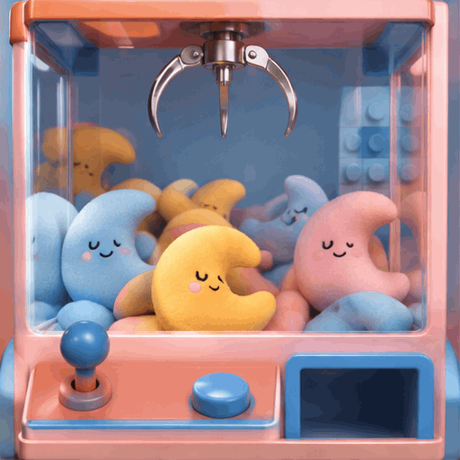

<!-- Generated by scripts/build_readme.py. Edit source data, locale catalogs and generator scripts. -->

# Arcade claw victory

[← Back to all cases](../../README.md#all-cases)

<a href="README.md"></a> <a href="README.zh-CN.md"></a>

**Original generation**

All nine frames decode and four sampled frames were visually checked.

## Images / GIFs



- [Arcade claw victory](../../assets/examples/raphael-arcade-claw-victory/arcade-claw-victory.gif) · gif
  - Credit: Raphael
  - Reuse: original. Generated for the Raphael prompt collection from an original text prompt.
  - [Provenance / rights evidence](../../cases/raphael-arcade-claw-victory/generation.json)

## Original prompt

```text
View a chunky arcade claw through the glass of a miniature candy-colored cabinet. It descends to pick up one plush crescent, carries it toward the prize chute, and reappears overhead for a loop. Peach and blue toy-brick palette, locked front camera, distinct claw motion, blank cabinet panels, no text.
```

[Original prompt (.txt)](../../cases/raphael-arcade-claw-victory/prompt.txt)


## Attribution and verification

- ID: raphael-arcade-claw-victory
- Author: Raphael
- [Generation record](../../cases/raphael-arcade-claw-victory/generation.json)
- Model: GPT Image 2.6
- Variant: Flare
- Evidence: EvoLink reported gpt-image-2.6-flare for each completed GIF generation task.
- Collected: 2026-11-23 (UTC)
- Generation verified: 2026-11-23 (UTC)
