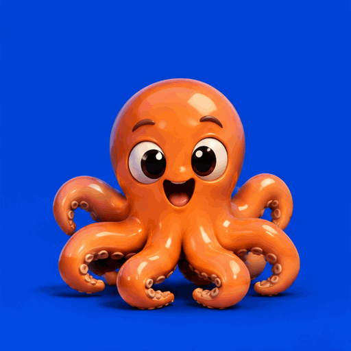

<!-- Generated by scripts/build_readme.py. Edit source data, locale catalogs and generator scripts. -->

# Ceramic octopus stretch

[← Back to all cases](../../README.md#all-cases)

<a href="README.md"></a> <a href="README.zh-CN.md"></a>

**Original generation**

All nine frames decode and four sampled frames were visually checked.

## Images / GIFs



- [Ceramic octopus stretch](../../assets/examples/raphael-ceramic-octopus-stretch/ceramic-octopus-stretch.gif) · gif
  - Credit: Raphael
  - Reuse: original. Generated for the Raphael prompt collection from an original text prompt.
  - [Provenance / rights evidence](../../cases/raphael-ceramic-octopus-stretch/generation.json)

## Original prompt

```text
A short square animated sticker of a glossy orange ceramic octopus with eight rubber-hose arms on a flat cobalt backdrop. It compresses like an accordion, stretches tall to fan its arms with a delighted expression, then settles into the original crouch. Smooth pose-to-pose motion, centered silhouette, locked camera, clean side light, no lettering. Loop back naturally to the opening pose.
```

[Original prompt (.txt)](../../cases/raphael-ceramic-octopus-stretch/prompt.txt)


## Attribution and verification

- ID: raphael-ceramic-octopus-stretch
- Author: Raphael
- [Generation record](../../cases/raphael-ceramic-octopus-stretch/generation.json)
- Model: GPT Image 2.6
- Variant: Flare
- Evidence: EvoLink reported gpt-image-2.6-flare for each completed GIF generation task.
- Collected: 2026-11-23 (UTC)
- Generation verified: 2026-11-23 (UTC)
