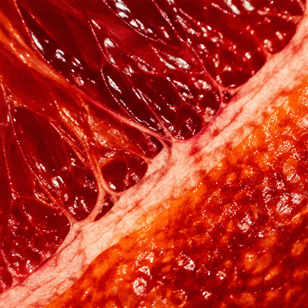

<!-- Generated by scripts/build_readme.py. Edit source data, locale catalogs and generator scripts. -->

# Citrus macro rhythm

[← Back to all cases](../../README.md#all-cases)

<a href="README.md"></a> <a href="README.zh-CN.md"></a>

**Original generation**

The red-to-gold cut is visible. The loop boundary makes a deliberate hard cut back to red.

## Images / GIFs



- [Citrus macro rhythm](../../assets/examples/raphael-citrus-macro-rhythm/citrus-macro-rhythm.gif) · gif
  - Credit: Raphael
  - Reuse: original. Generated for the Raphael prompt collection from an original text prompt.
  - [Provenance / rights evidence](../../cases/raphael-citrus-macro-rhythm/generation.json)

## Original prompt

```text
An editorial rapid-cut GIF of blood-orange pulp, grapefruit membranes and yuzu peel at extreme macro scale. Match each cut along the same diagonal ridge, alternating ruby, blush and ochre in a fixed graphic rhythm. Sharp analog flash and fine film grain. Match the final red frame to the opening; no type.
```

[Original prompt (.txt)](../../cases/raphael-citrus-macro-rhythm/prompt.txt)


## Attribution and verification

- ID: raphael-citrus-macro-rhythm
- Author: Raphael
- [Generation record](../../cases/raphael-citrus-macro-rhythm/generation.json)
- Model: GPT Image 2.6
- Variant: Flare
- Evidence: EvoLink reported gpt-image-2.6-flare for each completed GIF generation task.
- Collected: 2026-11-23 (UTC)
- Generation verified: 2026-11-23 (UTC)
