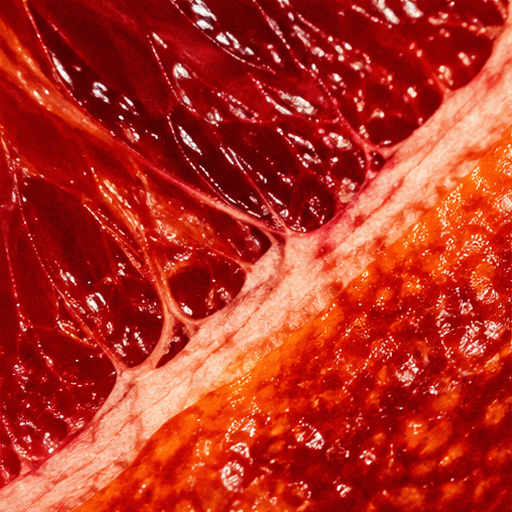

<!-- Generated by scripts/build_readme.py. Edit source data, locale catalogs and generator scripts. -->

# 柑橘微距快切

[← 返回全部案例](../../README.zh-CN.md#all-cases)

<a href="README.md"></a> <a href="README.zh-CN.md"></a>

**原创生成**

红色到金黄色的果肉切换清晰，循环接缝以硬切返回红色。

## 图片 / GIF



- [柑橘微距快切](../../assets/examples/raphael-citrus-macro-rhythm/citrus-macro-rhythm.gif) · gif
  - 署名：Raphael
  - 使用条件：original. Raphael 提示词合集的原创文本生成素材。
  - [来源 / 权利依据](../../cases/raphael-citrus-macro-rhythm/generation.json)

## 原始提示词

```text
An editorial rapid-cut GIF of blood-orange pulp, grapefruit membranes and yuzu peel at extreme macro scale. Match each cut along the same diagonal ridge, alternating ruby, blush and ochre in a fixed graphic rhythm. Sharp analog flash and fine film grain. Match the final red frame to the opening; no type.
```

[原始提示词 (.txt)](../../cases/raphael-citrus-macro-rhythm/prompt.txt)


## 来源与核对信息

- ID: raphael-citrus-macro-rhythm
- 作者：Raphael
- [生成记录](../../cases/raphael-citrus-macro-rhythm/generation.json)
- 模型：GPT Image 2.6
- 版本：Flare
- 依据：EvoLink 在每个已完成的 GIF 任务中回报模型为 gpt-image-2.6-flare。
- 收录：2026-11-23 (UTC)
- 生成核验：2026-11-23 (UTC)
