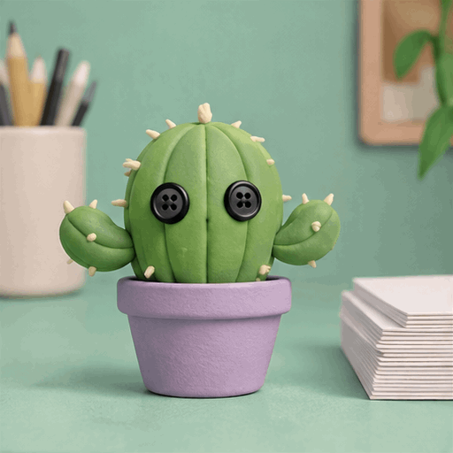
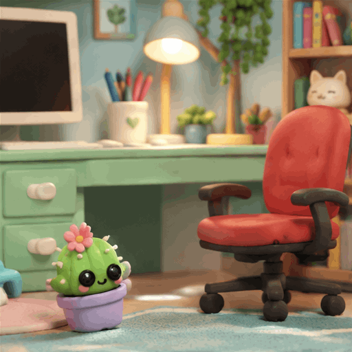

<!-- Generated by scripts/build_readme.py. Edit source data, locale catalogs and generator scripts. -->

# Desk plant workday stickers

[← Back to all cases](../../README.md#all-cases)

<a href="README.md"></a> <a href="README.zh-CN.md"></a>

**Original generation**

The cactus droops in the first GIF and hops onto a rolling chair in the second. Each clip was generated independently.

## Images / GIFs



- [Desk plant runs out of steam](../../assets/examples/raphael-desk-plant-workday/desk-plant-low-battery.gif) · gif
  - Credit: Raphael
  - Reuse: original. Generated for the Raphael prompt collection from an original text prompt.
  - [Provenance / rights evidence](../../cases/raphael-desk-plant-workday/generation.json)


- [Desk plant clocks out](../../assets/examples/raphael-desk-plant-workday/desk-plant-clock-out.gif) · gif
  - Credit: Raphael
  - Reuse: original. Generated for the Raphael prompt collection from an original text prompt.
  - [Provenance / rights evidence](../../cases/raphael-desk-plant-workday/generation.json)

## Original prompt

**Desk plant runs out of steam**

```text
A tiny lilac potted cactus with two button eyes sits beside a blank stack of papers on a mint desk. Its arms sag, face sinks briefly behind the rim, then it straightens to neutral. Studio-lit polymer clay, static front view, readable silhouette, no type, looping reaction GIF.
```

[Original prompt (.txt)](../../cases/raphael-desk-plant-workday/prompt-desk-plant-low-battery.txt)

**Desk plant clocks out**

```text
A tiny lilac potted cactus with button eyes in a home office hops into a red rolling desk chair and scoots toward the right. A quick circular wipe returns to the original setup as the pot sits down again. Mint desk, polymer-clay aesthetic, playful lettering-free loop with legible motions.
```

[Original prompt (.txt)](../../cases/raphael-desk-plant-workday/prompt-desk-plant-clock-out.txt)


## Attribution and verification

- ID: raphael-desk-plant-workday
- Author: Raphael
- [Generation record](../../cases/raphael-desk-plant-workday/generation.json)
- Model: GPT Image 2.6
- Variant: Flare
- Evidence: EvoLink reported gpt-image-2.6-flare for each completed GIF generation task.
- Collected: 2026-11-23 (UTC)
- Generation verified: 2026-11-23 (UTC)
