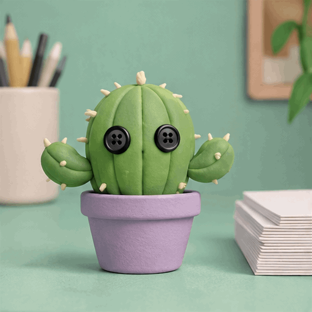
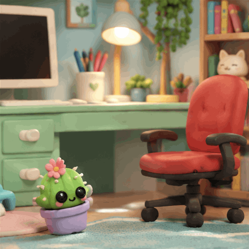

<!-- Generated by scripts/build_readme.py. Edit source data, locale catalogs and generator scripts. -->

# 办公盆栽的上班与下班

[← 返回全部案例](../../README.zh-CN.md#all-cases)

<a href="README.md"></a> <a href="README.zh-CN.md"></a>

**原创生成**

第一张展示仙人掌累趴，第二张展示它跳上办公椅。两段动画分别生成。

## 图片 / GIF



- [办公桌上的盆栽累趴了](../../assets/examples/raphael-desk-plant-workday/desk-plant-low-battery.gif) · gif
  - 署名：Raphael
  - 使用条件：original. Raphael 提示词合集的原创文本生成素材。
  - [来源 / 权利依据](../../cases/raphael-desk-plant-workday/generation.json)


- [盆栽打卡下班](../../assets/examples/raphael-desk-plant-workday/desk-plant-clock-out.gif) · gif
  - 署名：Raphael
  - 使用条件：original. Raphael 提示词合集的原创文本生成素材。
  - [来源 / 权利依据](../../cases/raphael-desk-plant-workday/generation.json)

## 原始提示词

**办公桌上的盆栽累趴了**

```text
A tiny lilac potted cactus with two button eyes sits beside a blank stack of papers on a mint desk. Its arms sag, face sinks briefly behind the rim, then it straightens to neutral. Studio-lit polymer clay, static front view, readable silhouette, no type, looping reaction GIF.
```

[原始提示词 (.txt)](../../cases/raphael-desk-plant-workday/prompt-desk-plant-low-battery.txt)

**盆栽打卡下班**

```text
A tiny lilac potted cactus with button eyes in a home office hops into a red rolling desk chair and scoots toward the right. A quick circular wipe returns to the original setup as the pot sits down again. Mint desk, polymer-clay aesthetic, playful lettering-free loop with legible motions.
```

[原始提示词 (.txt)](../../cases/raphael-desk-plant-workday/prompt-desk-plant-clock-out.txt)


## 来源与核对信息

- ID: raphael-desk-plant-workday
- 作者：Raphael
- [生成记录](../../cases/raphael-desk-plant-workday/generation.json)
- 模型：GPT Image 2.6
- 版本：Flare
- 依据：EvoLink 在每个已完成的 GIF 任务中回报模型为 gpt-image-2.6-flare。
- 收录：2026-11-23 (UTC)
- 生成核验：2026-11-23 (UTC)
