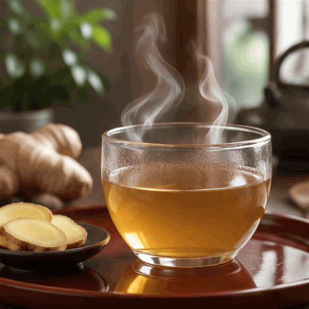

<!-- Generated by scripts/build_readme.py. Edit source data, locale catalogs and generator scripts. -->

# Ginger tea steam

[← Back to all cases](../../README.md#all-cases)

<a href="README.md"></a> <a href="README.zh-CN.md"></a>

**Original generation**

All nine frames decode and four sampled frames were visually checked.

## Images / GIFs



- [Ginger tea steam](../../assets/examples/raphael-ginger-tea-steam/ginger-tea-steam.gif) · gif
  - Credit: Raphael
  - Reuse: original. Generated for the Raphael prompt collection from an original text prompt.
  - [Provenance / rights evidence](../../cases/raphael-ginger-tea-steam/generation.json)

## Original prompt

```text
A low glass cup of ginger tea on a deep-red lacquer tray, seen from the side in a close studio shot. Two translucent strands of steam slowly uncurl and fade while the cup, sliced ginger and reflected daylight remain still. Cozy shallow depth of field, no text, quiet repeating cinemagraph GIF.
```

[Original prompt (.txt)](../../cases/raphael-ginger-tea-steam/prompt.txt)


## Attribution and verification

- ID: raphael-ginger-tea-steam
- Author: Raphael
- [Generation record](../../cases/raphael-ginger-tea-steam/generation.json)
- Model: GPT Image 2.6
- Variant: Flare
- Evidence: EvoLink reported gpt-image-2.6-flare for each completed GIF generation task.
- Collected: 2026-11-23 (UTC)
- Generation verified: 2026-11-23 (UTC)
