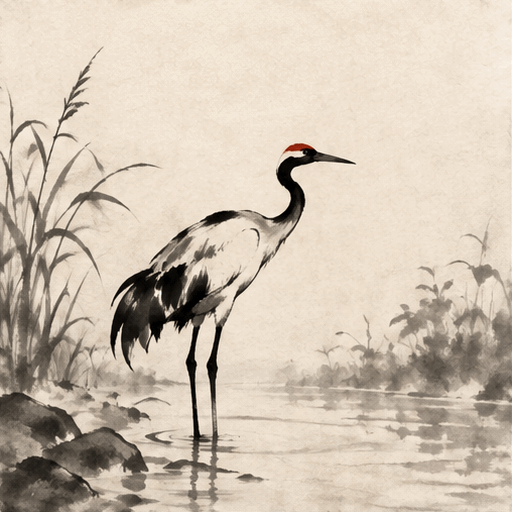

<!-- Generated by scripts/build_readme.py. Edit source data, locale catalogs and generator scripts. -->

# Ink-wash crane bows

[← Back to all cases](../../README.md#all-cases)

<a href="README.md"></a> <a href="README.zh-CN.md"></a>

**Original generation**

All nine frames decode and four sampled frames were visually checked.

## Images / GIFs



- [Ink-wash crane bows](../../assets/examples/raphael-ink-crane-bows/ink-crane-bows.gif) · gif
  - Credit: Raphael
  - Reuse: original. Generated for the Raphael prompt collection from an original text prompt.
  - [Provenance / rights evidence](../../cases/raphael-ink-crane-bows/generation.json)

## Original prompt

```text
A black ink-wash crane with a vermilion crown bows once at a reed-fringed pond, sending one ring of ink outward. The ripples fade into the textured ivory paper as the crane straightens. Reserve empty paper above the bird, retain expressive brush edges, no seals or calligraphy, looping locked scene.
```

[Original prompt (.txt)](../../cases/raphael-ink-crane-bows/prompt.txt)


## Attribution and verification

- ID: raphael-ink-crane-bows
- Author: Raphael
- [Generation record](../../cases/raphael-ink-crane-bows/generation.json)
- Model: GPT Image 2.6
- Variant: Flare
- Evidence: EvoLink reported gpt-image-2.6-flare for each completed GIF generation task.
- Collected: 2026-11-23 (UTC)
- Generation verified: 2026-11-23 (UTC)
