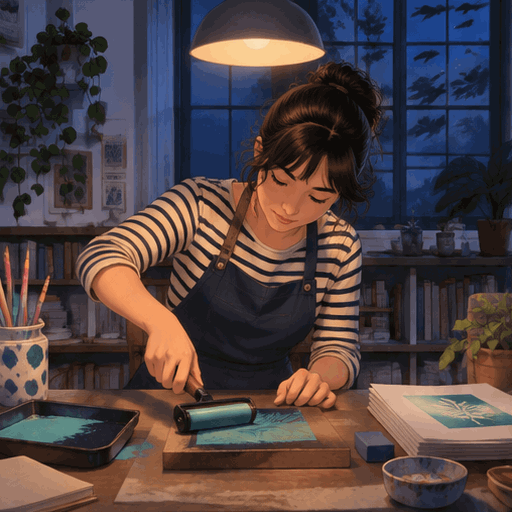

<!-- Generated by scripts/build_readme.py. Edit source data, locale catalogs and generator scripts. -->

# 深夜版画工作室

[← 返回全部案例](../../README.zh-CN.md#all-cases)

<a href="README.md"></a> <a href="README.zh-CN.md"></a>

**原创生成**

9 帧均通过解码检查，并逐个 GIF 抽查 4 帧画面。

## 图片 / GIF



- [深夜版画工作室](../../assets/examples/raphael-late-night-print-room/late-night-print-room.gif) · gif
  - 署名：Raphael
  - 使用条件：original. Raphael 提示词合集的原创文本生成素材。
  - [来源 / 权利依据](../../cases/raphael-late-night-print-room/generation.json)

## 原始提示词

```text
A quiet illustration of a late-night printmaker in striped sleeves rolling turquoise ink onto a small block at a cluttered desk. The roller rocks forward and back, a warm pendant light stays centered, and a few leaves move behind the studio window. Pastel pencils and blue shadows, fixed frame, no text, loop.
```

[原始提示词 (.txt)](../../cases/raphael-late-night-print-room/prompt.txt)


## 来源与核对信息

- ID: raphael-late-night-print-room
- 作者：Raphael
- [生成记录](../../cases/raphael-late-night-print-room/generation.json)
- 模型：GPT Image 2.6
- 版本：Flare
- 依据：EvoLink 在每个已完成的 GIF 任务中回报模型为 gpt-image-2.6-flare。
- 收录：2026-11-23 (UTC)
- 生成核验：2026-11-23 (UTC)
