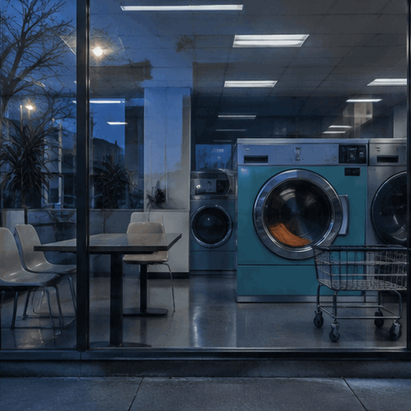

<!-- Generated by scripts/build_readme.py. Edit source data, locale catalogs and generator scripts. -->

# Laundromat at blue hour

[← Back to all cases](../../README.md#all-cases)

<a href="README.md"></a> <a href="README.zh-CN.md"></a>

**Original generation**

All nine frames decode and four sampled frames were visually checked.

## Images / GIFs



- [Laundromat at blue hour](../../assets/examples/raphael-laundromat-cinemagraph/laundromat-cinemagraph.gif) · gif
  - Credit: Raphael
  - Reuse: original. Generated for the Raphael prompt collection from an original text prompt.
  - [Provenance / rights evidence](../../cases/raphael-laundromat-cinemagraph/generation.json)

## Original prompt

```text
An empty neighborhood laundromat at blue hour, photographed from the sidewalk through a wide front window. Only the drum of one teal washing machine turns slowly, revealing a small orange garment once per rotation. Quiet reflected lights, locked camera, no pedestrians or legible signs, subtle repeating GIF.
```

[Original prompt (.txt)](../../cases/raphael-laundromat-cinemagraph/prompt.txt)


## Attribution and verification

- ID: raphael-laundromat-cinemagraph
- Author: Raphael
- [Generation record](../../cases/raphael-laundromat-cinemagraph/generation.json)
- Model: GPT Image 2.6
- Variant: Flare
- Evidence: EvoLink reported gpt-image-2.6-flare for each completed GIF generation task.
- Collected: 2026-11-23 (UTC)
- Generation verified: 2026-11-23 (UTC)
