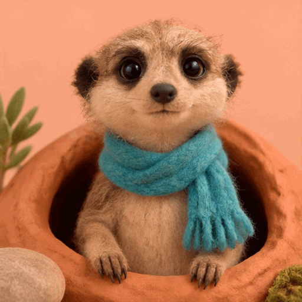

<!-- Generated by scripts/build_readme.py. Edit source data, locale catalogs and generator scripts. -->

# Meerkat double take

[← Back to all cases](../../README.md#all-cases)

<a href="README.md"></a> <a href="README.zh-CN.md"></a>

**Original generation**

All nine frames decode and four sampled frames were visually checked.

## Images / GIFs



- [Meerkat double take](../../assets/examples/raphael-meerkat-double-take/meerkat-double-take.gif) · gif
  - Credit: Raphael
  - Reuse: original. Generated for the Raphael prompt collection from an original text prompt.
  - [Provenance / rights evidence](../../cases/raphael-meerkat-double-take/generation.json)

## Original prompt

```text
A felted meerkat with a turquoise scarf peers from a terracotta burrow against a peach studio background. Its ears perk, it glances right, then snaps its gaze back with wide eyes before relaxing into the opening pose. Handcrafted wool fibers, medium close-up, no question marks or captions, short looping reaction GIF.
```

[Original prompt (.txt)](../../cases/raphael-meerkat-double-take/prompt.txt)


## Attribution and verification

- ID: raphael-meerkat-double-take
- Author: Raphael
- [Generation record](../../cases/raphael-meerkat-double-take/generation.json)
- Model: GPT Image 2.6
- Variant: Flare
- Evidence: EvoLink reported gpt-image-2.6-flare for each completed GIF generation task.
- Collected: 2026-11-23 (UTC)
- Generation verified: 2026-11-23 (UTC)
