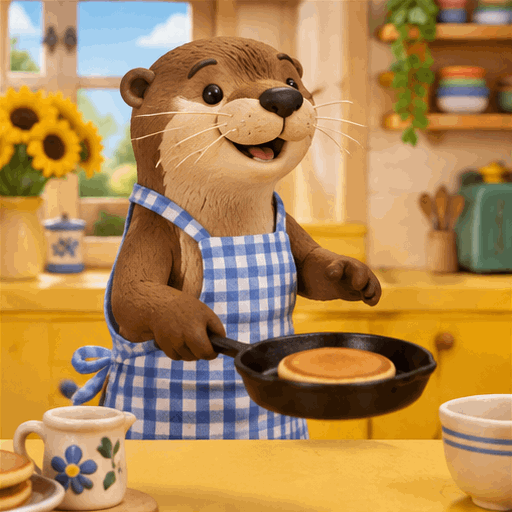

<!-- Generated by scripts/build_readme.py. Edit source data, locale catalogs and generator scripts. -->

# Otter flips a pancake

[← Back to all cases](../../README.md#all-cases)

<a href="README.md"></a> <a href="README.zh-CN.md"></a>

**Original generation**

All nine frames decode and four sampled frames were visually checked.

## Images / GIFs



- [Otter flips a pancake](../../assets/examples/raphael-otter-pancake-flip/otter-pancake-flip.gif) · gif
  - Credit: Raphael
  - Reuse: original. Generated for the Raphael prompt collection from an original text prompt.
  - [Provenance / rights evidence](../../cases/raphael-otter-pancake-flip/generation.json)

## Original prompt

```text
A claymation river otter in a blue gingham apron flips a miniature pancake from a cast-iron skillet at a sunflower-yellow breakfast counter. The pancake makes one visible airborne turn, lands back in the pan, and the otter resets its wrist. Stable medium shot, chunky crafted forms, no text, looping GIF.
```

[Original prompt (.txt)](../../cases/raphael-otter-pancake-flip/prompt.txt)


## Attribution and verification

- ID: raphael-otter-pancake-flip
- Author: Raphael
- [Generation record](../../cases/raphael-otter-pancake-flip/generation.json)
- Model: GPT Image 2.6
- Variant: Flare
- Evidence: EvoLink reported gpt-image-2.6-flare for each completed GIF generation task.
- Collected: 2026-11-23 (UTC)
- Generation verified: 2026-11-23 (UTC)
