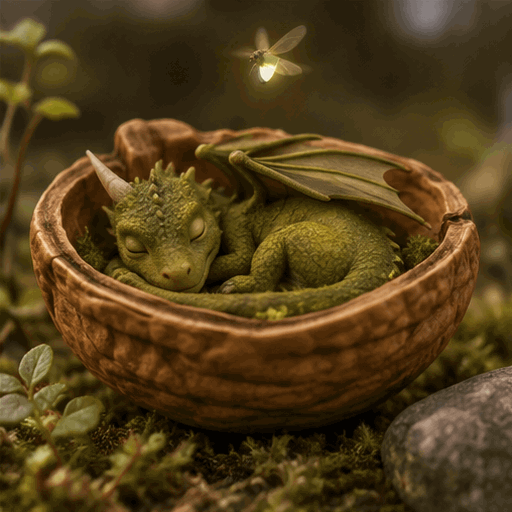

<!-- Generated by scripts/build_readme.py. Edit source data, locale catalogs and generator scripts. -->

# Pocket dragon snooze

[← Back to all cases](../../README.md#all-cases)

<a href="README.md"></a> <a href="README.zh-CN.md"></a>

**Original generation**

All nine frames decode and four sampled frames were visually checked.

## Images / GIFs



- [Pocket dragon snooze](../../assets/examples/raphael-pocket-dragon-snooze/pocket-dragon-snooze.gif) · gif
  - Credit: Raphael
  - Reuse: original. Generated for the Raphael prompt collection from an original text prompt.
  - [Provenance / rights evidence](../../cases/raphael-pocket-dragon-snooze/generation.json)

## Original prompt

```text
A tiny moss-green dragon sleeps curled inside an empty walnut shell, with both wings folded and one little horn visible. Its side rises and falls and a firefly circles just above it once. Make it feel like a macro photograph of a handmade miniature. No text or camera drift. Short quiet loop.
```

[Original prompt (.txt)](../../cases/raphael-pocket-dragon-snooze/prompt.txt)


## Attribution and verification

- ID: raphael-pocket-dragon-snooze
- Author: Raphael
- [Generation record](../../cases/raphael-pocket-dragon-snooze/generation.json)
- Model: GPT Image 2.6
- Variant: Flare
- Evidence: EvoLink reported gpt-image-2.6-flare for each completed GIF generation task.
- Collected: 2026-11-23 (UTC)
- Generation verified: 2026-11-23 (UTC)
