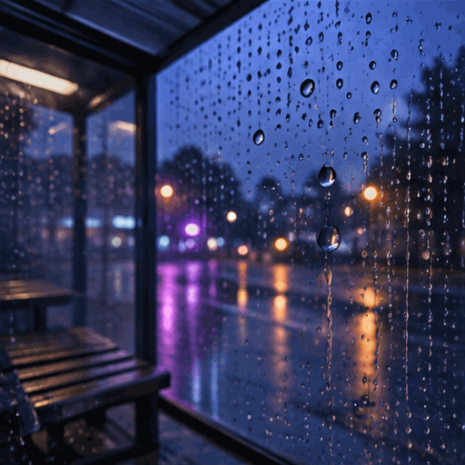

<!-- Generated by scripts/build_readme.py. Edit source data, locale catalogs and generator scripts. -->

# Rain at the bus shelter

[← Back to all cases](../../README.md#all-cases)

<a href="README.md"></a> <a href="README.zh-CN.md"></a>

**Original generation**

All nine frames decode and four sampled frames were visually checked.

## Images / GIFs



- [Rain at the bus shelter](../../assets/examples/raphael-raindrops-bus-shelter/raindrops-bus-shelter.gif) · gif
  - Credit: Raphael
  - Reuse: original. Generated for the Raphael prompt collection from an original text prompt.
  - [Provenance / rights evidence](../../cases/raphael-raindrops-bus-shelter/generation.json)

## Original prompt

```text
Blue-hour rain on the slanted glass of an empty bus shelter, lit by distant violet and amber traffic bokeh. Two sharp drops meet and glide down the foreground pane while new beads gather higher up. Stationary composition, no people, signs or lettering, muted photographic palette, looping cinemagraph.
```

[Original prompt (.txt)](../../cases/raphael-raindrops-bus-shelter/prompt.txt)


## Attribution and verification

- ID: raphael-raindrops-bus-shelter
- Author: Raphael
- [Generation record](../../cases/raphael-raindrops-bus-shelter/generation.json)
- Model: GPT Image 2.6
- Variant: Flare
- Evidence: EvoLink reported gpt-image-2.6-flare for each completed GIF generation task.
- Collected: 2026-11-23 (UTC)
- Generation verified: 2026-11-23 (UTC)
