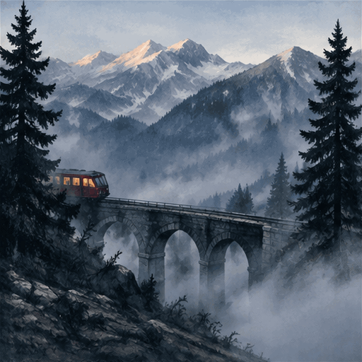

<!-- Generated by scripts/build_readme.py. Edit source data, locale catalogs and generator scripts. -->

# Red train in morning fog

[← Back to all cases](../../README.md#all-cases)

<a href="README.md"></a> <a href="README.zh-CN.md"></a>

**Original generation**

The train moves across the viaduct while fog thickens. It reappears on the next loop.

## Images / GIFs



- [Red train in morning fog](../../assets/examples/raphael-red-train-in-fog/red-train-in-fog.gif) · gif
  - Credit: Raphael
  - Reuse: original. Generated for the Raphael prompt collection from an original text prompt.
  - [Provenance / rights evidence](../../cases/raphael-red-train-in-fog/generation.json)

## Original prompt

```text
A little ruby funicular crosses an alpine viaduct at dawn; mist parts as its warm windows pass between two black pines. Let a dense bank of fog obscure the track at the end and reopen onto the starting view. Charcoal and gouache, textured cool palette, no signage, wide locked camera, short loop.
```

[Original prompt (.txt)](../../cases/raphael-red-train-in-fog/prompt.txt)


## Attribution and verification

- ID: raphael-red-train-in-fog
- Author: Raphael
- [Generation record](../../cases/raphael-red-train-in-fog/generation.json)
- Model: GPT Image 2.6
- Variant: Flare
- Evidence: EvoLink reported gpt-image-2.6-flare for each completed GIF generation task.
- Collected: 2026-11-23 (UTC)
- Generation verified: 2026-11-23 (UTC)
