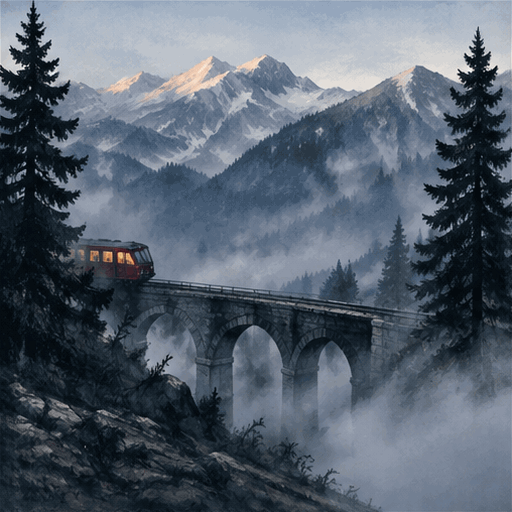

<!-- Generated by scripts/build_readme.py. Edit source data, locale catalogs and generator scripts. -->

# 晨雾中的红色列车

[← 返回全部案例](../../README.zh-CN.md#all-cases)

<a href="README.md"></a> <a href="README.zh-CN.md"></a>

**原创生成**

列车驶过高架桥时雾逐渐变浓，进入下一轮后列车重新出现。

## 图片 / GIF



- [晨雾中的红色列车](../../assets/examples/raphael-red-train-in-fog/red-train-in-fog.gif) · gif
  - 署名：Raphael
  - 使用条件：original. Raphael 提示词合集的原创文本生成素材。
  - [来源 / 权利依据](../../cases/raphael-red-train-in-fog/generation.json)

## 原始提示词

```text
A little ruby funicular crosses an alpine viaduct at dawn; mist parts as its warm windows pass between two black pines. Let a dense bank of fog obscure the track at the end and reopen onto the starting view. Charcoal and gouache, textured cool palette, no signage, wide locked camera, short loop.
```

[原始提示词 (.txt)](../../cases/raphael-red-train-in-fog/prompt.txt)


## 来源与核对信息

- ID: raphael-red-train-in-fog
- 作者：Raphael
- [生成记录](../../cases/raphael-red-train-in-fog/generation.json)
- 模型：GPT Image 2.6
- 版本：Flare
- 依据：EvoLink 在每个已完成的 GIF 任务中回报模型为 gpt-image-2.6-flare。
- 收录：2026-11-23 (UTC)
- 生成核验：2026-11-23 (UTC)
