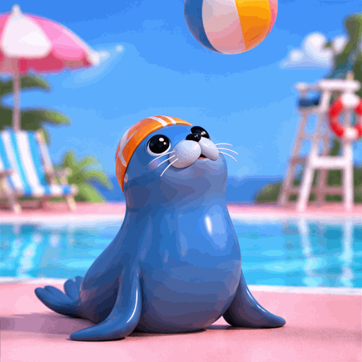

<!-- Generated by scripts/build_readme.py. Edit source data, locale catalogs and generator scripts. -->

# Sea lion ball save

[← Back to all cases](../../README.md#all-cases)

<a href="README.md"></a> <a href="README.zh-CN.md"></a>

**Original generation**

All nine frames decode and four sampled frames were visually checked.

## Images / GIFs



- [Sea lion ball save](../../assets/examples/raphael-sea-lion-ball-save/sea-lion-ball-save.gif) · gif
  - Credit: Raphael
  - Reuse: original. Generated for the Raphael prompt collection from an original text prompt.
  - [Provenance / rights evidence](../../cases/raphael-sea-lion-ball-save/generation.json)

## Original prompt

```text
A round blue sea lion in a tangerine swim cap stands on a pink pool deck. A striped beach ball drops into frame, taps its nose, and rebounds out along the same path while the seal dips and rises. Glossy inflatable toy aesthetic, strong silhouette, no captions, square reaction loop.
```

[Original prompt (.txt)](../../cases/raphael-sea-lion-ball-save/prompt.txt)


## Attribution and verification

- ID: raphael-sea-lion-ball-save
- Author: Raphael
- [Generation record](../../cases/raphael-sea-lion-ball-save/generation.json)
- Model: GPT Image 2.6
- Variant: Flare
- Evidence: EvoLink reported gpt-image-2.6-flare for each completed GIF generation task.
- Collected: 2026-11-23 (UTC)
- Generation verified: 2026-11-23 (UTC)
