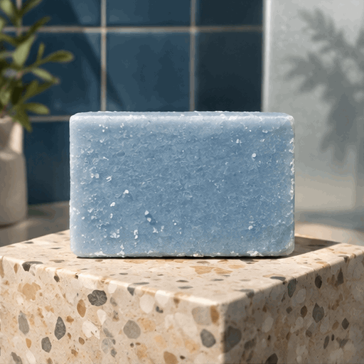

<!-- Generated by scripts/build_readme.py. Edit source data, locale catalogs and generator scripts. -->

# Sea salt soap launch loop

[← Back to all cases](../../README.md#all-cases)

<a href="README.md"></a> <a href="README.zh-CN.md"></a>

**Original generation**

The soap turns on a fixed terrazzo plinth. The background changes requested in the prompt are subtle.

## Images / GIFs



- [Sea salt soap launch loop](../../assets/examples/raphael-soap-launch-loop/soap-launch-loop.gif) · gif
  - Credit: Raphael
  - Reuse: original. Generated for the Raphael prompt collection from an original text prompt.
  - [Provenance / rights evidence](../../cases/raphael-soap-launch-loop/generation.json)

## Original prompt

```text
A pale blue rectangular bar of unbranded sea-salt soap turns slowly on a sand-colored terrazzo plinth. Cut on the rotation through three matching views: wet blue tiles, frosted glass, then the original terrazzo. Hard directional light brings out salt crystals, tactile premium product styling, clean geometry, no lettering or logos, rhythmically looped.
```

[Original prompt (.txt)](../../cases/raphael-soap-launch-loop/prompt.txt)


## Attribution and verification

- ID: raphael-soap-launch-loop
- Author: Raphael
- [Generation record](../../cases/raphael-soap-launch-loop/generation.json)
- Model: GPT Image 2.6
- Variant: Flare
- Evidence: EvoLink reported gpt-image-2.6-flare for each completed GIF generation task.
- Collected: 2026-11-23 (UTC)
- Generation verified: 2026-11-23 (UTC)
