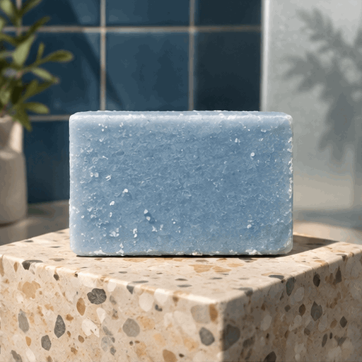

<!-- Generated by scripts/build_readme.py. Edit source data, locale catalogs and generator scripts. -->

# 海盐手工皂产品短片

[← 返回全部案例](../../README.zh-CN.md#all-cases)

<a href="README.md"></a> <a href="README.zh-CN.md"></a>

**原创生成**

手工皂在固定的水磨石底座上转动，提示词要求的背景切换并不明显。

## 图片 / GIF



- [海盐手工皂产品短片](../../assets/examples/raphael-soap-launch-loop/soap-launch-loop.gif) · gif
  - 署名：Raphael
  - 使用条件：original. Raphael 提示词合集的原创文本生成素材。
  - [来源 / 权利依据](../../cases/raphael-soap-launch-loop/generation.json)

## 原始提示词

```text
A pale blue rectangular bar of unbranded sea-salt soap turns slowly on a sand-colored terrazzo plinth. Cut on the rotation through three matching views: wet blue tiles, frosted glass, then the original terrazzo. Hard directional light brings out salt crystals, tactile premium product styling, clean geometry, no lettering or logos, rhythmically looped.
```

[原始提示词 (.txt)](../../cases/raphael-soap-launch-loop/prompt.txt)


## 来源与核对信息

- ID: raphael-soap-launch-loop
- 作者：Raphael
- [生成记录](../../cases/raphael-soap-launch-loop/generation.json)
- 模型：GPT Image 2.6
- 版本：Flare
- 依据：EvoLink 在每个已完成的 GIF 任务中回报模型为 gpt-image-2.6-flare。
- 收录：2026-11-23 (UTC)
- 生成核验：2026-11-23 (UTC)
