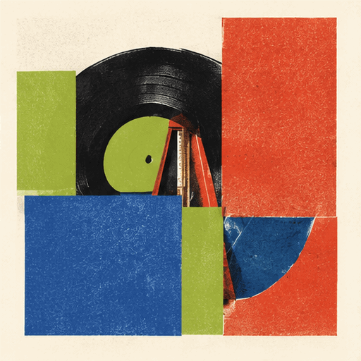

<!-- Generated by scripts/build_readme.py. Edit source data, locale catalogs and generator scripts. -->

# Sound garden in motion

[← Back to all cases](../../README.md#all-cases)

<a href="README.md"></a> <a href="README.zh-CN.md"></a>

**Original generation**

All nine frames decode and four sampled frames were visually checked.

## Images / GIFs



- [Sound garden in motion](../../assets/examples/raphael-sound-garden-risograph/sound-garden-risograph.gif) · gif
  - Credit: Raphael
  - Reuse: original. Generated for the Raphael prompt collection from an original text prompt.
  - [Provenance / rights evidence](../../cases/raphael-sound-garden-risograph/generation.json)

## Original prompt

```text
A screen-printed collage of a lime record, a cobalt ficus leaf and a vermilion metronome, arranged like an art-school editorial on ivory stock. Small blocks slide outward in sequence to reveal the objects, then glide back together. Sharp risograph registration, playful layering, fixed page boundaries, no readable type, looping GIF.
```

[Original prompt (.txt)](../../cases/raphael-sound-garden-risograph/prompt.txt)


## Attribution and verification

- ID: raphael-sound-garden-risograph
- Author: Raphael
- [Generation record](../../cases/raphael-sound-garden-risograph/generation.json)
- Model: GPT Image 2.6
- Variant: Flare
- Evidence: EvoLink reported gpt-image-2.6-flare for each completed GIF generation task.
- Collected: 2026-11-23 (UTC)
- Generation verified: 2026-11-23 (UTC)
