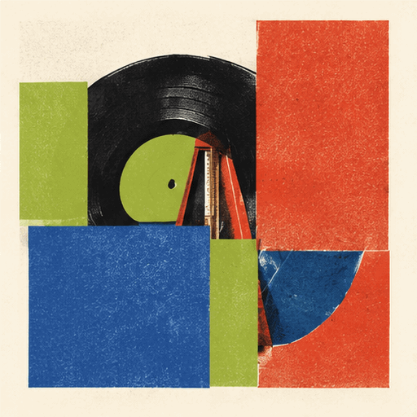

<!-- Generated by scripts/build_readme.py. Edit source data, locale catalogs and generator scripts. -->

# 声波花园拼贴动效

[← 返回全部案例](../../README.zh-CN.md#all-cases)

<a href="README.md"></a> <a href="README.zh-CN.md"></a>

**原创生成**

9 帧均通过解码检查，并逐个 GIF 抽查 4 帧画面。

## 图片 / GIF



- [声波花园拼贴动效](../../assets/examples/raphael-sound-garden-risograph/sound-garden-risograph.gif) · gif
  - 署名：Raphael
  - 使用条件：original. Raphael 提示词合集的原创文本生成素材。
  - [来源 / 权利依据](../../cases/raphael-sound-garden-risograph/generation.json)

## 原始提示词

```text
A screen-printed collage of a lime record, a cobalt ficus leaf and a vermilion metronome, arranged like an art-school editorial on ivory stock. Small blocks slide outward in sequence to reveal the objects, then glide back together. Sharp risograph registration, playful layering, fixed page boundaries, no readable type, looping GIF.
```

[原始提示词 (.txt)](../../cases/raphael-sound-garden-risograph/prompt.txt)


## 来源与核对信息

- ID: raphael-sound-garden-risograph
- 作者：Raphael
- [生成记录](../../cases/raphael-sound-garden-risograph/generation.json)
- 模型：GPT Image 2.6
- 版本：Flare
- 依据：EvoLink 在每个已完成的 GIF 任务中回报模型为 gpt-image-2.6-flare。
- 收录：2026-11-23 (UTC)
- 生成核验：2026-11-23 (UTC)
