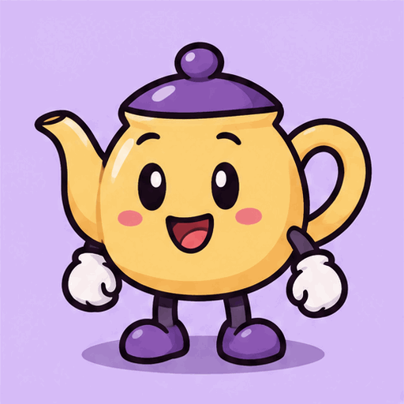
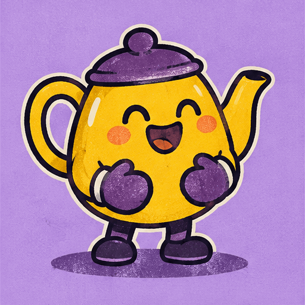
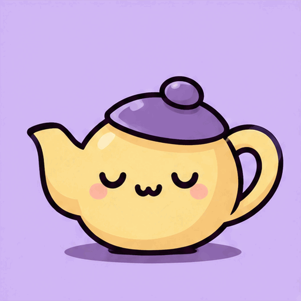

<!-- Generated by scripts/build_readme.py. Edit source data, locale catalogs and generator scripts. -->

# Teapot reaction stickers

[← Back to all cases](../../README.md#all-cases)

<a href="README.md"></a> <a href="README.zh-CN.md"></a>

**Original generation**

Three separately generated stickers share the same colors and visual brief. Small details, such as the lid and hands, vary across the set.

## Images / GIFs



- [Teapot approval](../../assets/examples/raphael-teapot-reactions/teapot-approval.gif) · gif
  - Credit: Raphael
  - Reuse: original. Generated for the Raphael prompt collection from an original text prompt.
  - [Provenance / rights evidence](../../cases/raphael-teapot-reactions/generation.json)


- [Teapot giggle](../../assets/examples/raphael-teapot-reactions/teapot-giggle.gif) · gif
  - Credit: Raphael
  - Reuse: original. Generated for the Raphael prompt collection from an original text prompt.
  - [Provenance / rights evidence](../../cases/raphael-teapot-reactions/generation.json)


- [Teapot snooze](../../assets/examples/raphael-teapot-reactions/teapot-snooze.gif) · gif
  - Credit: Raphael
  - Reuse: original. Generated for the Raphael prompt collection from an original text prompt.
  - [Provenance / rights evidence](../../cases/raphael-teapot-reactions/generation.json)

## Original prompt

**Teapot approval**

```text
A butter-yellow teapot character with a purple lid and small mitten hands stands against soft lilac. It lifts one mitten in a decisive thumbs-up as the lid pops once, then lowers the hand and settles. Bold screen-printed edges, a few accent rays, fixed square composition. Seamless sticker loop, no letters.
```

[Original prompt (.txt)](../../cases/raphael-teapot-reactions/prompt-teapot-approval.txt)

**Teapot giggle**

```text
A yellow teapot with a purple lid and mitten hands chuckles on a flat lilac field. Its belly rocks twice while two little puffs curl out of the spout, vanish, and leave the pot back in its first pose. Textured screen-print sticker, fixed camera, keep the design consistent, no letters, continuous loop.
```

[Original prompt (.txt)](../../cases/raphael-teapot-reactions/prompt-teapot-giggle.txt)

**Teapot snooze**

```text
A sleepy butter-yellow teapot with a purple lid on lilac. The lid droops like an eyelid and a single round steam bubble swells above the spout, quietly pops, and the character settles back into its starting pose. Screen-printed sticker with thick outlines, fixed framing, no typography, gentle GIF loop.
```

[Original prompt (.txt)](../../cases/raphael-teapot-reactions/prompt-teapot-snooze.txt)


## Attribution and verification

- ID: raphael-teapot-reactions
- Author: Raphael
- [Generation record](../../cases/raphael-teapot-reactions/generation.json)
- Model: GPT Image 2.6
- Variant: Flare
- Evidence: EvoLink reported gpt-image-2.6-flare for each completed GIF generation task.
- Collected: 2026-11-23 (UTC)
- Generation verified: 2026-11-23 (UTC)
