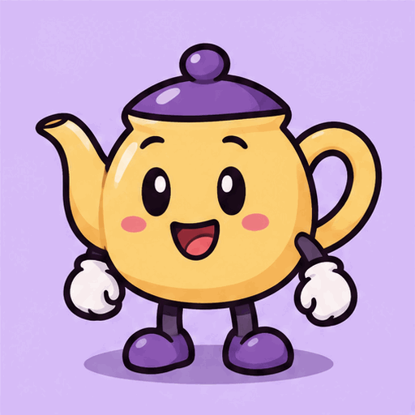
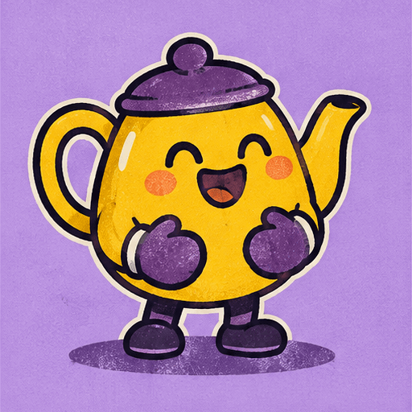
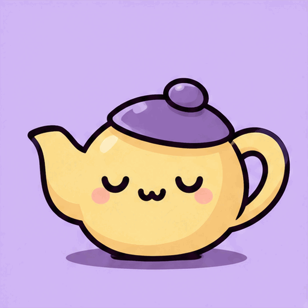

<!-- Generated by scripts/build_readme.py. Edit source data, locale catalogs and generator scripts. -->

# 茶壶反应贴纸三连

[← 返回全部案例](../../README.zh-CN.md#all-cases)

<a href="README.md"></a> <a href="README.zh-CN.md"></a>

**原创生成**

三张贴纸独立生成，共用配色与风格设定，壶盖、手套等细节有变化。

## 图片 / GIF



- [茶壶伸出赞](../../assets/examples/raphael-teapot-reactions/teapot-approval.gif) · gif
  - 署名：Raphael
  - 使用条件：original. Raphael 提示词合集的原创文本生成素材。
  - [来源 / 权利依据](../../cases/raphael-teapot-reactions/generation.json)


- [茶壶笑到冒泡](../../assets/examples/raphael-teapot-reactions/teapot-giggle.gif) · gif
  - 署名：Raphael
  - 使用条件：original. Raphael 提示词合集的原创文本生成素材。
  - [来源 / 权利依据](../../cases/raphael-teapot-reactions/generation.json)


- [茶壶打瞌睡](../../assets/examples/raphael-teapot-reactions/teapot-snooze.gif) · gif
  - 署名：Raphael
  - 使用条件：original. Raphael 提示词合集的原创文本生成素材。
  - [来源 / 权利依据](../../cases/raphael-teapot-reactions/generation.json)

## 原始提示词

**茶壶伸出赞**

```text
A butter-yellow teapot character with a purple lid and small mitten hands stands against soft lilac. It lifts one mitten in a decisive thumbs-up as the lid pops once, then lowers the hand and settles. Bold screen-printed edges, a few accent rays, fixed square composition. Seamless sticker loop, no letters.
```

[原始提示词 (.txt)](../../cases/raphael-teapot-reactions/prompt-teapot-approval.txt)

**茶壶笑到冒泡**

```text
A yellow teapot with a purple lid and mitten hands chuckles on a flat lilac field. Its belly rocks twice while two little puffs curl out of the spout, vanish, and leave the pot back in its first pose. Textured screen-print sticker, fixed camera, keep the design consistent, no letters, continuous loop.
```

[原始提示词 (.txt)](../../cases/raphael-teapot-reactions/prompt-teapot-giggle.txt)

**茶壶打瞌睡**

```text
A sleepy butter-yellow teapot with a purple lid on lilac. The lid droops like an eyelid and a single round steam bubble swells above the spout, quietly pops, and the character settles back into its starting pose. Screen-printed sticker with thick outlines, fixed framing, no typography, gentle GIF loop.
```

[原始提示词 (.txt)](../../cases/raphael-teapot-reactions/prompt-teapot-snooze.txt)


## 来源与核对信息

- ID: raphael-teapot-reactions
- 作者：Raphael
- [生成记录](../../cases/raphael-teapot-reactions/generation.json)
- 模型：GPT Image 2.6
- 版本：Flare
- 依据：EvoLink 在每个已完成的 GIF 任务中回报模型为 gpt-image-2.6-flare。
- 收录：2026-11-23 (UTC)
- 生成核验：2026-11-23 (UTC)
