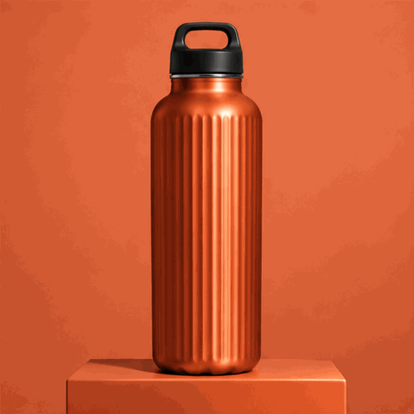

<!-- Generated by scripts/build_readme.py. Edit source data, locale catalogs and generator scripts. -->

# Trail bottle colorways

[← Back to all cases](../../README.md#all-cases)

<a href="README.md"></a> <a href="README.zh-CN.md"></a>

**Original generation**

The bottle retains its silhouette through color changes. The final green frame cuts to the opening orange frame.

## Images / GIFs



- [Trail bottle colorways](../../assets/examples/raphael-trail-bottle-colorways/trail-bottle-colorways.gif) · gif
  - Credit: Raphael
  - Reuse: original. Generated for the Raphael prompt collection from an original text prompt.
  - [Provenance / rights evidence](../../cases/raphael-trail-bottle-colorways/generation.json)

## Original prompt

```text
A compact ribbed aluminum trail bottle centered on a stationary plinth. Flash from persimmon to ultramarine to chalk to moss while each background shifts to a complementary flat tone. Keep cap, bottle silhouette, camera, scale and shadows aligned across all cuts. Editorial product GIF, no labels or text, cycle to orange.
```

[Original prompt (.txt)](../../cases/raphael-trail-bottle-colorways/prompt.txt)


## Attribution and verification

- ID: raphael-trail-bottle-colorways
- Author: Raphael
- [Generation record](../../cases/raphael-trail-bottle-colorways/generation.json)
- Model: GPT Image 2.6
- Variant: Flare
- Evidence: EvoLink reported gpt-image-2.6-flare for each completed GIF generation task.
- Collected: 2026-11-23 (UTC)
- Generation verified: 2026-11-23 (UTC)
