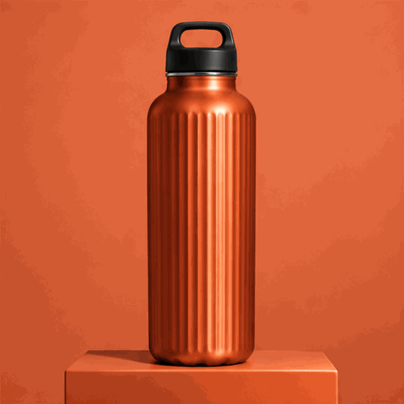

<!-- Generated by scripts/build_readme.py. Edit source data, locale catalogs and generator scripts. -->

# 户外水壶配色快切

[← 返回全部案例](../../README.zh-CN.md#all-cases)

<a href="README.md"></a> <a href="README.zh-CN.md"></a>

**原创生成**

水壶切换颜色时保留轮廓，末帧的绿色在下一轮直接切回橙色。

## 图片 / GIF



- [户外水壶配色快切](../../assets/examples/raphael-trail-bottle-colorways/trail-bottle-colorways.gif) · gif
  - 署名：Raphael
  - 使用条件：original. Raphael 提示词合集的原创文本生成素材。
  - [来源 / 权利依据](../../cases/raphael-trail-bottle-colorways/generation.json)

## 原始提示词

```text
A compact ribbed aluminum trail bottle centered on a stationary plinth. Flash from persimmon to ultramarine to chalk to moss while each background shifts to a complementary flat tone. Keep cap, bottle silhouette, camera, scale and shadows aligned across all cuts. Editorial product GIF, no labels or text, cycle to orange.
```

[原始提示词 (.txt)](../../cases/raphael-trail-bottle-colorways/prompt.txt)


## 来源与核对信息

- ID: raphael-trail-bottle-colorways
- 作者：Raphael
- [生成记录](../../cases/raphael-trail-bottle-colorways/generation.json)
- 模型：GPT Image 2.6
- 版本：Flare
- 依据：EvoLink 在每个已完成的 GIF 任务中回报模型为 gpt-image-2.6-flare。
- 收录：2026-11-23 (UTC)
- 生成核验：2026-11-23 (UTC)
